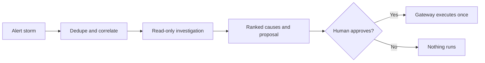

# SRE Incident Response Agent: Introduction

## Overview

An SRE team wants an agent that helps when hundreds of alerts fire after a bad deploy. A wrong rollback at 3 a.m. is worse than a slow summary, so the agent may read anything it is authorised to see and change nothing on its own. The observability stack it queries may be degraded by the same incident, so it must tell "nothing found" apart from "source unavailable".

The design folds the alert storm into one investigation before any model call. Read-only tools query metrics, logs and traces in parallel, and each result is marked success, empty, unavailable, denied or invalid. A strong model ranks likely causes with citations and coverage gaps, then proposes a mitigation with its blast radius, runbook and dry run. A human approves it, and one gateway executes it once. The agent runs outside the failure it is investigating.

The related variants keep this read-only boundary and shift the weight to requirements, approved mitigation or latency.

## The core idea

Dedupe first, investigate read-only, show evidence and source gaps, and stage any fix for human approval.

## Who it is for

Engineers preparing for Forward Deployed, solutions or applied-AI engineering interviews, especially a round that asks you to design an operations or incident-response agent.

## Objectives

After this case you can:

- explain the system end to end at interview depth, starting from its dangerous constraint: the agent changes nothing in production without human approval, even when the telemetry it relies on is degraded;
- answer follow-up questions on alert correlation, tool result states, the proposal and approval boundary, latency, failure modes, evaluation and rollout.

## What it assumes

Comfort with observability (metrics, logs and traces), LLM agents and tool calling, and basic incident response. The related reviews at the foot of each section cover each one.

## How to use it

1. Read the three mandatory sections in order: Interview Guide, Technical Deep Dive, Quick Review.
2. Mark each part as read when you finish it. The case counts as done in your progress when every part is read.
3. Open the Full Design when you need a worked number, a source or the reasoning behind a step.
4. Come back to the Quick Review the night before the interview.

## The sections

| Section | What it is for | Interview prep |
|---|---|---|
| [Interview Guide](#main) | The answer you would talk through in the interview, from the read-only boundary to how investigation works, latency, the failure playbook, rollout and delivery. Start here: it stands on its own. | Mandatory |
| [Technical Deep Dive](#deep-dive) | The detail behind each component, from the telemetry map and correlation to the tool result contract, the human boundary, latency arithmetic and the failure ladder. Read it after the Interview Guide, to answer follow-up questions. | Mandatory |
| [Quick Review](#cheat-sheet) | The whole case on one page: the flow, planning numbers, the five tool states, three boundaries and the latency answer, for recall before the interview. | Mandatory |
| [Full Design](#full-pack) (4 parts) | The complete, referenced write-up the other sections were drawn from: telemetry failure modes, the degraded observability stack, the release gate on hypothesis precision, the latency pivot and the sources. | Optional |

## Practise it

When you have read the mandatory sections, try the [SRE triage agent worksheet](/practice/sre-triage-agent). It asks you to produce the same design from a blank page, which shows what you can explain without the guide open.
