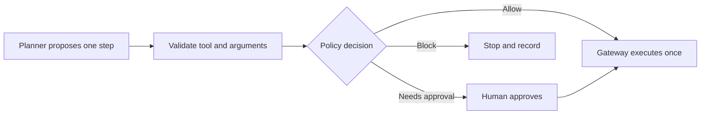

# Tool-Using Agent with Safety Controls: Introduction

## Overview

An operations team wants an agent that reads customer email, checks internal systems, updates the CRM and sometimes issues refunds. The useful part is interpreting a messy request. The dangerous part is letting that interpretation become authority: email and tool output are untrusted, and one injected instruction must not become a refund.

The design separates proposing from executing. The model proposes one bounded action at a time. Validation checks the tool and its arguments, policy answers allow, block or needs a human, a broker mints a short-lived, narrow token, and an idempotent gateway runs the action once and writes a receipt. Writes fail closed, and operators can stop in-flight work by revoking tokens and cancelling queues.

This is the anchor case for agents that act. An enterprise assistant over many apps, a slow or looping agent and a refund near miss all keep the same proposal-to-execution boundary and change which control dominates.

## The core idea

The model proposes; deterministic systems validate, authorise, approve, execute once and record.

## Who it is for

Engineers preparing for Forward Deployed, solutions or applied-AI engineering interviews, especially a round that asks you to design an agent that calls tools and changes real systems.

## Objectives

After this case you can:

- explain the system end to end at interview depth, starting from its dangerous constraint: the agent never holds broad credentials or decides whether its own action is allowed;
- answer follow-up questions on identity, policy, approval, idempotent execution, security controls, failure modes, release and rollout.

## What it assumes

Comfort with LLM agents and tool calling, authentication and scoped tokens, idempotent APIs and basic cloud architecture. The related reviews at the foot of each section cover each one.

## How to use it

1. Read the three mandatory sections in order: Interview Guide, Technical Deep Dive, Quick Review.
2. Mark each part as read when you finish it. The case counts as done in your progress when every part is read.
3. Open the Full Design when you need a worked number, a source or the reasoning behind a step.
4. Come back to the Quick Review the night before the interview.

## The sections

| Section | What it is for | Interview prep |
|---|---|---|
| [Interview Guide](#main) | The answer you would talk through in the interview, from the authority boundary to one request walked through, failure and recovery, rollout and the refund near-miss drill. Start here: it stands on its own. | Mandatory |
| [Technical Deep Dive](#deep-dive) | The detail behind each component, from execution records and the nine components to integrations, security drills and the cost and latency pivot. Read it after the Interview Guide, to answer follow-up questions. | Mandatory |
| [Quick Review](#cheat-sheet) | The whole case on one page: the flow, six must-haves, four security controls, failure triggers and the near-miss card, for recall before the interview. | Mandatory |
| [Full Design](#full-pack) (4 parts) | The complete, referenced write-up the other sections were drawn from: sizing by risk, identity through every call, the release gate, read-only rollout, the near-miss debug and the sources. | Optional |

## Practise it

When you have read the mandatory sections, try the [Tool-Using Agent with Safety Controls worksheet](/practice/tool-using-ai-agent-with-safety-controls). It asks you to produce the same design from a blank page, which shows what you can explain without the guide open.
