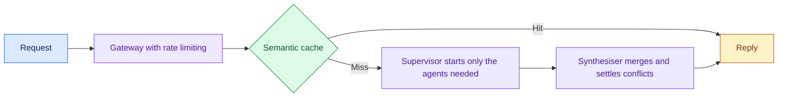

# Travel Agent: the 12-Part Framework Worked Through: Introduction

## Overview

A travel company wants an AI assistant for customers in three regions: AMER, EMEA and APJ. Five specialist agents handle search, booking, pricing, recommendations and travel policy. The first draft of the design ran every request through one shared cache, one retrieval stage, one LLM step and one tool-calling stage, in that order.

The hard constraint is that the diagram has to match how agents actually run. Each agent loops on its own, calls its own tools and finishes at its own pace, so a single shared pipeline either wastes work or holds it up. A review found five places where the draft broke that rule.

This case takes the draft apart and redraws it. Rate limiting moves inside the gateway, the semantic cache is checked before any agent starts, each agent owns its retrieval and tool calls, and a synthesiser merges the results into one reply.

## The core idea

Check the cache first, start only the agents a query needs, and let a synthesiser settle what they return.

## Who it is for

Engineers preparing for Forward Deployed, solutions or applied-AI engineering interviews, especially a round that hands you a multi-agent diagram to critique or asks you to draw one under time pressure.

## Objectives

After this case you can:

- name the five structural faults in the first draft and explain the fix for each one;
- put the same five questions to any multi-agent diagram, your own included, and defend the trade-offs: shared or per-agent retrieval, regional or global stores, and when another agent is worth its coordination cost.

## What it assumes

Comfort with AI agents, retrieval and tool calling. Read [The Twelve-Part Design Framework](/learn/ai-systems-design/design-framework/the-twelve-part-design-framework) and [Design Principles as Tie-Breakers](/learn/ai-systems-design/design-framework/design-principles-as-tie-breakers) in Learn first. The Worked Example applies their principles to one diagram.

## How to use it

1. Read the Worked Example. It covers the draft, the five fixes, the corrected architecture and the interview lens, and it stands on its own.
2. Before you read each fix, try to spot the fault in the draft yourself.
3. Redraw the corrected architecture from memory, then compare it with the diagram.
4. Mark each part as read when you finish it. The case counts as done in your progress when every part is read.
5. Open the 12-Part Framework when you want the same design as one reference write-up.
6. Come back to the Worked Example's level calibration the night before the interview.

## The sections

| Section | What it is for | Interview prep |
|---|---|---|
| [Worked Example](#worked-example) | The first draft, its five structural faults and the fix for each, then the corrected architecture, components, data flow, trade-offs, the interview lens, a checkpoint and level calibration. | Mandatory |
| [12-Part Framework](#framework-overview) | The corrected design written up as one reference: what changed and why, the architecture, key components, data flow, non-functional requirements, trade-offs and the airport model. | Optional |
