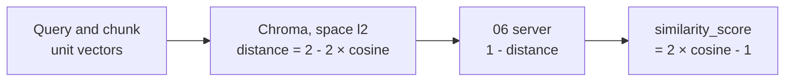
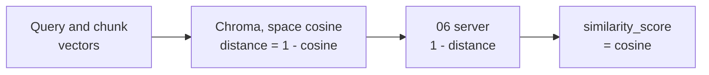

<!-- Generated by site/scripts/rag-theory-import.mjs from rag-agents-engineering. Edit the source there. -->
# RAG over MCP with LangChain

<!-- subtitle: Serving retrieval as MCP tools moves chunking, embeddings and the distance metric to one server, and a score that looks like cosine may not be -->
<!-- format: approved -->

## Start with a cutoff that drops good evidence

> **What you'll learn**
>
> - **Explain** which retrieval decisions move to the server when a RAG index sits behind MCP tools, and which stay with the host.
> - **Trace** one question through the 06 project: server start, discovery, the model's tool call, the retrieved chunks.
> - **Check** chunk units, chunk ids and result size before trusting the index.
> - **Convert** Chroma's default distance into what it really measures, and choose a metric that makes a cutoff mean what it says.

Larkspur moves its handbook index behind an MCP server, and the Streamlit app and any other host now share one copy. A developer adds a filter on the client: keep chunks whose `similarity_score` is above 0.5, the usual reading of "fairly similar" for cosine.

The filter quietly drops chunks with a cosine of 0.7. Nothing errors, the ranking is still right, and the answers get thinner. The cause is a metric nobody chose: the collection was created without one.

## RAG over MCP

The 06 server puts a whole LangChain RAG index behind four MCP tools:

- `ingest_pdf(source)` takes a PDF file, a folder of PDFs or a URL.
- `retrieve(query, n=5)` returns the top `n` chunks.
- `db_info()` reports the collection, its size and its settings.
- `clear_db()` deletes the collection and recreates it empty, with no confirmation.

Inside sits the pipeline from [T5.1](/learn/llm-and-retrieval/rag-from-first-principles/rag-from-first-principles-overview) to [T5.5](/learn/llm-and-retrieval/vector-stores-and-index-operations/vector-stores-and-index-operations-overview). PyPDF2 extracts the text, `RecursiveCharacterTextSplitter` cuts it, Ollama's `nomic-embed-text` embeds it, and Chroma persists it in `chroma_db/` beside `server.py`. The client is the Streamlit `app.py`: a LangGraph ReAct agent on Ollama's `qwen3` that loads the server's tools for each question.

```animated
<figure class="anim sheet" aria-labelledby="anim-ragmcp-cap">
  <div class="anim__canvas" tabindex="0" aria-label="RAG over MCP, scrolls sideways on a narrow screen">
    <svg viewBox="0 0 800 352" role="img" aria-labelledby="anim-ragmcp-title anim-ragmcp-desc">
      <title id="anim-ragmcp-title">RAG over MCP</title>
      <desc id="anim-ragmcp-desc">The 06 server ingests a PDF once: it splits the text into chunks of 4,096 characters with 409 of overlap, embeds them and stores them in Chroma. Later a user asks the host a question, the model calls the retrieve tool with n = 5, the server finds the five nearest chunks by squared L2 distance, reports 1 minus the distance as “similarity_score”, and returns one JSON result that the model answers from.</desc>
      <defs>
        <marker id="ah-ragmcp" viewBox="0 0 8 8" refX="7" refY="4" markerWidth="8" markerHeight="8" markerUnits="userSpaceOnUse" orient="auto-start-reverse"><path class="ah" d="M0 0 L8 4 L0 8 z"/></marker>
      </defs>

      <text class="lane-label" x="16" y="20">Host: the model and the MCP client</text>
      <rect class="lane" x="8" y="28" width="784" height="124"/>
      <text class="lane-label" x="16" y="200">06 server, over stdio</text>
      <rect class="lane" x="8" y="208" width="784" height="136"/>
      <g class="n-2"><rect class="box" x="30" y="60" width="130" height="44"/><text class="label" x="95" y="82">Question</text></g>
      <g class="n-3 n-6"><rect class="box" x="300" y="60" width="150" height="44"/><text class="label" x="375" y="82">Model</text></g>
      <g class="n-7"><rect class="box" x="630" y="60" width="130" height="44"/><text class="label" x="695" y="82">Answer</text></g>
      <path class="edge e-2 in-2" d="M160 82 H297" marker-end="url(#ah-ragmcp)"/>
      <path class="edge e-7 in-7" d="M450 82 H627" marker-end="url(#ah-ragmcp)"/>
      <g class="n-3 n-5">
        <rect class="box" x="290" y="240" width="170" height="56"/>
        <text class="label" x="375" y="258">retrieve</text>
        <text class="small" x="375" y="280">(query, n = 5)</text>
      </g>
      <g class="n-4">
        <path class="box" d="M500 240 a60 10 0 0 0 120 0 v56 a60 10 0 0 1 -120 0 z"/>
        <ellipse class="box" cx="560" cy="240" rx="60" ry="10"/>
        <text class="label" x="560" y="274">Chroma</text>
      </g>
      <g class="n-1">
        <rect class="box" x="650" y="240" width="130" height="56"/>
        <text class="label" x="715" y="258">ingest_pdf</text>
        <text class="small" x="715" y="280">4,096 / 409</text>
      </g>
      <path class="edge e-1 in-1" d="M650 268 H623" marker-end="url(#ah-ragmcp)"/>
      <text class="small in-1" x="715" y="318">chunks, embedded</text>

      <path class="edge e-3 in-3" d="M360 104 V237" marker-end="url(#ah-ragmcp)"/>
      <text class="small in-3" x="300" y="176">tools/call</text>
      <path class="edge e-4 in-4" d="M460 268 H497" marker-end="url(#ah-ragmcp)"/>
      <text class="small in-4" x="560" y="326">5 nearest, squared L2</text>
      <text class="fig in-5" x="375" y="318">1 − distance</text>
      <path class="edge dashed e-6 in-6" d="M390 240 V107" marker-end="url(#ah-ragmcp)"/>
      <text class="small in-6" x="460" y="176">JSON result</text>

      <circle class="tok" cx="0" cy="0" r="7"/>
    </svg>
  </div>
  <div class="anim__controls" hidden>
    <button class="anim__btn" type="button" data-act="prev">Previous</button>
    <button class="anim__btn" type="button" data-act="play" aria-pressed="false">Play</button>
    <button class="anim__btn" type="button" data-act="next">Next</button>
  </div>
  <ol class="anim__steps" id="anim-ragmcp-cap">
    <li><button type="button" data-tok="650,240">Ingest</button><span>The model calls ingest_pdf once per document. The server splits the text into 4,096-character chunks with 409 characters of overlap, embeds them and upserts them into Chroma.</span></li>
    <li><button type="button" data-tok="30,60">Question</button><span>Later, a user asks the host a question.</span></li>
    <li><button type="button" data-tok="300,60">Call</button><span>The model picks retrieve and writes the query. The host sends tools/call with that query and n = 5.</span></li>
    <li><button type="button" data-tok="500,240">Search</button><span>The server embeds the query and asks Chroma for the five nearest chunks by squared L2 distance.</span></li>
    <li><button type="button" data-tok="290,240">Score</button><span>It reports each distance as “similarity_score”, 1 − distance: the field every client reads.</span></li>
    <li><button type="button" data-tok="300,60">Result</button><span>Text, metadata and both scores go back as one JSON tool result.</span></li>
    <li><button type="button" data-tok="630,60">Answer</button><span>The model answers from the chunks it was given.</span></li>
  </ol>
</figure>
```

*Figure 1: Retrieval as a tool. The host's model asks; the server chunks, embeds, stores and searches.*

Serving retrieval this way splits the decisions cleanly:

| Decided by | Decisions | Shared by every host? |
|---|---|---|
| The server | Chunk size and overlap, the embedding model, the distance metric, the shape of each result | Yes |
| The host's model | When to ingest, what query to write, how many chunks to ask for, whether to call `clear_db` | No, each host decides alone |

*Table 1: Who owns which retrieval decision once the index is an MCP server.*

The split is the point of the design and its risk. One server fixes chunking for everyone, but a metric mistake on the server reaches every host, and a destructive tool is one model decision away from running.

Step through one question in the Streamlit app:

<div class="walkthrough learning-widget" data-stepper id="rag-question-walkthrough">
<p class="widget-intro">A scripted trace of one question through <code>app.py</code> and the 06 server, read from their code. No model ran; the question is illustrative.</p>
<div class="step-controls" hidden role="group" aria-label="One question through the 06 project"><button type="button" data-step="0" aria-pressed="false" aria-controls="rag-step-0">1. Start</button><button type="button" data-step="1" aria-pressed="false" aria-controls="rag-step-1">2. Discover</button><button type="button" data-step="2" aria-pressed="false" aria-controls="rag-step-2">3. Ask</button><button type="button" data-step="3" aria-pressed="false" aria-controls="rag-step-3">4. Retrieve</button><button type="button" data-step="4" aria-pressed="false" aria-controls="rag-step-4">5. Answer</button></div>
<div class="step-panels"><section id="rag-step-0" class="step-panel" aria-labelledby="rag-heading-0"><h4 id="rag-heading-0">1. The question starts a server</h4><dl><dt>Input</dt><dd>"Can I get a refund on an annual plan after 20 days?"</dd><dt>What happens</dt><dd>The form handler opens a new stdio client, which launches <code>server.py</code> as a new process. Its imports build the embeddings client and open <code>chroma_db/</code>.</dd></dl></section><section id="rag-step-1" class="step-panel" aria-labelledby="rag-heading-1"><h4 id="rag-heading-1">2. Handshake and discovery</h4><dl><dt>Messages</dt><dd><code>initialize</code>, the initialised notification, then <code>tools/list</code></dd><dt>State after</dt><dd>The four tools, wrapped as LangChain tools by the adapter and handed to a fresh agent</dd></dl></section><section id="rag-step-2" class="step-panel" aria-labelledby="rag-heading-2"><h4 id="rag-heading-2">3. The model writes the call</h4><dl><dt>Decision</dt><dd>The host's model picks <code>retrieve</code>, writes the query and chooses <code>n</code>, or leaves the default of 5</dd><dt>Not decided here</dt><dd>Chunking, embeddings and the metric: those were fixed on the server at ingest time</dd></dl></section><section id="rag-step-3" class="step-panel" aria-labelledby="rag-heading-3"><h4 id="rag-heading-3">4. The server searches</h4><dl><dt>Runs</dt><dd><code>similarity_search_with_score(query, k=n)</code> on the Chroma collection</dd><dt>Returns</dt><dd>For each chunk: <code>text</code>, <code>metadata</code>, <code>similarity_score</code> and <code>distance</code>. Whole chunks, up to 5 × 4,096 characters by default.</dd></dl></section><section id="rag-step-4" class="step-panel" aria-labelledby="rag-heading-4"><h4 id="rag-heading-4">5. Answer, then exit</h4><dl><dt>Output</dt><dd>The model answers from the returned chunks</dd><dt>Session</dt><dd>The handler's session closes and the server process exits. The next question starts it again.</dd></dl></section></div><div class="step-footer" hidden><button type="button" data-walk="previous">Previous</button><p class="step-status" aria-live="polite"></p><button type="button" data-walk="next">Next step</button></div></div>

Opening the session inside the handler costs nothing extra for one question. Over a conversation every question pays for a new process and a new handshake, as the [lab in lesson 6 of T12.3](/labs/rag/m40_mcp_applications/session-lifetime-lab.html) counts. The 06 server also prints a banner to stdout before it starts serving stdio, a hazard lesson 2 of T12.3 covers in [Stdout belongs to the protocol](/learn/agent-protocols-mcp-and-a2a/mcp-applications-and-rag-over-mcp/mcp-servers-with-claude-desktop#lesson-stdout-belongs-to-the-protocol).

## Check the index before trusting it

Three settings in `server.py` decide what a retrieval returns, and each is easy to misread:

- **Chunk size counts characters.** `CHUNK_SIZE = 4096` with `length_function=len`, and an overlap of `4096 // 10`, which is 409 characters. The project's presentation calls them "4096 tokens". Each of the 13 Larkspur handbook files is 555 to 1,038 characters long. A PDF of any one of them becomes a single chunk, and every hit returns a whole file. [T5.3](/learn/llm-and-retrieval/chunking-and-indexing/chunking-and-indexing-overview) is about choosing the size for the corpus.
- **Chunk ids are positions.** Each chunk is stored as `<file stem>_chunk_<i>`, and langchain-chroma 1.1.0's `add_documents` upserts. A probe ingested three chunks, then a two-chunk new version of the same file: the collection still held three chunks, the two new ones and the old third. Two PDFs with the same name in different folders overwrite each other the same way.
- **Results are whole chunks.** A default call can put up to 5 × 4,096 = 20,480 characters into the model's context.

One fix is needed before the project runs in this course's environment. `server.py` imports `RecursiveCharacterTextSplitter` from `langchain.text_splitter`, which raises `ModuleNotFoundError` under langchain 1.4.7. The class now lives in `langchain_text_splitters`.

## Distance is not similarity

`retrieve` calls `similarity_search_with_score`, which returns Chroma's **distance**, and reports `similarity_score = 1 - distance`. That conversion is right for only one metric, and the collection does not use it.

A collection created without a metric uses **squared L2 distance**: chromadb 1.5.9 records `'space': 'l2'` in its configuration. On unit vectors squared L2 equals `2 - 2 × cosine`, so the reported score is `2 × cosine - 1`, a number from -3 to 1:



*Figure 2: The default collection. The score falls as cosine falls, but on a stretched scale.*

Created with `collection_metadata={"hnsw:space": "cosine"}`, the collection stores `1 - cosine` as the distance, and the same server line returns the cosine itself:



*Figure 3: A cosine collection. One line of configuration makes the existing conversion true.*

A probe with langchain-chroma 1.1.0 stored four unit vectors and queried with the vector pointing east. These are exact synthetic vectors, not embedding-model measurements:

| Chunk vector | Cosine to the query | Default distance | 06's `similarity_score` | Cosine-space `1 - distance` |
|---|---|---|---|---|
| east | 1.000 | 0.000 | 1.000 | 1.000 |
| north-east | 0.707 | 0.586 | 0.414 | 0.707 |
| north | 0.000 | 2.000 | -1.000 | 0.000 |
| west | -1.000 | 4.000 | -3.000 | -1.000 |

*Table 2: The same four chunks under each metric (langchain-chroma 1.1.0, chromadb 1.5.9).*

Apply the client's 0.5 cutoff under each metric:

<div class="learning-widget evidence-switcher" data-comparison id="metric-switcher">
<p class="widget-intro">One query, four chunks, one filter: keep <code>similarity_score</code> above 0.5. Values from the probe in Table 2.</p>
<div class="mode-controls" hidden role="group" aria-label="Collection metric">
<button type="button" data-mode="l2" aria-pressed="false" aria-controls="metric-l2">Default, squared L2</button>
<button type="button" data-mode="cosine" aria-pressed="false" aria-controls="metric-cosine">hnsw:space cosine</button>
</div>
<section id="metric-l2" class="mode-panel" data-announcement="Default metric selected. The cutoff keeps only the east chunk."><h4>Default, squared L2</h4><ul><li>Scores: east 1.000, north-east 0.414, north -1.000, west -3.000.</li><li>The filter keeps east only. North-east, with a cosine of 0.707, is dropped.</li><li>A 0.5 cutoff here demands a cosine above 0.75, and the scale moves again if the embedding model's vectors are not unit length.</li></ul></section>
<section id="metric-cosine" class="mode-panel" data-announcement="Cosine metric selected. The cutoff keeps east and north-east."><h4>hnsw:space cosine</h4><ul><li>Scores: east 1.000, north-east 0.707, north 0.000, west -1.000.</li><li>The filter keeps east and north-east, which is what a 0.5 cosine cutoff means.</li><li>Vector length no longer matters: cosine distance ignores it.</li></ul></section>
<p class="switch-status" aria-live="polite"></p>
</div>

The ranking is right under both metrics, because the score falls as the distance grows. Only the scale is wrong, which is why the bug survives every test that checks order and none that checks a threshold. The 07 server in lesson 6 of T12.3 prints the same `1 - score` into its result text as "Similarity": there the model reads the stretched number too.

Two fixes, both checked with langchain-chroma 1.1.0:

- **Create the collection with the metric you mean.** `hnsw:space` cosine makes `1 - distance` the cosine. It only takes effect on a new collection: a probe reopened the default `documents` collection with the setting, raised no error, and still reported `l2`. Delete the collection and re-ingest.
- **Return what you computed, and say what it is.** Send `distance` and the metric's name, and keep any threshold on the server, where one person owns it.

## Limits of this evidence

- **Synthetic vectors.** Table 2 uses exact two-dimensional unit vectors. `nomic-embed-text` scores real chunks differently, and whether its vectors are unit length was not measured here.
- **Code reading, not a live run.** The walkthrough follows `app.py` and `server.py`; no Ollama model or server ran. The upsert and metric probes ran langchain-chroma 1.1.0 and chromadb 1.5.9 with a fixed embedding function.
- **PDF extraction.** Handbook lengths are of the Markdown files. PyPDF2's extracted text from a PDF export could differ slightly, still far below 4,096 characters.

## References

1. Lewis, P. et al. (2020). *Retrieval-Augmented Generation for Knowledge-Intensive NLP Tasks*. [arXiv:2005.11401](https://arxiv.org/abs/2005.11401).
2. Model Context Protocol, [Tools](https://modelcontextprotocol.io/specification/2025-06-18/server/tools), specification 2025-06-18.
3. LangChain, [Model Context Protocol (MCP)](https://docs.langchain.com/oss/python/langchain/mcp), loading MCP tools into LangChain agents.
4. Chroma, [Configure collections](https://docs.trychroma.com/docs/collections/configure), the `space` setting and its default.

## Run the notebooks

The code for this lesson is in these notebooks. Colab runs one in your browser: install the packages its first cell imports and set the API keys it reads. To run every notebook as written, clone the repository and use its uv environment.

| Notebook | GitHub | Colab |
|---|---|---|
| MCP RAG with LangChain | [Open on GitHub](https://github.com/Sourav692/rag-agents-engineering/tree/main/p11_agent_protocols/m40_mcp_applications/projects/06_mcp_rag_with_langchain) | Run locally |

## Key Takeaways

- Serving retrieval over MCP puts chunking, embeddings, the metric and the result shape on the server, shared by every host. The host's model still chooses queries, chunk counts and destructive calls such as `clear_db`.
- Check units and ids. `CHUNK_SIZE = 4096` counts characters, and position-based chunk ids leave stale chunks behind when a shorter version is re-ingested.
- Chroma's default distance is squared L2, so `1 - distance` is `2 × cosine - 1` on unit vectors. Create the collection with `hnsw:space` cosine, or return the distance and its metric.

## Check yourself

<details>
<summary>1. When retrieval is served over MCP, which decisions move to the server and which stay with the host?</summary>

The server decides chunking, embeddings, the distance metric and the shape of the result, and every host shares those choices. The host's model decides when to ingest, what query to write, how many chunks to ask for, and whether to call `clear_db`, which empties the collection with no confirmation.

</details>

<details>
<summary>2. A client keeps chunks whose reported similarity_score is above 0.5. What cosine does that threshold really require, and why?</summary>

Above 0.75. The collection uses squared L2 by default, which on unit vectors is `2 - 2 × cosine`, so `1 - distance` reports `2 × cosine - 1`. Creating the collection with `collection_metadata={"hnsw:space": "cosine"}` makes `1 - distance` the cosine.

</details>

<details>
<summary>3. You re-ingest a PDF whose new version splits into two chunks instead of three, and retrieve still returns text the new version dropped. Why?</summary>

Chunk ids are positions, `<file stem>_chunk_<i>`, and langchain-chroma 1.1.0's `add_documents` upserts. The two new chunks replace ids 0 and 1, and the old third chunk stays. For the same reason, two PDFs with the same name in different folders overwrite each other.

</details>
