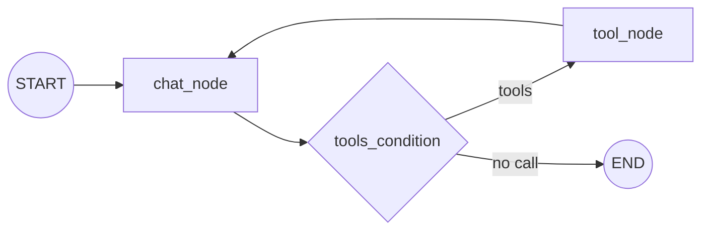

<!-- Generated by site/scripts/rag-theory-import.mjs from rag-agents-engineering. Edit the source there. -->
# Research assistant with MCP and LangGraph

*Notebooks on GitHub: [Research assistant with MCP and LangGraph](https://github.com/Sourav692/rag-agents-engineering/tree/main/course/p11_agent_protocols/m40_mcp_applications/projects/07_research_assistant_with_mcp_and_langgraph)*

## MCP + LangGraph

The research assistant splits into a graph that thinks and servers that act. `client.py` builds the graph; two MCP servers supply every tool it can call:

- **`research_server`** (this project's `server.py`) keeps research in Chroma, one database per topic under `research_chroma_dbs/<topic>/`. Its five tools: `save_research_data(content, topic)`, `search_research_data(query, topic, max_results=5)`, `list_research_topics()`, `get_topic_info(topic)` and `delete_research_topic(topic)`. Saving skips any text whose MD5 hash is already in the topic's `content_hashes.json`.
- **`firecrawl_server`** is the published `firecrawl-mcp` package, started with `npx -y`, which scrapes the web. The client copies `FIRECRAWL_API_KEY` from its environment into that server's `env` before it connects.

The graph is the tool loop from [T9.1](/learn/agentic-systems/the-agent-loop-and-tool-calling/the-agent-loop-and-tool-calling-overview) and [T10.4](/learn/agentic-and-self-correcting-rag/rag-as-an-agent-tool/rag-as-an-agent-tool-overview), unchanged:



MCP only changes where the tools come from. `MultiServerMCPClient(mcp_json).get_tools()` turns every tool of both servers into a LangChain tool; `llm.bind_tools(tools)` shows them to Ollama's `qwen3`; `ToolNode(tools=tools)` runs whichever the model picks; `tools_condition` routes. A system prompt tells the model to search saved research before crawling and to save what it finds.

The assistant has two memories, held in different processes. The client's `MemorySaver` keeps the conversation for the thread `research_session` and loses it when `client.py` exits. The research server keeps findings in Chroma on disk, across sessions and for any host that connects, Claude Desktop included (it is the `research_server` entry in the [40.2 config](/learn/agent-protocols-mcp-and-a2a/mcp-applications-and-rag-over-mcp/mcp-servers-with-claude-desktop#lesson-claude-desktop)).

Two fixes before it runs here: `client.py` imports `ChatPromptTemplate` and `MessagesPlaceholder` from `langchain.prompts`, which raises `ModuleNotFoundError` under langchain 1.4.7 (they live in `langchain_core.prompts`); and topic names become directory names unchecked, which [lesson 7 of T12.3](/learn/agent-protocols-mcp-and-a2a/mcp-applications-and-rag-over-mcp/deploying-an-mcp-server-on-ec2#lesson-deployment) shows is dangerous once the server is shared.

## How long a session lives

`MultiServerMCPClient.get_tools()` returns tools with no open connection behind them. Its docstring in langchain-mcp-adapters 0.3.2 says: "A new session will be created for each tool call". For a stdio server, a new session is a new process.

```animated
<figure class="anim sheet" aria-labelledby="anim-percall-cap">
  <div class="anim__canvas" tabindex="0" aria-label="A tool call with a session per call, scrolls sideways on a narrow screen">
    <svg viewBox="0 0 800 352" role="img" aria-labelledby="anim-percall-title anim-percall-desc">
      <title id="anim-percall-title">A tool call with a session per call</title>
      <desc id="anim-percall-desc">In the LangGraph client, chat_node returns a tool call and tools_condition routes it to tool_node. Because the tools came from MultiServerMCPClient.get_tools(), the call starts a new server process, which takes the handshake (3 messages), the call and its result (2), and a tools/list the client sends to fetch the output schema (2), then exits: 7 messages and 2,071 bytes for one call in the lab’s recording. The tool result goes back to chat_node.</desc>
      <defs>
        <marker id="ah-percall" viewBox="0 0 8 8" refX="7" refY="4" markerWidth="8" markerHeight="8" markerUnits="userSpaceOnUse" orient="auto-start-reverse"><path class="ah" d="M0 0 L8 4 L0 8 z"/></marker>
      </defs>

      <text class="lane-label" x="16" y="20">LangGraph client</text>
      <rect class="lane" x="8" y="28" width="344" height="316"/>
      <text class="lane-label" x="380" y="20">New server process for this call</text>
      <rect class="lane" x="372" y="28" width="420" height="316"/>
      <g class="n-1 n-8"><rect class="box" x="40" y="48" width="150" height="44"/><text class="label" x="115" y="70">chat_node</text></g>
      <g class="n-2">
        <path class="box" d="M115 120 L190 150 L115 180 L40 150 Z"/>
        <text class="small" x="115" y="150">tools_condition</text>
      </g>
      <g class="n-2"><rect class="box" x="40" y="220" width="150" height="44"/><text class="label" x="115" y="242">tool_node</text></g>
      <rect class="box" x="262" y="132" width="70" height="36"/><text class="label" x="297" y="150">END</text>
      <path class="edge e-1" d="M115 92 V117" marker-end="url(#ah-percall)"/>
      <path class="edge e-2" d="M115 180 V217" marker-end="url(#ah-percall)"/>
      <text class="small" x="150" y="200">tool call</text>
      <path class="edge" d="M190 150 H259" marker-end="url(#ah-percall)"/>
      <text class="small" x="226" y="138">no call</text>
      <path class="edge dashed e-8 in-8" d="M40 250 C16 250 16 62 37 62" marker-end="url(#ah-percall)"/>
      <text class="small in-8" x="290" y="318">ToolMessage</text>
      <path class="edge e-3 in-3" d="M190 236 C300 236 300 64 417 64" marker-end="url(#ah-percall)"/>
      <g class="n-3 in-3"><rect class="box" x="420" y="44" width="170" height="40"/><text class="label" x="505" y="64">Start process</text></g>
      <g class="n-4 in-4"><rect class="box" x="420" y="104" width="170" height="40"/><text class="label" x="505" y="124">initialize</text></g>
      <g class="n-5 in-5"><rect class="box" x="420" y="164" width="170" height="40"/><text class="label" x="505" y="184">tools/call</text></g>
      <g class="n-6 in-6"><rect class="box" x="420" y="224" width="170" height="40"/><text class="label" x="505" y="244">tools/list</text></g>
      <g class="n-7 in-7"><rect class="box" x="420" y="284" width="170" height="40"/><text class="label" x="505" y="304">Exit</text></g>
      <path class="edge e-4 in-4" d="M505 84 V101" marker-end="url(#ah-percall)"/>
      <path class="edge e-5 in-5" d="M505 144 V161" marker-end="url(#ah-percall)"/>
      <path class="edge e-6 in-6" d="M505 204 V221" marker-end="url(#ah-percall)"/>
      <path class="edge e-7 in-7" d="M505 264 V281" marker-end="url(#ah-percall)"/>
      <text class="fig in-4" x="690" y="124">3 messages</text>
      <text class="fig in-5" x="690" y="184">2 messages</text>
      <text class="fig in-6" x="690" y="244">2 messages</text>
      <text class="fig in-7" x="690" y="304">7 msgs, 2,071 bytes</text>
      <path class="edge dashed e-8 in-8" d="M420 310 C320 310 250 262 193 254" marker-end="url(#ah-percall)"/>

      <circle class="tok" cx="0" cy="0" r="7"/>
    </svg>
  </div>
  <div class="anim__controls" hidden>
    <button class="anim__btn" type="button" data-act="prev">Previous</button>
    <button class="anim__btn" type="button" data-act="play" aria-pressed="false">Play</button>
    <button class="anim__btn" type="button" data-act="next">Next</button>
  </div>
  <ol class="anim__steps" id="anim-percall-cap">
    <li><button type="button" data-tok="40,48">Chat</button><span>chat_node calls the model, which replies with a tool call for retrieve.</span></li>
    <li><button type="button" data-tok="40,120">Route</button><span>tools_condition sees the tool call and routes to tool_node.</span></li>
    <li><button type="button" data-tok="420,44">Start</button><span>The tool came from get_tools(), so it opens a new session: a new server process.</span></li>
    <li><button type="button" data-tok="420,104">Handshake</button><span>initialize, its result and the initialized notification: 3 messages.</span></li>
    <li><button type="button" data-tok="420,164">Call</button><span>tools/call and its result: 2 messages.</span></li>
    <li><button type="button" data-tok="420,224">Schema</button><span>The new session has no output schema for retrieve, so ClientSession sends tools/list before it checks the result: 2 more.</span></li>
    <li><button type="button" data-tok="420,284">Exit</button><span>The session closes and the process exits: 7 messages and 2,071 bytes for one call. A held session sends only the 2 call messages.</span></li>
    <li><button type="button" data-tok="40,48">Back</button><span>The result goes back to chat_node as a ToolMessage, and the next call starts another process.</span></li>
  </ol>
</figure>
```

The `tools/list` after the call comes from the SDK. mcp 1.30.0's `ClientSession` validates each structured tool result against the tool's output schema, and a session that has not listed its tools yet lists them first. A held session pays for that once; a session per call pays for it every time.

The [interactive lab](/labs/rag/m40_mcp_applications/session-lifetime-lab.html) records the real JSON-RPC traffic of the Larkspur handbook server under three client patterns, with a scripted model so every run makes the same calls. Its numbers:

| Questions × calls per question | Hold one session | Session per question (06 `app.py`) | Session per tool call (07 client) |
|---|---|---|---|
| 1 × 1 | 1 start, 7 messages | 1 start, 7 messages | 2 starts, 12 messages |
| 3 × 2 | 1 start, 17 messages | 3 starts, 27 messages | **7 starts, 47 messages** |
| 3 × 3 | 1 start, 23 messages, 9,963 bytes | 3 starts, 33 messages, 12,131 bytes | **10 starts, 68 messages, 19,726 bytes** |

```lab
src: /labs/rag/m40_mcp_applications/session-lifetime-lab.html
title: One server, three clients
```

Each pattern has a reason to exist:

- **Hold one session** for a conversation: `async with client.session("research_server") as session:` then `tools = await load_mcp_tools(session)`. One process, one handshake, server-side state kept in memory for as long as the session lives.
- **Session per question** isolates questions from each other and suits a request handler such as Streamlit's, at the price of one start per question.
- **Session per tool call** needs no lifecycle code, which is why `get_tools()` is the quickstart, and it is the costliest. The lab counts messages; on a real server each start also pays for the work done at import time. The research server builds its Ollama embeddings client at every start, and `npx -y firecrawl-mcp` starts Node for every crawl.

Message counts are not latency, and the lab does not time anything, because start-up cost depends on the machine and the server. Measure your own: log one line on the server's stderr at start-up and count the lines per conversation.

## Key Takeaways

- MCP changes only where the tools come from. The LangGraph tool loop stays the same, with the graph thinking and the servers acting.
- Conversation memory lives in the client's checkpointer and ends with the process; research saved by the server persists on disk for every host that connects.
- Hold one session for a conversation. A session per tool call needs no lifecycle code but restarts the server on every call, so measure start-ups with one stderr line.

## Check yourself

<details>
<summary>1. The research assistant has two memories. Where does each live, and how long does it last?</summary>

The client's `MemorySaver` keeps the conversation for the thread `research_session` and loses it when `client.py` exits. The research server keeps findings in Chroma on disk, across sessions and for any host that connects, Claude Desktop included.

</details>

<details>
<summary>2. For 3 questions with 3 tool calls each, what does the lab record for holding one session versus a session per tool call?</summary>

Holding one session: 1 start, 23 messages, 9,963 bytes. A session per tool call, as in the 07 client: 10 starts, 68 messages, 19,726 bytes. A session per question sits between, at 3 starts, 33 messages and 12,131 bytes.

</details>

<details>
<summary>3. You turn the research assistant into a chat that holds long conversations. Which session pattern should the client use, and why not the get_tools default?</summary>

Hold one session per conversation: `async with client.session("research_server") as session:` then `load_mcp_tools(session)`, for one process and one handshake. The `get_tools()` default opens a session per tool call, the costliest pattern: every start rebuilds the Ollama embeddings client, and `npx -y firecrawl-mcp` starts Node for every crawl. Log one stderr line at server start-up to count the starts.

</details>
