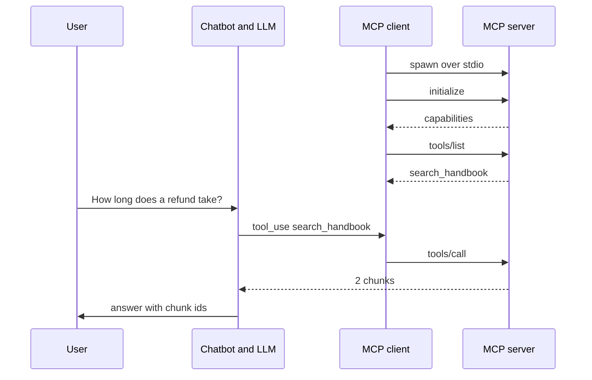

<!-- Generated by site/scripts/rag-theory-import.mjs from rag-agents-engineering. Edit the source there. -->
# Overview

M38 takes the tool-calling chatbot apart. The tool code and its schemas move into an MCP server, the chatbot keeps its loop and talks to the server through an MCP client, and from then on any client can reuse the server and the chatbot can plug in servers it did not write. The M38 notebooks build on four ideas: a server and a client that share one session, the three things a server can offer (tools, resources and prompts), the reference servers you add from a config file, and the transports that move a server off your machine.

The notebooks wrap an arXiv research server. These pages also put the Larkspur Cloud handbook from [M11](/learn/llm-and-retrieval/rag-from-first-principles/rag-from-first-principles-overview) to [M13](/learn/ingestion-and-indexing-pipeline/chunking-and-indexing/chunking-and-indexing-overview) behind MCP, which is the module's lab brief: a FastMCP server called `larkspur-handbook` with the [M11](/learn/llm-and-retrieval/rag-from-first-principles/rag-from-first-principles-overview) retriever as its one tool, `search_handbook`, the handbook chunks as resources, and an `answer_with_citations` prompt. The golden question is the [M11](/learn/llm-and-retrieval/rag-from-first-principles/rag-from-first-principles-overview) one, *How long does a refund take?* Every message, schema and status code quoted here was recorded from real runs with MCP Python SDK 1.30.0, the version in the course's `protocols` dependency group.

## In short

- An MCP server owns the tools; the chatbot keeps the loop. The client launches a stdio server as a subprocess, opens one session per server, sends `initialize` (protocol version `2025-11-25` in SDK 1.30.0), then `tools/list` and `tools/call` as the model asks.
- FastMCP builds each tool definition from the Python function: the function name, the whole docstring as the description, and a JSON schema from the type hints. The `Args:` lines stay inside the description; no parameter gets a schema description of its own.
- Tools are for the model to call. Resources and prompts are for the application and the user: the lesson 7 chatbot reads a resource when the user types `@topic` and fetches a prompt on `/prompt`.
- Every connected server's tools go to the model on every call. The notebook's three servers send 17 definitions, about 2,527 tokens, and the filesystem server is 80% of that. Two filesystem servers send 14 names twice, and the chatbot routes all 14 to the second one.
- Remote servers run on their own and the client connects by URL. Streamable HTTP uses one endpoint, `/mcp`, and an `mcp-session-id` header; the older SSE transport uses a stream at `/sse` plus POSTs to `/messages/`.

## Mental model

The client and the server agree on a protocol version and capabilities once, then the client lists what the server offers. The model sees only the tool definitions; it never talks to the server. When it asks for a tool, the chatbot hands the call to the session that owns that tool, and the result goes back to the model as a tool result. Swap the server for another and the chatbot code does not change.

## Interactive lab

[**Server config lab**](/labs/rag/m38_mcp_foundations/server-config-lab.html): open the file in a browser. Start with *Notebook config* and read the ledger: 17 tool definitions and 10,107 characters go out with every request, and `filesystem` sends 14 of them. Switch on `larkspur` to add the handbook retriever for 417 characters. Then pick *Two filesystem servers*: the first filesystem server still sends 14 definitions but gets 0 calls, and the file the model asks for comes back as missing.

## How it connects

- **Before:** [M23](/learn/agentic-systems/the-agent-loop-and-tool-calling/the-agent-loop-and-tool-calling-overview) builds the tool-calling loop that M38 splits in two, and [M24](/learn/agentic-systems/react-agents-and-langchain-create-agent/react-agents-and-langchain-create-agent-overview) packages it as `create_agent`. The `larkspur-handbook` server wraps the retriever from [M11](/learn/llm-and-retrieval/rag-from-first-principles/rag-from-first-principles-overview), the one Part VII improves. [M37](/learn/memory-and-multi-agent-rag/multi-agent-applied-builds-and-deep-agents/multi-agent-applied-builds-and-deep-agents-overview) ends Part X by pointing at protocols: the coordinator and specialist split stays, and the tools move behind servers.
- **Next:** [M39](/learn/agent-protocols-mcp-and-a2a/building-mcp-servers-and-clients/building-mcp-servers-and-clients-overview) builds MCP servers and clients with more of the protocol. [M40](/learn/agent-protocols-mcp-and-a2a/mcp-applications-and-rag-over-mcp/mcp-applications-and-rag-over-mcp-overview) builds MCP applications and RAG over MCP, and [M41](/learn/agent-protocols-mcp-and-a2a/a2a-agent-to-agent-protocol/a2a-agent-to-agent-protocol-overview) moves from tools to agents with the A2A protocol.

## Key Takeaways

- Put tools behind a server once and every client can use them; keep the loop, the model choice and the routing in the client.
- Read the definitions FastMCP generates before shipping: the docstring is the description the model sees, and parameter help belongs in the type hints if the model needs it.
- Count what each server costs on every request, and give every tool a name that is unique across all connected servers.
- Choose the transport by where the server runs: stdio for a local subprocess, Streamable HTTP at `/mcp` for a shared service, with the bind address, session header and auth checked before deploy.
