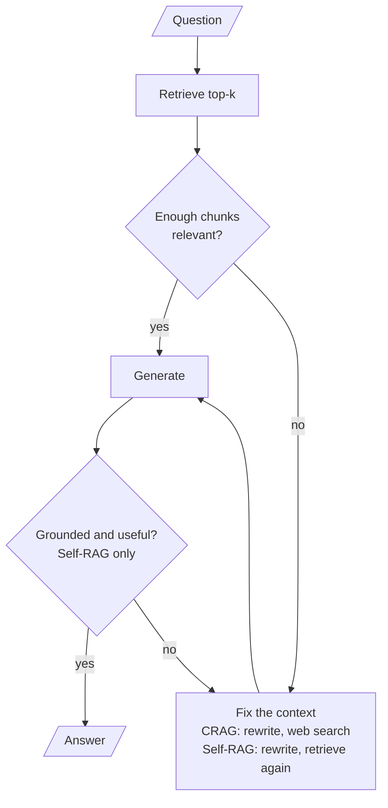

<!-- Generated by site/scripts/rag-theory-import.mjs from rag-agents-engineering. Edit the source there. -->
# Overview

A plain RAG pipeline generates from whatever the retriever returns. Corrective RAG (CRAG) grades the retrieved chunks first and finds other context when they fail. Self-RAG asks the model to judge each step, from whether to retrieve at all to whether its answer is supported and useful. The M29 notebooks build on four ideas: a retrieval evaluator, knowledge refinement, reflection tokens and a groundedness check.

The running example is the twelve-chunk Larkspur Cloud handbook from [M11](/learn/llm-and-retrieval/rag-from-first-principles/rag-from-first-principles-overview) and its three golden questions, plus two questions the handbook cannot answer: *Does Larkspur offer GPU servers?* and *How much does the starter plan cost per month?* The handbook is private, so a web search cannot answer for it. That makes it a fair stress test for a pipeline whose fallback is the web.

## In short

- CRAG puts a **retrieval evaluator** between retrieval and generation. In notebook 01a it grades each chunk yes or no and searches the web when half or fewer pass; in 01b it scores each chunk from 0 to 1 and picks Correct (above 0.7), Incorrect (below 0.3) or Ambiguous.
- **Knowledge refinement** cuts the context down to the parts that answer the question before generation. 01b does it with an LLM call that turns a document into bullet points.
- Self-RAG makes four judgements, the **reflection tokens** of the paper: retrieve or not, is this chunk relevant, is the answer supported, is it useful. Notebook 02a asks an LLM for each one and caps the retry loops at `max_iterations = 2`.
- The **groundedness check** is the hallucination guard, and in 02a it has two holes: it passes without a call when there are no documents, and its regenerate loop ignores the iteration cap.
- Correction is paid in LLM calls. In the lab at `k = 5`, the baseline makes 1 call per question, CRAG 5.6 on average and Self-RAG 15.0, up to 20 on a question the handbook cannot answer.

## Mental model

There are two places to catch a bad answer. CRAG checks the context before generation; Self-RAG also checks the answer after it. Each check is an LLM call, and each failed check sends the question round again, so the price of correction is set by how often the checks fail.

## Interactive lab

[**What correction costs**](/labs/rag/m29_crag_and_self_rag/correction-cost-lab.html): open the file in a browser. Pick *Can I export my data after I cancel my plan?* and move `k` from 3 to 4: CRAG still keeps both evidence chunks, yet it now searches the web, because 2 of 4 is not more than half. Then pick *How much does the starter plan cost per month?* at `k = 5` and read the Self-RAG row: three retrieval passes, 20 LLM calls, and a final generation with no context that the groundedness check never examines.

## How it connects

- **Before:** [M11](/learn/llm-and-retrieval/rag-from-first-principles/rag-from-first-principles-overview) supplies the handbook, the golden questions and the baseline these pipelines are compared against. [M18](/learn/retrieval-quality-engineering/query-transformation-and-routing/query-transformation-and-routing-overview) teaches query rewriting, and [M28](/learn/agentic-and-self-correcting-rag/agentic-rag-foundations-grading-and-query-rewriting/agentic-rag-foundations-grading-and-query-rewriting-overview) the relevance grader and bounded retry loop that CRAG and Self-RAG both reuse. [M26](/learn/agentic-systems/planning-reflection-and-reasoning-patterns/planning-reflection-and-reasoning-patterns-overview) covers reflection as a general agent pattern.
- **Next:** [M30](/learn/agentic-and-self-correcting-rag/adaptive-rag-and-query-routing/adaptive-rag-and-query-routing-overview) routes the question before retrieval and adds a hallucination grader of its own. [M32](/learn/agentic-and-self-correcting-rag/reliability-feedback-loops-and-diversity/reliability-feedback-loops-and-diversity-overview) turns these checks into feedback loops, and [M45](/learn/architecture-synthesis-and-capstone/agentic-rag-architectures-choosing-a-design/agentic-rag-architectures-choosing-a-design-overview) weighs CRAG and Self-RAG against the other agentic RAG designs.

## Key Takeaways

- Grade the context before you generate from it, and log the grade: the route a request took is the first thing to read when an answer is wrong.
- Pick the fallback by where the answer can live. A web search cannot answer for a private handbook; rewrite and retry against your own index first, and refuse when the corpus has nothing.
- A groundedness check guards only the cases it runs on. Make "no documents" a refusal, never an automatic pass.
- Count LLM calls per question on your golden set before you ship a correction loop, and bound every loop with a counter that a node, not a router, updates.
