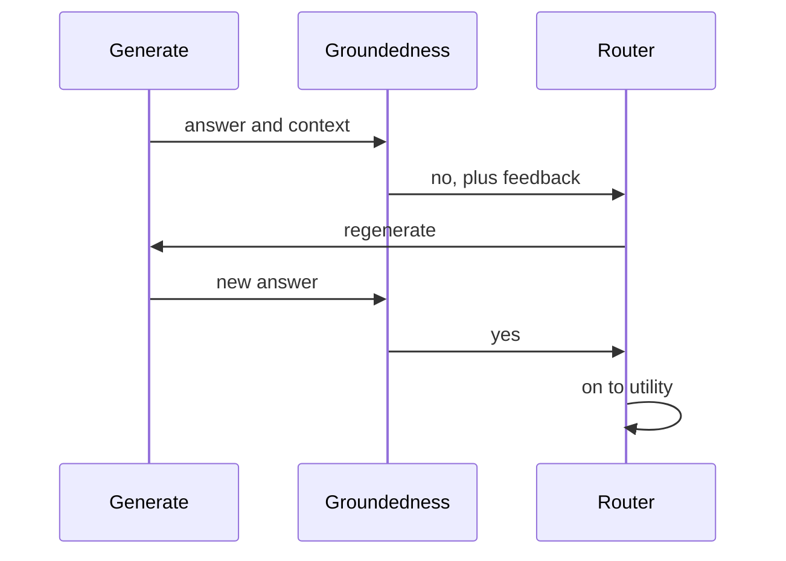

<!-- Generated by site/scripts/rag-theory-import.mjs from rag-agents-engineering. Edit the source there. -->
# Self-RAG: retrieve-or-not, relevance, groundedness, utility

<!-- subtitle: Four checks around retrieval and generation, and the two places the hallucination guard does not run -->

## Reflection tokens

> **What you'll learn**
>
> - **Explain** the four reflection decisions of Self-RAG and the question each one answers.
> - **Trace** a question the handbook cannot answer through every loop, and count its LLM calls.
> - **Diagnose** a groundedness check that passes without running, and a retry cap that never bites.
> - **Choose** where a loop counter must be updated in a LangGraph graph.

Lesson 1 of T9.2 checked the context before generation and never looked at the answer. Self-RAG checks both, and it can also skip retrieval when a question does not need it.

A Larkspur answer can cite real policy and still miss the question. As an *illustrative* case, ask *Can I export my data after I cancel my plan?*, retrieve only the `export` chunk, and the model can write a well-supported paragraph on how to export that never mentions the 30-day retention window. Every sentence is grounded in the context, and the customer still loses their data. Relevance, support and usefulness are three separate properties, and a pipeline that checks one of them misses the other two.

Self-RAG (Asai et al., *Self-RAG: Learning to Retrieve, Generate, and Critique through Self-Reflection*, 2023, [arXiv:2310.11511](https://arxiv.org/abs/2310.11511)) trains one model to emit special tokens that judge its own pipeline. **Reflection tokens are labels the model produces about its own retrieval and output: whether to retrieve, whether a passage is relevant, whether the answer is supported, and whether it is useful.** The table lists the four kinds and how each implementation in this module represents them:

| Token | Question it answers | Values in the paper | Self-RAG graph (LangGraph) | Self-RAG function variant (optional) |
|---|---|---|---|---|
| Retrieve | Do I need documents for this? | yes, no, continue | `need_retrieval`: yes or no | Yes or No |
| ISREL | Is this passage relevant? | relevant, irrelevant | yes or no, per chunk | Relevant or Irrelevant |
| ISSUP | Is the answer supported by the passage? | fully, partially, no support | yes or no, plus feedback | Fully supported, Partially supported or No support |
| ISUSE | Is the answer useful for the question? | a score from 1 to 5 | yes or no, plus feedback | an integer from 1 to 5 |

*Table 1: The four reflection tokens in the paper and in the two implementations.*

In the paper the tokens are part of the model's vocabulary and come out of the same decoding pass as the answer. Neither implementation trains a model. Each judgement is a separate LLM call with a structured-output schema, so "reflection token" here means one more call that returns a label.

> **Key distinction:** in the paper a reflection costs a few extra tokens. In these implementations it costs a full model round trip, and that changes which checks are worth running.

### How the graph wires the four checks

The LangGraph implementation wires each judgement to its own conditional edge:

```animated
<figure class="anim sheet" aria-labelledby="anim-selfrag-cap">
  <div class="anim__canvas" tabindex="0" aria-label="The Self-RAG loop, scrolls sideways on a narrow screen">
    <svg viewBox="0 -16 800 356" role="img" aria-labelledby="anim-selfrag-title anim-selfrag-desc">
      <title id="anim-selfrag-title">The Self-RAG loop on a question the handbook cannot answer</title>
      <desc id="anim-selfrag-desc">The starter-plan price question at k = 5. Self-RAG decides to retrieve, grades five chunks and keeps none, rewrites the question and tries again, twice. After the third pass the iteration cap sends it to generate with no context; the groundedness check sees no documents and passes without a call; the utility grade says no, and the run ends. 20 LLM calls in all.</desc>
      <defs>
        <marker id="ah-sr" viewBox="0 0 8 8" refX="7" refY="4" markerWidth="8" markerHeight="8" markerUnits="userSpaceOnUse" orient="auto-start-reverse"><path class="ah" d="M0 0 L8 4 L0 8 z"/></marker>
      </defs>
      <g class="n-1"><rect class="box" x="16" y="40" width="110" height="44"/><text class="label" x="71" y="62">Retrieve?</text></g>
      <g class="n-2 n-4 n-6"><rect class="box" x="156" y="40" width="120" height="44"/><text class="label" x="216" y="62">Retrieve</text></g>
      <g class="n-2 n-4 n-6"><rect class="box" x="306" y="40" width="120" height="44"/><text class="label" x="366" y="62">Grade chunks</text></g>
      <g class="n-7"><rect class="box" x="486" y="40" width="120" height="44"/><text class="label" x="546" y="62">Generate</text></g>
      <g class="n-7"><rect class="box" x="646" y="40" width="120" height="44"/><text class="label" x="706" y="62">Grounded?</text></g>
      <g class="n-3 n-5"><rect class="box" x="231" y="220" width="120" height="44"/><text class="label" x="291" y="242">Rewrite</text></g>
      <g class="n-8"><rect class="box" x="486" y="220" width="120" height="44"/><text class="label" x="546" y="242">Answer</text></g>
      <g class="n-8"><rect class="box" x="646" y="220" width="120" height="44"/><text class="label" x="706" y="242">Useful?</text></g>

      <path class="edge e-2" d="M126 62 H153" marker-end="url(#ah-sr)"/>
      <path class="edge e-2 e-4 e-6" d="M276 62 H303" marker-end="url(#ah-sr)"/>
      <path class="edge e-7" d="M426 62 H483" marker-end="url(#ah-sr)"/>
      <path class="edge e-7" d="M606 62 H643" marker-end="url(#ah-sr)"/>
      <path class="edge e-8" d="M750 84 V217" marker-end="url(#ah-sr)"/>
      <path class="edge e-8" d="M646 242 H609" marker-end="url(#ah-sr)"/>
      <path class="edge e-3 e-5" d="M340 84 C340 150 320 160 320 217" marker-end="url(#ah-sr)"/>
      <text class="small" x="372" y="190">none kept</text>
      <path class="edge e-4 e-6" d="M260 220 C260 150 230 150 230 87" marker-end="url(#ah-sr)"/>
      <path class="edge dashed" d="M690 40 C690 8 562 8 562 37" marker-end="url(#ah-sr)"/>
      <text class="small" x="626" y="0">not grounded</text>
      <path class="edge dashed" d="M670 264 V300 H291 V267" marker-end="url(#ah-sr)"/>
      <text class="small" x="420" y="318">not useful</text>
      <text class="small in-1" x="71" y="104">yes, 1 call</text>
      <text class="fig in-2" x="446" y="108">pass 1: 0 of 5</text>
      <text class="fig in-4" x="446" y="128">pass 2: 0 of 5</text>
      <text class="fig in-6" x="446" y="148">pass 3: 0 of 5</text>
      <text class="fig in-3" x="160" y="232">rewrite 1</text>
      <text class="fig in-5" x="160" y="252">rewrite 2</text>
      <text class="small in-7" x="566" y="104">no context</text>
      <g class="in-7"><text class="small" x="690" y="140">check skipped:</text><text class="small" x="690" y="158">no documents</text></g>
      <text class="small in-8" x="730" y="284">no, cap reached</text>
      <text class="fig in-8" x="546" y="284">20 LLM calls</text>

      <circle class="tok" cx="0" cy="0" r="7"/>
    </svg>
  </div>
  <div class="anim__controls" hidden>
    <button class="anim__btn" type="button" data-act="prev">Previous</button>
    <button class="anim__btn" type="button" data-act="play" aria-pressed="false">Play</button>
    <button class="anim__btn" type="button" data-act="next">Next</button>
  </div>
  <ol class="anim__steps" id="anim-selfrag-cap">
    <li><button type="button" data-tok="16,40">Decide</button><span>“How much does the starter plan cost per month?” is about the handbook, so the Retrieve judgement says yes. 1 call.</span></li>
    <li><button type="button" data-tok="306,40">Pass 1</button><span>Retrieve five chunks and grade each one. None mentions a price, so none is kept. 6 calls so far.</span></li>
    <li><button type="button" data-tok="231,220">Rewrite 1</button><span>Rewrite the question and go back to retrieval. 7 calls.</span></li>
    <li><button type="button" data-tok="306,40">Pass 2</button><span>The lab’s rewrite repeats the question, so the same five chunks come back and fail again. 12 calls.</span></li>
    <li><button type="button" data-tok="231,220">Rewrite 2</button><span>The second rewrite uses up max_iterations = 2. 13 calls.</span></li>
    <li><button type="button" data-tok="306,40">Pass 3</button><span>Nothing relevant, and the cap is reached, so the graph goes to generation anyway. 18 calls.</span></li>
    <li><button type="button" data-tok="486,40">Generate</button><span>The model generates with no context. The groundedness check sees no documents and passes without a call. 19 calls.</span></li>
    <li><button type="button" data-tok="646,220">Utility</button><span>The utility grade says no, but the cap is reached, so the run ends: 20 LLM calls for a question the handbook cannot answer.</span></li>
  </ol>
</figure>
```

*Figure 1: The Self-RAG graph. Two loops go back through a rewrite, one goes straight back to generation.*

The three loops have different exits:

- **No relevant chunk**: rewrite the question and retrieve again.
- **Answer not useful**: rewrite the question and retrieve again, with the utility feedback as a hint.
- **Answer not grounded**: generate again, with the groundedness feedback in the prompt.

`max_iterations = 2` bounds the rewrite loops, because the rewrite node increments the counter each time it runs. After two rewrites the relevance router sends the question to generation even with no relevant chunk, and the utility router ends the run.

The first token is the one CRAG lacks. *What is 9 plus 10?* gets `need_retrieval = no` in the graph and skips the vector store. Every Larkspur question is about the handbook, so on this corpus the Retrieve token saves nothing and costs one call.

### Counting the work on missing evidence

The loops make the cost depend on the question. The [T9.2 lab](/labs/rag/m29_crag_and_self_rag/correction-cost-lab.html) replays the graph on the handbook with stand-in graders, and on *How much does the starter plan cost per month?* at `k = 5` no chunk is ever relevant. Here is where its calls go:

| Pass | What happens | LLM calls | Running total |
|---|---|---|---|
| Start | Retrieve decision: yes | 1 | 1 |
| 1 | Five chunks graded, none relevant | 5 | 6 |
| 2 | Rewrite (iteration 1), five chunks graded, none relevant | 6 | 12 |
| 3 | Rewrite (iteration 2), five chunks graded, none relevant | 6 | 18 |
| End | Cap reached: generate with no documents, groundedness skipped, utility graded | 2 | 20 |

*Table 2: Self-RAG on the starter-plan price question at `k = 5`, from the T9.2 lab.*

That is 1 retrieve decision, 15 relevance grades, 2 rewrites, 1 generation and 1 utility grade. On the export question the same graph stops after one pass in 9 calls. The expensive question is the one the handbook cannot answer, and the run ends with a generation that has nothing to be grounded in. The groundedness check is the next section, and it is where that generation should have been caught.

## Groundedness check

**A groundedness check asks whether every claim in the answer is supported by the context the answer was generated from.** It is Self-RAG's hallucination guard. In the graph, the groundedness node sends the context and the answer to a "strict fact-checker" prompt. The schema returns a yes only if every claim is supported, and a feedback string naming the unsupported claims.

On a no, the router sends the run back to generation, and the feedback goes into the prompt as "a previous attempt at this answer was rejected for this reason". The regenerate loop is shown here as a sequence of calls:



*Figure 2: One regeneration after an unsupported answer.*

Groundedness and utility are separate checks because they fail separately. The export answer in the opening example is fully grounded and still not useful. An answer that quotes the retention window correctly and adds an invented export fee (again illustrative) sounds useful and is not grounded.

### Planted failures in the hallucination guard

Two details in the graph decide what the check actually catches. Planting one failing case against each shows them:

| Planted case | What the graph does | Why |
|---|---|---|
| No relevant chunk after the cap, starter-plan question | Generates with no context; groundedness returns yes with no call | The node treats "no documents" as grounded by default |
| A groundedness grader that always says no | Regenerates until LangGraph raises a recursion error | The regenerate loop's counter update is discarded |
| The same question in the function variant | Generates from "No relevant context found." with a prompt that asks only for a response, and runs no support check | No instruction to refuse, so the model answers from memory |

*Table 3: Three planted failures of the groundedness check.*

The first row is the **empty-context pass**. On the starter-plan question, Self-RAG exhausts its rewrites, generates with no context, and the check waves the answer through. The only guard left is the generation prompt's line "If the context does not contain enough information to answer confidently, say so plainly". The function variant is weaker still: its own low-relevance test asks a climate-change corpus *how did harry beat quirrell?*, and nothing stops the model from answering.

> **Pitfall: the empty-context pass.** A check that returns yes when it has nothing to check guards only the cases where it was least needed. Route "no documents after the cap" to a fixed refusal instead.

### The counter that never moves

The second row is the **stuck counter**. The groundedness router writes `iteration + 1` into the state inside the routing function. In LangGraph a conditional-edge router only returns the name of the next node. Only what nodes return is merged into the state, so a write inside a router is discarded:

| Where the update happens | Kept in state? | Effect on the cap |
|---|---|---|
| The rewrite node returns the new iteration | yes | Rewrite loops stop after two rewrites |
| The groundedness router writes the iteration | no | The regenerate loop never moves the counter |

*Table 4: Why one loop is bounded and the other is not.*

The cap still bites if earlier rewrites already pushed the counter to 2, because the router reads that value. On a question that passes relevance on the first pass, the counter starts at 0 and stays there. Run against the example's own node and router code with a groundedness grader that always says no, the compiled graph (langgraph 1.2.18) regenerated until LangGraph raised `GraphRecursionError`. With `recursion_limit = 200`, that was 98 regenerations and 200 LLM calls. With the default config it ran to the limit that release reports, 10,007 steps.

The fix is to count in a node: have generation return the new iteration when it is regenerating, or add a small regenerate node before it. A test with a grader that always says no proves the fix, and a per-request call budget catches the next loop nobody bounded.

### Keeping three support levels

The paper's three support levels are worth keeping when you build this yourself. The function variant generates one candidate answer per relevant passage and ranks them by "fully supported" first and utility second. A yes-or-no grade cannot rank candidates that way, because a partially supported answer and an unsupported one both come back as no.

## In practice: Self-RAG on the Larkspur handbook

Run the four checks on Larkspur's questions and the cost and the gaps line up:

1. *Can I export my data after I cancel my plan?* passes relevance, groundedness and utility on the first pass: 9 calls at `k = 5` for the context the baseline read in 1.
2. *How much does the starter plan cost per month?* runs three retrieval passes and 20 calls, then hits the **empty-context pass**: the answer that most needs checking is the one the check skips.
3. A grader outage that returns no on every call turns any first-pass question into a **stuck counter** and runs to the recursion limit.

For Larkspur, the out-of-corpus route ends in a refusal and a handoff to support, the regenerate counter moves in a node, and every request carries a call budget. Lesson 3 of T9.2 puts these call counts next to CRAG's and the baseline's.

## Run the notebooks

The code for this lesson is in these notebooks. Colab runs one in your browser: install the packages its first cell imports and set the API keys it reads. To run every notebook as written, clone the repository and use its uv environment.

| Notebook | GitHub | Colab |
|---|---|---|
| Self RAG LangGraph | [Open on GitHub](https://github.com/Sourav692/rag-agents-engineering/blob/main/p08_agentic_rag/m29_crag_and_self_rag/mandatory/notebook/02a_self_rag_langgraph.ipynb) | [Open in Colab](https://colab.research.google.com/github/Sourav692/rag-agents-engineering/blob/main/p08_agentic_rag/m29_crag_and_self_rag/mandatory/notebook/02a_self_rag_langgraph.ipynb) |
| Self RAG RAG techniques (optional) | [Open on GitHub](https://github.com/Sourav692/rag-agents-engineering/blob/main/p08_agentic_rag/m29_crag_and_self_rag/optional/notebook/02b_self_rag_rag_techniques.ipynb) | [Open in Colab](https://colab.research.google.com/github/Sourav692/rag-agents-engineering/blob/main/p08_agentic_rag/m29_crag_and_self_rag/optional/notebook/02b_self_rag_rag_techniques.ipynb) |

## Key Takeaways

- Self-RAG judges four things: whether to retrieve, whether each chunk is relevant, whether the answer is supported and whether it is useful. In these implementations each judgement is one more LLM call that returns a label.
- The loops make cost depend on the question, from 9 calls on the export question to 20 on an out-of-corpus price question at `k = 5`. With no documents, the groundedness check passes without running.
- Groundedness and utility fail separately, so check both, and make "no documents" a refusal rather than a pass.
- Update loop counters in a node, because LangGraph discards state written inside a routing function, and back every loop with a per-request call budget.

## Check yourself

<details>
<summary>1. How do the reflection labels in these implementations differ from the ones in the Self-RAG paper?</summary>

In the paper one trained model emits the tokens from its vocabulary, in the same decoding pass as the answer. Neither implementation trains a model: each judgement is a separate LLM call with a structured-output schema. So "reflection token" here means one more call that returns a label, and each check costs a full round trip.

</details>

<details>
<summary>2. On the starter-plan price question at k equal to 5, no chunk is ever relevant. How many LLM calls does Self-RAG make, and where do they go?</summary>

Twenty: 1 retrieve decision, 15 relevance grades over three passes, 2 rewrites, 1 generation and 1 utility grade. The groundedness check makes no call, because with no documents it returns yes without running. The export question stops after one pass in 9 calls.

</details>

<details>
<summary>3. With a groundedness grader that always says no, the graph regenerates until LangGraph raises a recursion error, despite its iteration cap. Why, and what is the fix?</summary>

The groundedness router writes the new iteration inside the routing function, and LangGraph keeps only what nodes return, so the counter never moves. With `recursion_limit = 200` that was 98 regenerations and 200 LLM calls. Count in a node instead: have generation return the new iteration, or add a small regenerate node.

</details>
