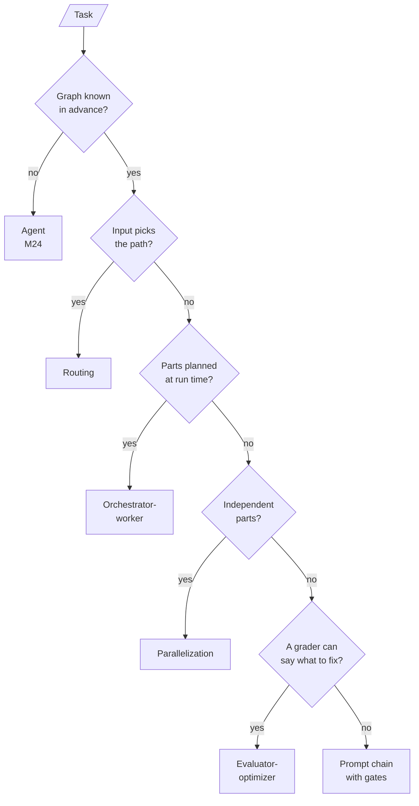

<!-- Generated by site/scripts/rag-theory-import.mjs from rag-agents-engineering. Edit the source there. -->
# Overview

A workflow is a graph you draw before the first token: the LLM fills in the nodes and, at most, picks one of the edges you wrote. Five such graphs cover most of what agentic RAG systems do: prompt chaining, routing, parallelisation, orchestrator-worker and evaluator-optimizer. The M25 notebooks build on four ideas: the line between a workflow and an agent, checks between steps, running branches at once and merging them, and loops that always stop.

The running example is the Larkspur Cloud support assistant from [M11](/learn/llm-and-retrieval/rag-from-first-principles/rag-from-first-principles-overview) to [M13](/learn/ingestion-and-indexing-pipeline/chunking-and-indexing/chunking-and-indexing-overview), answering from the same handbook. Its golden question *Can I export my data after I cancel my plan?* needs two evidence chunks, `export` and `retention`, which makes it the natural case for orchestrator-worker decomposition. The notebooks run their own small demos (an email, a story, a joke, a code review), and every number on these pages is one they printed or one the lab computes.

## In short

- In a workflow, code fixes the path through the LLM calls; in an agent ([M24](/learn/agentic-systems/react-agents-and-langchain-create-agent/react-agents-and-langchain-create-agent-overview)), the model picks its next step. Each M25 pattern hands the model one decision at most: a gate's verdict, a route, a vote, a plan's length or a grade.
- A **quality gate** checks an intermediate result before the next step spends tokens on it. In lesson 25.1 a concrete topic passed on attempt 1 (four LLM calls); an abstract one was rejected three times and stopped before drafting (six calls, no email).
- Routing by model tier sent 1 of 7 requests to `o4-mini` and scored 86%, against 71% for all-cheap and 100% for all-reasoning. The router's costly mistake is sending a hard request to the cheap tier.
- A **fan-out** lasts as long as its slowest branch: the 25.3 sections took 7.0 s in parallel against a 13.4 s sum. In the lab a cap of two concurrent branches costs nothing on that workload, until the slowest branch is submitted last.
- Every loop gets a cap in code. LCEL cannot loop at all, so a generate, critique, refine cycle lives in LangGraph, a Python loop or agent middleware, and at `MAX_ITERATIONS = 5` it makes at most ten LLM calls.

## Mental model

Real systems nest these. CRAG ([M29](/learn/agentic-and-self-correcting-rag/self-correcting-rag-crag-and-self-rag/self-correcting-rag-crag-and-self-rag-overview)) is an evaluator-optimizer around retrieval, adaptive RAG ([M30](/learn/agentic-and-self-correcting-rag/adaptive-rag-and-query-routing/adaptive-rag-and-query-routing-overview)) is a router, and query decomposition ([M18](/learn/retrieval-quality-engineering/query-transformation-and-routing/query-transformation-and-routing-overview)) is orchestrator-worker. Read an architecture by asking which of the five each node belongs to, and where the model, rather than your code, makes the call.

## Interactive lab

[**Fan-out and the concurrency cap**](/labs/rag/m25_agentic_workflow_patterns/fan-out-lab.html): open the file in a browser. Keep *Story sections* and drag the cap from 3 to 1 to watch the wall time grow from 10.6 s to 16.9 s. Set it to 2: the wall time goes back to 10.6 s, because the two short branches share one slot. Then pick *Fastest first* at a cap of 2 and see it rise to 12.2 s, because the slowest branch now waits for a slot.

## How it connects

- **Before:** [M08](/learn/langchain-and-langgraph-fundamentals/lcel-runnables-and-chains/lcel-runnables-and-chains-overview) (LCEL) and [M09](/learn/langchain-and-langgraph-fundamentals/langchain-and-langgraph/langchain-and-langgraph-overview) to [M10](/learn/langchain-and-langgraph-fundamentals/langgraph-runtime-persistence-hitl-and-streaming/langgraph-runtime-persistence-hitl-and-streaming-overview) (LangGraph state, conditional edges, reducers) supply every primitive these graphs use. [M24](/learn/agentic-systems/react-agents-and-langchain-create-agent/react-agents-and-langchain-create-agent-overview) builds the agent these workflows are contrasted with. [M18](/learn/retrieval-quality-engineering/query-transformation-and-routing/query-transformation-and-routing-overview) introduces the query decomposition that lesson 25.4 rebuilds as orchestrator-worker.
- **Next:** [M26](/learn/agentic-systems/planning-reflection-and-reasoning-patterns/planning-reflection-and-reasoning-patterns-overview) turns evaluator-optimizer into reflection, where the model also decides what to check. [M28](/learn/agentic-and-self-correcting-rag/agentic-rag-foundations-grading-and-query-rewriting/agentic-rag-foundations-grading-and-query-rewriting-overview) to [M30](/learn/agentic-and-self-correcting-rag/adaptive-rag-and-query-routing/adaptive-rag-and-query-routing-overview) assemble the patterns into agentic RAG: grading and rewriting, CRAG and Self-RAG, adaptive routing.

## Key Takeaways

- Draw the graph first. If you can, it is a workflow; give the model one decision per node at most, and keep that decision in a closed set your edges cover.
- Put a gate where a bad intermediate result would waste the steps after it, and give every gate a retry count and a terminal "stop with a reason" node.
- Measure a router against both of its baselines, and bias it toward the error that costs money rather than the one that costs correctness.
- Every loop has a cap in code, and hitting the cap is a metric. A fan-out costs its slowest branch, so time branches one by one before tuning any of them.
