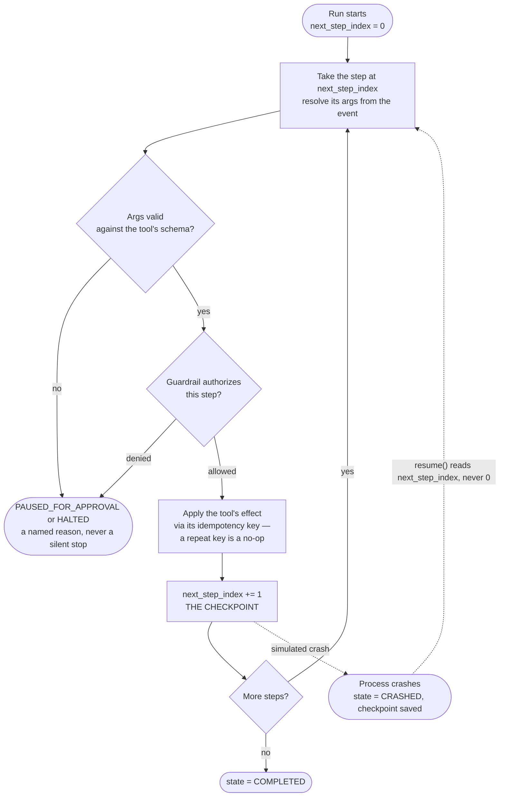

# Durability and Idempotency

*Retries and restarts must be allowed to happen freely, yet no customer may ever be refunded twice because one happened.*

◷ 8 min

Two questions decide whether an agent platform is safe to point at real money: what happens when the orchestrator restarts mid-run, and what happens when a refund step is retried. Answer both with one loop and one key per action, after reading [Determinism Over Free Text](/learn/agentic-systems/agentic-workflow-platforms/determinism-over-free-text) for the step list the loop walks.

**Objectives:**

- draw the orchestrator loop with its checkpoint, its exits, and its crash-and-resume edge;
- explain why the idempotency key sits on the action rather than the run;
- tell the two idempotency bugs and the lesson each teaches.

---

## Draw the Loop From Memory

This is the diagram to be able to draw without notes.



The orchestrator executes one step, checkpoints, then executes the next. It never runs the whole workflow at once.

## Make the Checkpoint One Integer

The checkpoint is not a separate mechanism. It is one field on the run, `next_step_index`. After a step applies, the index moves forward, and that is the saved progress.

Resume and a fresh run call the exact same loop. There is no special recovery path. The loop always starts wherever `next_step_index` says, whether that is 0 or mid-run. This is the whole design. A recovery path that is different code is a second implementation of the same logic, and its bugs are found only during incidents. A recovery path that is the normal path is exercised on every single run.

The demo proves it by actually crashing. It crashes a run after step 0, once the checkpoint is saved. Resuming continues from step 1, and the external call count shows step 0 never ran again.

## Put the Idempotency Key on the Action

The key for each side effect is the run plus the step:

```
idempotency_key = f"{run_id}:{step_name}"
```

Applying a side effect returns true only the first time a key is seen. Every later call with the same key is a no-op, and the external call count does not increase.

The key belongs on the action, not on a run-level "already started" flag. A run legitimately retries after a transient failure. A run-level flag would still let two attempts at the same step both fire. Keying by run and step deduplicates the specific side effect. Re-running the loop is fine and expected. Re-running a side effect that already applied is not, and the key tells the two apart precisely.

## End Every Run With a Named Outcome

A run ends in exactly one of three states: `COMPLETED`, `PAUSED_FOR_APPROVAL`, or `HALTED` for a budget. `CRASHED` is a transient fourth state that resume clears. There is no "it just stopped and nobody knows" path. Every non-completion carries a named reason on the trace, the same property as a single agent loop's three exits, at platform scale.

## Learn From Two Real Bugs

Both bugs were caught while building the project. Both show what idempotent has to mean.

**Bug 1: the spend cap checked the wrong number.** The cost that counts against the spend cap must be the actual dollar amount for a refund, the `amount_usd` argument. The first version used one nominal operational cost for every tool. So a refund of any size passed a deliberately tiny cap, because the cap check was looking at $0.00. Now every other tool uses a small fixed operational cost, and a financial tool's cost is the money it moves.

**Bug 2: idempotency covered the side effect but not the cost.** The first loop let an idempotent replay skip the side effect. But it still sent the step through `authorize_step` and still added the step's cost to the run's total again. An approved run whose completed refund step was retried could then hit `spend_cap_exceeded` on the retry. No money had moved a second time, and nothing in the outside world had changed.

The fix moves the idempotency check before authorisation. A replay of an applied key is recorded as a free, pre-authorised no-op. It never re-enters the guardrail or the cost total. The lesson in one sentence: idempotency has to cover every side effect of a step, not just its most obvious one, and cost accounting is a side effect too.

> **Warning: a correct-looking idempotency guarantee can still be false under retry.** Check every place a step leaves a mark, including counters, budgets, and logs, not only the external call. Bug 2 passed every happy-path test.

## Worked Example: A Refund Run That Pauses, Resumes, and Retries

The project's demo runs `run_001` on the ticket-triage workflow, version 1.

Step 0, `draft_reply`, applies and costs $0.02. Step 1, `issue_refund`, is denied because no approver is present, so the run pauses as `PAUSED_FOR_APPROVAL`. An approver arrives, and the run resumes through the same loop. Step 1 applies and the run completes.

Now a duplicate webhook triggers a retry of the refund step. The key `run_001:issue_refund` already exists. Before the retry there was one apply; after it there is still one apply. Because the replay check runs before authorisation, the retry adds nothing to the spend total either.

Separately, the crash test stops a run after step 0 and resumes it. Step 0 never runs again, and the run completes. Every guarantee here came from two things: one integer checkpoint and one key per action, both read by the same loop.

## Name the Storage and Retry Gaps

The lock store, idempotency-key store, and version store are in-process dictionaries. They are correct in shape and wrong in storage for anything past one process. A real deployment needs a distributed lock, either a database row with a unique constraint or a Redis lease. A lease must be checked with a fencing token, because it can expire while its holder is still writing. It also needs a durable idempotency-key store shared across workers that survives restarts.

The mechanism does not change, only where it is persisted. That is why the logic sits behind two thin lock functions and one side-effect function. The tractable slice is swapping the dictionary for a real store behind them.

The coverage map names one more gap: nothing calls resume automatically. A retry wrapper with backoff is low effort, because the hard part, idempotent resumption, is done.

The FDE Handbook introduced framework checkpointers earlier. Having built one by hand, you can say exactly what a checkpointer persists, and why a checkpoint after every step is the right granularity.

---

## Key Takeaways

- The orchestrator runs one step, checkpoints, and runs the next, and the diagram is worth drawing from memory.
- The checkpoint is one integer, and resume shares the normal loop, so the recovery path is exercised on every run.
- The idempotency key is `{run_id}:{step_name}`, on the action, so a retried loop is fine and a retried side effect is a no-op.
- Every run ends completed, paused for approval, or halted, each with a named reason.
- The spend cap must count the money a financial tool moves, and the replay check must run before authorisation and cost accounting.
- A paused refund resumes through the same loop, and a duplicate retry adds neither a second apply nor a second charge to the budget.
- In-process stores are the storage gap, fixed by a fenced distributed lock and a shared key store, and automatic resume is a low-effort gap.

## Check Yourself

1. **A workflow has run for two hours when the orchestrator restarts. What happens?**
   The run's `next_step_index` is the checkpoint, and resume continues from it, never from step 0. It is the same loop as a fresh run, so there is no separate recovery path with its own bugs.

2. **Why is the idempotency key on the action rather than on the run?**
   A run legitimately retries, and a run-level flag would still let two attempts at one step fire. Keying by run and step lets the loop re-run while each side effect applies only once.

3. **Explain bug 2 and state its lesson.**
   An idempotent replay skipped the refund but still passed through the guardrail and added its cost again, so a retry could trip the spend cap with no money moving. Idempotency must cover every side effect of a step, including cost accounting.

## References

**Sources:** `04_Durability_And_Idempotency.md` (FDE Handbook, Agentic Workflow Platforms): "Why this matters", "The loop", "Durability: the checkpoint is `next_step_index`", "Idempotency: a key on the action, not a flag on the run", "Three honest outcomes", "Two bugs that make the point", "Verified", "Where the honest gap is", and "Interview lens". `07_Coverage_Map.md`: "Reference architecture" (automatic retries) and "The scale gap".
