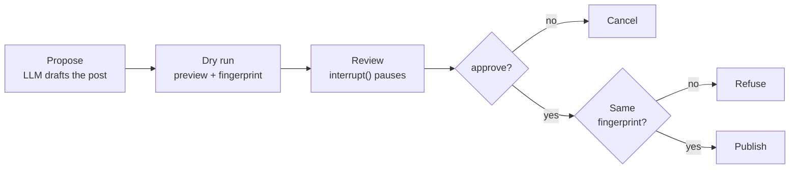

<!-- Generated by site/scripts/rag-theory-import.mjs from rag-agents-engineering. Edit the source there. -->
# Overview

An agent that only reads can give a wrong answer. An agent that acts can publish, delete or charge something, and that cannot be taken back. M27 puts a gate in front of those actions, then builds complete single-agent applications, including one that retrieves from a SQL database instead of a vector index. The M27 notebooks build on four ideas: the dry run, the approval gate, text-to-SQL, and workflow apps that check every model output in code.

The running example is the Larkspur Cloud handbook from [M11](/learn/llm-and-retrieval/rag-from-first-principles/rag-from-first-principles-overview) to [M13](/learn/ingestion-and-indexing-pipeline/chunking-and-indexing/chunking-and-indexing-overview), seen from the operations side. An agent drafts posts for the Larkspur status feed after the eu-west outage, and a person approves each one before it goes out. The text-to-SQL lesson keeps the notebooks' comic-store database, because its numbers come from that data; the interview questions move the same ideas to Larkspur's billing data.

## In short

- A **dry run** calls the action's own code path with `dry_run=True` and returns a preview of the effect, so the reviewer judges what will happen instead of a description of it.
- An **approval gate** pauses the graph with `interrupt()`, keeps the run in a checkpointer, and resumes it with `Command(resume=decision)`. It fails closed: only the exact answer `approve` (after stripping and lowercasing) approves.
- The approval covers a **fingerprint**, the first 12 hex digits of SHA-256 over the previewed post. In the lab, editing "72 hours" to "48 hours" after review changes the fingerprint from `c4e9e330698e` to `11673ae3c1d4`, and the publish node refuses.
- **Text-to-SQL** retrieves by computing over every row, which vectors cannot do for counts, sums and rankings. In the notebooks' database, 16 of the 20 sales disagree with their own line items, so the top salesperson is John Doe by one definition of revenue and Alice Brown by the other. A business rule in the prompt has to decide.
- A **workflow app** keeps the LLM to fixed steps with structured output, and does the routing, checking and final rendering in code. The workflow form of text-to-SQL costs 2 LLM calls per question; the ReAct agent costs several.

## Mental model

The graph stops at Review and waits, for seconds or for hours, while the checkpointer holds its state. Two checks guard the live call. The first is the reviewer's answer, and anything unclear counts as no. The second is a hash comparison at publish time, which catches any change between what the reviewer saw and what is about to run.

## Interactive lab

[**The approval gate**](/labs/rag/m27_human_approval_applied_agents/approval-gate-lab.html): open the file in a browser. Keep the eu-west post and try the answers `␣Approve␣`, `approved` and `sure, why not`: the first publishes, the other two fail closed. Then set the answer back to `approve` and pick *Small edit*: the reviewer said yes, the audit log records an approve, and the post still does not publish. Last, approve the uptime post. It reaches the feed, because the gate enforces whatever the reviewer decides.

## How it connects

- **Before:** [M10](/learn/langchain-and-langgraph-fundamentals/langgraph-runtime-persistence-hitl-and-streaming/langgraph-runtime-persistence-hitl-and-streaming-overview) teaches `interrupt()` and checkpointers, and [M24](/learn/agentic-systems/react-agents-and-langchain-create-agent/react-agents-and-langchain-create-agent-overview) uses `HumanInTheLoopMiddleware`, which is built on the same mechanism. [M25](/learn/agentic-systems/agentic-workflow-patterns/agentic-workflow-patterns-overview)'s chaining, routing and parallel patterns are the parts the workflow apps assemble. [M20](/learn/complete-rag-applications/end-to-end-rag-systems/end-to-end-rag-systems-overview) builds RAG over CSV and JSON rows, the vector side of this module's SQL-or-vectors lab. [M11](/learn/llm-and-retrieval/rag-from-first-principles/rag-from-first-principles-overview) shows why top-k retrieval cannot aggregate.
- **Next:** [M28](/learn/agentic-and-self-correcting-rag/agentic-rag-foundations-grading-and-query-rewriting/agentic-rag-foundations-grading-and-query-rewriting-overview) to [M30](/learn/agentic-and-self-correcting-rag/adaptive-rag-and-query-routing/adaptive-rag-and-query-routing-overview) grade, correct and route retrieval; sending a question to SQL or to the vector index is [M30](/learn/agentic-and-self-correcting-rag/adaptive-rag-and-query-routing/adaptive-rag-and-query-routing-overview)'s routing problem. [M31](/learn/agentic-and-self-correcting-rag/rag-as-an-agent-tool/rag-as-an-agent-tool-overview) exposes retrieval as an agent tool behind the same approval gates.

## Key Takeaways

- Split every consequential action into a dry run and a live call that share one code path, and keep the dry run in its own node before the pause.
- Fail closed. Only an explicit approve approves, and the approval covers the fingerprint of what was previewed, recomputed at execute time.
- Use SQL to retrieve when the answer is a count, sum or ranking over rows, enforce read-only access in the connection, and write ambiguous business terms down as rules.
- Let the LLM fill typed fields and keep routing, checks and the final document in code, where a test can run on every output.
