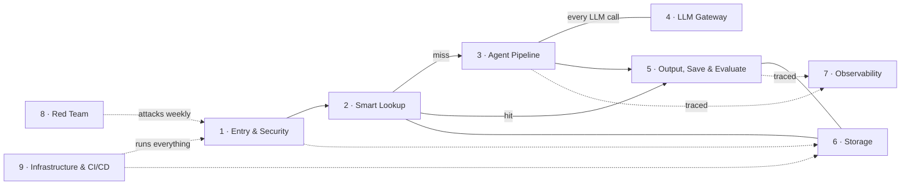
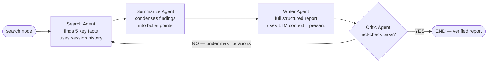

# Anatomy of a Deployed Multi-Agent Platform

*A layered platform around a few agents makes them safe, cheap, and observable, but each layer is one more thing to build and to know the limits of.*

◷ 10 min

In a deployed multi-agent system the agents are one layer of nine, and most of the engineering sits around them. Read the platform one layer at a time, asking what each does and why, as [Failure Isolation and Evaluation](/learn/agentic-systems/multi-agent-systems/failure-isolation-and-evaluation) did per agent.

**Objectives:**

- trace one request through the nine layers of a deployed research platform;
- explain the three similarity thresholds in front of the agent pipeline;
- argue whether the platform's agent pipeline is multi-agent, and name what the platform lacks.

---

## Trace One Request Through Nine Layers

The product is simple to state. Give it a topic, and it researches, writes a full report, checks it for safety, caches it, and remembers it. It runs on AWS with FastAPI, LangGraph, a TensorZero gateway, Bedrock guardrails, Redis, Postgres with pgvector, LangSmith, PyRIT, Terraform, and GitHub Actions.

| Layer | What it does |
|---|---|
| 1. Entry and security | Lets the request in, or rejects it |
| 2. Smart lookup | Checks whether the work is already done |
| 3. Agent pipeline | Researches and writes the report |
| 4. Model gateway | Carries every model call to a provider |
| 5. Output, save, and evaluate | Checks, stores, and scores the result |
| 6. Storage | Holds the shared state every layer reads and writes |
| 7. Observability | Watches all of it |
| 8. Red team | Attacks the same path every week |
| 9. Infrastructure and delivery | Runs everything and ships new versions |

Arrows are the request path, plain lines are two-way reads and writes, a cache hit skips the agent pipeline entirely, and dotted arrows are tracing, weekly attacks, and the infrastructure underneath.

## Check the Caller Before Any Model Sees the Text

Every request passes three checks, in order, before it becomes a job. Is the caller who they claim to be? API key middleware rejects a wrong or missing key with a 401 at once. Is the caller calling too often? A Redis counter per client IP allows 10 requests per 60 seconds, which stops retry storms and abuse with one increment. Is the content safe? Bedrock Guardrails screen for hate, PII, weapons, and prompt injection before any model sees the text.

Only then does the request become a job on a Redis Stream queue. The queue separates "accepted" from "processed". The guardrail runs on raw user input, not on an agent's reading of it, by deliberate choice. An LLM-backed API is expensive to run and easy to abuse, so this layer is the front-door lock, not an afterthought.

## Look Up Past Work Before Spending on Agents

Before paying for four agents, the platform runs three progressively looser checks.

| Check | Store | Similarity threshold | On a hit |
|---|---|---|---|
| Semantic cache | Redis, cosine similarity | 0.85 or above | Return the cached answer with no model call |
| Exact match in long-term memory | Postgres with pgvector | 0.88 or above | Return the stored report, catching what the short-lived cache evicted |
| Related long-term memory | pgvector | 0.50 to 0.88 | Not close enough to reuse, but passed to the Writer agent as context so the new report builds on prior research |

Only a total miss enters the pipeline with no prior context. The cache sits in front of the expensive work, with each threshold decision made explicit.

## Read the Agent Pipeline Precisely

The pipeline is a LangGraph state machine of four agents. The Search agent takes the topic and the last four turns of session history, and finds five key facts. The Summarize agent condenses the raw findings into structured bullets. The Writer agent drafts the report, with an executive summary, findings, analysis, and conclusion, adding any related prior report from smart lookup. The Critic agent rereads the report for factual consistency and coherence, and answers yes or no with a reason.

The only branch is the Critic: a failed check loops back to Search while the iteration budget lasts.

A "no" while under `agent_max_iterations` routes back to Search. A "yes", or an exhausted budget, ends the graph.

Why split the work at all? A single "write a good research report" prompt produces shallow, unverified output. Narrow agents produce better output. They also give the system a natural place for a quality gate, the Critic, and for a bounded retry loop.

Is this multi-agent? The sources disagree. By the FDE Handbook's definition, it is a pipeline with a loop and a gate. Its agents share one context and one tool set, so it sits closer to a single agent with several steps. What earns the split is the Critic's independent judgement and the bounded retry. The coordination-patterns guide, by contrast, treats a generator and a separate evaluator as their own multi-agent pattern, evaluator-optimizer. Both readings are defensible. In an interview, name the definition in use and describe the shape exactly.

## Put One Gateway in Front of Every Model Call

Every agent, and the evaluator, calls one shared sidecar, TensorZero, instead of a provider's SDK. Agents send a request naming a *function*, such as `research_summarize` or `report_write`, not a model. The gateway maps each function to a provider and model. The primary is OpenAI GPT-4o. The fallback is Groq's `llama-3.1-8b-instant`, which is faster and cheaper, at some cost in quality. It keeps the system available during an OpenAI outage. Agents add their own retry wrapper on top.

Hard-coding a provider into every agent turns each outage, rate limit, or price change into a code change in five places. Centralising means agents know only "call the gateway".

## Check the Output, Then Save and Score It

Once a report exists, fresh or from the cache, three things happen. Bedrock Guardrails run again, this time on the generated content, because a model can produce harmful output from a harmless prompt. The report is saved to Redis, as a cache entry and session history, and to Postgres, as a new long-term memory vector. An LLM-as-judge scores it for relevance, completeness, hallucination, and quality. The scoring runs in parallel with the save, does not block the user, and feeds observability.

## Store by Access Pattern

Two managed stores serve different access patterns. Redis ElastiCache holds anything fast and short-lived: rate-limit counters, the semantic cache, session memory, and the job queue. Losing these on restart is acceptable. RDS PostgreSQL 15 with pgvector holds anything durable and searchable by similarity. Every finished report is stored there as text plus a 384-dimension embedding. Every other layer talks to these two stores, not to each other. That shared state lets a stateless FastAPI app scale out and still remember.

## Trace Every Agent, With Scores Attached

Every agent method carries a `@traceable` decorator, so LangSmith records inputs, outputs, and timing as spans in one trace per request. The evaluator's four scores attach to the same trace, so quality data and execution data live together. "Why did this report take three iterations?" and "which agent produced the bad fact?" become trace queries, not log searches. Embeddings come from an in-process SentenceTransformer model, `all-MiniLM-L6-v2`. So cache checks, memory lookups, and saves add no gateway latency or cost.

## Attack the Real Path, Then Ship Through Code

A dedicated adversarial service, PyRIT, attacks the platform's own `/query` endpoint the way a malicious user would. It runs jailbreaks, cross-prompt injection (XPIA), Crescendo's gradual escalation, and Skeleton Key. It runs on demand from its own dashboard and automatically every Monday at 02:00 UTC through EventBridge. It hits the same endpoint through the same authentication, rate limit, and guardrails as a real user. A passing run is therefore genuine evidence that the production defences hold. A separate test endpoint would only test a copy.

Terraform provisions everything as versioned, reviewable text: the VPC, subnets, ECS, ALB, RDS, ElastiCache, the image registry, Bedrock access, Secrets Manager, IAM, EventBridge, and the state lock. GitHub Actions builds three Docker images on every push: the app, PyRIT, and TensorZero. It deploys them to ECS Fargate and rolls back automatically if health checks fail. Secrets Manager holds every key, loaded at container start and never baked into an image. CloudWatch keeps container logs for seven days.

> **Warning: know what the system does not have.** This platform has one API key and no tenant model, so every user sees every cached report. That is fine for a research tool and wrong for an enterprise one. Its judge scores are observability, not a release gate.

## Worked Example: Two Topics, Two Paths

A user asks for a report on a topic the platform researched last week under different wording. Entry checks pass. The semantic cache misses, because the similarity is below 0.85. Exact long-term memory misses too, below 0.88. The related-memory check finds last week's report in the 0.50 to 0.88 band, so it travels to the Writer as context. Search, Summarize, and Writer run, each through the gateway. The Critic says no once, citing an inconsistent figure, and the loop runs again within `agent_max_iterations`. The second draft passes. The output guardrail clears it, it is saved to both stores, and the judge scores it in the background.

A second user then asks almost the same question. The semantic cache hits at 0.85 or above and returns the stored report with no model call at all.

The two paths show the platform's priorities. Smart lookup spends nothing when the work is done. The agent pipeline spends carefully when it is not, under a bounded loop, behind guardrails on both sides.

---

## Key Takeaways

- A deployed multi-agent platform is nine layers, and the agents are only one of them.
- Entry checks identity, rate, and content safety on raw input before any model sees it.
- Three similarity thresholds let the platform reuse, build on, or skip past prior work before paying for agents.
- The four-agent pipeline is a loop with a Critic gate; whether that counts as multi-agent depends on the definition.
- One gateway maps functions to models with a cheaper fallback, so outages are not code changes.
- Output guardrails, saving, and asynchronous judge scoring follow every report.
- Fast, disposable state goes to Redis and durable, searchable state to Postgres with pgvector.
- Every agent is traced, with quality scores attached to the same trace.
- The red team attacks the real path weekly, and infrastructure ships through code with automatic rollback.
- The platform lacks per-user access control and a release gate, which matters for enterprise use.

## Check Yourself

1. **Why is the input guardrail run on raw user input rather than on an agent's reading of it?**
   It must screen the text before any model sees it. An agent's interpretation could already be shaped by an injected instruction, so the check belongs at the front door.

2. **What happens to a match in the 0.50 to 0.88 band?**
   It is not close enough to reuse, so the pipeline still runs. But the related prior report is passed to the Writer agent as context, so the new report builds on earlier research.

3. **Why does PyRIT attack through the same endpoint as a real user?**
   So a passing run proves the real authentication, rate-limit, and guardrail path holds. A separate test endpoint would only prove that a copy is safe.

