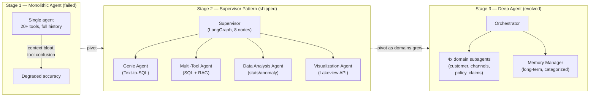

# From Supervisor to Deep Agent

*Splitting a supervisor into self-contained sub-agents puts a ceiling on tool confusion, but it buys that ceiling with more endpoints and more moving parts.*

◷ 9 min

This case study is the judgement from [When Multi-Agent Is Justified](/learn/agentic-systems/multi-agent-systems/when-multi-agent-is-justified) exercised twice in production. Read it as an architecture that evolved, and note that each pivot had a different, named cause.

**Objectives:**

- trace the three stages of the insurer's data assistant and the cause of each pivot;
- explain why asset resolution was centralised at the supervisor;
- compare the supervisor and deep-agent shapes, and say what each costs.

---

## Start From the Business Problem

The customer was a large Asian life insurer. Actuaries, claims managers, and regional analysts needed answers over governed enterprise data. Every question, however routine, went through a queue of business-intelligence analysts. An ad hoc question took days. A new dashboard took weeks.

The team built a governed data assistant in about two months, on a short build engagement. It went through three stages. The first failed in testing. The second shipped. The third evolved as the analytics domains grew.

| Stage | Shape | What happened |
|---|---|---|
| 1. Monolithic agent | One agent, 20+ tools, full history | Failed on context bloat and tool confusion |
| 2. Supervisor | A supervisor graph of eight nodes and four specialists | Shipped |
| 3. Deep agent | An orchestrator, four domain sub-agents, and a memory manager | Evolved as domains grew |



Read the chart left to right: the monolith failed, the supervisor shipped, and the deep agent grew out of it as domains multiplied.

Why three stages and not one design up front? The first design failed in real testing, not on paper. The second pivot happened for a different reason than the first. That is iterative engineering judgement, not a plan that worked first time.

## Split Deciding From Doing

The single agent carried the full system prompt, 20+ tool schemas, and the entire conversation history. Every tool's schema sat in context on every turn, which degraded reasoning about the actual question. With that many tools competing, it also chose the wrong one often enough to make accuracy unusable.

A bigger model would still read the same crowded context. So the fix was architectural, not a better model or prompt: separate deciding what to do from doing it.

## Choose the Framework for the Properties You Need

The team evaluated LangGraph against CrewAI and AutoGen and chose LangGraph for three concrete reasons.

| Requirement | Why LangGraph fitted |
|---|---|
| Routing on confidence | Explicit conditional edges: intent classification routes to clarification only when confidence is below 60%. Frameworks built on role-based delegation did not expose deterministic branching as cleanly |
| Durable, resumable state | Multi-turn conversations were backed by checkpoints in Delta tables. Governance required every conversation state to be auditable, and the checkpointer mapped directly onto a Delta table |
| Deterministic composition | A governed insurance environment cannot let open-ended agent-to-agent chat decide its own flow. The graph is fixed at build time, with eight nameable nodes |

The point is not the framework's name. Each choice traces back to a property the environment required.

## Walk the Eight-Node Supervisor

The supervisor graph ran in a fixed order.

```
classify_intent -> clarify_or_disambiguate -> resolve_assets_with_context_index
    -> route_to_{genie | multi_tool | analysis | visualization} -> compose_answer
```

`classify_intent` sorts the question into simple KPI, deep analysis, document lookup, visualisation, or conversational, with a confidence score. `clarify_or_disambiguate` fires only below the 60% threshold. "Show me the numbers" gets a clarifying question, not a guess. `resolve_assets_with_context_index` lets the supervisor, and only the supervisor, search a Context Index of 16 assets: Genie Spaces, metric views, tables, and document indexes. Endorsed assets rank first. A `route_to_*` node delegates to one of four specialists with the resolved asset list in shared graph state. `compose_answer` turns the specialist's structured output into a cited answer.

## Resolve Data Assets Once, at the Supervisor

Why should only the supervisor search for assets? Suppose the Genie agent and the Multi-Tool agent each ran their own retrieval. They could resolve the same question to different tables. In insurance, two answers to one question are worse than one slow answer.

Centralising costs one extra hop of latency. It buys a single, auditable source of truth for the data behind any answer. This is the handoff rule from [Handoffs and Permission Scope](/learn/agentic-systems/multi-agent-systems/handoffs-and-permission-scope): the specialist receives a resolved, trusted package, not a licence to go and find things.

## Scope Each Specialist by Governance, Not Only by Topic

Each of the four specialists embodies a trade-off.

| Agent | Role and tools | The trade-off it embodies |
|---|---|---|
| Genie | Business-intelligence specialist on the managed Genie Space text-to-SQL service | Less flexible than a hand-built text-to-SQL chain, but far smaller prompt- and SQL-injection surface, and non-engineers can curate the tables |
| Multi-Tool | Generalist with model-generated SQL and retrieval over policy documents | The one place generated SQL was allowed, for ad hoc questions outside Genie's curated scope, under deliberately narrower governance |
| Data Analysis | Statistics: z-score anomaly detection and trend statistics | Kept deterministic: thresholds are computed, not reasoned about, so the model cannot invent a plausible but wrong number |
| Visualisation | Creates dashboards through the Lakeview REST API | Publishes real, clickable dashboards rather than a static image, closing the loop on the weeks-long dashboard wait |

The Genie and Multi-Tool split is a familiar decision made per specialist: fixed operations by default over open natural-language queries. The safe path is the default. The open path exists, scoped and governed, for what the safe path cannot cover.

## Build Governance Underneath

Governance shaped the build as much as the agents did. A handful of governed metric views replaced raw fact tables. If the agent and a human analyst computed "claims by region" differently, trust in the whole system would collapse. A metric view makes the KPI definition one versioned artefact that every consumer shares.

Short-term memory lived in a Delta table keyed by `thread_id`, checkpointed at key nodes with short retention. In-memory state was ruled out because conversations had to survive a serving-endpoint restart and be auditable afterwards. Prompts lived as base and overlay prompts in a Delta table with a five-minute cache. Behaviour could be tuned in production without a redeploy, at the cost of a short delay before a change took effect.

Every node carried MLflow tracing with proper span types, so a wrong answer traced to the exact node and tool call. An AI gateway in front of the serving endpoint added rate limits, PII filtering, and guardrails. It was required before the assistant could be offered as an internal chat app at all.

## Own the Code When the Managed Option Is Unavailable

The platform's managed multi-agent feature was not available to this customer at the time. So the team hand-built the supervisor in LangGraph, using only standard platform pieces. The trade-off was more code to own and maintain. In exchange, the production path did not depend on a release timeline nobody on the engagement controlled. That is a forward-deployed engineering decision, and worth recognising as one.

## Specialise Again When the Trigger Recurs

As analytics domains grew, the supervisor's own tool list began to approach the original bloat. It was the Stage 1 failure, one level up. The fix was the same principle again: specialise further.

The design evolved into a deep agent. An orchestrator delegates to fully self-contained sub-agents, each with its own prompt, small toolset, and context window. Four domain sub-agents covered customer analytics, distribution channels, policy and underwriting, and claims. Each had its own Genie Space and its own gold and silver tables. A memory-manager sub-agent owned long-term memory across conversations, in a Delta table with five categories: preference, fact, decision, project, and feedback. The orchestrator had to check and update it every turn.

| Question | Supervisor | Deep agent: orchestrator and sub-agents |
|---|---|---|
| Who holds the tools? | The supervisor holds routing; specialists hold their own | Each sub-agent is self-contained, with its own prompt, tools, and context |
| Where does context live? | Shared graph state, resolved centrally | Per sub-agent; the orchestrator holds only what it needs to delegate |
| When does it fit? | A bounded set of specialists, where consistent shared lookups matter | The supervisor's own tool list has started to bloat and domains keep growing |
| What does it cost? | One extra hop for central resolution | More infrastructure: more endpoints, more moving parts |

Neither shape is better in general. The deep agent is what to evolve to when the supervisor meets the tool-bloat trigger one level up. Here it cost more Genie Spaces, more serving endpoints, and more moving parts. In exchange, it set a ceiling on tool-selection degradation that does not return as the system grows. For a system meant to scale across business units and markets, that ceiling mattered more than simplicity.

> **Warning: say what the numbers do and do not prove.** Adoption grew after rollout, but that is a correlational signal, not a controlled experiment. Claiming the assistant caused the growth overstates the evidence.

## Worked Example: Reporting the Results Honestly

The team's results were these. Time to insight fell from days to minutes. Dashboard delivery went from about four weeks to governed self-service. The MVP took about two months. Adoption grew after rollout, and the write-up calls that correlational.

The team also named what it would change if rebuilding today. It would instrument resolution-time and accuracy metrics from day one, rather than relying on tracing alone for debugging after the fact. It would also build the offline evaluation dataset earlier. Both were flagged as second-phase priorities at the time, and both are things to pull forward.

That is the shape of an honest result: measured gains, a clearly labelled weak signal, and the gaps stated before anyone asks. Every multi-agent principle in these lessons shows up somewhere in the case. One agent was the default, and a named trigger forced the split. The same trigger recurred one level up. The handoff was a resolved package. Specialists were scoped by governance. Durable state was a governance property.

---

## Key Takeaways

- The insurer's assistant moved through a monolith, a supervisor, and a deep agent, and each pivot had a different named cause.
- The monolith failed on context bloat and tool confusion, so the fix separated deciding from doing.
- LangGraph was chosen for confidence routing, durable auditable state, and deterministic composition.
- The eight-node supervisor clarifies below 60% confidence and routes with a resolved asset list.
- Only the supervisor resolves data assets, trading one hop for a single auditable source of truth.
- Each specialist embodies a governance trade-off: managed, open but narrower, deterministic, or publishing.
- Metric views, durable checkpoints, versioned prompts, tracing, and a gateway made the system governable.
- Hand-building the supervisor traded more code for independence from an uncontrolled timeline.
- When the supervisor's tool list bloated, specialising into sub-agents capped degradation at the cost of more infrastructure.
- Honest results separate measured gains from correlational signals and name what to pull forward.

## Check Yourself

1. **Why was the Stage 1 fix architectural rather than a better model?**
   The failures were context bloat and tool confusion from 20+ tool schemas and full history in every turn. A bigger model still reads the same crowded context, so the fix split deciding from doing.

2. **Why centralise asset resolution at the supervisor, and what does it cost?**
   Independent retrieval per specialist could resolve one question to different tables. Centralising costs one extra hop of latency and buys a single, auditable source of truth.

3. **What triggered the second pivot, and what did the deep-agent shape cost?**
   The supervisor's own tool list grew back toward the original bloat as domains grew. The deep agent cost more Genie Spaces, serving endpoints, and moving parts, in exchange for a ceiling on tool-selection degradation.

