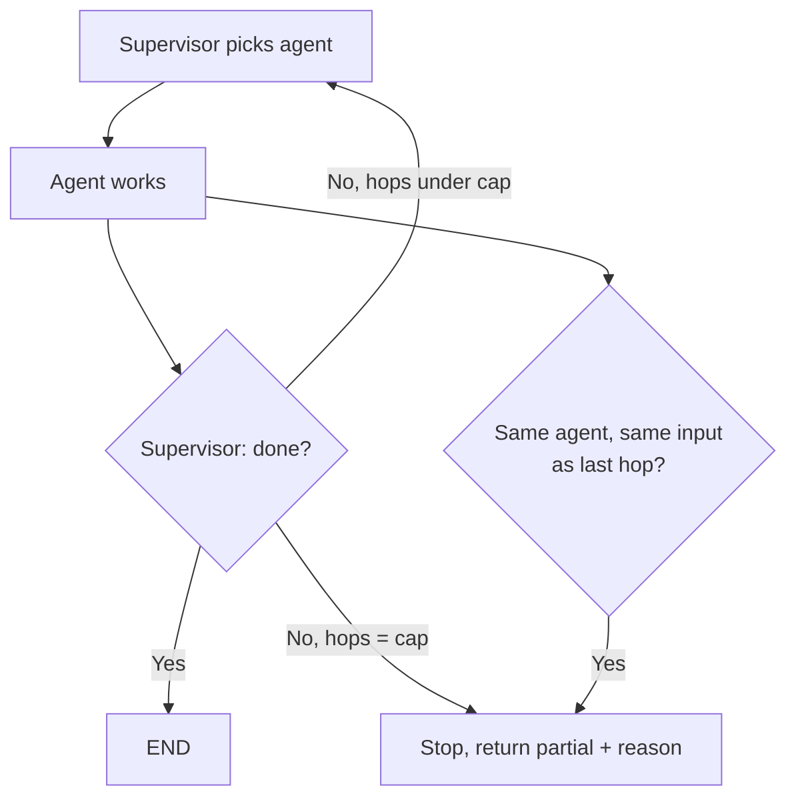

# Shared State, Routing, and Termination

*Shared state makes agents easy to connect, but every key two agents write and every routing choice they make is a new way to lose work or loop forever.*

◷ 8 min

Agents in a graph do not call each other; they read and write one shared state, and the graph decides who runs next. Make the merge rules, the routing choice, and the stop condition explicit values in that state, using the patterns from [Multi-Agent Coordination Patterns](/learn/agentic-systems/multi-agent-systems/multi-agent-coordination-patterns).

**Objectives:**

- explain why shared state is the communication channel, and why written keys need reducers;
- build a supervisor router that cannot pick an agent that does not exist;
- stop a multi-agent run with three combined defences.

---

## Communicate Through Shared State, Not Direct Calls

In a graph-based system, one agent never calls another. Each agent reads the shared state and returns updates. The graph merges those updates and decides who runs next. That is the entire messaging model.

Direct calls between agents would cost something important. The graph checkpoints state between nodes, so it can pause and resume a run. A call that bypasses the graph bypasses the checkpoint too. Keep communication in state, so every exchange is recorded and resumable.

The interview tutorial's supervisor state shows the shape.

```python
class SupervisorState(TypedDict):
    messages: Annotated[list[BaseMessage], add_messages]  # every agent appends
    next_agent: str          # who the supervisor picked
    task_complete: bool      # the termination flag
    final_response: str      # what the user gets
```

Each field earns its place. `messages` has a reducer because every agent writes it. `next_agent` is the routing decision as a plain value, so it can be logged and asserted on in a test. `task_complete` is the stop signal; without something like it, the supervisor loops forever.

## Give Every Shared Key a Reducer

A reducer is the rule that merges two writes to the same key. Without one, the last write wins. That default is fine for a key only one agent writes. It silently loses data for a key several agents write.

Two failures follow from forgetting this. In a parallel fan-out to four agents, all four write `findings`, and one result comes back. In a sequential run, several agents overwrite a scalar such as `summary`, so the final answer reflects only the last agent. The fix for both is the same. Accumulate into a list with `Annotated[list, operator.add]`, then synthesise at the end.

```python
class ParallelState(TypedDict):
    findings: Annotated[list[str], operator.add]    # each agent appends its own

builder.add_edge("dispatch", "agent_a")
builder.add_edge("dispatch", "agent_b")   # two edges out of one node = fan-out
builder.add_edge("agent_a", "merge")
builder.add_edge("agent_b", "merge")      # two edges into one node = join; it waits for both
```

A reducer cannot rescue a write it was never told to merge. So make it a rule: any key more than one node writes gets a reducer.

## Constrain the Router With a Schema

A supervisor is one node that reads state and picks the next agent. Build it with structured output, so the choice is limited to real agent names.

```python
class DepartmentRoute(BaseModel):
    department: Literal["research", "content", "analysis"] = Field(
        description="Which department should handle this request"
    )
    reasoning: str = Field(description="Why this department was chosen")

router_llm = llm.with_structured_output(DepartmentRoute)
```

The `Literal` means the model cannot route to an agent that does not exist. The `reasoning` field gives a logged justification for every hop. That reasoning is what makes a bad routing decision debuggable later, and it doubles as labelled data for evaluating the router.

A free-text routing decision fails at run time, with a `KeyError` on the routing map. So does a `Literal` that has drifted out of step with the graph's node names. Derive both the `Literal` and the routing map from one list of agent names. Then adding a sixth agent cannot break routing.

## Stop on Purpose, in Both Directions

One agent stops when it stops calling tools. Several agents can disagree about whether the work is done, and each hop costs money. Termination fails both ways. Stopping early abandons work that could be solved. Never stopping burns budget on work that cannot be.

The failure called out most often is a rejection loop. The supervisor rejects a worker's output, the worker retries the same way, and the supervisor rejects again. A related failure is an agent that never signals done, so its peers keep waiting.



The chart has two exits besides "done": the hop cap and the repeated-delegation check both stop the run and return partial results with a reason.

Combine three defences, all kept in state and all read by the routing function.

```python
MAX_HOPS = 8

class SupervisorState(TypedDict):
    messages: Annotated[list[BaseMessage], add_messages]
    next_agent: str
    task_complete: bool                        # 1. explicit done flag
    hops: Annotated[int, operator.add]         # 2. hard cap
    last_delegation: str                       # 3. no-progress detector

def route(state) -> Literal["agent", "give_up", "end"]:
    if state["task_complete"]:
        return "end"
    if state["hops"] >= MAX_HOPS:
        return "give_up"                       # partial results, with a reason
    signature = f"{state['next_agent']}::{state['messages'][-1].content[:200]}"
    if signature == state.get("last_delegation"):
        return "give_up"
    return "agent"
```

The done flag ends a run that has finished. The hop cap bounds a run that has not. The no-progress check is the one people leave out. A hop cap alone still lets a supervisor and worker spend the whole budget repeating an identical request. It only limits how much they spend. Comparing each delegation with the previous one catches the loop on hop two instead of hop eight.

Every ceiling should return partial results with a reason, not raise an error. Specific feedback helps too: a rejection the worker can act on is how the loop converges at all.

> **Warning: a hop cap is a bound, not a fix.** It stops the spending from growing without limit, but a rejection loop still runs to the cap. Pair it with the no-progress check and with feedback specific enough for the worker to change its approach.

## Worked Example: A Research Run That Reported One Finding

A research system fans out to four worker agents, one per sub-question, and then merges. In testing, every run reports the findings of only one worker. All four ran; the trace shows four calls.

The cause is the state schema. All four workers write `findings`, a plain `str` with last-write-wins semantics. Whichever worker finished last overwrote the other three. The fix is `findings: Annotated[list[str], operator.add]`, plus a synthesiser node after the join that merges the list.

The same run later burns budget on one hard sub-question. The supervisor keeps rejecting the worker's answer, and the worker keeps resubmitting it. A hop counter capped at eight stops it eventually. The no-progress signature stops it on the second identical delegation and returns the other findings with a gap noted.

Both bugs share one root: behaviour the system relied on was implicit. Making the merge rule, the route, and the stop condition explicit values in state turns each into something a test can check.

---

## Key Takeaways

- Agents communicate through shared state, so every exchange stays inside the graph's checkpoints.
- Any key more than one agent writes needs a reducer, or parallel results and conclusions are silently lost.
- A `Literal` over real agent names keeps routing safe, and a `reasoning` field makes each route debuggable.
- Termination needs a done flag, a hop cap, and a no-progress check together, and every ceiling returns partial results with a reason.
- The research example shows that both lost results and runaway loops come from leaving behaviour implicit.

## Check Yourself

1. **Four agents ran in parallel and one result came back. What did you forget?**
   A reducer on the shared key. With last-write-wins semantics, the last writer overwrote the others. Use `Annotated[list, operator.add]` and synthesise at the end.

2. **How do you keep supervisor routing safe when you add a sixth agent?**
   Use structured output with a `Literal` over agent names, and derive both the `Literal` and the routing map from one list. The model then cannot route to an agent that does not exist.

3. **Why is a hop cap not enough on its own?**
   A supervisor and worker can repeat an identical rejected request until the cap, spending the whole budget. A no-progress check on repeated identical delegations catches that on the second hop.

## References

**Sources:** `07_multi_agent_systems_INTERVIEW_TUTORIAL.md`: §1.1 "Shared state is the communication channel", §1.2 "The supervisor is a router with a schema", §1.4 "Parallel agents need reducers and a merge policy", §1.6 "Termination is harder with several agents", the §2 gotchas on missing reducers, rejection loops, non-existent agents and overwritten conclusions, and §4 questions 2, 3 and 6.
