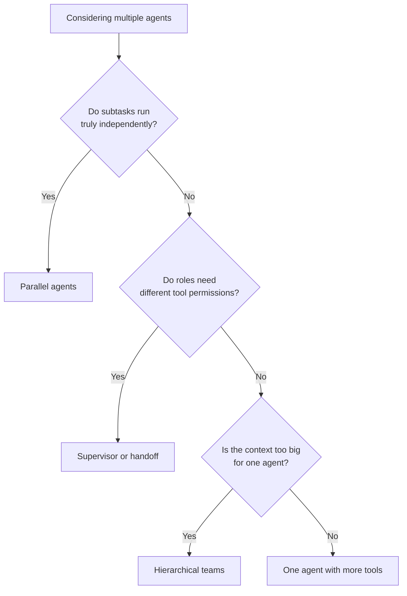

# When Multi-Agent Is Justified

*Splitting work across specialist agents can fix context and tool overload, but every split adds coordination that has to be designed, tested, and paid for.*

◷ 7 min

Multi-agent is an escalation, not a mark of a complete design. Start with one agent and a tight tool set, and split only when a named trigger has fired; [Multi-Agent Coordination Patterns](/learn/agentic-systems/multi-agent-systems/multi-agent-coordination-patterns) covers what to build once it has.

**Objectives:**

- tell a single agent with several steps apart from a true multi-agent system;
- name the triggers that justify a split, and say where the sources disagree on them;
- route simple requests past the planner, and know when to collapse agents back into one.

---

## Separate Steps From Agents

A pipeline with several steps is not a multi-agent system. Rewrite the question, retrieve, check quality, generate: that is one agent taking four steps. An eight-node graph of that shape is still one agent, and it is honest to describe it that way.

Multi-agent means several independently scoped agents. Each has its own responsibility, its own tools, and its own failure mode. Something above them coordinates, and they pass a defined package of information rather than a raw transcript.

| Question | Single agent, several steps | True multi-agent |
|---|---|---|
| Who decides what happens next? | One fixed sequence | A coordinator, or the agents themselves through handoff |
| Which tools can each part use? | One shared set | Each agent only what its job needs |
| What happens when one part fails? | One bad step can fail the whole run | One agent's failure should degrade the others, not crash them |
| What is passed forward? | Everything accumulates | A defined handoff with what the next agent needs |

Read the right-hand column as a list of obligations. Each row now has to be designed, tested, and operated. That cost is why the left-hand column is the default.

## Start With One Agent and Tight Tools

One agent with a small tool set is simpler to debug and cheaper to run. It has one context to reason about. The interview tutorial puts it bluntly: most multi-agent systems should have been one agent with more tools.

Multi-agent also brings failures a single agent cannot have. Coordination adds overhead and message-passing latency. Agents can wait on a peer that never signals it is done. Three agents can cost three times as much and produce nothing better than one. So lead with the simple design out loud. Choosing it explicitly scores better than building the complicated one by fashion.

## Name the Trigger Before You Split

The FDE Handbook names two triggers.

1. **Contexts genuinely conflict.** One model cannot hold "be a careful finance closer" and "be a chatty support drafter" at once. The system prompt for one job degrades the other.
2. **The tool count becomes unmanageable.** Every tool's schema and description sits in context on every turn. Past some number of tools, the model starts picking the wrong one.

The interview tutorial frames it differently. It accepts three reasons: real parallelism over independent subtasks, distinct tool permissions per role, and context too large for one agent to hold. The two lists overlap on context size. The Handbook's "tool count" is close to the tutorial's "context too big", since tool schemas are what fill the context. The tutorial adds parallelism and permissions, which the Handbook does not list as triggers. The Handbook's "conflicting contexts" has no direct match in the tutorial.

Treat the union as the working list, and keep one rule from both. A split is justified only when its benefit can be named. "It sounds more sophisticated" is not on either list.

The tutorial's decision order is a useful check. Ask first whether the subtasks run truly independently; if so, run parallel agents. If not, ask whether roles need different tool permissions; if so, use a supervisor or handoff. If not, ask whether the context is too big for one agent; if so, consider hierarchical teams. If none apply, use one agent with more tools.

Read the chart top to bottom: each "no" moves one step closer to the bottom-right box, one agent with more tools.

## Keep the Planner for Cross-System Work

The same judgement applies per request. "Track my order" is a single tool call and needs no orchestration. "My laptop arrived damaged. Refund the order, cancel the warranty, notify shipping, and create a high-priority ticket" needs planning across several systems. That is when a planner agent earns its cost.

So even inside a multi-agent system, route simple requests straight to a tool or a single agent. Reserve the planner for cross-system tasks. A supervisor should spawn only the specialists a query needs, and a cache hit should spawn none.

## Collapse Agents That Do Not Earn Their Split

Splitting is not one-way. The tutorial's test for collapsing is simple. Three agents that share tools, share context, and never run concurrently are three prompts, not three agents. Merge them.

The same test helps on cost. An agent whose only job is passing messages along adds a call and buys nothing. Collapsing pass-through agents is usually the biggest single saving in an expensive multi-agent design.

> **Warning: do not split before the single agent has failed.** Interviewers notice when a candidate reaches for specialists before showing one agent fail. The justification is a measured failure on a named trigger, not a diagram that looks complete.

## Worked Example: A Monolith That Failed in Testing

A governed data assistant for a large Asian life insurer started with the default: one agent. It carried the full system prompt, **20+ tool schemas**, and the entire conversation history. It broke in real testing, not on paper, on both Handbook triggers.

The first failure was context bloat. Every tool's schema and description sat in context on every turn, which degraded the model's reasoning about the actual question. The second was tool confusion. With that many tools competing, the agent picked the wrong one often enough that accuracy was unusable for a production engagement.

The fix was not a bigger model or a better prompt. It was architectural: separate *deciding what to do* from *doing it*. Later, when the supervisor's own tool list grew back toward the same problem, the team applied the same principle one level up. [From Supervisor to Deep Agent](/learn/agentic-systems/multi-agent-systems/from-supervisor-to-deep-agent) tells the full story.

The sequence is the answer to "why multi-agent?". The default was tried first. It failed measurably on a named trigger. The escalation was justified by that failure.

---

## Key Takeaways

- A pipeline with several steps is one agent; multi-agent means independently scoped agents, and each property of that is an obligation.
- The default is one agent with a tight tool set, because it is simpler, cheaper, and easier to debug.
- Split only on a named trigger: the Handbook names conflicting contexts and tool overload, the tutorial adds parallelism and per-role permissions.
- Route simple requests straight to a tool, and keep the planner for cross-system tasks.
- Collapse agents that share tools and context and never run concurrently.
- The insurer's monolith failed on both triggers in testing, and that failure is what justified the split.

## Check Yourself

1. **Why is an eight-node retrieve-and-generate graph not a multi-agent system?**
   It is one agent following one fixed sequence with one shared tool set. Multi-agent needs independently scoped agents, each with its own tools and failure mode, coordinated by something above them.

2. **An interviewer asks, "Why not many agents?" What do you name?**
   A trigger, not sophistication. The Handbook's two are conflicting contexts and a tool count too large to route reliably. The tutorial also accepts real parallelism and distinct tool permissions per role. Ideally you have seen the single agent fail first.

3. **When would you merge three agents back into one?**
   When they share tools, share context, and never run concurrently. Then they are three prompts, not three agents, and every extra hop is cost with no return.

## References

**Sources:** `01_When_Multi_Agent_Is_Justified.md` (FDE Handbook, Multi-Agent Systems): "What actually makes something multi-agent", "The default", "Not every request needs a planner", "The evidence", "The judgement, stated", and "Interview lens". `05_Case_Study_Supervisor_To_Deep_Agent.md`: "Stage 1 → 2". `07_multi_agent_systems_INTERVIEW_TUTORIAL.md`: the opening note, "Should you use multiple agents at all?", the §2 gotcha "Multi-agent is usually the wrong answer", §3 "One agent versus many", and §5.1 and §5.3 on collapsing agents and cost.
