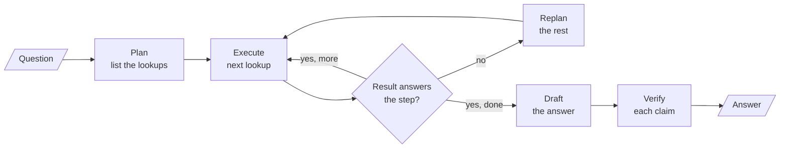

<!-- Generated by site/scripts/rag-theory-import.mjs from rag-agents-engineering. Edit the source there. -->
# Overview

A ReAct agent decides its next step after every tool result, in one LLM call per step. This module pulls that call apart and spends extra calls in three places: before acting (a plan), between steps (a check that can trigger a new plan, or a search over several candidate steps), and after the draft (a verification of its claims). The M26 notebooks build on four ideas: plan-and-execute, replanning, chain-of-verification, and tree search with tree of thoughts and LATS.

The running example is a Larkspur Cloud customer who wants to cancel an annual plan. The answer needs up to six handbook lookups: the refund rule, how long a refund takes, what happens to servers, how long data is kept, what an export includes, and how fast support answers. The lab plans and runs those lookups against the handbook chunks [M11](/learn/llm-and-retrieval/rag-from-first-principles/rag-from-first-principles-overview) to [M13](/learn/ingestion-and-indexing-pipeline/chunking-and-indexing/chunking-and-indexing-overview) use, and lesson 26.4 verifies a drafted answer against the same chunks.

## In short

- A fixed plan makes 2 LLM calls (planner and synthesizer) however many lookups it holds. ReAct makes one per search plus one to answer, and each call re-reads the conversation so far. On the lab's four-lookup question that is 2 calls and about 504 tokens against 5 calls and about 918.
- A fixed plan cannot notice a wrong search result; it writes the answer from it. Evaluating every step and replanning on a failure raises the cost to 8 LLM calls when one of the four lookups comes back wrong, and it is the planner whose answer is still complete.
- A loop that can replan needs a cap, and `max_iterations` counts executed steps, retries included. Six lookups with one retry need 7; the notebook's cap of 6 leaves one lookup unanswered.
- Chain-of-verification answers one question per claim in a fresh call that never sees the draft, then revises. It costs 1 + 1 + N + 1 calls and removes unsupported claims; it does not add missing ones.
- Self-consistency, tree of thoughts and LATS spend extra calls on several reasoning paths. They pay off only when something can score a partial answer: the evaluator decides what survives.

## Mental model

Every box is a place to spend an LLM call, and each one buys a different guarantee. The plan makes the work visible before it runs, the check stops a wrong result from reaching the answer, and verification catches claims the draft invented. ReAct folds plan, execute and check into one call per step. Tree search (lesson 26.6) replaces the single Execute box with several candidate steps and an evaluator that keeps the best.

## Interactive lab

[**Plan or react: the call budget**](/labs/rag/m26_planning_reflection_reasoning/plan-or-react-lab.html): open the file in a browser. Clear the wrong-result toggle and slide the lookups from 1 to 6: the fixed plan stays at 2 LLM calls while ReAct's tokens climb past the replanner's at six. Then press lookup 1 again and compare the three answers. Finally set six lookups, keep one wrong, and drop the cap from 7 to 6 to see a lookup go unanswered.

## How it connects

- **Before:** [M23](/learn/agentic-systems/the-agent-loop-and-tool-calling/the-agent-loop-and-tool-calling-overview) and [M24](/learn/agentic-systems/react-agents-and-langchain-create-agent/react-agents-and-langchain-create-agent-overview) build the agent loop and ReAct that this module measures against. In [M25](/learn/agentic-systems/agentic-workflow-patterns/agentic-workflow-patterns-overview)'s workflow patterns (prompt chaining, routing, parallelisation, orchestrator and worker, evaluator and optimiser) you draw every step; from this module on, the model writes part of the control flow.
- **Next:** [M27](/learn/agentic-systems/human-approval-and-applied-single-agent-builds/human-approval-and-applied-single-agent-builds-overview) adds human approval before an agent acts. [M18](/learn/retrieval-quality-engineering/query-transformation-and-routing/query-transformation-and-routing-overview)'s query decomposition is a plan for retrieval, and [M29](/learn/agentic-and-self-correcting-rag/self-correcting-rag-crag-and-self-rag/self-correcting-rag-crag-and-self-rag-overview)'s Self-RAG checks a generated answer for groundedness in the retrieved evidence, the RAG form of the verify step.

## Key Takeaways

- Plan when the steps are knowable up front; react when the next step depends on the last result. Count LLM calls and tokens for both on your own questions before choosing.
- A plan is only as safe as its check. Evaluate every step's result, replan from the reason it failed, and send only accepted results to the answer.
- Any loop that can grow needs a cap, set from planned steps plus allowed retries, and a fallback that says what is missing.
- Verify claims in calls that cannot see the draft, and spend tree search only where an evaluator can tell a good partial answer from a bad one.
