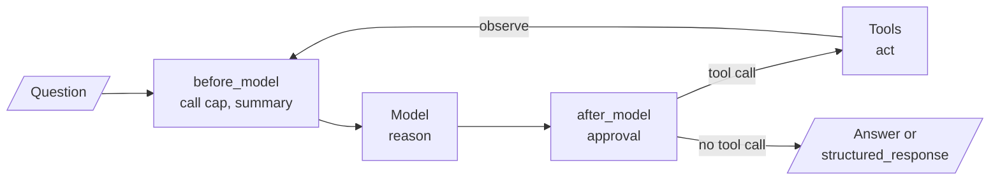

<!-- Generated by site/scripts/rag-theory-import.mjs from rag-agents-engineering. Edit the source there. -->
# Overview

A ReAct agent reasons about one step, acts with a tool, reads the result and decides again, until it can answer. LangChain 1.x packages that loop as `create_agent` and opens it to middleware, which is where call limits, redaction and human review go. The M24 notebooks build on four ideas: the reason, act and observe loop, the `create_agent` graph, structured output, and middleware.

The running example is a support agent for the Larkspur Cloud handbook from [M11](/learn/llm-and-retrieval/rag-from-first-principles/rag-from-first-principles-overview) to [M13](/learn/ingestion-and-indexing-pipeline/chunking-and-indexing/chunking-and-indexing-overview). Its one tool, `search_handbook`, is the [M11](/learn/llm-and-retrieval/rag-from-first-principles/rag-from-first-principles-overview) lab's TF-IDF retriever over twelve chunks, and its questions are the [M11](/learn/llm-and-retrieval/rag-from-first-principles/rag-from-first-principles-overview) golden set: *Can I export my data after I cancel my plan?*, *How long does a refund take?* and *What happens if my server goes down?* The interview questions add the tools a real support agent would have, such as an account lookup and a refund action.

## In short

- ReAct interleaves reasoning and tool calls, and reads every observation before choosing the next step. The difference from a single-shot tool call is one edge, `tools → model`.
- In the lab, the loop lifts mean evidence recall on the [M11](/learn/llm-and-retrieval/rag-from-first-principles/rag-from-first-principles-overview) golden set from 0.50 (one search, the [M11](/learn/llm-and-retrieval/rag-from-first-principles/rag-from-first-principles-overview) baseline) to 1.00 by rewording failed searches, for 9 model calls instead of 3. Every call rereads the whole message list, so cost grows each round.
- `create_agent(model, tools, system_prompt=...)` returns that loop as a compiled LangGraph graph (`model ⇄ tools`) on native tool calls, so there is no text to parse.
- `response_format=Schema` on an agent, or `with_structured_output(Schema)` on a model, returns typed data the next system can trust; Pydantic is the style that validates it.
- Middleware hooks run before and after each model call: `ModelCallLimitMiddleware` bounds the loop, `HumanInTheLoopMiddleware` pauses irreversible tool calls for approve, edit or reject, `PIIMiddleware` redacts, `SummarizationMiddleware` compresses history.

## Mental model

The model is the only part that decides; the graph executes and the middleware guards. A run is as long as the model's decisions make it, so every production agent pairs the loop with a cap, and every irreversible tool with a checkpoint where a person can stop it.

## Interactive lab

[**The ReAct loop and its call cap**](/labs/rag/m24_react_agents/react-loop-lab.html): open the file in a browser. Pick *What happens if my server goes down?* and switch between single shot and ReAct: one search returns `reboot` and `sizing`, the loop rewords twice and finds `incidents` and `sla`. Then drag the call cap down to 3 and watch the run stop with both evidence chunks already in the message list, one call short of the answer.

## How it connects

- **Before:** [M23](/learn/agentic-systems/the-agent-loop-and-tool-calling/the-agent-loop-and-tool-calling-overview) introduces the agent loop and tool calling this module names ReAct. [M09](/learn/langchain-and-langgraph-fundamentals/langchain-and-langgraph/langchain-and-langgraph-overview) and [M10](/learn/langchain-and-langgraph-fundamentals/langgraph-runtime-persistence-hitl-and-streaming/langgraph-runtime-persistence-hitl-and-streaming-overview) teach the LangGraph state, persistence and interrupts that `create_agent` and its middleware compile to. The lab's tool is the [M11](/learn/llm-and-retrieval/rag-from-first-principles/rag-from-first-principles-overview) baseline retriever, and its rewording does by hand what query rewriting ([M18](/learn/retrieval-quality-engineering/query-transformation-and-routing/query-transformation-and-routing-overview)) does on purpose.
- **Next:** [M25](/learn/agentic-systems/agentic-workflow-patterns/agentic-workflow-patterns-overview) sets fixed workflows beside this loop, [M26](/learn/agentic-systems/planning-reflection-and-reasoning-patterns/planning-reflection-and-reasoning-patterns-overview) adds planning and reflection, and [M27](/learn/agentic-systems/human-approval-and-applied-single-agent-builds/human-approval-and-applied-single-agent-builds-overview) uses human approval in applied single-agent builds. [M28](/learn/agentic-and-self-correcting-rag/agentic-rag-foundations-grading-and-query-rewriting/agentic-rag-foundations-grading-and-query-rewriting-overview) to [M32](/learn/agentic-and-self-correcting-rag/reliability-feedback-loops-and-diversity/reliability-feedback-loops-and-diversity-overview) build agentic RAG on these pieces; [M31](/learn/agentic-and-self-correcting-rag/rag-as-an-agent-tool/rag-as-an-agent-tool-overview) makes the retriever an agent tool.

## Key Takeaways

- Use ReAct when the next step depends on what a tool returns; use a planned pipeline when the steps are known.
- Read the `ToolMessage`s before you blame the model. A loop that keeps searching usually has a tool that returns the wrong thing.
- Give every loop a call cap sized from your golden set, and gate every irreversible tool with human approval.
- When code consumes the answer, ask for a schema, validate it with Pydantic, and make fields optional when the source may not contain them.
