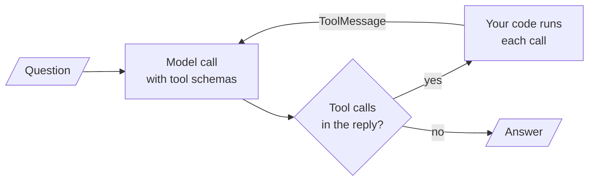

<!-- Generated by site/scripts/rag-theory-import.mjs from rag-agents-engineering. Edit the source there. -->
# Overview

An agent is a model call inside a loop. The model reads the conversation and either answers or asks for tools; your code runs the tools, appends their results, and calls the model again. The M23 notebooks build on four ideas: the loop itself, the schema a tool becomes when the model reads it, how to score whether the model called the right tool with the right arguments, and who runs the tool, you or the provider.

The running example is a support agent for Larkspur Cloud, the fictional host from [M11](/learn/llm-and-retrieval/rag-from-first-principles/rag-from-first-principles-overview) to [M13](/learn/ingestion-and-indexing-pipeline/chunking-and-indexing/chunking-and-indexing-overview). It has two client-side tools: `search_handbook`, which ranks the twelve handbook chunks from the [M11 lab](/learn/llm-and-retrieval/rag-from-first-principles/rag-from-first-principles-overview) with TF-IDF and returns the best two, and `get_server_status`, which looks up one of the customer's servers. The golden questions are an [M11](/learn/llm-and-retrieval/rag-from-first-principles/rag-from-first-principles-overview) one (*Can I export my data after I cancel my plan?*), a two-tool one (*Is my server web-1 running, and does a reboot change its IP address?*), and two that fail on purpose: a server that does not exist and a tool call with the wrong argument name.

## In short

- The loop has one rule: while the model's reply holds tool calls, run them and call the model again; a reply with no tool calls is the answer. Cap the rounds (the from-scratch `ReactAgent` stops at `max_rounds=10`).
- A tool reaches the model only as a schema: a name, a description and typed parameters. Without type hints the `@tool` decorator emits `"query": {}`, and the model gets no type to follow.
- Tool results go back as one `ToolMessage` per call, matched by `tool_call_id`. A two-tool question in the lab ends with 5 messages; a retried call ends with 6.
- A tool error has to reach the model as a message. `ToolNode`'s default only catches bad arguments and re-raises exceptions from inside the tool; in the lab, `handle_tool_errors=True` answers 4 of 4 questions, the default 3 and `False` 2.
- Score tool selection, tool input and synthesis separately. Run code yourself when it touches customer data; use a hosted tool for commodity work where nothing needs enforcing between the call and the result.

## Mental model

The model never runs anything. It writes a request; your code decides whether to run it, runs it, and writes the result into the conversation. Every later agent in this course, from `create_agent` to a multi-agent graph, is this loop with more around it.

## Interactive lab

[**Where a tool error goes**](/labs/rag/m23_agent_loop_and_tools/tool-error-routing-lab.html): open the file in a browser. Pick *Is my server web-9 up?* and switch `handle_tool_errors` between `default`, `True` and `False`: only `True` turns the `ValueError` into a message the model can answer from. Then pick *How long does a refund take?*, where the model names the argument `q`: the default setting survives it with one extra round trip, and `False` crashes. The table under the trace counts how many of the four questions each setting answers.

## How it connects

- **Before:** [M11](/learn/llm-and-retrieval/rag-from-first-principles/rag-from-first-principles-overview) built the handbook index that `search_handbook` wraps. [M09](/learn/langchain-and-langgraph-fundamentals/langchain-and-langgraph/langchain-and-langgraph-overview) and [M10](/learn/langchain-and-langgraph-fundamentals/langgraph-runtime-persistence-hitl-and-streaming/langgraph-runtime-persistence-hitl-and-streaming-overview) taught the LangGraph state, reducers and conditional edges the 23.4 and 23.5 graphs use. [M20](/learn/complete-rag-applications/end-to-end-rag-systems/end-to-end-rag-systems-overview) is the end-to-end retriever the module lab asks you to wrap as a tool.
- **Next:** [M24](/learn/agentic-systems/react-agents-and-langchain-create-agent/react-agents-and-langchain-create-agent-overview) packages this loop as a ReAct agent with LangChain's `create_agent`, and [M25](/learn/agentic-systems/agentic-workflow-patterns/agentic-workflow-patterns-overview) to [M27](/learn/agentic-systems/human-approval-and-applied-single-agent-builds/human-approval-and-applied-single-agent-builds-overview) add workflow patterns, planning and human approval around it. [M28](/learn/agentic-and-self-correcting-rag/agentic-rag-foundations-grading-and-query-rewriting/agentic-rag-foundations-grading-and-query-rewriting-overview) to [M31](/learn/agentic-and-self-correcting-rag/rag-as-an-agent-tool/rag-as-an-agent-tool-overview) put the retriever inside the loop (agentic RAG), and [M38](/learn/agent-protocols-mcp-and-a2a/mcp-foundations/mcp-foundations-overview) to [M40](/learn/agent-protocols-mcp-and-a2a/mcp-applications-and-rag-over-mcp/mcp-applications-and-rag-over-mcp-overview) reach tools over MCP, a server you run that the model calls through a protocol.

## Key Takeaways

- Write the loop's exit conditions first: no tool calls means answer, and a round cap means stop with a fallback.
- Treat the tool schema as the interface. Type every argument and describe it, because the model reads nothing else.
- Every tool failure must come back as a `ToolMessage` the model can read. Set `handle_tool_errors` deliberately and test it with a tool that raises.
- Run tools that touch customer data in your own process, where you can log, refuse and stub them. Hosted tools fit commodity capabilities with nothing to enforce.
