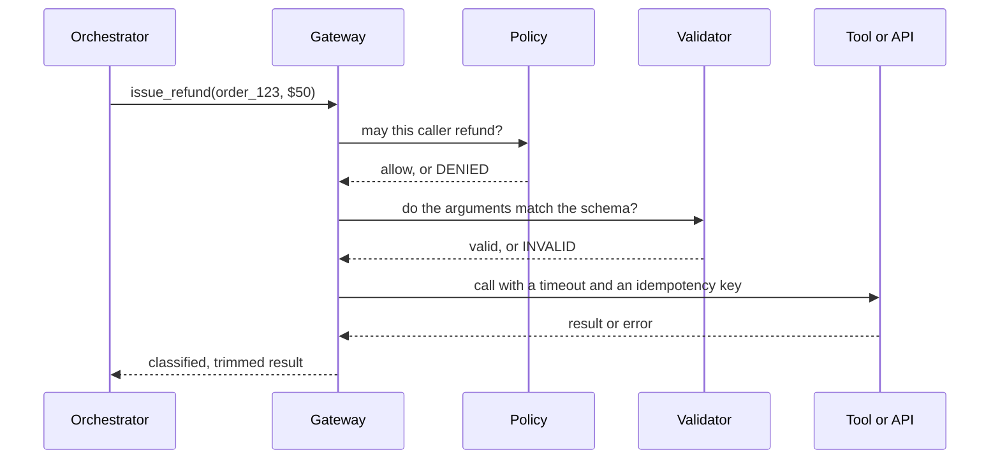

# The Tool Gateway and Code Sandboxing

*Letting each tool enforce its own rules is faster to build, but only one shared doorway can guarantee every call is checked the same way.*

Safety that depends on the model choosing well is not safety. Route every tool call through one gateway that enforces the checks in a fixed order, and isolate any tool that runs code, because no check can predict what code will do.

**Objectives:**

- list the gateway's checks in order and say why authorisation comes before validation;
- build an idempotency key and say what it prevents;
- name the six controls of a code sandbox and why validation is not one of them.

---

## Send Every Call Through One Gateway

The gateway is the single doorway between the agent and anything that changes the world. Every call, whether a refund or a lookup, goes through the same checks in the same order, with no exceptions.



The order is authorise, validate, call idempotently, trim, log. "How do you stop the agent doing something it shouldn't?" deserves that mechanism as an answer, not "we add guardrails".

## Authorise Before You Validate

Check permission first. A denied caller who reaches validation gets back a schema error, and that error describes the tool's arguments. The caller learns the tool's shape without ever being allowed to use it.

Then validate properly. The interview tutorial's practice answer is specific: check types and ranges, not only "is this JSON". Keep an allowlist of the tools each agent role may call. For destructive or costly calls, add a confirmation step, by a human or a second check, before execution. That confirmation is separate from the tool's own error handling.

## Make Every Call Idempotent

The gateway attaches an idempotency key to each call. The source builds it as a hash of `run_id`, the tool name and the arguments. Call twice with the same key and get the same result: the refund happens once.

A retry cannot tell a failed write from a slow one. The key makes that ambiguity harmless.

## Trim the Result Before It Returns

Return only the fields the tool declares. The source tells of a support agent whose cost doubled overnight, and which became 9 seconds slower. A backend team had added 14 new fields to the order record. The tool passed all of them back, unfiltered, on every step.

## Enforce Safety at the Tool Layer, Not in the Prompt

The interview tutorial has a sharp example. A hotel-booking query contained `Family Suite' OR '1'='1`, a SQL-injection pattern. The SQL tool executes whatever query the model writes. Nothing in the tool blocked it. A separate compliance agent happened to flag "security concerns" in free text, which is luck, not a control.

The fix is at the tool layer: parameterised queries, a read-only database role, or an allowlist of queries. Treat any model-side compliance check as defence in depth, never the primary control. The same holds for guardrails generally. An agent without them can burn API credits in a loop, leak private data, or act on invented facts, and the guardrails belong in the tools: parameterised queries, allowlists and rate limits.

> **Warning: the prompt is not a security boundary.** If a dangerous call is only stopped because the model chose not to make it, it is not stopped. Put the control where the model cannot route around it.

## Isolate Any Tool That Runs Code

Running arbitrary code is the most dangerous tool an agent can hold. Validation cannot make it safe, because nobody can know in advance what a piece of code will do. Isolation is the only real answer.

Picture a data-analysis agent that writes Python to find last month's top 10 refund reasons. Someone tricks it into running `os.system('rm -rf /')`. Six controls contain that, and none of them asks the model to behave: isolate the code in a container with a read-only root, one small writable folder and a non-root user; give it no network by default; cap CPU, memory, process count and wall-clock time; give it no cloud credentials or secrets; destroy the container after one run; and truncate its output so a print loop cannot flood the context.

The source shows each control as a container flag:

```bash
docker run --rm --network none --read-only \
  --tmpfs /work:rw,size=256m,noexec \
  --user 65534:65534 --memory 512m --cpus 1.0 \
  --pids-limit 128 --cap-drop ALL \
  --security-opt no-new-privileges \
  agent-sandbox:python-3.12 timeout --signal=KILL 30s python /work/task.py
```

A static check that blocks `os.system`, `eval` or `exec` before the code runs is a useful extra layer. It is never the main defence.

## Worked Example: One Refund Through the Gateway

The support agent calls `issue_refund(order_123, $50)`.

The gateway first asks policy whether this caller may refund at all. A caller without refund rights gets `DENIED`, and learns nothing about the tool's arguments. This caller is allowed. The validator checks that the amount is a positive integer in cents and within range. The gateway calls the refund API with a timeout and a key hashed from the run, the tool name and the arguments.

The API times out. The orchestrator retries. The same key reaches the API, which returns the first call's result rather than refunding again. The gateway trims the response to the refund id, amount and status, logs the call, and hands back a typed result.

Every check ran in the same order it runs for every other tool. That uniformity is what lets a reviewer trust all calls after reading one path.

---

## Key Takeaways

- Route every tool call through one gateway: authorise, validate, call idempotently, trim, log.
- Authorise before validating, so a denied caller cannot learn a tool's schema from its errors.
- An idempotency key hashed from run, tool and arguments turns a retried write into a harmless repeat.
- Trim results to declared fields; unfiltered records cost money and latency on every step.
- Put safety controls in the tool layer, and isolate code execution with six controls rather than validating it.

## Check Yourself

1. **Why must authorisation come before validation in the gateway?**
   Validation errors describe the tool's arguments. A denied caller who reaches validation learns the schema of a tool it may not use.

2. **How do you stop an agent's SQL tool being exploited?**
   At the tool layer: parameterised queries, a read-only role, or a query allowlist. A model-side compliance check is only defence in depth.

3. **Why is a static check for `os.system` not enough for a code interpreter?**
   Nobody can predict what arbitrary code will do, so validation always has gaps. Isolation, with no network, no credentials, resource caps and a single-use container, is the real control.

