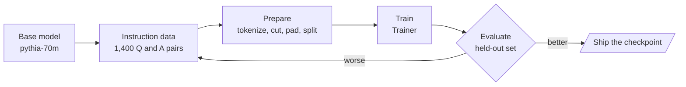

<!-- Generated by site/scripts/rag-theory-import.mjs from rag-agents-engineering. Edit the source there. -->
# Overview

Fine-tuning changes a model’s weights with your own examples, so the change travels with the model instead of sitting in every prompt. It is good at behaviour (a format, a tone, a refusal, one narrow task) and poor at facts that change. The M04 notebooks build on four ideas: how instruction data turns a text predictor into an assistant, how that data becomes token tensors, what the Hugging Face `Trainer` does with them, and how to tell whether the result is better.

The notebooks fine-tune `EleutherAI/pythia-70m` on `lamini_docs`, 1,400 questions and answers about one company’s product. These pages run the same steps on the Larkspur Cloud support assistant from [M11](/learn/llm-and-retrieval/rag-from-first-principles/rag-from-first-principles-overview) to [M13](/learn/ingestion-and-indexing-pipeline/chunking-and-indexing/chunking-and-indexing-overview): the support team wants answers that lead with *Yes* or *No*, state the policy in a sentence, and decline questions that are not about Larkspur. The examples reuse [M11](/learn/llm-and-retrieval/rag-from-first-principles/rag-from-first-principles-overview)’s golden questions (*How long does a refund take?*, *Can I export my data after I cancel my plan?*, *What happens if my server goes down?*) and add the notebooks’ off-topic probe, *What do you think of Mars?*

## In short

- **Fine-tune for behaviour, retrieve for facts.** The notebooks’ clearest result is a format change: the base Llama 2 continues “Tell me how to train my dog to sit” with more questions, and the chat model answers it. A fact that changes next month belongs in the [M11](/learn/llm-and-retrieval/rag-from-first-principles/rag-from-first-principles-overview) index.
- **The training text is all the model learns from.** The `lamini/lamini_docs` copy that lesson 4.5 trains on joins each question to its answer with no template and no end token, in all 1,260 training rows. A model trained that way never learns where an answer stops.
- **Truncation and padding decide what survives.** In the lab, `max_length = 48` cuts 11 answer tokens from the refund example with right truncation, or the header and 7 question tokens with left truncation. Padding the batch to its longest row adds 18 pad tokens, 13% of the batch.
- **Count examples, not steps.** The lesson 4.5 run is `max_steps = 3` with a batch of 1 and 4 accumulation steps: 12 of 1,260 training examples, under 1% of one epoch, and the first update runs at learning rate 0.
- **Exact match fails on free text.** The notebooks’ evaluation set has 0 exact matches in 139 answers, and 127 predicted answers repeat a sentence. Measure the behaviour you trained for, on held-out questions, against the prompted or RAG baseline.

## Mental model

When evaluation shows a problem, the fix is usually in the examples or in how they were prepared (a missing end token, a truncated answer, a template the model never sees at inference), and the loop goes back to the data before it goes back to the training settings.

## Interactive lab

[**Truncation and padding**](/labs/rag/m04_fine_tuning_fundamentals/truncation-padding-lab.html): open the file in a browser. Start at `max_length = 48` with right truncation and watch the refund answer lose its last 11 tokens; switch to left truncation and the `### Question:` header goes instead. Then set the end token to *Appended*, slide to 64 so every row ends with it, and pick *To max_length* to see padding rise to 27% of the batch.

## How it connects

- **Before:** [M03](/learn/ai-engineering-foundations/hugging-face-models-and-gradio-demos/hugging-face-models-and-gradio-demos-overview) loads Hugging Face models and tokenizers, which every M04 notebook uses. [M02](/learn/ai-engineering-foundations/llm-provider-apis-and-model-selection/llm-provider-apis-and-model-selection-overview) covers choosing a hosted or open model, the decision that comes before fine-tuning one.
- **Next:** [M05](/learn/prompt-and-context-engineering/prompt-engineering-patterns/prompt-engineering-patterns-overview) gets as far as prompting can go, which is the first thing to try before fine-tuning. [M11](/learn/llm-and-retrieval/rag-from-first-principles/rag-from-first-principles-overview) puts facts in an index instead of the weights, and its baseline is what the M04 lab compares a fine-tuned model against.

## Key Takeaways

- Try prompting first, put changing facts in retrieval, and fine-tune for behaviour you can describe and measure.
- Before training, decode a few prepared rows: check the template, the end token, what truncation removed and what padding added.
- Report training runs in examples and epochs, and read the learning-rate schedule for the steps you actually run.
- Evaluate the fine-tuned model on held-out questions, on the behaviour you trained for, against the baseline it is meant to replace.
