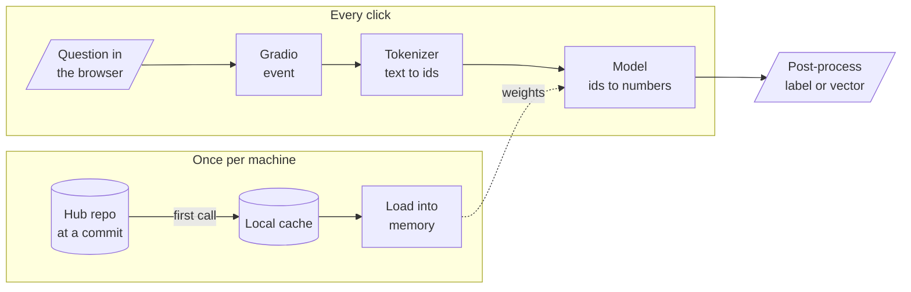

<!-- Generated by site/scripts/rag-theory-import.mjs from rag-agents-engineering. Edit the source there. -->
# Overview

[M02](/learn/ai-engineering-foundations/llm-provider-apis-and-model-selection/llm-provider-apis-and-model-selection-overview) called models that run on someone else's servers. This module runs open models from the Hugging Face Hub on your own machine: the same kind of model that embeds chunks in [M14](/learn/ingestion-and-indexing-pipeline/embeddings-and-model-selection/embeddings-and-model-selection-overview) and reranks them in [M19](/learn/retrieval-quality-engineering/post-retrieval-optimisation-and-reranking/post-retrieval-optimisation-and-reranking-overview). The M03 notebooks build on four ideas: where a downloaded model lives and how to pin it, what a pipeline does between your string and its answer, why every limit and price is counted in tokens, and how to put a web page in front of a Python function.

The running example is the Larkspur Cloud support team, which uses the handbook from [M11](/learn/llm-and-retrieval/rag-from-first-principles/rag-from-first-principles-overview) to [M14](/learn/ingestion-and-indexing-pipeline/embeddings-and-model-selection/embeddings-and-model-selection-overview). They want three things from open models: a sentiment label on incoming tickets such as *My refund took three weeks.*, a vector for every handbook answer so that *Can I export my data after I cancel my plan?* finds the right one, and a demo page the support lead can try without opening a notebook.

## In short

- `from_pretrained` and `pipeline` download a model once into `~/.cache/huggingface/hub` and read it from disk after that. The cache holds files by content hash under `blobs/` and links them from `snapshots/<commit>/`, so a model is pinned by its commit, not by its name.
- `pipeline(task)` runs three steps: the tokenizer turns text into ids, the model turns ids into numbers, and post-processing turns those numbers into a label and a score. Without `model=`, the task picks a default model, and the defaults change between `transformers` releases.
- Models read tokens, not characters. On the handbook's FAQ page GPT-2 counts 308 tokens and `all-MiniLM-L6-v2` 291, both near [M11](/learn/llm-and-retrieval/rag-from-first-principles/rag-from-first-principles-overview)'s four characters per token. Rare words cost more: the notebook's *Preposterous, I'm flabbergasted!* runs at 2.29 characters per MiniLM token.
- Every model has a token limit, and text past it is cut without an error. `all-MiniLM-L6-v2` reads 256 tokens; embed the whole FAQ page and the last 35 tokens, the support and promotional-credit answers, are not in the vector.
- `gr.Interface` wraps one function in a form. `gr.Blocks` lays components out in rows, columns and tabs, and wires each event (`click`, `change`) to a function by naming its inputs and outputs.

## Mental model

Only the first call touches the network; every later call reads the cache, and a running app loads the model once and keeps it in memory. The tokenizer and the model come from the same repo and must stay together, because the ids mean nothing to any other model. Gradio adds nothing to the model; it calls the same Python function on every click.

## Interactive lab

[**Tokens and the limit**](/labs/rag/m03_hugging_face_models/token-limit-lab.html): open the file in a browser. It opens on the FAQ page under MiniLM at its real limit of 256: the support and promotional-credit answers are struck through. Switch to *Refunds section* and press 128: the cut lands inside the sentence that [M13](/learn/ingestion-and-indexing-pipeline/chunking-and-indexing/chunking-and-indexing-overview)'s golden question needs, after "100 GB of out". Then pick *The product name* and compare the two tokenizers' pieces of "Larkspur".

## How it connects

- **Before:** [M02](/learn/ai-engineering-foundations/llm-provider-apis-and-model-selection/llm-provider-apis-and-model-selection-overview) calls hosted models and counts their tokens on the bill; this module runs open ones locally and counts tokens against the model's limit. [M01](/learn/ai-engineering-foundations/python-and-data-toolkit-refresher/python-and-data-toolkit-refresher-overview) covers the Python and NumPy the notebooks use.
- **Next:** [M04](/learn/ai-engineering-foundations/fine-tuning-fundamentals/fine-tuning-fundamentals-overview) trains these models instead of only running them. [M13](/learn/ingestion-and-indexing-pipeline/chunking-and-indexing/chunking-and-indexing-overview) sizes chunks, and the token limit here is the ceiling for that size. [M14](/learn/ingestion-and-indexing-pipeline/embeddings-and-model-selection/embeddings-and-model-selection-overview) loads `all-MiniLM-L6-v2` with sentence-transformers, and [M19](/learn/retrieval-quality-engineering/post-retrieval-optimisation-and-reranking/post-retrieval-optimisation-and-reranking-overview) loads cross-encoder rerankers from the same cache.

## Key Takeaways

- Pin every model by name and commit. A task default or a moving `main` branch changes your results without changing your code.
- Count tokens with the model's own tokenizer, and keep every input under its limit; truncation is silent.
- A pipeline is tokenizer, model and post-processing. When its output is wrong, check each of the three before blaming the model.
- Load models once and call them many times, in notebooks, services and Gradio demos alike.
