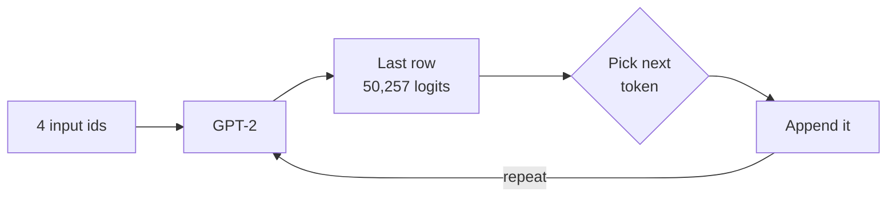

<!-- Generated by site/scripts/rag-theory-import.mjs from rag-agents-engineering. Edit the source there. -->
# Pipelines, tokenization and pretrained models

<!-- subtitle: Tokenise, run, post-process: where each step of a pipeline fails, and why text past the token limit vanishes -->
<!-- format: approved -->

## Pipelines

> **What you'll learn**
>
> - **Explain** the three steps a pipeline runs, and what can fail at each.
> - **Pin** the model and revision a pipeline loads instead of the task's default.
> - **Measure** text in the embedding model's own tokens, and predict what truncation drops.
> - **Compare** greedy decoding, beam search and sampling.

A Larkspur FAQ page holds the answer to *How fast does support answer a ticket?*, yet retrieval scores it 0.229 against that question, far below a chunk that holds the answer alone. No error was raised anywhere. The answer sat past the embedding model's token limit and never reached the model.

A **pipeline**, `pipeline()` from `transformers`, loads a tokenizer and a model from one Hub repo and runs three steps on every call: pre-processing (the tokenizer turns text into token ids), the forward pass (the model turns ids into numbers) and post-processing (those numbers become a label, a span or generated text). Notebook `02a` runs it for sentiment, named entities, question answering and translation; `01b` uses it to label 1,066 movie reviews and computes accuracy against the dataset's labels.

```animated
<figure class="anim sheet" aria-labelledby="anim-pipeline-cap">
  <div class="anim__canvas" tabindex="0" aria-label="Inside a pipeline, scrolls sideways on a narrow screen">
    <svg viewBox="0 0 800 330" role="img" aria-labelledby="anim-pipeline-title anim-pipeline-desc">
      <title id="anim-pipeline-title">Inside a sentiment-analysis pipeline</title>
      <desc id="anim-pipeline-desc">The ticket “My refund took three weeks.” goes through the tokenizer, which splits it into nine tokens including [CLS] and [SEP] and maps them to ids. The model returns two logits. Post-processing applies softmax and looks up the label for the larger probability, NEGATIVE or POSITIVE, and returns it with its score.</desc>
      <defs>
        <marker id="ah-pipeline" viewBox="0 0 8 8" refX="7" refY="4" markerWidth="8" markerHeight="8" markerUnits="userSpaceOnUse" orient="auto-start-reverse"><path class="ah" d="M0 0 L8 4 L0 8 z"/></marker>
      </defs>

      <g class="n-1"><rect class="box" x="16" y="28" width="130" height="44"/><text class="label" x="81" y="50">Ticket text</text></g>
      <g class="n-2 n-3"><rect class="box" x="186" y="28" width="190" height="44"/><text class="label" x="281" y="50">Tokenizer</text></g>
      <g class="n-4"><rect class="box" x="416" y="28" width="140" height="44"/><text class="label" x="486" y="50">Model</text></g>
      <g class="n-5 n-6"><rect class="box" x="596" y="28" width="188" height="44"/><text class="label" x="690" y="50">Post-process</text></g>
      <path class="edge e-2 in-2" d="M146 50 H183" marker-end="url(#ah-pipeline)"/>
      <path class="edge e-4 in-4" d="M376 50 H413" marker-end="url(#ah-pipeline)"/>
      <path class="edge e-5 in-5" d="M556 50 H593" marker-end="url(#ah-pipeline)"/>

      <g class="in-1">
        <rect class="doc" x="16" y="96" width="130" height="56"/>
        <text class="small" x="81" y="114">My refund took</text>
        <text class="small" x="81" y="134">three weeks.</text>
      </g>

      <g class="in-2">
        <text class="small" x="281" y="100">tokens</text>
        <text class="fig" x="281" y="124">[CLS] my ref ##und</text>
        <text class="fig" x="281" y="144">took three weeks</text>
        <text class="fig" x="281" y="164">. [SEP]</text>
      </g>
      <g class="in-3">
        <text class="small" x="281" y="200">input_ids</text>
        <text class="fig" x="281" y="224">101 2026 25416</text>
        <text class="fig" x="281" y="244">8630 2165 2093</text>
        <text class="fig" x="281" y="264">3134 1012 102</text>
      </g>

      <g class="in-4">
        <text class="small" x="486" y="100">logits, shape [1, 2]</text>
        <rect class="chunk" x="446" y="116" width="60" height="16"/>
        <rect class="chunk" x="446" y="140" width="60" height="16"/>
        <text class="fig" x="530" y="124">0</text>
        <text class="fig" x="530" y="148">1</text>
      </g>

      <g class="in-5">
        <text class="small" x="690" y="100">softmax</text>
        <text class="fig" x="690" y="124">p0 + p1 = 1</text>
      </g>
      <g class="in-6">
        <text class="small" x="690" y="160">id2label</text>
        <text class="fig" x="690" y="184">0 NEGATIVE</text>
        <text class="fig" x="690" y="204">1 POSITIVE</text>
        <rect class="doc" x="606" y="226" width="168" height="56"/>
        <text class="fig" x="690" y="246">label: the larger</text>
        <text class="fig" x="690" y="266">score: its p</text>
        <rect class="hit" x="606" y="290" width="168" height="6"/>
      </g>
    </svg>
  </div>
  <div class="anim__controls" hidden>
    <button class="anim__btn" type="button" data-act="prev">Previous</button>
    <button class="anim__btn" type="button" data-act="play" aria-pressed="false">Play</button>
    <button class="anim__btn" type="button" data-act="next">Next</button>
  </div>
  <ol class="anim__steps" id="anim-pipeline-cap">
    <li><button type="button">Text</button><span>A Larkspur ticket arrives: “My refund took three weeks.”</span></li>
    <li><button type="button">Tokens</button><span>The tokenizer lower-cases it and splits it into nine tokens; “refund” becomes <code>ref</code> and <code>##und</code>.</span></li>
    <li><button type="button">Ids</button><span>Each token becomes its row number in the vocabulary, from 101 for <code>[CLS]</code> to 102 for <code>[SEP]</code>.</span></li>
    <li><button type="button">Model</button><span>DistilBERT reads the nine ids and returns two numbers, one per class.</span></li>
    <li><button type="button">Softmax</button><span>Softmax turns the two logits into probabilities that sum to 1.</span></li>
    <li><button type="button">Label</button><span>The config’s <code>id2label</code> names the larger one, and the pipeline returns that label with its probability as the score.</span></li>
  </ol>
</figure>
```

*Figure 1: The three steps of a text-classification pipeline on a Larkspur ticket.*

For a Larkspur ticket, *My refund took three weeks.*, the sentiment pipeline's tokenizer produces nine ids: `[CLS] my ref ##und took three weeks . [SEP]`. The model returns two logits, softmax turns them into probabilities, and the model's `config.json` maps index 0 to `NEGATIVE` and 1 to `POSITIVE`. Each step can go wrong on its own. A ticket longer than the model's 512 positions has to be truncated at the tokenizer, a model trained on movie reviews misreads billing language in the forward pass, and a two-label head cannot say "billing" or "outage" at all.

**A task name picks a model for you.** `pipeline(task="text-classification")` with no `model=` loads the task's default, and `transformers` prints "No model was supplied, defaulted to … Using a pipeline without specifying a model name and revision in production is not recommended." In `transformers` 5.17.0, the version this course locks, the defaults include:

| Task | Default model | Pinned revision |
|---|---|---|
| `text-classification` (alias `sentiment-analysis`) | `distilbert/distilbert-base-uncased-finetuned-sst-2-english` | `714eb0f` |
| `token-classification` (alias `ner`) | `dbmdz/bert-large-cased-finetuned-conll03-english` | `4c53496` |
| `text-generation` | `HuggingFaceTB/SmolLM3-3B` | `a07cc9a` |

*Table 1: Task defaults and their pinned revisions in `transformers` 5.17.0, read from the installed library.*

The NER default (named-entity recognition) is 1.33 GB of weights, five times the sentiment model's 268 MB, which is why `02a` warns before loading it. Pass `model=` (and `revision=` with a commit hash) to choose the model yourself: `02a` loads `ProsusAI/finbert` for financial headlines, and the task comes from the repo's metadata.

**The task list changes between releases.** The list printed at the top of `02a` comes from an older `transformers`. Version 5.17.0 has no `question-answering`, `translation`, `summarization`, `text2text-generation` or `conversational` task, and the notebook's `pipeline('question-answering')` and `pipeline('translation_en_to_fr')` cells fail in this course's environment. Print `transformers.pipelines.get_supported_tasks()` to see what your installed version supports.

Two smaller points from the notebooks. `save_pretrained(folder)` writes the tokenizer, model and config into a folder that `pipeline(model=folder)` loads again; `02a` saves the text-classification pipeline that way, not the NER one, and writes the folder next to the notebook. Notebook `02c` shows the same text generation twice: once with `AutoTokenizer` and `AutoModelForCausalLM` and an explicit `generate()`, once as `pipeline("text-generation", model="gpt2")`. The pipeline is shorter; the explicit version lets you read the logits, which the next two sections need.

## Tokenization

Models read tokens, pieces of text from a fixed vocabulary, each mapped to an integer id. Notebook `02b` explains why the pieces are subwords: a character vocabulary is small but needs many tokens per sentence, a word vocabulary is large and still meets unknown words, and subwords keep common words whole while building rare ones from parts. Every model ships its own tokenizer, and the ids mean nothing to any other model. These are real outputs of the two tokenizers this module and [T5.4](/learn/llm-and-retrieval/embeddings-and-model-selection/embeddings-and-model-selection-overview) use, from `AutoTokenizer` in `transformers` 5.17.0:

| Text | GPT-2 (byte-level BPE, 50,257 tokens) | `all-MiniLM-L6-v2` (WordPiece, lower case, 30,522 tokens) |
|---|---|---|
| *Larkspur Cloud* | `L` `arks` `pur` `␣Cloud` | `[CLS]` `lark` `##sp` `##ur` `cloud` `[SEP]` |
| *Preposterous, I'm flabbergasted!* | `Prep` `oster` `ous` `,` `␣I` `'m` `␣fl` `ab` `berg` `asted` `!` | `[CLS]` `prep` `##ost` `##ero` `##us` `,` `i` `'` `m` `fl` `##ab` `##berg` `##ast` `##ed` `!` `[SEP]` |
| *Can I export my data after I cancel my plan?* | 11 tokens, one per word plus `?` | 13 tokens, the same split plus `[CLS]` and `[SEP]` |

*Table 2: The same texts under two tokenizers, rerun with `transformers` 5.17.0.*

The two schemes differ in ways that matter later. GPT-2 keeps case and attaches a leading space to the token after it (`␣` above), so "fl" at the start of a text is id 2704 and " fl" after a space is id 781; `02b`'s markdown quotes the second. WordPiece lower-cases everything, marks a piece that continues a word with `##`, and adds `[CLS]` and `[SEP]` around every input.

Prices and limits are counted in tokens, so the ratio of characters to tokens decides what a text costs. [T5.1](/learn/llm-and-retrieval/rag-from-first-principles/rag-from-first-principles-overview) estimated tokens as characters divided by four. On the handbook that holds: the refunds section is 1,111 characters and 246 GPT-2 tokens (4.52 characters per token), the FAQ page 1,415 characters and 308 tokens (4.59). It fails on rare words: *Preposterous, I'm flabbergasted!* runs at 2.91 characters per GPT-2 token and 2.29 per MiniLM token, not counting `[CLS]` and `[SEP]`. Product names, codes and other languages move the ratio the same way. Count with the model's own tokenizer before you budget.

**Every model has a token limit, and the text past it is dropped without an error.** GPT-2 has 1,024 positions. The MiniLM tokenizer reports 512, but sentence-transformers reads `max_seq_length: 256` from the repo's `sentence_bert_config.json` and cuts every input there, `[CLS]` and `[SEP]` included. The FAQ page is 291 MiniLM tokens. Its last 35 tokens, 183 characters holding the support response times and the promotional-credit rule, never reach the model. Embedding the whole page and embedding its first 1,231 characters give the same vector (cosine similarity 1.0000). *How fast does support answer a ticket?* then scores 0.229 against the page and 0.687 against the support answer on its own. We call this **silent truncation**. It is the reason [T5.3](/learn/llm-and-retrieval/chunking-and-indexing/chunking-and-indexing-overview) sizes chunks and why the size must be measured in the embedding model's tokens.

The [interactive lab](/labs/rag/m03_hugging_face_models/token-limit-lab.html) holds the real token ids for five Larkspur texts under both tokenizers and cuts them exactly as `tokenizer(text, truncation=True, max_length=N)` does; it matches the library at every limit from 8 to 320, 3,130 settings with 0 mismatches. Lower the limit on the refunds section to 128 and MiniLM keeps the text up to "less than 100 GB of out", splitting the sentence [T5.3](/learn/llm-and-retrieval/chunking-and-indexing/chunking-and-indexing-overview)'s golden question needs, while GPT-2's cut falls one word earlier, before "GB".

```lab
src: /labs/rag/m03_hugging_face_models/token-limit-lab.html
title: Tokens and the limit
```

## From logits to text

A causal language model such as GPT-2 predicts the next token. Notebook `02b` feeds it *I skip across the*, four tokens, and gets logits of shape `[1, 4, 50257]`: one batch, one row per input token, one score per vocabulary entry. The last row scores every possible next token; `argmax` picks the most likely, and `softmax` turns the row into probabilities. `generate()` repeats that step, appending each new token to the input.



*Figure 2: The generation loop. Each pass scores every vocabulary entry and appends one token.*

How the next token is picked is the decoding strategy, set by `generate()`'s arguments. The notebook's settings:

- **Greedy** (the default): the most likely token every time. Deterministic, and prone to repeating itself in long text.
- **Beam search**, `num_beams=5`: keeps the five most likely sequences and returns the best whole one; `repetition_penalty=1.2` lowers the score of tokens already used.
- **Sampling**, `do_sample=True`: draws from the probabilities. `temperature=0.4` sharpens them toward the top tokens, `top_k=10` draws only from the ten most likely, and `top_p=0.94` from the smallest set whose probabilities add up to 0.94. The notebook sets `top_k=0` to switch the top-k filter off when it tests temperature and top-p alone.

Two details catch people out. `max_new_tokens=20` counts only generated tokens, while `max_length=40` counts the prompt too and leaves room for 36 new tokens after the 4-token prompt. And GPT-2 has no padding token; `02c` passes `pad_token_id=tokenizer.eos_token_id` to silence the warning `generate()` gives about it. The code comment in `02b`'s first tokenizer cell, `tensor([[1026, 373, 257, 3223, 290, 6388, 88]])`, is the encoding of *It was a dark and stormy*, not of the sentence in that cell.

## Limits of this evidence

- **Version-bound.** Table 1, the missing tasks and the tokenizer outputs come from `transformers` 5.17.0. Defaults and the task list change between releases.
- **No model outputs.** The notebooks ship without outputs. The token counts, the 0.229 and 0.687 scores and the truncation point were rerun with the tokenizers and with `all-MiniLM-L6-v2` through sentence-transformers; no GPT-2 generation was run, and the decoding settings are described, not measured.
- **Lab texts.** The refunds section and the FAQ page are the lab's copies of the Larkspur handbook. The lab's stored token ids match both live tokenizers on all five texts.

## References

1. Hugging Face, [pipelines](https://huggingface.co/docs/transformers/main_classes/pipelines), on tasks, default models and pinning a model.
2. Hugging Face, [generation strategies](https://huggingface.co/docs/transformers/generation_strategies), covering greedy decoding, beam search and sampling.

## Run the notebooks

The code for this lesson is in these notebooks. Colab runs one in your browser: install the packages its first cell imports and set the API keys it reads. To run every notebook as written, clone the repository and use its uv environment.

| Notebook | GitHub | Colab |
|---|---|---|
| Pipelines for nlp tasks | [Open on GitHub](https://github.com/Sourav692/rag-agents-engineering/blob/main/p01_ai_engineering_foundations/m03_hugging_face_models/mandatory/notebook/02a_pipelines_for_nlp_tasks.ipynb) | [Open in Colab](https://colab.research.google.com/github/Sourav692/rag-agents-engineering/blob/main/p01_ai_engineering_foundations/m03_hugging_face_models/mandatory/notebook/02a_pipelines_for_nlp_tasks.ipynb) |
| Understanding LLMs | [Open on GitHub](https://github.com/Sourav692/rag-agents-engineering/blob/main/p01_ai_engineering_foundations/m03_hugging_face_models/mandatory/notebook/02b_understanding_llms.ipynb) | [Open in Colab](https://colab.research.google.com/github/Sourav692/rag-agents-engineering/blob/main/p01_ai_engineering_foundations/m03_hugging_face_models/mandatory/notebook/02b_understanding_llms.ipynb) |
| Accessing pretrained models (optional) | [Open on GitHub](https://github.com/Sourav692/rag-agents-engineering/blob/main/p01_ai_engineering_foundations/m03_hugging_face_models/optional/notebook/02c_accessing_pretrained_models.ipynb) | [Open in Colab](https://colab.research.google.com/github/Sourav692/rag-agents-engineering/blob/main/p01_ai_engineering_foundations/m03_hugging_face_models/optional/notebook/02c_accessing_pretrained_models.ipynb) |

## Key Takeaways

- A pipeline is tokenise, forward pass, post-process, and each step can fail on its own. Pass `model=` and `revision=` yourself, because the task default and the task list change between releases.
- Count tokens with the model's own tokenizer, since rare words and codes shift the ratio. Text past the limit is dropped without an error, so measure chunk sizes in the embedding model's tokens.
- `generate()` picks one next token at a time from the last row of logits. Greedy is deterministic but repeats; beam search and sampling with `temperature`, `top_k` and `top_p` change that.

## Check yourself

<details>
<summary>1. Why is pipeline with only a task name a risk in production code?</summary>

It loads the task's default model, chosen by the installed `transformers` version, and the library warns that a pipeline without a model name and revision is not recommended in production. In 5.17.0, `text-classification` loads `distilbert/distilbert-base-uncased-finetuned-sst-2-english` at `714eb0f`. Pass `model=` and `revision=` with a commit hash to choose it yourself.

</details>

<details>
<summary>2. The FAQ page is 291 MiniLM tokens. Why does the support-speed question score 0.229 against the whole page but 0.687 against the support answer alone?</summary>

sentence-transformers cuts every input at `max_seq_length: 256`, so the page's last 35 tokens, the 183 characters with the support response times, never reach the model. The whole page and its first 1,231 characters give the same vector, so the page's embedding carries no trace of the answer. This is why [T5.3](/learn/llm-and-retrieval/chunking-and-indexing/chunking-and-indexing-overview) sizes chunks in the embedding model's tokens.

</details>

<details>
<summary>3. A GPT-2 reply generated with default settings repeats itself in long text. Which generate arguments from the notebook change that?</summary>

The default is greedy decoding, which is deterministic and prone to repetition. Beam search with `num_beams=5` and `repetition_penalty=1.2` lowers the score of tokens already used. Sampling with `do_sample=True` draws from the probabilities instead, shaped by `temperature`, `top_k` and `top_p`.

</details>
