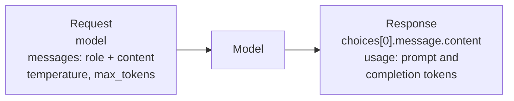
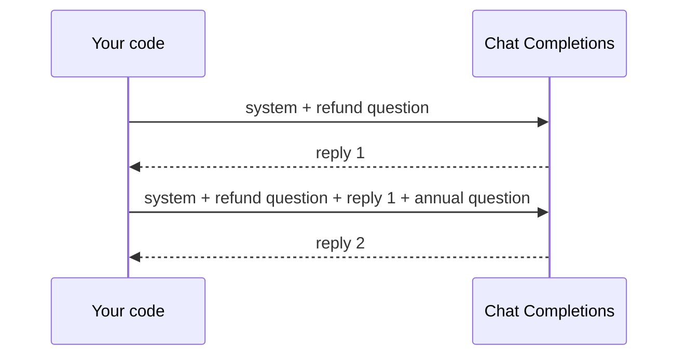
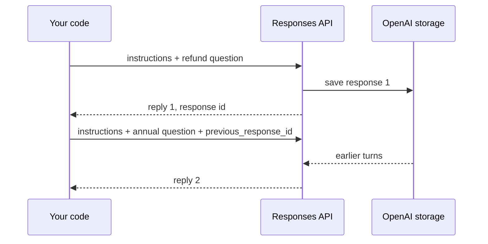

<!-- Generated by site/scripts/rag-theory-import.mjs from rag-agents-engineering. Edit the source there. -->
# Calling commercial LLM APIs: OpenAI and Gemini

<!-- subtitle: One stateless call, two API shapes, two SDKs, and the wrapper that keeps the rest of your code unchanged -->
<!-- format: approved -->

## Chat completions

> **What you'll learn**
>
> - **Explain** what a chat completion request and response carry, and why every turn resends the history.
> - **Read** the billed token counts, including hidden reasoning tokens, from the response.
> - **Compare** Chat Completions with the Responses API on state, storage and billing.
> - **Design** a provider wrapper that fails loudly on a model it does not know.

The Larkspur generator answers *How long does a refund take?*, then the customer asks *And for annual plans?* The second answer comes back confused about what "annual plans" refers to. Nothing failed: the API simply received the second question alone. Every fact about the conversation has to travel in the request.

A **chat completion** is one HTTP call. The request names a model and carries the conversation as a list of messages, each a `role` and a `content`; the response carries the model's reply and a count of the tokens it used. Notebook 01a sends one user message to `gpt-4o` with a temperature of 0.1 and reads the reply from the first choice:

*Figure 1: The fields of one chat completion request and its response.*

Four parts of the request and response matter on every call:

- **Roles**: `system` sets standing instructions, `user` is the question, `assistant` is an earlier reply. For the Larkspur generator the system message says to answer only from the handbook excerpts, and the user message holds the excerpts and the customer's question.
- **The call is stateless**: the API remembers nothing between calls. A follow-up question works only if you send the earlier turns again, so every turn of a long conversation pays for all the turns before it.
- **Sampling parameters**: `temperature` controls randomness, and the notebook uses 0.1 for repeatable answers. `max_tokens` caps the reply; lesson 2 of T2.2's notebook sets 1,000. Reasoning models are stricter: [T7.3's routing page](/learn/agentic-systems/agentic-workflow-patterns/routing-by-handler-and-by-model-tier#lesson-routing-by-model-tier) records that o-series models reject a custom temperature.
- **`usage`**: `prompt_tokens` and `completion_tokens` are what the provider bills. In the installed `openai` 2.54.0, `usage.completion_tokens_details.reasoning_tokens` reports how many of the completion tokens were hidden reasoning. Lesson 3 of T2.2 is about that field.

The notebook reads the key with `getpass` and sets it on the SDK's module-level client. Lessons 3 and 4 of T2.2 create a client object instead, which reads `OPENAI_API_KEY` from the environment loaded from `.env`. Either way the key stays out of the code and out of the notebook's saved state.

## The Responses API

The notebook uses Chat Completions, which OpenAI still supports. For new projects, OpenAI's migration guide recommends its newer **Responses API**. The installed `openai` 2.54.0 supports it, and the same call maps field by field:

| | Chat Completions | Responses |
|---|---|---|
| Send | `messages`, a list of role and content | `input`, a string or a list of items; standing instructions go in `instructions` |
| Read the reply | `response.choices[0].message.content` | `response.output_text`, the text items of `output` joined |
| Cap the reply | `max_tokens` | `max_output_tokens` |
| Usage | `prompt_tokens`, `completion_tokens` | `input_tokens`, `output_tokens`, with hidden reasoning in `output_tokens_details.reasoning_tokens` |
| Conversation state | You resend every turn | Resend every turn, or pass `previous_response_id` and OpenAI keeps the history |
| Stored by OpenAI | By default only on new accounts | By default; `store=False` turns it off |

*Table 1: The same call in both OpenAI APIs.*

The follow-up turn shows the difference in state. Under Chat Completions your code holds the conversation:

*Figure 2: Chat Completions. The application resends every earlier turn.*

Under the Responses API with `previous_response_id`, OpenAI holds it:

*Figure 3: Responses API. The application sends only the new turn and an id.*

Follow the second Larkspur turn, the annual-plans question, through each API and compare what is sent, billed and stored.

<button type="button" data-mode="chat" aria-pressed="false" aria-controls="state-chat">Chat Completions</button>
<button type="button" data-mode="responses" aria-pressed="false" aria-controls="state-responses">Responses with an id</button>

<section id="state-chat" class="mode-panel" data-announcement="Chat Completions: your code resends the history."><h4>Chat Completions</h4><dl><dt>Your request carries</dt><dd>the system message, the refund question, reply 1 and the annual question</dd><dt>Billed as input</dt><dd>every one of those turns</dd><dt>Who keeps the history</dt><dd>your code; storage by OpenAI is on by default only for new accounts</dd></dl></section>
<section id="state-responses" class="mode-panel" data-announcement="Responses with an id: OpenAI keeps the history, and it is still billed."><h4>Responses with <code>previous_response_id</code></h4><dl><dt>Your request carries</dt><dd>the instructions again, the annual question and the previous response's id</dd><dt>Billed as input</dt><dd>every earlier turn still, because the history reaches the model</dd><dt>Who keeps the history</dt><dd>OpenAI, which stores responses by default unless you pass <code>store=False</code></dd></dl></section>

Four differences change what you build:

- **`previous_response_id` still bills the history.** The earlier turns reach the model and are billed as input tokens, so a long conversation costs what it did under Chat Completions.
- **Instructions do not carry over.** A call that uses `previous_response_id` must send `instructions` again; the previous response's instructions are dropped.
- **Storage is a data-handling choice.** Responses are stored by default. For customer data under a retention policy, set `store=False` and resend the history yourself.
- **Hosted tools need it.** Web search, code execution and image generation run only on the Responses API; [T7.1's hosted tools page](/learn/agentic-systems/the-agent-loop-and-tool-calling/hosted-vs-client-side-tools-code-execution-and-image-generation) compares them with client-side tools.

The model names in this module's notebooks (`gpt-4o`, `gpt-4o-mini`, `o4-mini`) were current when the notebooks were written, and the numbers on these pages were measured with them. OpenAI has released newer families since: in November 2026 its migration guide's examples use `gpt-6-astra`. For new code, take the ID from the provider's models page and prefer a dated snapshot to an alias, so the model behind your answers changes only when your code does.

## Two SDKs, two shapes

The notebook calls Gemini through Google's `google-generativeai` package, and the two SDKs disagree on almost every part of the call:

| | OpenAI | Gemini (`google-generativeai`) |
|---|---|---|
| Set the key | `openai.api_key = key` | `genai.configure(api_key=key)` |
| Pick the model | `model="gpt-4o"` on each call | `genai.GenerativeModel("gemini-2.5-pro")` |
| Send | `messages`, a list of role and content | `generate_content(prompt)`, a string |
| Read the reply | `response.choices[0].message.content` | `response.text` |

*Table 2: The notebook's OpenAI and Gemini calls side by side.*

The notebook hides the difference behind one function, `get_completion(prompt, model)`, which branches on the model name. The rest of the code calls one function, and switching provider becomes a one-argument change. Two details of the notebook's version are worth fixing before you copy it:

- **It fails quietly.** Any model name other than exactly `"gpt-4o"` or `"gemini-2.5-pro"` returns the string `"LLM not configured! ..."` as if it were an answer. A typo such as `"gpt-4o-mini"` prints that sentence where the model's reply should be. We call this a **placeholder answer**; a wrapper you own should raise on a model it does not know.
- **The Gemini package is retired.** The installed `google-generativeai` 0.8.6 describes itself as legacy, with all support ended on 30 November 2025; its successor is `google-genai`, which this repository also installs. The notebook's Gemini cells still show the shape of a second SDK, which is their point here.

LangChain ([T4.1](/learn/langchain-and-langgraph-fundamentals/langchain-core-models-prompts-and-parsers/langchain-core-models-prompts-and-parsers-overview)) is the general version of `get_completion`: one chat-model interface over many providers, so a RAG chain does not change when the generator does.

## Limits of this evidence

- **No live calls.** The notebook ships without outputs and this page made no API calls. Field names and defaults come from the installed `openai` 2.54.0 and `google-generativeai` 0.8.6 and from OpenAI's migration guide, read in November 2026.
- **Moving targets.** Model names, storage defaults and which tools need the Responses API change with provider releases. Check them again before relying on them.
- **The annual-plans follow-up is illustrative.** It shows the state difference; it is not a recorded conversation.

## References

1. OpenAI, [migrating to the Responses API](https://developers.openai.com/api/docs/guides/migrate-to-responses), on state, storage and billing of `previous_response_id`.
2. Google, [migrating to the Google Gen AI SDK](https://aistudio.google.com/docs/migrate), the successor to `google-generativeai`.

## Run the notebooks

The code for this lesson is in these notebooks. Colab runs one in your browser: install the packages its first cell imports and set the API keys it reads. To run every notebook as written, clone the repository and use its uv environment.

| Notebook | GitHub | Colab |
|---|---|---|
| Using chatgpt or google gemini | [Open on GitHub](https://github.com/Sourav692/rag-agents-engineering/blob/main/p01_ai_engineering_foundations/m02_llm_apis_and_model_selection/mandatory/notebook/01a_using_chatgpt_or_google_gemini.ipynb) | [Open in Colab](https://colab.research.google.com/github/Sourav692/rag-agents-engineering/blob/main/p01_ai_engineering_foundations/m02_llm_apis_and_model_selection/mandatory/notebook/01a_using_chatgpt_or_google_gemini.ipynb) |

## Key Takeaways

- A chat completion is one stateless HTTP call: a model, a list of role and content messages, and a reply with `usage`. Every turn resends the history, so long conversations cost more each turn.
- Bill from `prompt_tokens` and `completion_tokens` (`input_tokens` and `output_tokens` in the Responses API, which OpenAI recommends for new code), keep the API key in the environment, and set a low `temperature` when you need repeatable answers.
- Hide provider SDKs behind one function so switching model is a one-argument change, and make that function raise on a model it does not know instead of returning a placeholder string.

## Check yourself

1. Why does each turn of a long chat conversation cost more than the turn before it?

The call is stateless: the API remembers nothing between calls. A follow-up works only if you send the earlier turns again in `messages`, so every turn pays for all the turns before it in `prompt_tokens`.

2. You call the notebook's get_completion with the model name gpt-4o-mini. What comes back, and what should a wrapper you own do instead?

The string `"LLM not configured! ..."`, printed where the model's reply should be. The function branches only on exactly `"gpt-4o"` or `"gemini-2.5-pro"` and returns that sentence for anything else. Your own wrapper should raise on a model it does not know.

3. You are starting a new Gemini integration. Should you copy the notebook's google-generativeai calls?

No. The installed `google-generativeai` 0.8.6 describes itself as legacy, with support ended on 30 November 2025; its successor is `google-genai`, which the repository also installs. The notebook's Gemini cells are there to show the shape of a second SDK, and one interface over both providers (`get_completion` here, LangChain in [T4.1](/learn/langchain-and-langgraph-fundamentals/langchain-core-models-prompts-and-parsers/langchain-core-models-prompts-and-parsers-overview)) keeps the rest of the code unchanged when you switch.

