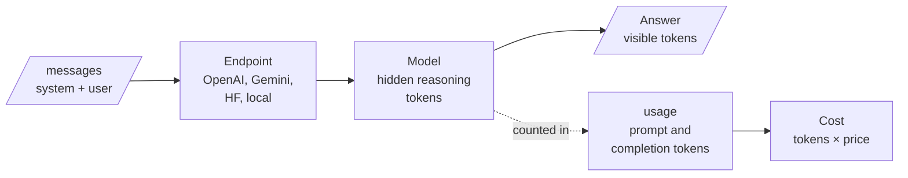

<!-- Generated by site/scripts/rag-theory-import.mjs from rag-agents-engineering. Edit the source there. -->
# Overview

Every RAG answer ends in a model call: a list of messages goes to an endpoint, and an answer and a token count come back. The M02 notebooks build on four ideas: the chat completion as the unit of work, the endpoints that serve hosted and open models, reasoning models that think in tokens you never see, and the trade between accuracy and what each answer costs.

The running example is the generator of the Larkspur Cloud support assistant from [M11](/learn/llm-and-retrieval/rag-from-first-principles/rag-from-first-principles-overview) to [M13](/learn/ingestion-and-indexing-pipeline/chunking-and-indexing/chunking-and-indexing-overview): the call that turns retrieved handbook chunks into an answer. *How long does a refund take?* has its answer in one chunk. *Can I get a refund after 45 days?* needs proration arithmetic. Those two questions decide which model and how much thinking the assistant pays for. The notebooks run their own tasks (a deployment-order puzzle, an order-line extraction, a six-problem sweep) and save no outputs, so every figure on these pages is one the notebooks state, one counted from their code, or one the lab computes.

## In short

- A chat completion is one stateless call: role-tagged messages and parameters in, `choices[0].message.content` and a `usage` object out. OpenAI and the Hugging Face `InferenceClient` share that shape; the Gemini SDK in lesson 2.1 takes a prompt string and returns `response.text`.
- An open model is reached through a hosted endpoint or run on your own GPU. With no `provider` set, the installed `huggingface_hub` 1.16.1 sends chat calls to server-side auto routing; locally you apply the chat template yourself and need the memory (at least 5 GB of GPU memory for `recurrentgemma-2b-it`, per the notebook).
- A reasoning model spends hidden reasoning tokens before it answers. They are counted inside `completion_tokens` and billed at the output rate. At the notebooks' prices `o4-mini` costs 7.3 times `gpt-4o-mini` per token, before it thinks at all.
- `reasoning_effort` buys deliberation, which helps only when the failure was too little thinking. In the lab's step-then-plateau sweep, medium answers 5 of 6 for $31.24 per 10,000 answers and high answers the same 5 for $79.64.
- Pick a setting with the marginal number, dollars per extra accuracy point, measured on a mixed task set that contains your easy traffic as well as your hard cases.

## Mental model

The answer is the only part you read, and it is the smallest part you pay for. A fast model goes straight from messages to answer; a reasoning model spends tokens in the middle box first, and `usage` is the only place they show up. Lessons 2.3 and 2.4 are about deciding when that middle box is worth paying for.

## Interactive lab

[**Where effort stops paying**](/labs/rag/m02_llm_apis_and_model_selection/effort-knee-lab.html): open the file in a browser. Start on *Step, then plateau* and drag the threshold from $2.0 down to $1.0: the knee drops from medium to low, because the step from low to medium costs $1.19 per accuracy point per 10,000 answers. Then pick *Wrong lever* and raise the reasoning tokens at high: the bill climbs and the accuracy column does not move.

## How it connects

- **Before:** [M01](/learn/ai-engineering-foundations/python-and-data-toolkit-refresher/python-and-data-toolkit-refresher-overview) sets up the Python and data tools these notebooks run on.
- **Next:** [M03](/learn/ai-engineering-foundations/hugging-face-models-and-gradio-demos/hugging-face-models-and-gradio-demos-overview) takes lesson 2.2's local pipeline further with Hugging Face models and Gradio demos. [M05](/learn/prompt-and-context-engineering/prompt-engineering-patterns/prompt-engineering-patterns-overview) turns these calls into prompt patterns; its chain-of-thought lesson is the prompt-side version of what a reasoning model does in training. [M07](/learn/langchain-and-langgraph-fundamentals/langchain-core-models-prompts-and-parsers/langchain-core-models-prompts-and-parsers-overview) wraps the same provider SDKs behind one LangChain chat-model interface. [M11](/learn/llm-and-retrieval/rag-from-first-principles/rag-from-first-principles-overview) records cost per question in its baseline row, and [M25](/learn/agentic-systems/agentic-workflow-patterns/agentic-workflow-patterns-overview) routes each request to a cheap or a reasoning tier at run time, which is lessons 2.3 and 2.4 applied per request.

## Key Takeaways

- Read cost from `usage`, never from the reply. Reasoning tokens are billed and never returned.
- Keep provider calls behind one function you own, and make it fail loudly on a model it does not know.
- Use a reasoning model where a wrong intermediate step is expensive, and a fast model or plain code where the answer is already in the input.
- Choose an effort level with dollars per extra accuracy point on a mixed set, and fix missing facts, vague prompts and wrong labels before you turn the dial.
