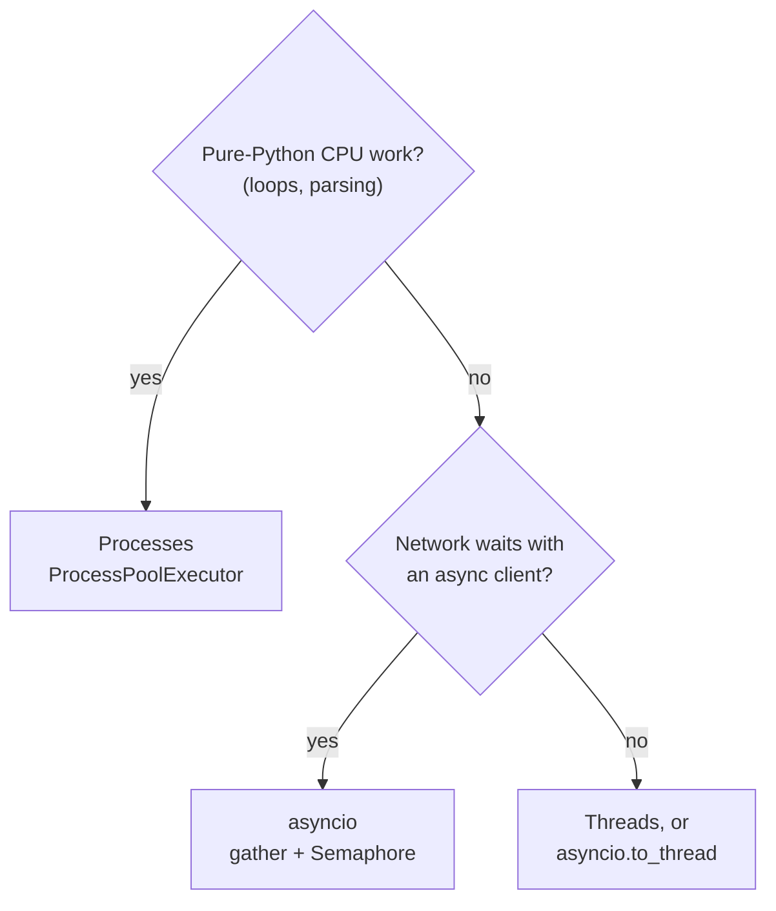
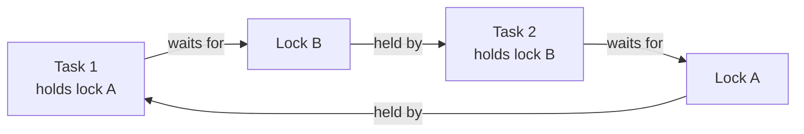

<!-- Generated by site/scripts/rag-theory-import.mjs from rag-agents-engineering. Edit the source there. -->
# Concurrency: threads, processes, the GIL and asyncio (22 runnable scripts)

*Notebooks: [`06a_concurrency_scripts`](https://github.com/Sourav692/rag-agents-engineering/tree/main/course/p01_ai_engineering_foundations/m01_python_data_refresher/optional/06a_concurrency_scripts) (optional)*

## asyncio

A coroutine, written `async def`, is a function that can pause. Each `await` is a pause point: while one coroutine waits for a network reply, the event loop runs another. One thread and one loop can keep many waits overlapping. Scripts 13 to 18 build this up:

- **13:** `asyncio.run(brew_chai())` starts an event loop and runs one coroutine to completion.
- **14:** `asyncio.gather` runs three coroutines that each `await asyncio.sleep(3)`; the waits overlap, so the three take about 3 s instead of 9.
- **15:** the same pattern with real HTTP: three `aiohttp` requests to an endpoint that delays 2 s overlap in one `ClientSession`.
- **16 and 17:** `loop.run_in_executor` hands a blocking function to a `ThreadPoolExecutor`, or CPU-bound work to a `ProcessPoolExecutor`, and awaits the result without stopping the loop.
- **18:** a daemon thread keeps logging while the loop runs a coroutine.

A model call is a network wait of a second or more, and RAG work is full of independent ones: a golden-set evaluation, a batch of embedding requests, one question sent to several retrievers. `gather` starts them together. A `Semaphore` caps how many are in flight, because every provider enforces a rate limit:

```python
sem = asyncio.Semaphore(2)

async def ask(question):
    async with sem:                          # waits here while two calls are in flight
        return await llm.ainvoke(question)

async def main(questions):
    return await asyncio.gather(*(ask(q) for q in questions))
```

With eight Larkspur handbook questions and a semaphore of 2, each queued call starts the moment a slot frees up:

```animated
<figure class="anim sheet" aria-labelledby="anim-semaphore-cap">
  <div class="anim__canvas" tabindex="0" aria-label="Eight calls through a semaphore of two, scrolls sideways on a narrow screen">
    <svg viewBox="0 0 800 340" role="img" aria-labelledby="anim-semaphore-title anim-semaphore-desc">
      <title id="anim-semaphore-title">Eight calls through asyncio.Semaphore(2)</title>
      <desc id="anim-semaphore-desc">Eight model calls start together under asyncio.gather, but a semaphore of two lets only two run at once. Each time a call returns, the next queued call is sent. The last call, server size, returns at 5.6 seconds, against 11.0 seconds for the same calls one at a time.</desc>
      <text class="lane-label" x="16" y="20">Calls in flight, two at a time</text>
      <text class="small" x="206" y="44" style="text-anchor: end">Refund time</text>
      <g class="in-1"><rect class="chunk" x="220.0" y="36" width="110.4" height="16"/><text class="fig" x="352.4" y="44">1.2</text></g>
      <text class="small" x="206" y="76" style="text-anchor: end">Annual billing</text>
      <g class="in-1"><rect class="chunk" x="220.0" y="68" width="73.6" height="16"/><text class="fig" x="315.6" y="76">0.8</text></g>
      <text class="small" x="206" y="108" style="text-anchor: end">Server down</text>
      <path class="line in-1" d="M220 108 H293.6"/>
      <g class="in-2"><rect class="chunk" x="293.6" y="100" width="239.2" height="16"/><text class="fig" x="554.8" y="108">3.4</text></g>
      <text class="small" x="206" y="140" style="text-anchor: end">Export after cancel</text>
      <path class="line in-1" d="M220 140 H330.4"/>
      <g class="in-3"><rect class="chunk" x="330.4" y="132" width="92.0" height="16"/><text class="fig" x="444.4" y="140">2.2</text></g>
      <text class="small" x="206" y="172" style="text-anchor: end">Support speed</text>
      <path class="line in-1" d="M220 172 H422.4"/>
      <g class="in-4"><rect class="chunk" x="422.4" y="164" width="138.0" height="16"/><text class="fig" x="582.4" y="172">3.7</text></g>
      <text class="small" x="206" y="204" style="text-anchor: end">Reboot and IP</text>
      <path class="line in-1" d="M220 204 H532.8"/>
      <g class="in-5"><rect class="chunk" x="532.8" y="196" width="82.8" height="16"/><text class="fig" x="637.6" y="204">4.3</text></g>
      <text class="small" x="206" y="236" style="text-anchor: end">Server size</text>
      <path class="line in-1" d="M220 236 H560.4"/>
      <g class="in-6"><rect class="hit" x="560.4" y="228" width="174.8" height="16"/><text class="fig" x="757.2" y="236">5.6</text></g>
      <text class="small" x="206" y="268" style="text-anchor: end">Promo credits</text>
      <path class="line in-1" d="M220 268 H615.6"/>
      <g class="in-7"><rect class="chunk" x="615.6" y="260" width="101.2" height="16"/><text class="fig" x="738.8" y="268">5.4</text></g>
      <path class="edge" d="M220 300 H772"/>
      <path class="edge" d="M220 300 V306"/><text class="fig" x="220" y="320">0 s</text>
      <path class="edge" d="M312 300 V306"/><text class="fig" x="312" y="320">1 s</text>
      <path class="edge" d="M404 300 V306"/><text class="fig" x="404" y="320">2 s</text>
      <path class="edge" d="M496 300 V306"/><text class="fig" x="496" y="320">3 s</text>
      <path class="edge" d="M588 300 V306"/><text class="fig" x="588" y="320">4 s</text>
      <path class="edge" d="M680 300 V306"/><text class="fig" x="680" y="320">5 s</text>
      <path class="edge" d="M772 300 V306"/><text class="fig" x="772" y="320">6 s</text>
      <g class="in-8"><path class="hit-line" d="M735.2 28 V300"/><text class="fig" x="735.2" y="20">wall 5.6 s</text></g>
      <circle class="tok" cx="0" cy="0" r="7"/>
    </svg>
  </div>
  <div class="anim__controls" hidden>
    <button class="anim__btn" type="button" data-act="prev">Previous</button>
    <button class="anim__btn" type="button" data-act="play" aria-pressed="false">Play</button>
    <button class="anim__btn" type="button" data-act="next">Next</button>
  </div>
  <ol class="anim__steps" id="anim-semaphore-cap">
    <li><button type="button" data-tok="220.0,300">Start</button><span>gather creates eight tasks. The semaphore lets two in: refund time and annual billing are sent; six wait.</span></li>
    <li><button type="button" data-tok="293.6,300">0.8 s</button><span>Annual billing returns and frees a slot. Server down, the slowest call, is sent.</span></li>
    <li><button type="button" data-tok="330.4,300">1.2 s</button><span>Refund time returns. Export after cancel takes its slot.</span></li>
    <li><button type="button" data-tok="422.4,300">2.2 s</button><span>Export after cancel returns. Support speed is sent.</span></li>
    <li><button type="button" data-tok="532.8,300">3.4 s</button><span>Server down returns after 2.6 s in flight. Reboot and IP is sent.</span></li>
    <li><button type="button" data-tok="560.4,300">3.7 s</button><span>Support speed returns. Server size is sent; it will end last.</span></li>
    <li><button type="button" data-tok="615.6,300">4.3 s</button><span>Reboot and IP returns. Promo credits, the last in the queue, is sent after waiting 4.3 s.</span></li>
    <li><button type="button" data-tok="735.2,300">5.6 s</button><span>Server size returns and gather hands back all eight answers: 5.6 s, against 11.0 s one at a time.</span></li>
  </ol>
</figure>
```

The call times are representative; the schedule is what asyncio does with them. The [interactive lab](/labs/rag/m01_python_data_refresher/asyncio-concurrency-lab.html) runs that schedule for every limit from 1 to 8. Its JavaScript scheduler matches real `asyncio.gather` with `asyncio.Semaphore` (Python 3.12, on a virtual clock) on all 128 call intervals (eight calls at eight limits, with each client), start and end within 1e-15 s:

| Semaphore limit | Wall time | Faster than one at a time |
|---|---|---|
| 1 | 11.0 s | 1.0× |
| 2 | 5.6 s | 2.0× |
| 3 | 4.5 s | 2.4× |
| 4 | 3.1 s | 3.5× |
| 7 or 8 | 2.6 s | 4.2× |
| Any, with a sync client | 11.0 s | 1.0× |

Three things follow from the table:

- **A semaphore of 1 is a for loop.** The wall time is the sum of the calls, 11.0 s.
- **The slowest call sets the floor.** *What happens if my server goes down?* takes 2.6 s, so no limit beats 2.6 s, and from 7 on a higher limit changes nothing. Going from 4 to 8 saves 0.5 s; going from 1 to 2 saved 5.4 s. Pick the limit from the provider's rate limit, then measure.
- **A call that never awaits blocks everything.** `llm.invoke`, `requests.get` and `time.sleep` inside `async def` hold the event loop until they return, so no other coroutine starts and the eight calls run one after another at any limit. Use the async method (`ainvoke`, `aiohttp`), or move the sync call to a thread with `await asyncio.to_thread(llm.invoke, question)`, which is what script 16 does with `run_in_executor`.

```lab
src: /labs/rag/m01_python_data_refresher/asyncio-concurrency-lab.html
title: Concurrent calls with asyncio
```

Two more rules for production runs. `gather` raises the first exception to the caller while the other calls keep running; pass `return_exceptions=True` to get every result and every error back in order, so one failed question does not hide the other seven. And in a Jupyter notebook an event loop is already running, so `asyncio.run(main())` raises `RuntimeError`; write `await main()` in the cell instead.

## Threads, processes and the GIL

CPython's global interpreter lock (GIL) lets one thread execute Python bytecode at a time. A thread gives up the GIL while it sleeps or waits on I/O, so threads overlap waiting (scripts 01 and 05 to 07: brewing, toasting, three downloads) but not pure-Python computation. Script 03 runs two threads that each count to 100 million and script 04 runs the same count in two processes; time both on your machine. Each process has its own interpreter and its own GIL, so the processes can use two cores.

Processes cost more. Each starts a new interpreter, its arguments are pickled across, and it shares no memory by default: script 11 sends a result back through a `multiprocessing.Queue`, and script 12 shares one counter through a `Value`. On macOS and Windows a new process imports your script again, which is why scripts 02, 04 and 10 put their start-up code under `if __name__ == "__main__":`.

Scripts 09 and 10 make the same comparison, but 10 counts to a billion per process against 10 million per thread in 09, a hundred times the work. Compare 03 with 04 instead.



Daemon threads (script 19) are killed when the main program exits, which suits a background logger; a regular thread (script 20) keeps the process alive until it returns, so one stuck in a loop keeps the program from ever exiting.

## Races and deadlocks

A race happens when two flows of control read shared state, one changes it, and the other writes back a value computed from the stale read. Script 21 has two threads each run `chai_stock += 1` 100,000 times. On CPython 3.12 it printed 200,000 in all three runs on the machine these pages were written on: the interpreter rarely switches threads inside `+=`, which hides the race without removing it. Put `time.sleep(0)` between the read and the write and two threads of 1,000 increments ended at 1,075 and 1,030 of 2,000.

asyncio has the same bug in a form that never hides. Code between two `await`s runs without interruption, so a race needs an `await` between the read and the write, and a model call is exactly that:

```python
spent = 0

async def ask(cost):
    global spent
    v = spent
    await asyncio.sleep(0.01)                # the model call
    spent = v + cost                         # writes back a stale total
```

Eight of these under `gather` leave `spent` at 1, not 8, on every run: all eight read 0 before any of them writes. Updating after the `await` (`spent += cost` on one line) gives 8; an `asyncio.Lock` around the read and the write also works.

For threads the fix is a lock around the read-modify-write. Script 08 wraps the increment in `with lock:` and ten threads of 100,000 reach exactly 1,000,000; script 12 does the same across four processes with `counter.get_lock()` and reaches 400,000.

Locks bring the opposite failure. In script 22, task 1 holds lock A and waits for B while task 2 holds B and waits for A, so both wait forever:



Acquire locks in one fixed order everywhere (A before B), hold one lock at a time where you can, or use `lock.acquire(timeout=5)` so a thread fails with a visible error instead of hanging.
