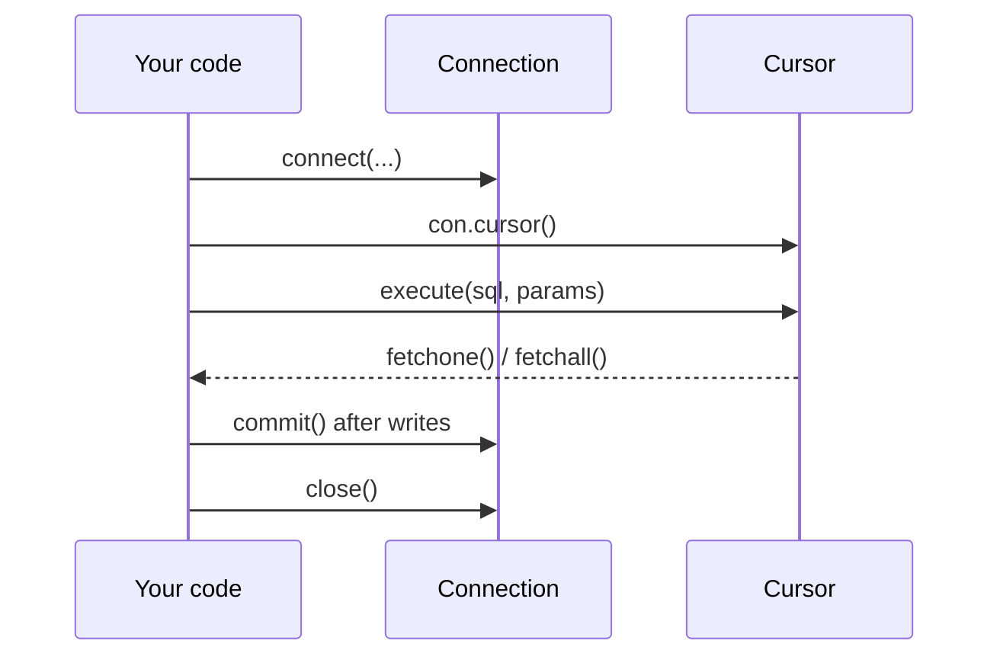

<!-- Generated by site/scripts/rag-theory-import.mjs from rag-agents-engineering. Edit the source there. -->
# Databases from Python: SQLite, MySQL, PostgreSQL

<!-- subtitle: One interface for three databases, and the two habits that keep a lookup safe: parameters and transactions -->
<!-- format: approved -->

## SQL from Python

> **What you'll learn**
>
> - **Explain** the connection, cursor, execute, fetch and commit steps every Python database driver shares.
> - **Explain** why a query parameter cannot rewrite the query, while the same value pasted into the SQL text can.
> - **Predict** what a failed write inside a transaction leaves behind.
> - **Choose** where credentials live and what the application's database user may do.

A support assistant answers *How fast do you reply on my plan?* by looking up the customer's plan in a table. One customer's account holds a plan name with a quote and `OR '1'='1` in it, and the assistant answers with every plan's terms. The lookup was correct; the way the value reached the database was not.

RAG systems keep structured facts in tables because a lookup beats a similarity search when the answer is one exact value. The Larkspur handbook says support tickets are answered within 4 hours on business plans and within 24 hours on starter plans. As a table, `plans` has two rows: `business` with 4 support hours and `starter` with 24.

Python talks to SQLite, MySQL and PostgreSQL through the same interface, the **DB-API**: open a connection, get a cursor, execute a statement, fetch rows, commit writes, close. The three notebooks differ only in the driver and the connection arguments. `sqlite3` ships with Python and opens a file or `:memory:`; PyMySQL and `mysql.connector` need a MySQL server; `psycopg2` needs a PostgreSQL server.

*Figure 1: The DB-API steps, the same for all three databases.*

The plan lookup follows those steps:

| Step | What happens | Result |
|---|---|---|
| Connect | `sqlite3` opens an in-memory database | a connection |
| Create and fill | `plans` is created, then both rows are inserted inside one transaction | two rows, committed |
| Query | `SELECT support_hours FROM plans WHERE name = ?`, with the customer's plan passed separately | the statement runs with the value as data |
| Fetch | `fetchone()` for `starter` | `(24,)` |

*Table 1: The Larkspur plan lookup through the DB-API.*

### Values go in as parameters

The `?` tells the driver to send the plan name as data, separately from the SQL text. Build the same query with an f-string and the value becomes part of the SQL. We call that **query injection**: a value that rewrites the statement it was meant to fill in.

Send the same hostile plan name through both styles of query and compare what reaches the database.

<button type="button" data-mode="fstring" aria-pressed="false" aria-controls="inj-fstring">Pasted into the SQL</button>
<button type="button" data-mode="param" aria-pressed="false" aria-controls="inj-param">Sent as a parameter</button>

<section id="inj-fstring" class="mode-panel" data-announcement="Pasted into the SQL. Every plan comes back."><h4>Pasted into the SQL with an f-string</h4><dl><dt>Plan value</dt><dd>starter' OR '1'='1</dd><dt>Condition the database runs</dt><dd>name equals starter, or 1 equals 1</dd><dt>Rows returned</dt><dd><code>[(4,), (24,)]</code>: every plan in the table</dd></dl></section>
<section id="inj-param" class="mode-panel" data-announcement="Sent as a parameter. Nothing comes back."><h4>Sent as a parameter</h4><dl><dt>Plan value</dt><dd>starter' OR '1'='1</dd><dt>Condition the database runs</dt><dd>name equals that whole string, quotes included</dd><dt>Rows returned</dt><dd><code>[]</code>: no plan has that name</dd></dl></section>

Both results were reproduced on an in-memory SQLite table. The placeholder differs by driver, and each driver publishes it as `paramstyle`:

| Driver | Database | `paramstyle` | Placeholder |
|---|---|---|---|
| `sqlite3` | SQLite | `qmark` | `?` |
| PyMySQL 2.2.8, `mysql.connector` | MySQL | `pyformat` | `%s` or `%(name)s` |
| `psycopg2` 2.9.13 | PostgreSQL | `pyformat` | `%s` or `%(name)s` |

*Table 2: Placeholders by driver, read from each installed driver's `paramstyle`.*

> **Pitfall: query injection.** The `%s` placeholder looks like Python string formatting, but the driver fills it in. Pass the values as the second argument to `execute`, never with the `%` operator or an f-string.

### Writes happen in a transaction

Nothing an `INSERT` or `UPDATE` changes is permanent until `commit()`, which is why notebook 04a calls `connection.commit()` after each write. Using the connection as a context manager (`with con:`) commits when the block succeeds and rolls back when it raises.

Inserting a new `pro` plan and then a duplicate `starter` in one block raises `IntegrityError` (a unique constraint failure on the plan name), and the table still has 2 rows: the `pro` insert was rolled back with the rest. The `with` block does not close the connection; call `close()` yourself.

### pandas sits on top

`pd.read_sql` runs a query and returns a DataFrame, and `df.to_sql` writes one. With [T5.1](/learn/llm-and-retrieval/rag-from-first-principles/rag-from-first-principles-overview)'s baseline rows in a `runs` table, grouping by `k` and averaging recall and precision in SQL gives the same baseline as the pandas `groupby` in [lesson 3 of T2.1](/learn/ai-engineering-foundations/python-and-data-toolkit-refresher/numpy-pandas-and-matplotlib#lesson-pandas-dataframes):

| `k` | Mean recall | Mean precision |
|---|---|---|
| 1 | 0.33 | 0.67 |
| 2 | 0.5 | 0.5 |
| 5 | 0.5 | 0.2 |
| 12 | 0.5 | 0.08 |

*Table 3: The [T5.1](/learn/llm-and-retrieval/rag-from-first-principles/rag-from-first-principles-overview) baseline from one grouped query per k, rounded to two places.*

For MySQL and PostgreSQL, notebook 04b passes `pd.read_sql` a SQLAlchemy engine built from a connection URL that names the driver, user, password, host and database. The engine manages the connections for you.

### Credentials come from the environment

The MySQL and PostgreSQL notebooks put the server host, user and password in a cell so the demo runs as is. In your own code read them from environment variables, or a `.env` file loaded at start-up. Give the application a database user that can only run the statements it needs: a support assistant that answers from the `plans` table needs `SELECT` on that table and nothing else.

SQL returns as a retriever in [T8.3](/learn/advanced-agents/human-approval-and-applied-single-agent-builds/human-approval-and-applied-single-agent-builds-overview), where an agent writes the query itself from the customer's question (text-to-SQL), and as a memory store on SQLite in [T10.2](/learn/memory-and-multi-agent-rag/memory-and-state/memory-and-state-overview).

## Limits of this evidence

- **SQLite only.** The injection results and the rollback were reproduced on an in-memory SQLite database. The MySQL and PostgreSQL notebooks need running servers and were not run; Table 2 reads each installed driver's `paramstyle` instead.
- **Driver versions.** PyMySQL 2.2.8 and `psycopg2` 2.9.13 are the versions installed in this course's environment. Placeholder styles have been stable for years, but check them after an upgrade.
- **Parameters cover values only.** A placeholder can stand for a value, never for a table or column name. Code that chooses a table at run time must pick it from a fixed list.

## References

1. Python, [the database interface specification](https://peps.python.org/pep-0249/), which defines connections, cursors and `paramstyle`.
2. Python, [the sqlite3 module](https://docs.python.org/3/library/sqlite3.html), covering placeholders and using the connection as a context manager.
3. Psycopg, [passing parameters to queries](https://www.psycopg.org/docs/usage.html#passing-parameters-to-sql-queries), on why the `%` operator must never fill them in.

## Run the notebooks

The code for this lesson is in these notebooks. Colab runs one in your browser: install the packages its first cell imports and set the API keys it reads. To run every notebook as written, clone the repository and use its uv environment.

| Notebook | GitHub | Colab |
|---|---|---|
| Sqlite operations | [Open on GitHub](https://github.com/Sourav692/rag-agents-engineering/blob/main/p01_ai_engineering_foundations/m01_python_data_refresher/mandatory/notebook/04a_sqlite_operations.ipynb) | [Open in Colab](https://colab.research.google.com/github/Sourav692/rag-agents-engineering/blob/main/p01_ai_engineering_foundations/m01_python_data_refresher/mandatory/notebook/04a_sqlite_operations.ipynb) |
| Mysql connection (optional) | [Open on GitHub](https://github.com/Sourav692/rag-agents-engineering/blob/main/p01_ai_engineering_foundations/m01_python_data_refresher/optional/notebook/04b_mysql_connection.ipynb) | [Open in Colab](https://colab.research.google.com/github/Sourav692/rag-agents-engineering/blob/main/p01_ai_engineering_foundations/m01_python_data_refresher/optional/notebook/04b_mysql_connection.ipynb) |
| Postgresdb connection (optional) | [Open on GitHub](https://github.com/Sourav692/rag-agents-engineering/blob/main/p01_ai_engineering_foundations/m01_python_data_refresher/optional/notebook/04c_postgresdb_connection.ipynb) | [Open in Colab](https://colab.research.google.com/github/Sourav692/rag-agents-engineering/blob/main/p01_ai_engineering_foundations/m01_python_data_refresher/optional/notebook/04c_postgresdb_connection.ipynb) |

## Key Takeaways

- Use a table lookup when the answer is one exact value. SQLite, MySQL and PostgreSQL share the DB-API steps; only the driver, connection arguments and placeholder change.
- Pass values as the second argument to `execute`, never through an f-string or the `%` operator, so the driver sends them as data and they cannot rewrite the query.
- Writes count only after `commit()`, and `with con:` rolls back the whole block on an error without closing the connection. Keep credentials in the environment and grant only the statements the application needs.

## Check yourself

1. A customer's plan arrives as the string starter' OR '1'='1. Why does the f-string query return every plan while the parameterised one returns nothing?

The `?` placeholder makes the driver send the value as data, separately from the SQL text, so the query looks for a plan with that literal name and returns `[]`. The f-string puts the value inside the SQL, so `OR '1'='1'` becomes part of the condition and matches every row: `[(4,), (24,)]`.

2. Inside one with con: block you insert a pro plan and then a duplicate starter plan. How many rows does plans hold afterwards, and is the connection open?

Two rows, and the connection is still open. The duplicate raises `IntegrityError`, so `with con:` rolls back the whole block, including the `pro` insert. The `with` block commits or rolls back but does not close the connection; call `close()` yourself.

3. The PostgreSQL notebook puts the host, user and password in a cell. What should the Larkspur support assistant's own code do instead?

Read the credentials from environment variables, such as `os.environ["PGPASSWORD"]` or a `.env` file loaded at start-up. Give the application a database user that can only run the statements it needs: an assistant that answers from the `plans` table needs `SELECT` on that table and nothing else.

