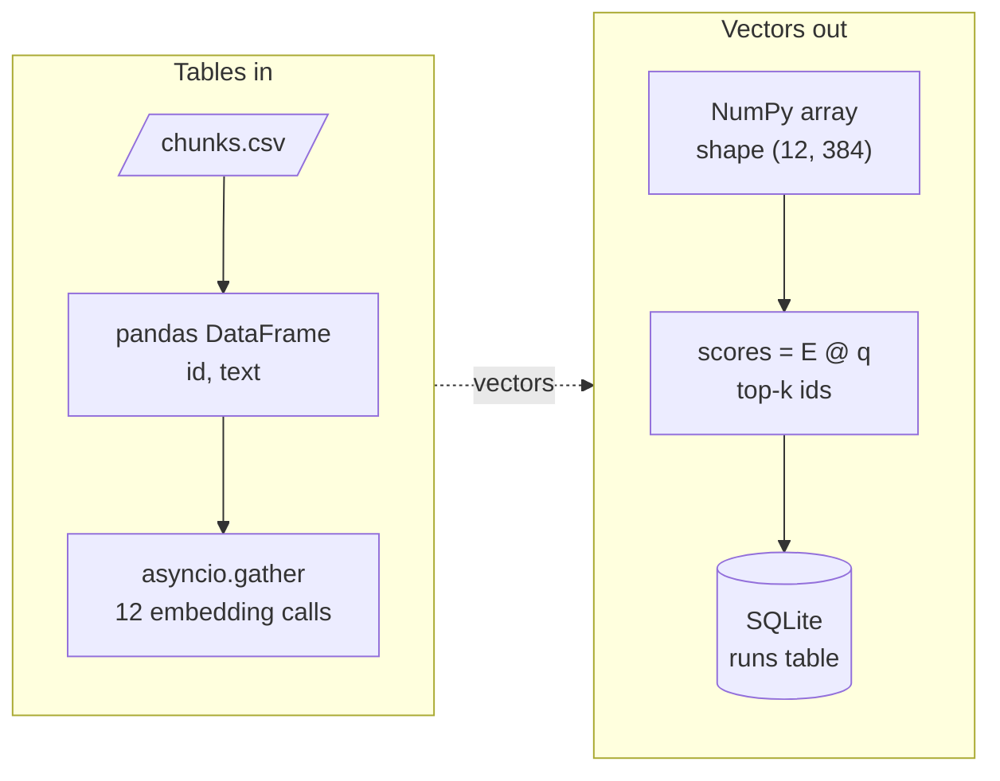

<!-- Generated by site/scripts/rag-theory-import.mjs from rag-agents-engineering. Edit the source there. -->
# Overview

Every RAG and agent notebook in this course moves data through the same few Python tools. Chunks arrive as rows in a table, become rows of a float matrix, get scored with one matrix product, and the results land back in a table you can query. The model calls in between are slow network waits, so they run concurrently. The M01 notebooks build on four ideas: NumPy arrays, pandas DataFrames, SQL from Python, and asyncio for concurrent calls.

The running example is the Larkspur Cloud handbook that [M11](/learn/llm-and-retrieval/rag-from-first-principles/rag-from-first-principles-overview) to [M13](/learn/ingestion-and-indexing-pipeline/chunking-and-indexing/chunking-and-indexing-overview) index: twelve chunks on pricing, refunds, exports, outages and server sizing. Here the chunks sit in a DataFrame and a NumPy matrix, [M11](/learn/llm-and-retrieval/rag-from-first-principles/rag-from-first-principles-overview)'s baseline numbers sit in a SQLite table, and the lab sends eight handbook questions to a model at once.

## In short

- An embedding index is a 2-D NumPy array, one row per chunk. Normalise the rows with `keepdims=True` and one matrix product gives every cosine score. Without `keepdims`, a square toy matrix divides columns instead of rows and the ranking flips.
- `float32` halves the memory of `float64`: a million 1,536-dimension vectors take 6.1 GB instead of 12.3 GB.
- The baseline row every later module compares against is a `groupby`: [M11](/learn/llm-and-retrieval/rag-from-first-principles/rag-from-first-principles-overview)'s mean recall is 0.33, 0.50, 0.50 and 0.50 at `k` = 1, 2, 5 and 12. `mean()` skips `NaN`, so a question that errored silently raises the average.
- Pass values to SQL as parameters (`?` in `sqlite3`, `%s` in PyMySQL and psycopg2), never through an f-string. A plan name of `starter' OR '1'='1` returns every plan when the query is built from a string.
- In the lab, eight model calls take 11.0 s one at a time, 5.6 s with a semaphore of 2, 3.1 s with 4, and 2.6 s from a limit of 7, the time of the slowest call. A sync client inside `async def` keeps it at 11.0 s at any limit.

## Mental model

Each tool holds the data in the shape the next step needs. pandas keeps labelled rows and columns, NumPy keeps one dtype in a fixed shape so arithmetic runs on whole arrays, SQL keeps results you can filter and group later, and asyncio keeps the slow calls from waiting on each other. Most bugs in the later modules are a shape, a dtype or a blocked event loop at one of these handoffs.

## Interactive lab

[**Concurrent calls with asyncio**](/labs/rag/m01_python_data_refresher/asyncio-concurrency-lab.html): open the file in a browser. Slide the semaphore from 1 to 8 and watch the wall time fall from 11.0 s to 2.6 s, then stop falling at 7. Then switch the client to `llm.invoke` and move the slider again; nothing changes, because a sync call never hands the event loop back.

## How it connects

- **Before:** nothing. M01 is the first module; skim the lessons you know.
- **Next:** [M02](/learn/ai-engineering-foundations/llm-provider-apis-and-model-selection/llm-provider-apis-and-model-selection-overview) makes the model calls this module runs concurrently. NumPy scoring returns in [M11](/learn/llm-and-retrieval/rag-from-first-principles/rag-from-first-principles-overview) (TF-IDF nearest neighbours) and [M14](/learn/ingestion-and-indexing-pipeline/embeddings-and-model-selection/embeddings-and-model-selection-overview) (embeddings). SQL becomes a retriever in [M27](/learn/agentic-systems/human-approval-and-applied-single-agent-builds/human-approval-and-applied-single-agent-builds-overview) (text-to-SQL) and a memory store in [M34](/learn/memory-and-multi-agent-rag/memory-and-state/memory-and-state-overview). asyncio drives LangGraph's async nodes in [M10](/learn/langchain-and-langgraph-fundamentals/langgraph-runtime-persistence-hitl-and-streaming/langgraph-runtime-persistence-hitl-and-streaming-overview) and the parallel agents of [M36](/learn/memory-and-multi-agent-rag/collaboration-control-and-parallel-agents/collaboration-control-and-parallel-agents-overview).

## Key Takeaways

- Keep vectors in one 2-D array of a fixed dtype; check `.shape` and `.dtype` before you trust a score.
- Make the baseline a `groupby` over a long results table, and compare `count()` with `size()` before you read the mean.
- Every value that reaches SQL from outside goes in as a parameter, and every credential comes from the environment.
- Use asyncio for many slow network calls, cap them with a semaphore, and make sure every call inside `async def` is awaited.
