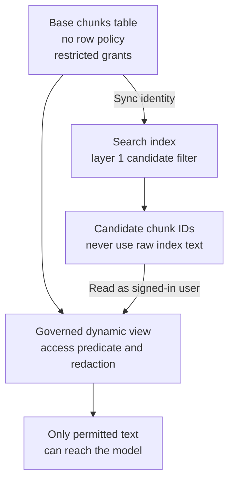

# Access-Controlled RAG on Databricks

*Letting the platform enforce access deletes code that had to be proven correct, but the vector index sits outside that enforcement and forces a split design.*

## Understand the Customer Problem

In this scenario, Meridian Cloud wants the permission-aware assistant from the previous case to run on Databricks. Support agents need useful answers without seeing engineering, commercial, or another tenant's restricted material. The customer already has a data platform and wants to reuse its governance. The challenge is keeping search candidates separate from the text that the signed-in user is actually allowed to read.

Reuse [the enterprise RAG design](/learn/ai-systems-design/classic-ai-designs/access-controlled-enterprise-rag), then explain where Unity Catalog enforces access and where the application must still constrain search. The source calls the product Vector Search; current documentation calls it [AI Search](https://docs.databricks.com/aws/en/ai-search/ai-search/).

---

## Plant the Hook in the Framing Sentence

Use this version when the interviewer is a Databricks customer or asks how the design runs on their stack. The persona table, the scope and the generic failure table are the same as in [Access-Controlled Enterprise RAG](/learn/ai-systems-design/classic-ai-designs/access-controlled-enterprise-rag). The framing sentence changes its ending. On Databricks, most of the access work is Unity Catalog's job rather than ours, with two specific exceptions that decide the physical architecture.

That last clause plants a hook. It signals knowledge of the sharp edge before anyone asks. The time plan shifts to match: 15–35 minutes go to the two Vector Search facts and the two-layer answer.

Add four Databricks-specific clarifying questions. Is Unity Catalog already the governance boundary, or is data still in a Hive metastore and external systems? If not, that migration is the first project, not the RAG. Are groups SCIM-synced from Okta or Entra? Hand-managed workspace groups break live revocation. Must source-system permissions be mirrored per document, or is a coarser model acceptable? Finally, is serverless available, and in which cloud and region? Residency is both a row-filter rule and a workspace-placement decision.

## Lead With the Two Vector Search Facts

Draw the naive design first, then break it. The naive claim is that Unity Catalog governs the table, so the index is governed too. It is not.

First fact: Databricks Vector Search does not enforce Unity Catalog row filters or column masks. The documentation says row- and column-level permissions are not supported, and points to application-level ACLs through the filter API. The index is a derived copy. The sync pipeline reads with its own identity and writes into a serving system with no concept of end users. With no query-time principal, `is_account_group_member()` has nobody to evaluate.

Second observation: the supplied reference build failed when creating an index over a source table with row/column security. Treat this as a recorded build result, not a new workspace test or a promise about every index configuration.

```text
BadRequest: Table main.meridian_rag.chunks cannot have both
            row/column security and online materialized views.
```

The [current limitations](https://docs.databricks.com/aws/en/ai-search/ai-search/) still say row- and column-level permissions are unsupported. Validate the target configuration before building on the reference observation.

## Split the Base Table From the Governed View

The platform forces a physical split.



Because the base table carries no policies, granting anyone `SELECT` on it bypasses the whole access model. Locking it to the pipeline identity stops being hygiene and becomes load-bearing. Write that rule down and audit it.

> **Warning: `CREATE OR REPLACE TABLE` does not detach an attached row filter.** A half-finished setup run can leave the table permanently un-indexable until the filter or the schema is dropped. Make the setup idempotent.

## Let Unity Catalog Be the Second Layer

The two-layer answer from the platform-agnostic design survives, but layer 2 changes owner. Layer 1 is the Vector Search filter. It runs as the service principal, compiled from the caller's groups and passed on every query. It narrows candidate results according to the endpoint filter semantics. It is not the authoritative user-access decision.

Layer 2 re-reads the returned chunk IDs from the governed view, on behalf of the user. Unity Catalog applies the row filter and column mask itself, and that is the authoritative decision. The text that reaches the model is what layer 2 returned, never what the index returned.

Layer 2 is not application code; it is the same engine that governs every dashboard in the company. The platform-agnostic build had to write that post-check in Python and prove it with tests. Here that code is deleted and the platform enforces it. That is the argument for building on Databricks rather than beside it.

## Write the Policy Once, in SQL

Express tenant, clearance, region, validity dates, group access, need-to-know, and external-user restrictions in a governed SQL policy. Keep the search source separate from the governed read. The following is an illustrative view over a trusted entitlement table; adapt and test the actual schema.

```sql
CREATE OR REPLACE VIEW kb.chunks_secure AS
SELECT c.chunk_id, c.doc_id,
       CASE WHEN NOT c.contains_pii
                 OR is_account_group_member('pii_readers')
            THEN c.content ELSE '[REDACTED]' END AS content
FROM kb.chunks c
WHERE EXISTS (
  SELECT 1 FROM security.user_entitlements e
  WHERE e.user_email = current_user()
    AND c.tenant_id = e.tenant_id
    AND c.sensitivity_lvl <= e.clearance_lvl
    AND (c.region = 'GLOBAL' OR c.region = e.region)
    AND (c.valid_from IS NULL OR c.valid_from <= current_date())
    AND (c.valid_until IS NULL OR current_date() <= c.valid_until)
    AND (c.need_to_know IS NULL OR c.need_to_know = e.compartment)
    AND arrays_overlap(c.allowed_groups, e.groups)
    AND (NOT e.is_external OR c.source_system NOT IN ('contract','pricing'))
);
```

This example assumes tenant-scoped entitlements with `groups` and `compartment` fields. A deployed policy needs deny precedence, validity semantics, and persona tests. The view redacts entire sensitive content; an email-only regex would not be a complete PII control. Grant readers `SELECT` on the view, not the base. Other governed tables can use `SET ROW FILTER` and column masks.

PII becomes a column mask keyed on `is_account_group_member('pii_readers')`. Draw the distinction for anyone who knows the platform. A Unity Catalog column mask is an access-control primitive. `ai_mask` is an AI transform, and it should never sit between a user and PII.

Revocation depends on identity synchronisation and query-time policy freshness. `is_account_group_member()` evaluates account membership; SCIM propagates changes from the identity provider. Measure propagation and invalidate scoped caches. Do not promise immediate revocation from an upstream change.

## Encode Groups for the Index Filter

The reference uses scalar group flags rather than assuming array-containment support in the index filter. Confirm the deployed endpoint's [filter operators](https://docs.databricks.com/aws/en/ai-search/filtering-guide). The governed SQL read can use richer predicates.

| Encoding | How | Cost |
|---|---|---|
| One boolean column per group (default for a bounded group set) | `tenant_id='meridian' AND sensitivity_lvl<=2 AND region IN ('GLOBAL','EU') AND (grp_public=true OR grp_support_t3=true OR grp_engineering=true)` | A column per group |
| One row per chunk and group | Filter `group_id IN (...)` | Handles unbounded groups, but multiplies vectors, the expensive thing |

The reference build hit a gotcha worth telling. On a Standard endpoint, filters are dictionaries, and a multi-column OR is positional. Its value must be an array with one element per OR clause.

```python
{"grp_a OR grp_b": True}          # 400: "input must be an array"
{"grp_a OR grp_b": [True]}        # 400: "length of value != number of clauses"
{"grp_a OR grp_b": [True, True]}  # works: grp_a = true OR grp_b = true
```

The array must be regenerated whenever the caller's group count changes. Build the clause and its value array from the same list so they cannot drift.

## Choose the Storage-Optimized Endpoint

The reference chooses Storage-Optimized for its SQL-like filter syntax. Standard uses dictionary filters. Build either form from trusted, allow-listed attributes, not raw model or user strings.

| | Standard | Storage-Optimized (choose) |
|---|---|---|
| Latency | 20–50 ms | 300–500 ms |
| Capacity | ~320M | 1B+ |
| Cost | Higher | ~7× lower |
| Filters | Dictionary | SQL string |

These are the source's illustrative comparison figures, not a benchmark or current price quote. A 300–500 ms retrieval still adds to a 2-second generation. Compare end-to-end latency, vector dimensions, update rate, and actual cost before choosing an endpoint.

Retrieval itself shrinks to parameters. Hybrid search is one parameter, replacing a hand-rolled BM25 index. It also removes the worst limitation of the platform-agnostic build, the per-request lexical index over the authorised pool. The source proposes managed reranking over the top ~50 candidates. Verify availability and where it runs. In this case, do not let a managed reranker read raw index content before the governed re-read.

```python
index.similarity_search(
    query_text=q,
    query_type="HYBRID",              # dense + BM25, managed
    filters=acl_filter,               # layer 1, on every call
    columns=["chunk_id", "doc_id"],   # fetch text only through the governed view
    num_results=20)
```

After the governed read, rerank only its permitted text. Multi-query, hypothetical-document embeddings (HyDE), decomposition, and Reciprocal Rank Fusion (RRF) remain orchestration choices to evaluate.

## Carry the User's Identity to the Governed Read

The governed read must run as the signed-in user, not the search sync principal. Validate that a user token exists, confirm the expected principal, and create the request-scoped client. Never silently fall back to a broadly privileged service identity.

The source discusses `x-forwarded-access-token` and `get_user_workspace_client()`. Choose the supported mechanism for the actual host. [Databricks Apps on-behalf-of-user authorisation is now generally available](https://www.databricks.com/blog/now-ga-building-permission-aware-databricks-apps-behalf-user-authorization); that is distinct from the source's agent-endpoint preview configuration. Check declared scopes and hosting-specific setup.

The source mentions a ~5-minute refresh lag. Treat it as a historical caveat, not a revocation guarantee. Measure identity propagation and cache freshness in the deployed environment.
