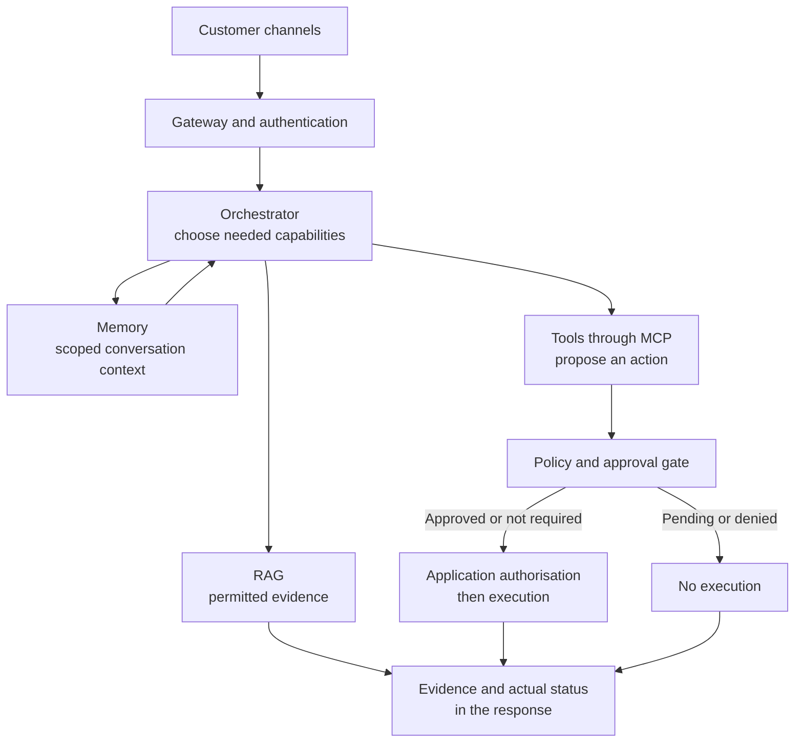
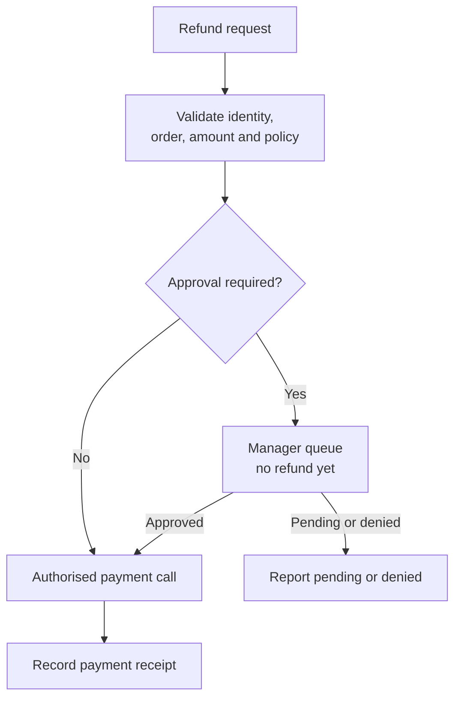
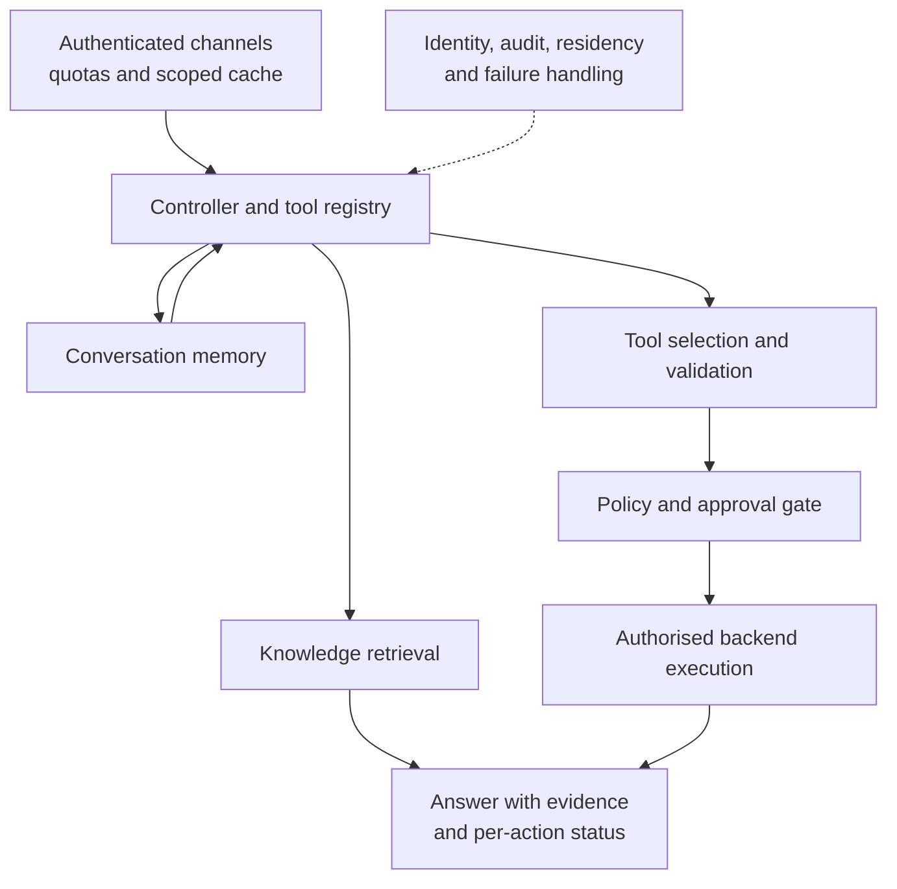

# Customer Support Assistant: Knowledge, Actions, and Approval

*Letting the assistant answer and act autonomously cuts response time, while routing risky actions to a person keeps money and compliance under control.*

## Understand the Customer Problem

In this scenario, customers need help with policies, damaged orders, refunds, and account issues. Information sits across product documents and business systems. The support team wants one assistant that can explain an answer and carry out permitted work. It must keep customers' data separate, remember relevant conversation details, and wait for a person when an action needs approval.

Separate knowledge, actions, and memory. Retrieval-augmented generation (RAG) supplies evidence; validated tool calls request changes. Use [the enterprise assistant](/learn/ai-systems-design/classic-ai-designs/enterprise-ai-assistant-integration-layers-at-scale) for the integration layers underneath.

---

## Clarify What It Answers and What It Does

The prompt asks for a customer-support platform in the style of Salesforce Einstein plus Zendesk plus AI agents. It answers FAQs, creates and updates tickets, queries CRM, processes refunds and escalates cases. The interviewer wants to hear when to use RAG, agent orchestration, tool calling, MCP servers, human approval and memory, and what each costs.

| Question | Answer | What it decides |
|---|---|---|
| Answering only, or executing actions? | **Both** | Retrieval *and* action paths |
| Where does product knowledge live? | Docs, knowledge base, CRM, order management, ticketing | Exactly the shape RAG is built for |
| Can the AI make business decisions independently, such as a $5,000 refund? | No | Human-in-the-loop for sensitive operations |
| Scale? | ~1M conversations/day globally (this consumer-support scenario) | Cost optimisation is first-class |
| Should it remember previous conversations? | Yes | Conversational memory on top of enterprise knowledge |

These are scenario assumptions. Ask who owns approval thresholds, which tenant/customer may see each document, and how asynchronous applications report completion. Name the policy owner before implementing a refund rule. The Customer Support Automation case sizes a different scenario, 2M tickets a month at 100 QPS peak.

## Draw Capabilities as Peers, Not a Pipeline



RAG, tool calling and memory sit side by side. The orchestrator draws on whichever one the request needs. They are not stages every request must pass through. This is the same lesson as the travel agent in [Reviewing an Agent Architecture](/learn/ai-systems-design/design-framework/reviewing-an-agent-architecture): retrieval is something an agent calls when it needs it.

## Use RAG for Answers and Tools for Actions

"What is your refund policy?" needs permitted policy evidence. "Refund my order" needs an application to make a change. RAG helps ground an answer; check whether current evidence actually supports it.

A structured tool call is a proposal. Application code validates arguments and authorisation before dispatch. Model Context Protocol (MCP) standardises discovery and invocation. It does not replace application APIs or selective tool loading. See the [MCP tools specification](https://modelcontextprotocol.io/specification/2026-07-28/server/tools).

## Save the Planner for Cross-System Requests

"Track my order" may need one read. A damaged-laptop request spanning refunds, warranty, shipping, and tickets needs coordination. One controller can track those dependencies and results. Add specialist agents only when their separation earns the extra cost and failure handling.

## Split Memory Into Three Layers

| Layer | Holds | Example |
|---|---|---|
| **Short-term** | Context within the session | "Where's my package?" … "Can you refund it?": *it* is the same order |
| **Long-term customer** | Preferences and history across sessions | Language, channel, past purchases, past support interactions |
| **Enterprise knowledge** | Stored separately in RAG | Product docs, policies, FAQs, troubleshooting |

Keep enterprise knowledge apart from conversational memory. A stale preference and an outdated policy fail very differently. Mixing them makes both harder to find and fix. Separation improves accuracy and maintainability at once.

## Put a Human Between the Assistant and Risky Actions

Human approval is required for high-risk or high-value actions. Examples are refunds above a threshold, VIP escalations, account deletion, legal or compliance requests, and changes to payment information.



Policy checks decide which requests need approval. The design goal is that most requests never reach a human, so measure the queue volume rather than assume the goal is met.

> **Warning: the LLM never bypasses application authorisation.** Every tool call propagates enterprise identity, OAuth, RBAC/ABAC and audit. Business systems stay the source of truth. An approval queue protects nothing if the model can reach the refund system under its own authority.

## Scale to 10M Conversations a Day

At 50M customers and 10M conversations a day, seven moves carry the load. Keep gateways, orchestrators and LLM routing stateless behind load balancers. Partition embeddings by product, region, language and business unit instead of searching everything. Cache eligible policy answers within tenant, access, version, and freshness boundaries. "Where is my order?" needs current customer-specific data; never reuse another customer's answer.

Run refunds, warranty cancellations and shipping investigations asynchronously. The assistant replies "your request has been submitted" at once. Rate-limit per user, per tenant and per tool, with circuit breakers. Route by cost: an FAQ goes to a small model, and a refund investigation to a large reasoning model. Propagate identity on every tool call as the warning above requires.

Globally, run regional gateways and orchestrators. Partition knowledge indexes by geography where residency requires it. Keep stateless services active-active and customer data within compliance boundaries. Route each user to the nearest healthy region.

The full request path puts the semantic cache after the gateway, rate limiter and intent classifier. Only an eligible, revalidated hit bypasses generation. On a miss, one bounded orchestrator plans the calls through the shared capability layer. That layer holds RAG over partitioned vector stores, short- and long-term memory, MCP tool calls and a model gateway. Approval precedes high-risk writes. Backend receipts determine the response. Monitor the whole path.

| Technology | Best use | Advantages | Trade-offs |
|---|---|---|---|
| RAG | Enterprise knowledge retrieval | Accurate, current | Indexing and embedding pipeline |
| Tool calling | Deterministic business actions | Reliable, auditable | Limited to predefined tools |
| MCP | Standardised integrations | Discoverability, extensibility | An extra abstraction layer |
| Agent framework | Multi-step workflows | Modular, parallel | Orchestration complexity |
| Human approval | High-risk operations | Governance, compliance | Response time |
| Memory | Personalised conversations | Better experience | Lifecycle management, privacy |
| Semantic cache | Repeated questions | Latency and cost | Invalidation complexity |

## Combine Both Assistant Designs Into One Spine

This design and the enterprise assistant are complementary. The enterprise assistant goes deep on integration methods and tool discovery at scale. Its main focus is not retrieval, memory, or detailed approval policy. The support assistant covers the full agent loop: RAG, memory, human-in-the-loop and model routing. It does not revisit the tool-registry scaling problem. Together they provide a starting point, with the gaps below still open.



Both cases agree on one principle: the application, never the LLM, is the source of truth. Both apply RBAC/ABAC, identity propagation per tool call and audit logging.

## Raise the Four Gaps Both Designs Leave

Four concepts are missing from both handbook designs (this assistant and the enterprise assistant), and a senior interviewer waits for them. The Customer Support Automation case closes two of them. It treats customer text as untrusted data, and it derives model and retrieval call volumes from 2M tickets a month.

| Gap | Why it matters | Where to bring it from |
|---|---|---|
| **Guardrails and prompt-injection defence** | Neither fully designs untrusted-input handling or prompt-injection defence | Security and governance in [Scale, Reliability, and Security](/learn/ai-systems-design/design-framework/scale-reliability-and-security); architectural injection defence, separate channels and red teaming elsewhere in the curriculum |
| **Prompt management and versioning** | System prompts are implied but never treated as versioned, tested artefacts | Prompt management as a versioned component in [Architecture, Data, and Request Flow](/learn/ai-systems-design/design-framework/architecture-data-and-request-flow) |
| **Disaster recovery and chaos testing** | Multi-region appears for latency and residency, but neither walks through losing a region or the LLM provider | Chaos testing, multi-region failover and reliability versus availability in [Scale, Reliability, and Security](/learn/ai-systems-design/design-framework/scale-reliability-and-security) |
| **Explicit capacity estimation** | Both state a target (1M or 10M conversations/day; 50K–200K employees) but neither derives RPS, storage or bandwidth | Capacity estimation in [The Twelve-Part Design Framework](/learn/ai-systems-design/design-framework/the-twelve-part-design-framework); the coding assistant's latency budget; the logistics design's event-throughput sizing |

Walk the spine top to bottom when you draw an agentic assistant, and check every row. Raise the four gap rows unprompted in the cross-cutting step of the [60-minute method](/learn/ai-systems-design/sixty-minute-whiteboard/deep-dive-failure-modes-and-the-close).

## Worked Example: The Damaged Laptop

> **Added production guidance:** the clarification, payload, and failure contract are illustrative extensions to the source case.

### Resolve the Order and Policy

Ask: "Which order and damaged item? Do you want the warranty cancelled too?" Resolve the order under the verified account. Confirm which actions depend on refund approval.

### Follow the Request

A customer writes: "My laptop arrived damaged. Refund the order, cancel the warranty, notify shipping, and create a high-priority ticket." The gateway authenticates the customer, and the semantic cache misses because the request is specific. The orchestrator sees four actions across systems, so the planner decomposes it.

Short-term memory resolves "the order" to the laptop order from earlier in the session. The orchestrator drafts the refund through the payments MCP server. Its value crosses the approval threshold, so it goes to the manager queue rather than executing. Independent warranty, shipping, and ticket work proceeds only where policy permits. Work dependent on the refund waits for its outcome. The cancellation and investigation run asynchronously. The customer gets "your request has been submitted" at once.

Every capability played its own part. Memory resolved a reference, tools acted, the planner coordinated, and approval held back the one action that moves real money. No step needed RAG, and none was forced through it.

### Trace the Refund Proposal

Application code supplies trusted account and tenant scope. The model proposes business arguments; the payment application checks access and eligibility.

```json
{
  "proposal": {"action": "refund_order", "order_id": "order-42"},
  "trusted_context": {"tenant": "tenant-a", "customer": "customer-7"},
  "policy_result": "approval_required",
  "execution": "not_started",
  "approval_id": "approval-19"
}
```

This is an approval receipt, not a refund receipt. After approval, dispatch under a supported deduplication contract and record the payment result.

### Handle Pending and Uncertain Outcomes

| Situation | Next step | Customer-facing result |
| --- | --- | --- |
| Manager has not approved | Keep refund queued. | Pending approval. |
| Cancellation denied | Stop that action; retain other confirmed results. | Report each result separately. |
| Payment response times out | Reconcile authoritative status before retrying. | Refund status unconfirmed. |

A stable operation ID helps only when the backend supports deduplication. Bound retries; a local ID cannot prevent duplicate payments by itself. See [HTTP retry guidance](https://www.rfc-editor.org/rfc/rfc9110.html#section-9.2.2).

## Explain the Design in 60 Seconds

> "I'd separate policy questions from business actions. RAG would retrieve current, permitted evidence; validated tools would request changes. Customer identity would stay attached to each read and action. Memory would preserve conversation context without becoming the source of policy truth.
>
> For a damaged laptop, one controller would track refund, warranty, shipping, and ticket work. It would resolve missing details and wait for required approval. Backend receipts would establish completion. For growth, I'd use scoped caching, queues, quotas, partitioned knowledge, and model routing. I'd report partial results and reconcile uncertain writes. Prompt injection, prompt versioning, recovery, and capacity estimates would need explicit follow-up designs."

---

## Key Takeaways

- Five clarifying answers (act as well as answer, scattered knowledge, no autonomous $5,000 refunds, ~1M conversations/day, remembered history) set the shape.
- RAG, tool calling and memory are peer capabilities the orchestrator calls, not a pipeline.
- RAG grounds answers in permitted evidence; validated tools request actions; MCP standardises access.
- Use a controller for dependencies; several steps do not automatically require several agents.
- Keep short-term, long-term customer and enterprise knowledge apart, because they fail differently.
- Route refunds above a threshold, VIP escalations, deletions, legal requests and payment changes through human approval, after AI validation.
- Scale with statelessness, partitioned embeddings, a semantic cache after the intent classifier, async work, rate limits and model routing.
- The enterprise and support designs combine into one agentic spine.
- Both leave four gaps: guardrails, prompt versioning, disaster recovery, and derived capacity numbers.

## Check Yourself

<details>
<summary>1. Why are RAG, tool calling and memory peers rather than a pipeline?</summary>

Each request needs a different subset. "Track my order" needs one tool call and no retrieval. Forcing every request through all three adds latency and cost for nothing.

</details>

<details>
<summary>2. Enterprise knowledge is listed as a memory layer. Why is it stored separately?</summary>

It lives in RAG, not conversation memory. A stale preference and an outdated policy fail differently, so keeping them apart makes each easier to find and fix.

</details>

<details>
<summary>3. Name the four gaps both assistant designs leave, and when to raise them.</summary>

Guardrails and prompt-injection defence, prompt versioning, disaster recovery and chaos testing, and explicit capacity estimation. Raise them unprompted in the cross-cutting part of the round.

</details>

<details>
<summary>4. Which three discovery questions make the action path concrete?</summary>

Who owns approval thresholds, which sources are current and visible to this customer, and how asynchronous systems confirm completion.

</details>

<details>
<summary>5. Does a structured refund proposal prove a refund happened?</summary>

No. Policy may require approval, and only an authoritative payment result confirms execution.

</details>

<details>
<summary>6. Can a semantic cache answer every repeated order-status question?</summary>

No. Personal order state needs customer scope and freshness; eligible policy answers have different cache rules.

</details>

<details>
<summary>7. Does a cross-system request require several agents?</summary>

No. One controller can coordinate dependencies. Add specialists only when their benefit justifies overhead.

</details>

<details>
<summary>8. What should happen after a payment timeout?</summary>

Mark the result unconfirmed, reconcile backend status, and retry only under a safe deduplication contract.

</details>

<details>
<summary>9. Why keep policies out of conversation memory?</summary>

Policies need an authoritative, versioned source. Customer history cannot establish the current refund rule.

</details>

