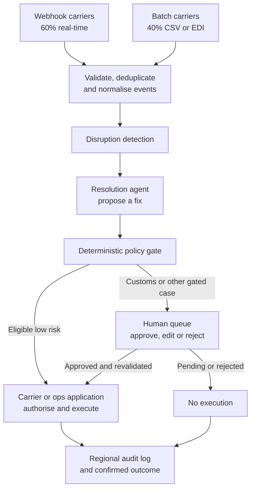
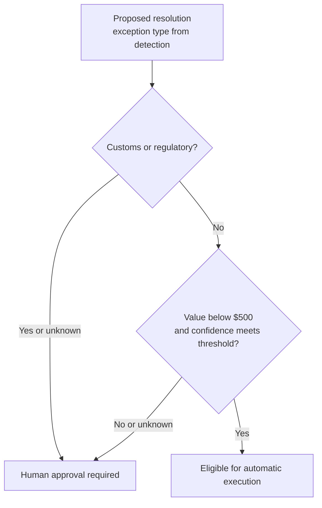
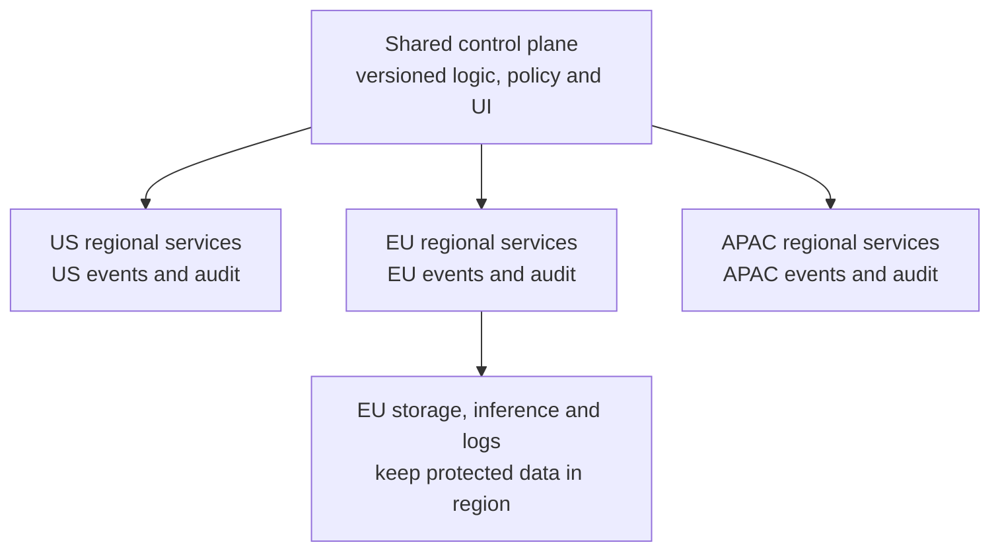

# Logistics Exceptions: Designing Around a Policy Gate

*Auto-resolving disruptions clears the backlog faster, while every action the assistant takes without a person has to stay inside a boundary the customer will be held accountable for.*

## Understand the Customer Problem

In this scenario, a logistics operations team watches shipments across many carriers. Customs holds, missed scans, and weather delays create work that agents must resolve before shipments stay stuck. Some carriers send live events; others send files hours apart. The customer wants low-risk fixes handled automatically, sensitive cases routed to a person, and regional shipment data kept within its required location.

Let the customer's answers shape ingestion, the policy gate, and regional deployment. Use [the first ten minutes](/learn/ai-systems-design/sixty-minute-whiteboard/the-six-step-whiteboard-clock) to establish those boundaries.

---

## Let Each Answer Move a Box

The scenario puts an FDE inside a mid-size logistics customer. The customer wants an assistant that watches the shipment pipeline. It detects customs holds, missed carrier scans and weather delays. It auto-resolves each disruption or drafts a fix for a human ops agent. It spans many carriers. Feeds are a mix of real-time and batch.

Four clarifying questions decide the design.

| Asked | Answer | Implication |
|---|---|---|
| **Data volume and freshness per carrier?** | Mixed. ~60% of carriers push real-time webhooks (scan events, status changes), ~200 events/s combined at peak. ~40%, mostly smaller regional carriers, drop CSV/EDI batch files every 2–6 hours, a few thousand records each | Ingestion needs **both** a streaming path and a scheduled batch path feeding the same pipeline |
| **Who are the users, and what scale?** | Internal only: the customer's ops team. ~150 agents across three shifts, ~40 concurrent at peak during shift handoff, each handling 30–50 cases a day | **Low-DAU, high-stakes-per-interaction.** Scale pressure comes from event throughput, not concurrent users |
| **Where is the auto-resolve vs human-approval boundary?** | Under $500 shipment value and high confidence: auto-resolve. **Customs/regulatory holds: always human, regardless of confidence.** Over $500, or below the confidence threshold: always human | **The core risk boundary.** A policy layer sits in front of every auto-resolution, with customs as a distinct always-gated path |
| **Regional or multi-tenant topology?** | One customer, one experience, across US, EU and APAC with different carriers per region; **EU data cannot leave the EU** | Rules out a single global deployment or data store |

Each answer moved a box. That adaptation is the signal. It starts with [the first ten minutes](/learn/ai-systems-design/sixty-minute-whiteboard/the-six-step-whiteboard-clock) of clarification.

Functionally, the assistant ingests carrier events and detects disruptions. It classifies them by type, value and confidence. It auto-resolves low-risk cases. Everything else becomes a draft for an agent to approve, edit or reject. A full audit trail covers all of it. The non-functional list starts with EU residency. Reliability matters, because a missed exception is a stuck shipment. Add low detection-to-draft latency, auditability and cost efficiency at bounded scale. New carriers must not need a core redeploy.

## Draw the Policy Gate as Its Own Component



The Policy Gate is a first-class component, not a side check inside the Resolution Agent. The customer said customs must never be bypassed. A rule hidden inside the agent cannot be tested or audited on its own. So the gate stands alone, where it can be both.

## Unify Streaming and Batch After Ingestion

A fake real-time interface for batch carriers helps no one. Polling a file drop every few seconds adds no freshness. It only adds infrastructure. Keep two ingestion paths. Converge them after ingestion.

Webhook events are validated, deduplicated and pushed onto the stream at once. Detection must be low-latency here. Batch files arrive on each carrier's schedule. Each is parsed and diffed against the last known state per shipment. Only changes enter the stream.

A missed scan on a batch carrier is detected late by design. Surface that latency to agents rather than hide it, because it changes how urgently they should act.

## Check Customs Before Anything Else



The customs check runs first and short-circuits everything else. This mirrors the customer's own framing: customs is a hard compliance boundary, not something that competes with a confidence score. Only after that check does the value and confidence rule apply. The gate reads the exception type from the detection service, never from the agent's own label, so an agent that mislabels a customs hold as a weather delay cannot talk its way past it. An unknown customs status goes to a person too. It is the same structure as deny-rules-first in access control, and as short-circuiting in [Scale, Reliability, and Security](/learn/ai-systems-design/design-framework/scale-reliability-and-security).

> **Warning: checking confidence before the customs carve-out builds the forbidden system.** If the gate asks "confident and under $500?" first, a high-confidence model could, in principle, auto-resolve a customs hold. That is exactly what the customer ruled out. State the ordering out loud in the round.

## Share the Logic, Isolate the Data

EU data cannot leave the EU, so one global deployment is out. Use a **shared control plane**: agent logic, model routing, policy definitions and UI, deployed identically in each region. Pair it with a **regional data plane** (event store, any vector store, audit log) that never replicates across regions.



Agents share UI and policy versions. Regional execution, model calls, telemetry, storage, and support access must also respect residency. Name the pattern, *shared logic, isolated data*, rather than just drawing three boxes.

## Size by Event Throughput and Correctness

Users do not constrain this system. Event throughput and correctness do. Keep detection and resolution services stateless behind a queue, with state in the event store and audit log. Queue-backed ingestion turns a regional weather event that hits many shipments at once into backlog, not overload.

Put an idempotency key on every auto-resolve action. Use it only with a backend that actually deduplicates repeated operations. Reconcile uncertain outcomes before retrying; unsupported carriers may need human handling. Wrap carrier APIs in circuit breakers, so a flaky carrier degrades to "route to human" instead of piling up retries that delay every other exception.

Track time-to-detect separately for real-time and batch carriers. An average hides that a meaningful share are detected hours late by design. Watch approval-queue SLAs too. With 40 concurrent agents, a queue growing faster than they clear it at shift handoff is a capacity problem the AI cannot solve. Alert on queue depth, not just event latency.

## Make Every Decision Auditable and Explainable

Treat the audit log as a first-class store. It records every gate decision and agent action immutably, with the confidence, observable rationale, policy version, and authoritative execution result attached. Give carrier credentials least privilege: only the scopes needed to rebook or reschedule, never broad account access. Mirror residency at the application layer, so an EU agent's session cannot query US data by default, and the reverse.

Show *why* at the point of approval. An agent approving a black box under time pressure is how a wrong suggestion becomes a wrong human decision.

| Decision | Advantage | Trade-off |
|---|---|---|
| Unified stream (webhook + batch) | One detection code path; simpler to add carriers | Batch exceptions detected late by design, so must be surfaced |
| Policy Gate as a separate component | Independently testable; the customs rule cannot be bypassed by a confidence-score bug | Extra hop in the critical path |
| Regional data planes, shared control plane | Supports residency boundaries; consistent UX and policy | Cross-region reporting needs an aggregation layer that respects residency |
| Queue-backed ingestion | Absorbs bursts | Latency under normal load; backlog needs monitoring |
| Idempotent auto-resolve | Safe to retry | Every carrier integration must support idempotency keys; legacy ones may not, forcing some carriers to human-only |

## Worked Example: A Missed Scan on an EU Batch Carrier

> **Added production guidance:** the clarification, payload, and failure choices below are illustrative extensions. Carrier support for idempotency must be established explicitly.

### Clarify What May Change

Ask: "Which shipment and carrier? What is the last authoritative update? Who owns the confidence threshold, and what happens at exactly $500?" The stated rule is strictly under $500; route the boundary value and missing data to human review.

### Follow the Batch Event

A regional EU carrier drops its CSV file four hours after the last one. Batch ingest diffs it against the last known state and finds one shipment with no scan since yesterday. Only that change enters the EU stream, and the record never leaves the EU data plane. Detection flags a missed scan and records that it came from the batch path, so the agent sees it was detected late.

The Resolution Agent drafts a reschedule with high confidence on a $320 shipment. The gate first asks whether this is a customs hold. It is not. It then checks value and confidence: under $500 and the confidence meets the threshold, so it auto-resolves. For this example, assume the carrier honours an idempotency contract. Reuse the same key and arguments on a safe retry; otherwise reconcile status before any repeat call. Each step, its rationale, and the carrier receipt land in the EU audit log.

Change one fact and the path changes. Were the exception a customs hold, the first check would send it to a person regardless of the $320 value or the confidence. One boundary decides, and everything else feeds it correctly and acts on its verdict safely.

### Trace the Gate Decision

```json
{
  "trusted_scope": {"customer": "logistics-a", "region": "EU"},
  "shipment_id": "shipment-42",
  "exception": "missed_scan",
  "value_usd": 320,
  "confidence_meets_policy": true,
  "policy_version": "v3",
  "decision": "eligible_for_auto_resolution",
  "execution_status": "not_started"
}
```

The application validates carrier facts and scope. The gate's eligibility decision is not a completed rebooking. Execute through the authorised carrier connector and record its receipt.

### Handle Delays and Unknown Outcomes

| Situation | Response |
| --- | --- |
| Customs hold, even at $320 | Always wait for human approval. |
| Late batch data or conflicting status | Surface freshness; recheck before acting. |
| Carrier call times out | Mark outcome unknown and reconcile; do not blindly repeat. |
| Duplicate event | Deduplicate detection and the business operation separately. |

Keep audit, reconciliation, and model traffic in the permitted regional path.

## Practise From the Architecture Prompt

The source includes a mock session that ran the four clarifying questions and stopped at the opening architecture prompt. It reads: "Walk me through your high-level architecture. What are the major components, and how does an event — say, a missed carrier scan — flow through the system from ingestion to either auto-resolution or a human agent's queue?" Use this lesson as the model answer, and practise picking up from exactly that prompt.

---

## Explain the Design in 60 Seconds

> "I'd start with four facts: carrier freshness, operations staffing, the automatic-action boundary, and residency. I'd ingest webhooks and scheduled files separately, then normalise changes into one regional stream. Detection would identify a disruption and the agent would draft a fix.
>
> A deterministic policy gate would check customs first. Customs always goes to a person; only other cases below $500 with sufficient confidence could proceed automatically. Carrier APIs would enforce access and return execution receipts. I'd handle duplicates, reconcile uncertain writes, and isolate failing carriers. Shared policy would run in regional data planes. I'd measure event backlog, freshness, approval queues, and confirmed outcomes rather than just user count."

---

## Key Takeaways

- Four clarifying answers (mixed feeds, 150 internal users, a value and customs boundary, EU residency) each moved a box.
- The Policy Gate is its own component, so the customs rule is testable and auditable.
- Keep separate webhook and batch ingestion, converge after ingestion, and surface batch latency.
- Check customs first and short-circuit; only then apply the under-$500, high-confidence rule.
- A shared control plane with regional data planes supports EU residency only when processing, inference, logs, and access follow the same boundary.
- Size by event throughput and correctness: queues, idempotent actions, circuit breakers, separate time-to-detect, and queue-depth alerts.
- Make the audit log first-class, scope carrier credentials tightly, and show the reasoning at approval.
- Practise answering from the mock's architecture prompt.

## Check Yourself

<details>
<summary>1. Why must the customs check run before the value and confidence rule?</summary>

Customs is a hard compliance boundary. Checking confidence first would let a confident model auto-resolve a customs hold, which the customer ruled out.

</details>

<details>
<summary>2. Why not make the batch carriers real-time?</summary>

Polling a file drop every few seconds makes the data no fresher, only the infrastructure more complex. Keep two paths, converge after ingestion, and surface the batch latency.

</details>

<details>
<summary>3. What does the shared control plane and regional data plane pattern cost?</summary>

Cross-region reporting needs an aggregation layer that respects residency. In return, residency holds by construction and every region shares one UI and policy.

</details>

<details>
<summary>4. What happens at exactly $500 or when value is missing?</summary>

The automatic rule is strictly under $500. Route the boundary or missing information to human review.

</details>

<details>
<summary>5. Does a local idempotency key guarantee one rebooking?</summary>

No. The carrier must support deduplication or authoritative reconciliation; otherwise automatic retries are unsafe.

</details>

<details>
<summary>6. Which regional traffic matters besides storage?</summary>

Model calls, telemetry, reconciliation, support access, and audit must follow the residency boundary too.

</details>

<details>
<summary>7. Does policy eligibility mean the shipment was rescheduled?</summary>

No. The carrier application must authorise the call and return a confirmed result.

</details>

<details>
<summary>8. What should the UI show for a batch carrier?</summary>

The last authoritative update and detection freshness, so the agent can judge delayed evidence.

</details>

