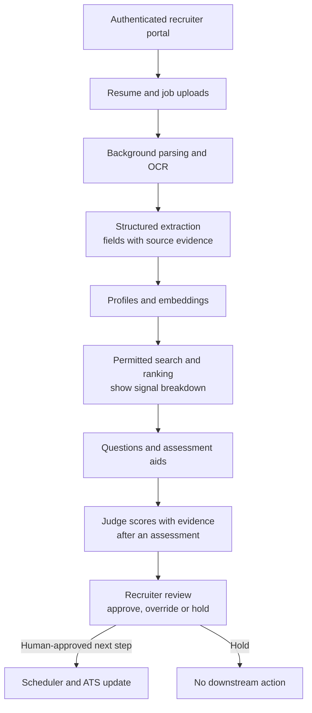
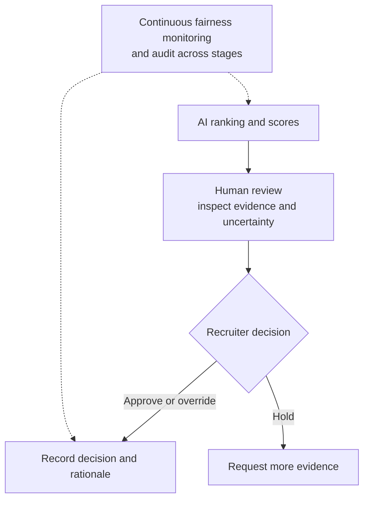

# Recruiting Platform: Explainable Ranking, Human Decisions

*Automating more of the hiring funnel makes recruiters faster, while every decision the AI takes alone carries legal and ethical risk.*

## Understand the Customer Problem

In this scenario, a recruiting team receives more resumes than it can review quickly. It wants help extracting experience, finding relevant candidates, preparing interviews, and organising feedback. The customer needs rankings that recruiters can question and override, not an automated hiring verdict. Candidate information must stay protected, and every recommendation needs enough evidence for a person to understand its limits.

Use AI to organise evidence and suggest next steps. Keep hiring decisions with people. Follow [the design framework](/learn/ai-systems-design/design-framework/the-twelve-part-design-framework) to connect explainability, access, and scale.

---

## Read the Last Clause as the Design Constraint

The prompt is a platform that screens resumes, matches candidates to job descriptions and generates interview questions. It also scores candidates, schedules interviews and assists hiring managers, from upload to hiring decision. Recruiters upload a job description and receive resumes in bulk. They get candidates ranked by fit, questions and scorecards, and a recommendation, all while remaining in control of the final decision.

That last clause is the whole constraint. Every later choice bends towards explainability and human review.

| Question | Answer | What it decides |
|---|---|---|
| Enterprise hiring or staffing agencies? | Differs | Multi-tenancy and volume assumptions |
| Real-time or batch matching? | Batch for bulk ingestion; near-real-time for recruiter search | Two processing modes |
| Can recruiters override AI recommendations? | Yes, always | Human-in-the-loop is first-class |
| Fully automated or human-assisted decisions? | Human-assisted | Every downstream choice bends toward explainability |
| Compliance: GDPR, EEOC? | Yes | Fairness monitoring and audit are non-negotiable |

The functional list is to upload job descriptions and resumes and extract structured information. The platform ranks by fit and searches profiles semantically. It generates questions and scorecards, recommends decisions, schedules, summarises feedback, offers a recruiter chatbot and learns from past decisions. The non-functional list is thousands of resumes an hour, accuracy, low hallucination, secure PII, scale, **explainable rankings**, compliance and cost.

## Make Structured Extraction the Seam



Structured extraction divides the system in two. Everything before it handles PDFs and free text. Everything after it handles comparable, rankable profiles. A ranker cannot compare documents that arrive in a different shape every time. Resumes vary wildly, so the parser must produce one consistent shape.

## Follow a Candidate Through the Pipeline

The job description is parsed into required and preferred skills, experience, education, certifications, location and salary. Resumes arrive as PDF, DOCX, a LinkedIn profile or an ATS record. Extraction produces comparable fields, but errors still need review. Keep source spans and mark missing or uncertain fields rather than filling them in.

Embeddings capture semantic meaning for the job description, profile, skills, projects, experience and certifications. Similarity search then lets "LLM Engineer" retrieve candidates who mention Generative AI, RAG, prompt engineering or agentic AI. Ranking combines several weighted signals into an explainable list, not a pass/fail.

Interview questions are generated for the role. They draw on the job description, the candidate's experience, missing skills and past projects. After interviews or assessments, the AI judge scores technical correctness, communication, problem-solving and alignment, with structured feedback. A recruiter or hiring manager reviews ranking, scores, summaries and recommendations, and makes the final decision. Scheduling then checks availability, picks slots, sends invites and notifications, and updates the ATS.

## Weight Ranking Signals Explicitly

The ranking engine combines signals rather than trusting one similarity number. Those signals are semantic similarity, required-skills match, experience level, domain expertise, location, certifications and availability. Historical hiring success counts where applicable. Explicit weights make the score inspectable. They do not by themselves establish fairness or job relevance.

An illustrative weighting is semantic similarity ~30%, skills match ~25% and experience ~20%. Domain expertise takes ~15% and other signals ~10%. A recruiter can then see *why* a candidate ranked where they did, not just that they did.

## Let the AI Judge Score, Never Decide

The AI judge follows the same principle. It produces standardised scores with a rationale, and it does not make the final decision. The evaluation pipeline combines similarity, completeness, judge scores, interview feedback and recruiter and hiring-manager input. Low confidence triggers additional review. Calibrate thresholds against labelled assessments; a model's self-reported confidence is not a reliable probability. Final decisions always remain human.

> **Warning: never gate a consequential decision on an LLM judge alone.** A judge's score is one signal with its own errors. Here the decision is someone's career. Keep the judge as input to a human, and force review whenever its confidence is low.

## Scale Ingestion Without Blocking Uploads

Thousands of resumes an hour need asynchronous processing. Parse and embed as background jobs, never blocking the upload. Use event-driven ingestion to decouple upload from parse, extract, embed and rank. Add distributed vector databases, and GPU-backed inference to absorb the burst when a new posting triggers thousands of comparisons. Run multi-region for latency and candidate-PII residency, cache embeddings and generated outputs, and queue work for peak seasons.

## Treat Fairness as a Continuous Control

Candidate data is sensitive, and hiring decisions carry legal weight. Encrypt at rest and in transit, protect PII, and give recruiters and hiring managers role-based access. Keep audit logs for every AI recommendation and hiring action. Ask the responsible privacy and legal owners which GDPR, CCPA, and EEOC requirements apply, including deletion and retention. These controls do not certify compliance. Monitor models for fairness and bias across protected groups continuously, not once.



Human review is required here, but does not automatically remove bias. The [EEOC's AI resources](https://www.eeoc.gov/eeoc-disability-related-resources/artificial-intelligence-and-ada) explain why automated assessment needs scrutiny.

| Decision | Pros | Cons |
|---|---|---|
| Keyword matching | Fast, simple | Misses semantically similar candidates |
| Embedding-based search | Better discovery | Compute cost |
| Fully automated hiring | Faster | Legal and ethical risk |
| Human-in-the-loop | Oversight, fairness | Slower |
| Large reasoning model | Better summaries and questions | Latency, cost |
| Smaller model | Faster, cheaper | Lower reasoning |

## Prepare the Three Follow-Ups

**"How do we reduce bias?"** Mask demographic information where appropriate and use diverse training and evaluation data. Track fairness metrics continuously, require human approval, explain rankings transparently and audit regularly.

**"How do we improve matching accuracy?"** Compare lexical and semantic retrieval on relevant roles, and combine signals only when evaluation supports them. Feed recruiter feedback into the ranking model, measure precision and recall against historical outcomes, and tune prompts and retrieval on feedback.

**"How do we personalise for recruiters?"** Learn from previous decisions and prioritise candidates similar to successful hires, while monitoring for bias. Set question difficulty by seniority, weight team-specific skills, and let recruiters configure weights. "Similar to successful hires" can copy past bias, which is why the monitoring clause is not optional.

## Worked Example: An "LLM Engineer" Posting

> **Added production guidance:** the clarification, record, and failure choices below are illustrative, not a deployed hiring policy.

### Clarify the Role and Human Decision

Ask: "Which skills are genuinely required? Who approves the rubric and weights? Can candidates correct extracted information, and who authorises interview invitations?" Confirm permitted uses of candidate data before ingestion.

### Follow the Candidate

A recruiter posts an "LLM Engineer" role, and thousands of resumes arrive. Uploads return immediately; parsing and embedding run as background jobs. Extraction turns each resume into one structured profile. Similarity search surfaces a candidate who never wrote "LLM" but lists RAG and agentic AI projects.

The ranking shows that candidate's score as a breakdown: strong semantic similarity at ~30% weight, a partial skills match at ~25%, solid experience at ~20%. After the interview, the AI judge scores communication highly but problem-solving with low confidence. That low confidence makes manual review mandatory. The hiring manager reads the rationale, overrides the ranking, and advances the candidate. The override is logged.

The system automated processing and recommendations; the manager retained the consequential decision. The explicit weights let the manager see what to question, and the threshold put a person in front of the uncertain score.

### Trace One Review Record

```json
{
  "trusted_scope": {"tenant": "tenant-a", "recruiter": "recruiter-8"},
  "candidate_id": "candidate-24",
  "rubric_version": "llm-engineer-v3",
  "evidence": ["resume-24:projects:2"],
  "assessment": "insufficient_problem_solving_evidence",
  "next_step": "human_review",
  "invitation_sent": false
}
```

The application supplies scope and checks access. The model's assessment cannot authorise an invitation or hiring decision. Record the human decision separately.

### Handle Uncertainty and Duplicate Actions

| Situation | Response |
| --- | --- |
| Resume extraction incomplete | Request correction; do not invent a skill or score. |
| Assessment evidence insufficient | Hold for review; do not auto-reject. |
| Recruiter has not approved | Do not schedule. |
| Invitation API times out | Reconcile the appointment before resending. |

Repeated invitations need a supported backend deduplication contract. An application-side request ID is not enough.

## Explain the Design in 60 Seconds

> "I'd build an assisted recruiting workflow with the recruiter in control. Uploads would return quickly, while background jobs parse documents into profiles linked to source evidence. Search would combine useful matching signals, and ranking would expose the weights rather than hide everything in one score.
>
> Interview questions and assessment scores would help the reviewer, not decide the candidate's outcome. I'd mark missing evidence, calibrate uncertainty, and log approvals and overrides. Scheduling would follow an authorised human decision. For scale, I'd queue ingestion and cache scoped artefacts. Candidate privacy, correction and deletion workflows, fairness evaluation, and monitoring of historical bias would remain explicit responsibilities."

---

## Key Takeaways

- "Recruiters remain in control" is the constraint that makes the whole design AI-assisted, not autonomous.
- Structured extraction is the seam between free-text documents and rankable profiles.
- The flow runs parse, extract, embed, search, rank, generate questions, judge, human review and schedule.
- Explicit weights make rankings inspectable, but fairness and job relevance still need evaluation.
- The AI judge scores with a rationale but never decides, and low confidence forces manual review.
- Scale ingestion with background jobs, event-driven stages, GPU bursts and queues.
- Fairness is monitored continuously, with PII protection, audit logs and a human on every decision.
- Have answers ready on bias, matching accuracy and personalisation, including the bias risk of "similar to successful hires".

## Check Yourself

1. **Why is structured extraction the most important seam?**
   Before it, every resume has a different shape. After it, profiles are comparable and rankable. Search and ranking are only reliable on one consistent shape.

2. **Why is an explicit weighted ranking more defensible than a single model score?**
   A recruiter or auditor can see which signals put a candidate where they are. One opaque score explains nothing and cannot be challenged.

3. **What does the AI judge do, and what forces manual review?**
   It produces standardised scores with a rationale. It never makes the final decision, and confidence below a threshold makes human review mandatory.

4. **Do inspectable weights prove the ranking is fair?**
   No. Review job relevance, evaluate outcomes, and monitor for bias; human review alone is not a fairness guarantee.

5. **What if a resume lacks a required field?**
   Keep it missing or uncertain, link to source evidence, and request correction rather than inventing a qualification.

6. **Who supplies recruiter and tenant identity?**
   The application derives scope from the verified session and enforces candidate access before retrieval or action.

7. **When may an invitation be sent?**
   After an authorised human decision and application checks. Reconcile an uncertain send before resending.

8. **Why be careful when learning from successful hires?**
   Historical outcomes can reproduce past bias. Validate the signal rather than treating past selection as ground truth.

