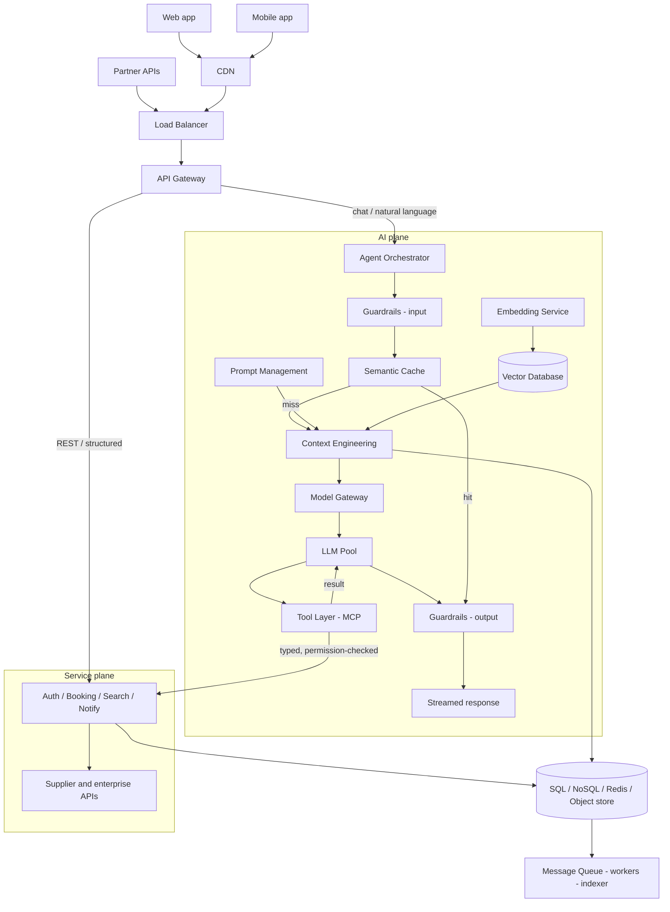

# Architecture, Data, and Request Flow

*An AI plane adds powerful components to a design, but every one of them must sit beside the traditional core, never replace it.*

◷ 9 min

The middle of a design answer is not a box diagram; it is proof that the boxes interact. Draw the request path, choose a store per access pattern, give each service an owner, and then trace one real request through all of it, as set up in [The Twelve-Part Design Framework](/learn/ai-systems-design/design-framework/the-twelve-part-design-framework).

**Objectives:**

- draw the traditional request path and say the one detail per block that shows judgement;
- add the AI-specific components and explain where each sits and what it risks;
- decide SQL versus NoSQL with one question, and trace a request end to end.

---

## Draw the Request Path With One Judgement Per Block

Part 5 is the major blocks and the path a request takes: users, CDN, load balancer, API gateway, application services, databases, cache, message queue and monitoring. Naming the blocks earns little. Each block earns credit only with the detail that shows judgement.

| Block | Role | The detail that shows judgement |
|---|---|---|
| CDN | Static assets and cacheable responses at the edge | Removes most bytes from origin; absorbs the first wave of a spike |
| Load balancer | Spreads load across healthy instances, terminates TLS | Zone-aware routing; connection draining during deploys |
| API gateway | Single entry: auth, rate limiting, routing, shaping | Keeps cross-cutting concerns out of every service |
| Application services | Stateless business logic split by domain | Statelessness makes horizontal scaling and rolling deploys trivial |
| Databases | System of record, chosen per access pattern | Name the primary and replica topology and where writes land |
| Cache | In-memory tier in front of expensive reads | Always name invalidation and TTL; a cache without them is a correctness bug |
| Message queue | Decouples slow or bursty work | Spikes become backlog instead of errors; enables retries with backoff |
| Monitoring | Wired in from day one | Define SLIs and alert thresholds, not "we'll use Prometheus" |

## Add the AI Plane Beside the Service Plane

AI systems add components the traditional path lacks. Treat each as a dependency with a specific risk, because that risk is what an interviewer probes.

| Component | Role | Treat it as |
|---|---|---|
| LLM | Generation, summarisation, intent | A slow, expensive, non-deterministic dependency; design timeouts and fallbacks |
| Model gateway | Routes to the right model or provider with fallback | The home of retries, quotas, per-tenant limits and token accounting |
| Prompt management | Prompts as versioned, reviewable artefacts | A/B tests, instant rollback and an audit trail |
| Context engineering | Builds the window from history, retrieved documents and tool output | A token budget: what to include, in what order, what to drop |
| Embedding service | Documents and queries to vectors, batch and online | Versioned; changing the model invalidates the whole index |
| Vector database | Embeddings plus approximate nearest-neighbour search | Index type and the recall-versus-latency trade are real decisions |
| Semantic cache | Stored answers for semantically close queries | The main cost lever; a false hit is a wrong answer, not a slow one |
| Agent orchestrator | Plans multi-step tasks, picks tools or sub-agents, decides when done | Needs step and token limits, or a loop runs away |
| Tool layer | Typed connectors that let the model act | Every call needs permission checks, timeouts and audit logging |
| LLM observability | Latency, tokens, cost, hallucination rate, quality per prompt version | How "the answers feel worse" becomes a specific regression |
| Guardrails | Injection, moderation and policy on input and output | Fail closed on money or customer data |

The integrated picture shows where these sit. The AI plane hangs off the same gateway as the traditional services and calls back into them through the tool layer.

Read six claims off the picture. Two planes share one front door: chat goes to the orchestrator and REST goes straight to services, so a model outage never takes down booking. The tool layer is the boundary. Everything the agent does to the real world passes through typed, permission-checked tool calls into existing services, and the LLM never touches a database directly.

Retrieval is a side path, not an extra hop, so it can be skipped when a task does not need it. A semantic cache hit returns with no model call, no retrieval and no tool execution, so tune its threshold conservatively. Guardrails bracket the model: input checks run before it and output checks validate structure and grounding after it, and both fail closed on transactional requests. Finally, the data and async planes stay shared. The AI plane adds to the traditional architecture; it replaces none of it.

## Choose Storage by the One Question That Decides It

Part 6 picks a store per access pattern and says what is stored, where and for how long.

| Store | For | Trade |
|---|---|---|
| SQL | Transactional, strongly consistent data with joins: bookings, payments, users | Correctness over raw write throughput |
| NoSQL | High-volume, flexible-schema, partition-friendly data: sessions, catalogues | Gives up joins and multi-record transactions for horizontal scale |
| Graph | Relationship traversal: recommendations, fraud rings, itinerary connections | Use when queries are about paths, not rows |
| Time-series | Append-heavy, timestamp-ordered data: metrics, prices, events | Built-in downsampling and retention |

One question decides SQL versus NoSQL. Does this write need to be correct together with another write, or this read together with another read? Booking a flight decrements inventory, inserts the booking and charges the payment. If the charge fails, the decrement must roll back, or a seat is sold that nobody paid for. That is a transaction, which is what SQL guarantees, and bookings also need joins across users and payments.

A hotel catalogue is the opposite. Reading one listing never locks or joins against another. Different hotels also have genuinely different shapes, such as `pet_friendly` versus `conference_rooms`, and rigid columns would mean a table of NULLs. The same logic puts sessions in Redis or NoSQL, being independent, high-volume and ephemeral. Bookings and payments go in SQL, being interdependent, transactional and permanent.

Name the data models too. Customer is privacy-sensitive, so plan for export and deletion. Booking is a state machine with an immutable event history, not a mutable row. Flight data is external and cache-heavy with short TTLs. Hotel data changes slowly and suits a search index plus a CDN. Payment needs the strictest consistency and audit, and stores tokens, never card data.

Then state four storage decisions. Hot versus cold tiering is often the largest cost lever. The partitioning key matters because a bad one creates hotspots that need a migration to fix. Replication mode trades safety for speed: synchronous is safer and slower, asynchronous is faster and risks recent writes. Backups need a defined RPO and RTO plus restore drills, because a backup never restored is a hypothesis.

> **Warning: the LLM never touches a database directly.** Every action the agent takes must go through the tool layer, where authorisation, timeouts and audit are enforced. A model with a direct connection has no choke point, so none of those controls can apply.

## Give Every Service an Owner and an Interface

Part 7 zooms into each service: what it is responsible for, what it exposes and what data it owns.

The authentication service handles login with credentials or OIDC, and rate limiting and lockout live there. It issues short-lived JWT access tokens with longer refresh tokens, and rotation and revocation need a plan. Step-up MFA before payment or cancellation is a good detail to volunteer. Session validation happens at the gateway, fast and cacheable.

The booking service reserves seats atomically with an idempotency key, so retries never double-book. Reservations expire if payment does not complete. Payments run as a saga with compensating actions, because the provider is external. Cancellation is idempotent and auditable, since partial failures here are customer-visible.

The AI agent classifies intent with a confidence score, and low confidence produces a clarifying question, not a guess. It plans with a step and token cap. It invokes tools with validated arguments and explicit permission checks on every write-capable tool. Its memory retrieval is scoped strictly per user and selective rather than a dump.

## Trace One Real Request End to End

Part 8 is where interviewers check that the pieces actually interact. Trace one request: user, gateway, authentication, supervisor agent, semantic cache, travel agent, flight API, hotel API, booking service, LLM and response.

| Stage | What happens | The detail to mention |
|---|---|---|
| User | "Find me a flight to Delhi next Friday" | The client attaches an auth token and a trace ID that follows the call everywhere |
| Gateway | TLS, rate limits, route to the assistant | Where the trace begins and the global timeout budget is set |
| Authentication | Resolve identity, roles and entitlements | Everything downstream runs under that scope, which keeps memory user-isolated |
| Supervisor agent | Interpret, plan, delegate | Owns the step budget and decides when the task is done |
| Semantic cache | Was a similar request answered recently? | A hit skips the expensive path; a miss continues and populates |
| Travel agent | Domain specialist that knows which tools to combine | Normalises supplier differences into one internal shape |
| Flight API | Suppliers, usually called in parallel | Slow suppliers get a timeout and a partial result |
| Hotel API | Properties, rooms, rates | Cached briefly: prices move, but not by the second |
| Booking service | Runs only on user confirmation | Idempotent create plus payment; emits events for notifications and history |
| LLM | Structured results to grounded natural language | Ground strictly in retrieved data; validate before it reaches the user |
| Response | Streamed | Log latency and token cost per stage |

## Worked Example: Why Booking and Catalogue Data Split

A candidate draws one NoSQL store for the whole travel assistant, for scale. Apply the deciding question to bookings. A booking must commit together with an inventory decrement and a payment charge, or a seat sells unpaid. That is a multi-record transaction NoSQL gives up, so bookings move to SQL.

Apply it to the catalogue. No hotel read depends on another, and the attributes differ per property. Forcing them into SQL columns creates a table of NULLs, so the catalogue stays in NoSQL behind a search index and CDN. Sessions follow the catalogue into Redis.

The single store became three, each justified by one sentence. That is what part 6 is for: a store per access pattern, defended by the access pattern, not by fashion.

---

## Key Takeaways

- Name each block on the request path with the one detail that shows judgement.
- The AI plane sits beside the service plane, reaches it only through a typed tool layer, and brings a specific risk per component.
- SQL versus NoSQL is decided by whether operations must be correct together; tiering, partitioning, replication and backups are stated decisions.
- Each service has explicit responsibilities, interfaces and owned data.
- One traced request proves the components interact and shows where trace IDs, budgets and caches act.

## Check Yourself

1. **Why does a semantic cache false hit matter more than a normal cache miss?**
   A miss is only slower. A false hit returns an answer to a different question, which is a wrong answer. Tune the threshold conservatively.

2. **Why route chat and REST traffic differently at the gateway?**
   Chat goes to the orchestrator and REST goes straight to services. A model outage then cannot take down booking.

3. **Where should a sessions table and a payments table live, and why?**
   Sessions in Redis or NoSQL: independent, high-volume and ephemeral. Payments in SQL: transactional, audited and correct together with bookings.

