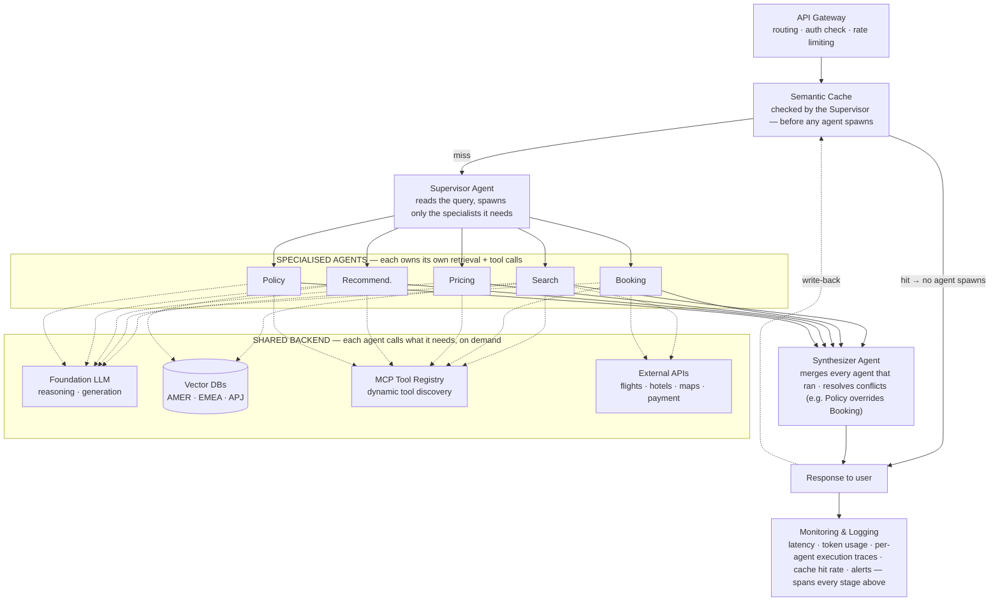

# Reviewing an Agent Architecture

*A multi-agent diagram that looks complete can still waste every cache hit and force work on agents that never needed it.*

The framework and principles stay abstract until they correct a real diagram. Spotting structural mistakes in a first-draft agent architecture is worth more than memorising a corrected one, because the same five mistakes appear in most drafts, including ones drawn under time pressure.

**Objectives:**

- find five structural mistakes in a published multi-agent travel-assistant diagram;
- rebuild it with the cache first, per-agent retrieval and tools, and a synthesiser;
- ask five review questions of any agent architecture, including your own.

---

## Start From the Flawed Original

The system is an agentic travel assistant serving customers across AMER, EMEA and APJ. It has specialised agents for search, booking, pricing, recommendation and policy. The published original drew a strict pipeline. Five agents fan out, then everything funnels through one shared cache, one retrieval stage, one LLM step and one tool-calling stage, in sequence.

A careful reviewer found five structural mistakes in that drawing. Each one breaks a principle from [Design Principles as Tie-Breakers](/learn/ai-systems-design/design-framework/design-principles-as-tie-breakers) or a part of [Scale, Reliability, and Security](/learn/ai-systems-design/design-framework/scale-reliability-and-security).

## Fold Rate Limiting Into the Gateway

The original drew the rate limiter as a second box off the load balancer, parallel to the gateway, with no line continuing downstream. It was a dead end. Rate limiting is a policy the gateway enforces on every request, not an alternative route. Drawing it as a peer box suggests it is a component rather than a behaviour.

## Check the Cache Before Any Agent Spawns

The original placed the semantic cache after all five agents had already run. A cache that runs after the expensive work cannot save that work. Move it to the front: checking the cache is the supervisor's first move, and a hit returns without spawning a single agent.

This is short-circuiting, and it decides whether the cache saves money at all. Placed after the agents, it saves nothing. Placed before them, a hit removes the entire fan-out.

> **Warning: a cache after the expensive step is decoration.** Every request still pays for the agents, retrieval and model calls the cache was meant to skip. Before drawing a cache, ask which work a hit removes; if the answer is none, move it.

## Let Each Agent Own Its Retrieval

One mandatory retrieval box downstream of all five agents forced a vector-database lookup on agents that never needed one. Search and Recommendation pull regional travel content. Booking and Policy mostly do not. So retrieval becomes a call each agent makes for itself, inside its own loop, when its task requires it.

## Give Each Agent Its Own Turn With Tools

The original funnelled every agent into one shared LLM step, then one tool-calling step, then one MCP registry, as if the whole request got a single turn. A Booking agent needs the Payment and Flight MCP servers during its own turn, not after four unrelated agents finish. So the shared backend becomes something each agent calls on demand: the foundation LLM, the regional vector databases, the MCP tool registry and the external APIs.

## Name the Step That Merges Outputs

The original never showed how five parallel outputs become one response. The diagram simply continued as a single line, as if merging were automatic. It is not. Parallel outputs cannot become one answer without something that merges them and settles their conflicts.

Add a named synthesiser agent. It merges the output of every agent that actually ran and resolves conflicts between them, such as a Policy decision overriding a Booking choice, before anything reaches the user.

## Draw the Corrected Architecture

Walk the flow in ten steps. The user submits a request. Authentication validates identity, the load balancer routes it, and the gateway applies rate limiting and forwards it to the supervisor. The supervisor checks the semantic cache first, and a hit returns at once with no agent spawned. On a miss, it spawns only the agents the query needs.

Each agent retrieves its own context from the relevant regional vector database as a tool call inside its own loop. Each calls the external APIs it needs through the MCP registry, also inside its own loop. The synthesiser collects the outputs, resolves conflicts and composes one grounded response. The response returns to the user and is written back to the cache. Monitoring captures latency, tokens and per-agent traces across the whole request.

The non-functional answers change with the structure. Performance now comes from semantic caching before the fan-out. Cost comes from a cache-first strategy that actually gates spawning, smaller models for simple tasks and regional routing. Observability adds distributed tracing per agent, and maintainability comes from modular agents that own their own tools. Availability uses an active-active regional architecture.

## Say the Trade-offs Out Loud

Four trade-offs are worth naming. A shared retrieval service centralises data-residency and guardrail enforcement but couples every agent to one service. Per-agent retrieval matches how LangGraph- and CrewAI-style frameworks wire tools, at the cost of duplicated embedding infrastructure if ungoverned. Either is defensible. The real mistake is treating RAG as a peer of the agents instead of as infrastructure or a tool.

Multi-agent adds coordination and synthesis overhead. It earns its keep when subtasks need different tools, different guardrails or independent scaling, as Booking and Policy clearly do here. A semantic cache matches near-duplicate queries, not only exact ones, which is why it can short-circuit the whole fan-out. Regional vector databases buy data-residency compliance and lower latency, while a global store buys simpler operations and cross-region consistency.

## Ask Five Questions of Any Agent Diagram

The five fixes generalise into five review questions. Is every component really a component, or a policy that belongs inside something else? Does the cache sit before the expensive work it claims to save? Is retrieval forced on agents that do not need it? Does each agent get its own turn with its own tools, or is the request funnelled through one shared step? Where do parallel outputs converge, and who resolves conflicts?

## Worked Example: The Airport Mental Model

An international airport maps onto the corrected design and makes it easy to redraw from memory.

| Airport | System |
|---|---|
| Passengers | Users |
| Airport entrance | Authentication |
| Security check and baggage scanner, one line, not two | API gateway with rate limiting built in |
| Information desk: "have we answered this before?" | Semantic cache, checked before any staff are dispatched |
| Air traffic control tower | Supervisor agent |
| Airline staff, each with their own manuals and radios | Specialised agents with their own retrieval and tools |
| Flight information binders each desk keeps | Vector databases, consulted by whichever desk needs them |
| Ground crew, catering, fuel trucks | External APIs |
| Dispatch officer compiling one departure report | Synthesiser agent |
| CCTV and operations centre | Monitoring and observability |

Each original mistake has an airport absurdity. A second security line that leads nowhere is the dead-end rate limiter. An information desk visited after the staff have already flown is the late cache. Every desk forced to read every binder is the shared retrieval stage. The model helps because each mistake becomes visibly wrong in a setting everyone already knows.

---

## Key Takeaways

- The original pipeline funnelled five agents through shared stages and showed five structural mistakes.
- Rate limiting is a gateway policy, not a peer box.
- The semantic cache must run before any agent spawns, or it saves nothing.
- Retrieval belongs to the agents that need it, inside their own loops.
- Each agent calls the shared LLM, tools and APIs on demand during its own turn.
- A named synthesiser merges parallel outputs and resolves conflicts.
- The corrected flow is cache first, selective spawning, per-agent backend calls, synthesis and write-back.
- Shared versus per-agent retrieval is defensible either way; treating RAG as a peer of agents is the mistake.
- Five review questions turn the fixes into a reusable check.

## Check Yourself

1. **Why does cache placement decide whether a semantic cache saves anything?**
   A cache after the agents runs only once all the expensive work is done, so a hit saves nothing. Before them, a hit skips the entire fan-out.

2. **What is the actual mistake in the shared-versus-per-agent retrieval debate?**
   Both are defensible. The mistake is drawing RAG as a peer stage of the agents instead of infrastructure or a tool they call.

3. **What does the synthesiser do that a single continuing line hides?**
   It merges the outputs of every agent that ran and resolves conflicts between them, such as Policy overriding Booking.

