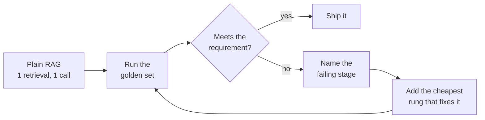

<!-- Generated by site/scripts/rag-theory-import.mjs from rag-agents-engineering. Edit the source there. -->
# Overview

[M11](/learn/llm-and-retrieval/rag-from-first-principles/rag-from-first-principles-overview) to [M44](/learn/hierarchical-memory-and-graph-rag/graphrag-techniques/graphrag-techniques-overview) built more than a dozen ways to answer a question from documents, from one retrieval and one model call up to self-correcting loops, teams of agents and graph indexes. This module puts them on one map and asks which one a requirement needs. The M45 notebooks build on four ideas: choosing an architecture against a simpler alternative, the budget each extra component spends, late interaction as a retrieval upgrade that adds no model calls, and evaluating the whole pipeline end to end.

The running example is the Larkspur Cloud handbook from [M11](/learn/llm-and-retrieval/rag-from-first-principles/rag-from-first-principles-overview). Six questions carry the comparison, and an earlier module's lab has already run each one through several architectures: *Can I export my data after I cancel my plan?* ([M24](/learn/agentic-systems/react-agents-and-langchain-create-agent/react-agents-and-langchain-create-agent-overview), [M28](/learn/agentic-and-self-correcting-rag/agentic-rag-foundations-grading-and-query-rewriting/agentic-rag-foundations-grading-and-query-rewriting-overview), [M29](/learn/agentic-and-self-correcting-rag/self-correcting-rag-crag-and-self-rag/self-correcting-rag-crag-and-self-rag-overview)), *What happens if my server goes down?* ([M17](/learn/retrieval-quality-engineering/retrieval-hybrid-rerank/retrieval-hybrid-rerank-overview), [M24](/learn/agentic-systems/react-agents-and-langchain-create-agent/react-agents-and-langchain-create-agent-overview), [M28](/learn/agentic-and-self-correcting-rag/agentic-rag-foundations-grading-and-query-rewriting/agentic-rag-foundations-grading-and-query-rewriting-overview), [M29](/learn/agentic-and-self-correcting-rag/self-correcting-rag-crag-and-self-rag/self-correcting-rag-crag-and-self-rag-overview)), *My server went down last night. Do I get service credits?* ([M35](/learn/memory-and-multi-agent-rag/multi-agent-architectures/multi-agent-architectures-overview)), *Does Larkspur offer GPU servers?* ([M29](/learn/agentic-and-self-correcting-rag/self-correcting-rag-crag-and-self-rag/self-correcting-rag-crag-and-self-rag-overview)), *How does service continuity work?* ([M42](/learn/hierarchical-memory-and-graph-rag/hierarchical-and-memory-augmented-retrieval/hierarchical-and-memory-augmented-retrieval-overview)) and *Which plans support data export in the EU?* ([M43](/learn/hierarchical-memory-and-graph-rag/knowledge-graphs-with-neo4j/knowledge-graphs-with-neo4j-overview)). This module reuses their counts and adds no new measurements.

## In short

- Start with plain RAG, one retrieval and one model call, and add one component at a time, each justified by a failure on the golden set. Every step up is paid in model calls: in the course's labs a router costs 2, a supervisor 3 to 5, CRAG 4 to 7 plus a web search and Self-RAG 7 to 20.
- Fix the stage that fails. On *What happens if my server goes down?* TF-IDF retrieves neither evidence chunk, and dense retrieval ranks both first and second ([M17](/learn/retrieval-quality-engineering/retrieval-hybrid-rerank/retrieval-hybrid-rerank-overview) lab) for the same single call. The [M28](/learn/agentic-and-self-correcting-rag/agentic-rag-foundations-grading-and-query-rewriting/agentic-rag-foundations-grading-and-query-rewriting-overview) retry loop needs 10 calls to get there, and Self-RAG spends 14 without finding them.
- Two kinds of question need a different index. A theme across the handbook needs summaries built at index time ([M42](/learn/hierarchical-memory-and-graph-rag/hierarchical-and-memory-augmented-retrieval/hierarchical-and-memory-augmented-retrieval-overview)), and "available in the EU" needs an edge to check ([M43](/learn/hierarchical-memory-and-graph-rag/knowledge-graphs-with-neo4j/knowledge-graphs-with-neo4j-overview)). No retrieval setting stands in for either.
- Late interaction (ColBERT) keeps one vector per token and scores with MaxSim. A passage of up to 180 tokens at 128 dimensions is up to 23,040 numbers before compression, against 1,536 for one `text-embedding-3-small` vector, and it still makes one retrieval and one model call.
- Evaluate the pipeline on one golden set with a metric per stage: context recall for retrieval, faithfulness for generation, answer correctness end to end. In this course's locked environment `import ragas` fails, so the notebook's RAGAS cells do not run as shipped.

## Mental model

Every architecture in the course is plain RAG plus components: better retrieval, a router, a grader, a loop, more agents, a different index. Each component has a price in model calls, latency and parts to test, so it stays only when the golden set shows the failure it fixes. The simplest architecture that meets the requirement is the one this loop stops at.

## Interactive lab

[**The simplest architecture that works**](/labs/rag/m45_architecture_synthesis/architecture-picker-lab.html): open the file in a browser. It opens on the outage question with one handbook index, a budget of 5 calls and a cheap wrong answer: dense retrieval wins at 1 call, and the ladder shows TF-IDF and the hybrid blend falling short. Set the wrong answer to cost a support ticket and the only counted rung that has a check and answers is the [M28](/learn/agentic-and-self-correcting-rag/agentic-rag-foundations-grading-and-query-rewriting/agentic-rag-foundations-grading-and-query-rewriting-overview) retry loop at 10 calls, so nothing fits until the budget reaches 10. Then pick the service-credits question and switch between one index and three knowledge bases: decomposition at 5 calls against a swarm at 3, with the router's 2 calls never asking billing.

## How it connects

- **Before:** every module. The baseline and the golden set come from [M11](/learn/llm-and-retrieval/rag-from-first-principles/rag-from-first-principles-overview); retrieval upgrades from [M14](/learn/ingestion-and-indexing-pipeline/embeddings-and-model-selection/embeddings-and-model-selection-overview) to [M19](/learn/retrieval-quality-engineering/post-retrieval-optimisation-and-reranking/post-retrieval-optimisation-and-reranking-overview); the self-correcting loops from [M28](/learn/agentic-and-self-correcting-rag/agentic-rag-foundations-grading-and-query-rewriting/agentic-rag-foundations-grading-and-query-rewriting-overview), [M29](/learn/agentic-and-self-correcting-rag/self-correcting-rag-crag-and-self-rag/self-correcting-rag-crag-and-self-rag-overview) and [M32](/learn/agentic-and-self-correcting-rag/reliability-feedback-loops-and-diversity/reliability-feedback-loops-and-diversity-overview); routing from [M30](/learn/agentic-and-self-correcting-rag/adaptive-rag-and-query-routing/adaptive-rag-and-query-routing-overview) and [M35](/learn/memory-and-multi-agent-rag/multi-agent-architectures/multi-agent-architectures-overview); tool-based retrieval from [M24](/learn/agentic-systems/react-agents-and-langchain-create-agent/react-agents-and-langchain-create-agent-overview), [M26](/learn/agentic-systems/planning-reflection-and-reasoning-patterns/planning-reflection-and-reasoning-patterns-overview) and [M31](/learn/agentic-and-self-correcting-rag/rag-as-an-agent-tool/rag-as-an-agent-tool-overview); structural indexes from [M42](/learn/hierarchical-memory-and-graph-rag/hierarchical-and-memory-augmented-retrieval/hierarchical-and-memory-augmented-retrieval-overview), [M43](/learn/hierarchical-memory-and-graph-rag/knowledge-graphs-with-neo4j/knowledge-graphs-with-neo4j-overview) and [M44](/learn/hierarchical-memory-and-graph-rag/graphrag-techniques/graphrag-techniques-overview).
- **Next:** the [capstone projects](https://github.com/Sourav692/rag-agents-engineering/blob/main/capstones/README.md). Each ships a working system, an evaluation report on a golden question set and a demo, and the M45 lab brief asks for the design document behind it: every component justified against a simpler alternative.

## Key Takeaways

- Build plain RAG first and record its row on a frozen golden set; every later component has to beat that row on the questions it targets.
- Name the failing stage before adding anything. A retrieval miss is fixed in retrieval, at no extra model calls; a loop on top of it pays repeatedly for the same missing chunk.
- Count what each component costs in model calls, retrievals and index-time work, and set a budget per question before choosing; loops get a cap in code.
- Change the data when the question needs it: summaries for themes, explicit edges for constraints, separate knowledge bases only when routing to them buys something.
