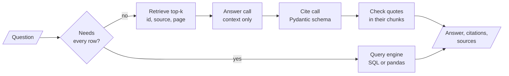

<!-- Generated by site/scripts/rag-theory-import.mjs from rag-agents-engineering. Edit the source there. -->
# Overview

A RAG pipeline returns an answer. A RAG system returns an answer a user can check: the chunks it came from, the sentences that support it, and a refusal when the evidence is missing or the question needs something other than retrieval. The M20 notebooks build on four ideas: grounding the answer in retrieved context, a schema for citations, how a table row becomes a retrievable record, and running the pipeline on your own hardware.

The running example is the Larkspur Cloud handbook from [M11](/learn/llm-and-retrieval/rag-from-first-principles/rag-from-first-principles-overview) to [M13](/learn/ingestion-and-indexing-pipeline/chunking-and-indexing/chunking-and-indexing-overview) (refunds, exports, outages) plus its server catalogue: ten server sizes with vCPUs, memory, a monthly price and a one-line description. The golden questions are *Can I get a refund on my annual plan?* for citations, and four questions on the catalogue for structured data: the average monthly price, the servers under $50, the `ls-cpu-8` server, and a server for a memory-hungry database.

## In short

- Grounded generation has three parts: evidence retrieved for this question, an instruction to use only that evidence, and permission to say "I don't know". Lesson 20.1's chain has all three but formats the metadata away, so its answers cannot be checked.
- `RunnablePassthrough.assign` keeps the retrieved chunks in the output with one retrieval. A second call fills a `QuotedCitations` schema (`id`, `source`, `title`, `page`, `quotes`); check every quote against its chunk in code, because the notebook's highlighter fails silently on a paraphrase.
- An LLM explanation per retrieved chunk costs `k` extra calls and, asked why a chunk is relevant, explains even a wrong one. Show scores to engineers and grade relevance with a yes or no.
- Put a record's description in `page_content` and its ids, numbers and dates in metadata. In the lab, embedding every column shrinks the lead of the right rows from 0.115 to 0.0004, and *What is the average monthly price?* answered from the top 4 rows gives $36.25 where the table says $102.50.
- The local pipeline embeds with `bge-base-en-v1.5` and searches FAISS on your machine, but generates through the Hugging Face Inference API. Fully local means `HuggingFacePipeline` as well.

## Mental model

Each box adds something a reader can verify. The router keeps questions that need the whole table away from top-k retrieval; the metadata carried from retrieval to the answer is what makes a citation point somewhere; the quote check is the one step that runs as code, not as a model call.

## Interactive lab

[**Sample or population**](/labs/rag/m20_end_to_end_rag_systems/sample-or-population-lab.html): open the file in a browser. Pick *What is the average monthly price of a Larkspur server?* and slide `k` from 1 to 10: the answer from the retrieved rows stays far below $102.50 until the last row, `ls-gpu-1` at $480, comes in. Then pick *Tell me about ls-cpu-8.* at `k = 1` and switch between Description only and Every column to see the lookup flip between the wrong server and a 0.050 win. Last, pick the memory-hungry database question, the one retrieval answers well, and compare the two texts' margins.

## How it connects

- **Before:** [M11](/learn/llm-and-retrieval/rag-from-first-principles/rag-from-first-principles-overview) built the plain pipeline and its baseline; [M12](/learn/ingestion-and-indexing-pipeline/document-ingestion-and-metadata-design/document-ingestion-and-metadata-design-overview) loaded CSV and JSON; [M15](/learn/ingestion-and-indexing-pipeline/vector-stores-and-index-operations/vector-stores-and-index-operations-overview) covered metadata filters; [M16](/learn/ingestion-and-indexing-pipeline/advanced-indexing-strategies/advanced-indexing-strategies-overview) built the contextual-retrieval index that lesson 20.2 cites from; [M18](/learn/retrieval-quality-engineering/query-transformation-and-routing/query-transformation-and-routing-overview) covered self-query and routing; [M19](/learn/retrieval-quality-engineering/post-retrieval-optimisation-and-reranking/post-retrieval-optimisation-and-reranking-overview) decided which chunks reach the prompt.
- **Next:** [M21](/learn/complete-rag-applications/multimodal-rag/multimodal-rag-overview) extends retrieval to images and page scans. [M28](/learn/agentic-and-self-correcting-rag/agentic-rag-foundations-grading-and-query-rewriting/agentic-rag-foundations-grading-and-query-rewriting-overview) and [M29](/learn/agentic-and-self-correcting-rag/self-correcting-rag-crag-and-self-rag/self-correcting-rag-crag-and-self-rag-overview) grade chunks and answers inside the loop; [M32](/learn/agentic-and-self-correcting-rag/reliability-feedback-loops-and-diversity/reliability-feedback-loops-and-diversity-overview) adds hallucination checks and source highlighting; [M33](/learn/memory-and-multi-agent-rag/conversation-memory-and-conversational-rag/conversation-memory-and-conversational-rag-overview) adds the session history the module lab's research assistant keeps.

## Key Takeaways

- Carry metadata from the store to the answer. A chunk without its id, source and page in the output cannot be cited.
- Treat citations as model output to verify: check each quote against the chunk it names, show the page counting from 1, and count the failures.
- Route a question by what it needs. If it needs every row, a filter or one known record, send it to a query, a filter or a get by id, not to top-k retrieval.
- Call a pipeline local only after checking each component, the generator above all.
