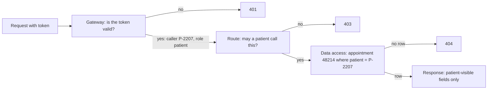

# Authorise Every Object

## Start with the trusted identifier

Thorne Clinics, a fictional chain of outpatient clinics, launched a patient portal. After each visit a patient could download a letter summarising it. The link looked like `/appointments/48213/letter`.

The portal used single sign-on. The gateway rejected any request without a valid token, and the security review had checked that carefully. A patient, curious, changed 48213 to 48214 in the address bar and received a stranger's letter: name, date of birth and diagnosis.

The handler loaded the appointment by its identifier and returned it. It never asked whether this patient was allowed to see this appointment. Every request was authenticated. None was authorised. Call this **the trusted identifier**.

> **What you'll learn**
>
> - The difference between authentication and authorisation.
> - Where each check belongs in a request's path.
> - Why the changed-identifier leak happens, and how to close it.
> - How to make object checks hard to forget, in lists as well as single records.

## Authentication against authorisation

Two different questions are often blurred into one word, "auth".

| | Authentication | Authorisation |
| --- | --- | --- |
| Question | Who is calling? | May this caller do this to this object? |
| Evidence | A credential: password, token, certificate, key | The caller's identity, roles and relationships, and the object's owner and state |
| Decided | Once per request, usually at the edge | For every action on every object |
| Failure response | 401: no valid credential | 403 forbidden, or 404 to hide that the object exists |
| Typical tools | Single sign-on, OIDC tokens, API keys | Role checks, ownership checks, policy engines, row-level security |

*Table 1: Authentication establishes identity. Authorisation decides each action. Passing the first says nothing about the second.*

Authentication is a solved problem you configure: validate the token's signature, issuer, audience and expiry, then turn it into a caller identity. [Identity Verification with SSO and OIDC](/learn/production-ai/security-tenancy-prompt-injection/identity-verification-with-sso-and-oidc) teaches that in depth.

Authorisation is the part you write, because only your code knows that appointment 48214 belongs to patient P-3381 and that a patient may read only their own.

## Where each check belongs

Authorisation is not one check. It happens at several layers, and each layer can see different facts.

| Layer | Check | What it can see |
| --- | --- | --- |
| Gateway or middleware | Authenticate. Reject missing or expired tokens. | The token, not your data |
| Route | Function-level: may this role call this endpoint at all? | The caller's roles and scopes |
| Service or data access | Object-level: is this caller related to this object? | The object, its owner and its tenant |
| Response | Field-level: which fields may this caller see? | The object and the caller together |

*Table 2: Authorisation layers. The object check needs the object, so it cannot live at the gateway.*

Thorne's gateway did its job. The route check passed too, because patients may call the letters endpoint. The missing check was the third one, and the gateway could never have done it, because the gateway does not know who owns appointment 48214.

Figure 1 shows the layers and the facts each one needs.

*Figure 1: The four checks on Thorne's letter endpoint. Only the data-access step can compare the caller with the object's owner.*

## The changed-identifier leak

The OWASP API Security Top 10 ranks broken object-level authorisation first. The pattern is the same everywhere: an endpoint takes an object identifier from the client, loads the object and acts on it, without checking the caller's relationship to that object. It is also known as an insecure direct object reference.

Two common responses do not fix it:

- **Random identifiers.** Replacing 48214 with a long random string makes guessing harder. But identifiers leak through emails, logs, shared links and browser history. Unguessable is not the same as authorised.
- **Hiding the link in the interface.** The interface only shows a patient their own letters. The API does not care what the interface shows, and anyone can call it directly.

The fix is to make the object lookup include the caller. Instead of "load appointment 48214", the data layer asks "load appointment 48214 where the patient is the caller". If no row comes back, return 404. RFC 9110 allows a server to answer 404 when it wants to hide that a forbidden resource exists, which stops callers learning which identifiers are real.

The walkthrough traces the curious patient's request through a fixed version of Thorne's endpoint.

Patient P-2207 owns appointment 48213 and asks for the letter for appointment 48214, which belongs to P-3381.

<button type="button" data-step="0" aria-pressed="false" aria-controls="authz-step-0">1. Identity</button><button type="button" data-step="1" aria-pressed="false" aria-controls="authz-step-1">2. Route</button><button type="button" data-step="2" aria-pressed="false" aria-controls="authz-step-2">3. Object</button><button type="button" data-step="3" aria-pressed="false" aria-controls="authz-step-3">4. Response</button>

<section id="authz-step-0" class="step-panel" aria-labelledby="authz-heading-0"><h4 id="authz-heading-0">1. Establish identity</h4><dl><dt>Check</dt><dd>The gateway validates the token's signature, issuer, audience and expiry.</dd><dt>Result</dt><dd>Valid. The caller is P-2207, role patient.</dd><dt>Decides</dt><dd>Only who is calling. Nothing about appointment 48214.</dd></dl></section><section id="authz-step-1" class="step-panel" aria-labelledby="authz-heading-1"><h4 id="authz-heading-1">2. Check the route</h4><dl><dt>Check</dt><dd>May a patient call the letter endpoint?</dd><dt>Result</dt><dd>Yes. Patients may read letters.</dd><dt>Decides</dt><dd>That patients may read some letters. Not which ones.</dd></dl></section><section id="authz-step-2" class="step-panel" aria-labelledby="authz-heading-2"><h4 id="authz-heading-2">3. Load the object with the caller</h4><dl><dt>Check</dt><dd>Find appointment 48214 where the patient is P-2207.</dd><dt>Result</dt><dd>No row. Appointment 48214 belongs to P-3381.</dd><dt>Decides</dt><dd>Return 404, the same answer as for an identifier that does not exist.</dd></dl></section><section id="authz-step-3" class="step-panel" aria-labelledby="authz-heading-3"><h4 id="authz-heading-3">4. Shape and record the response</h4><dl><dt>Check</dt><dd>For an allowed request, return only patient-visible fields. For this denied one, log it.</dd><dt>Result</dt><dd>A denial log line with caller, object and endpoint.</dd><dt>Decides</dt><dd>Whether an alert fires. Twenty denials a minute from one caller look like enumeration.</dd></dl></section>

<button type="button" data-walk="previous">Previous</button>

<button type="button" data-walk="next">Next step</button>

The walkthrough is a scripted illustration. Before the fix, step 3 loaded 48214 without the caller and returned the letter.

## Making the check hard to forget

A check that each developer must remember on each endpoint will be forgotten on one of them. Make the safe path the easy path:

- **Deny by default.** A new endpoint with no declared policy should refuse every request, not allow it. The OWASP Authorization Cheat Sheet recommends this.
- **Pass the caller into data access.** Write repository functions that require the caller, such as "get appointment for caller", and do not offer a version without one. A missing argument becomes a compile or test failure, not a breach.
- **Enforce tenancy in the database.** PostgreSQL's row security policies can restrict every query on a table to rows whose tenant matches a session setting. That catches a forgotten filter, though it needs care with connection pools and administrative jobs.
- **Test with a second user.** For every endpoint that takes an identifier, run an automated test that calls it with another user's token and expects 404 or 403. This one test pattern finds most of these leaks before release.
- **Watch the denials.** Log every object-level denial and alert on bursts from one caller.

### Lists, search and exports leak too

The same failure appears without any identifier in the path. A list endpoint that returns appointments "for clinic 12" must check that the caller works at clinic 12. A search that counts matching records across all patients leaks a number even if it shows no names. A bulk export is a list endpoint with a large page size. Apply the caller's scope as a filter the client cannot remove, before any client filter, as [Pagination, Filtering and Versioning](/learn/engineering-foundations/apis-and-backend/pagination-filtering-and-versioning) notes for list endpoints.

AI features add one more path. A retrieval step that searches documents for a model must apply the same permission filter, or the model will quote documents the user could never open. [Tenant Isolation Levels](/learn/production-ai/security-tenancy-prompt-injection/tenant-isolation-levels) covers tenancy across a whole AI service.

## Limits of this lesson

- **Policy design is wider than this.** Role-based and attribute-based access, delegation and break-glass access for clinicians each need their own design. This lesson covers where checks go, not every policy model.
- **Row-level security is a safety net.** It catches a forgotten filter, but the service still needs object checks that return the right error and log the denial.
- **Fictional data.** Thorne Clinics, its patients and identifiers are illustrative.

## Interview angle

Each answer is an outline to say in about two minutes. Open each question and try it aloud before reading.

Interview question 1. What is the difference between authentication and authorisation, and where would you enforce each in an API?

- **Answer:** Authentication answers who is calling, from a credential such as a signed token. Enforce it once at the edge, in a gateway or middleware, and turn the token into a caller identity. Authorisation answers whether this caller may do this action to this object. Enforce it at several layers: the route checks the role, the data layer checks the caller's relationship to the object, and the response drops fields the caller may not see. The object check must sit where the object is loaded.
- **Trade-off:** Central policy engines keep rules consistent but add a call per decision. Checks inside each service are fast but can drift apart.
- **Follow-up to expect:** "401 or 403?" 401 means no valid identity. 403, or 404 to hide existence, means identity is fine but the action is not allowed.

Interview question 2. A customer reports that changing a number in an invoice link shows another company's invoice. What do you do, now and afterwards?

- **Answer:** Now: confirm it, then ship a fix that loads invoices only where the tenant matches the caller and returns 404 otherwise. Search access logs for requests where the caller's tenant differs from the invoice's tenant, to find who saw what, and involve security and legal, because this may be a reportable breach. Afterwards: audit every endpoint that takes an identifier, add second-user tests to the build, require the caller in data-access functions and consider row-level security as a backstop.
- **Trade-off:** Taking the endpoint offline stops the leak at once but breaks the feature. A hot fix keeps it running but needs care under pressure.
- **Follow-up to expect:** "Would random identifiers have prevented it?" They would slow guessing, not stop a leaked link from working.

Interview question 3. Design the API for a support-ticket system used by many customer companies.

- **Answer:** Resources: tickets, comments on a ticket, attachments and users, with routes such as `/tickets/{id}/comments`. Typed schemas with validation and one error format. Create with an idempotency key, so a retried submit does not open two tickets. A cursor-paged list filtered by status, assignee and updated date, from an allow-list, with indexes behind each. Every lookup scoped to the caller's company, and roles deciding who may assign, close or see internal notes. A version in the path, and webhooks or a change feed for integrations.
- **Trade-off:** Internal notes as a field on comments keep one table but risk leaking through a missed field check. A separate resource is safer and adds an endpoint.
- **Follow-up to expect:** "An agent works for two companies." Authorise by membership per company, not by a single company on the user.
- **Go deeper:** [Pagination, Filtering and Versioning](/learn/engineering-foundations/apis-and-backend/pagination-filtering-and-versioning) and [Idempotent Writes and Long-Running Jobs](/learn/engineering-foundations/apis-and-backend/idempotent-writes-and-long-running-jobs).

## References

1. OWASP, [API1:2023, broken object-level authorisation](https://owasp.org/API-Security/editions/2023/en/0xa1-broken-object-level-authorization/), accessed 17 November 2026. The changed-identifier leak, ranked first in the API Security Top 10.
2. [OWASP Authorization Cheat Sheet](https://cheatsheetseries.owasp.org/cheatsheets/Authorization_Cheat_Sheet.html), accessed 17 November 2026. Deny by default, check on every request, test access controls.
3. IETF, [RFC 9110: HTTP Semantics](https://www.rfc-editor.org/rfc/rfc9110), accessed 17 November 2026. Meanings of 401, 403 and 404, including 404 to hide a forbidden resource.
4. PostgreSQL, [Row Security Policies](https://www.postgresql.org/docs/current/ddl-rowsecurity.html), accessed 17 November 2026. Restricting rows per session in the database.

## Key takeaways

- Authentication says who is calling. Authorisation decides each action on each object.
- The gateway authenticates. Only the data layer can check the caller against the object.
- Load objects with the caller in the query, and return 404 when there is no match.
- Random identifiers and hidden links do not authorise anything.
- Deny by default, require the caller in data access, test with a second user and watch denials.

## Check yourself

1. Why could Thorne's gateway not have caught the leak, however well configured?

The gateway knows the token, not the data. Only code that loads appointment 48214 can see that it belongs to another patient.

2. Why return 404 rather than 403 when the object belongs to someone else?

A 403 confirms the identifier exists. Returning the same 404 as for a missing identifier stops callers mapping which identifiers are real.

3. A list endpoint takes no identifier. How can it still leak data?

If it does not apply the caller's scope before the client's filters, a request for another clinic or tenant returns their rows, and even counts can reveal information.

