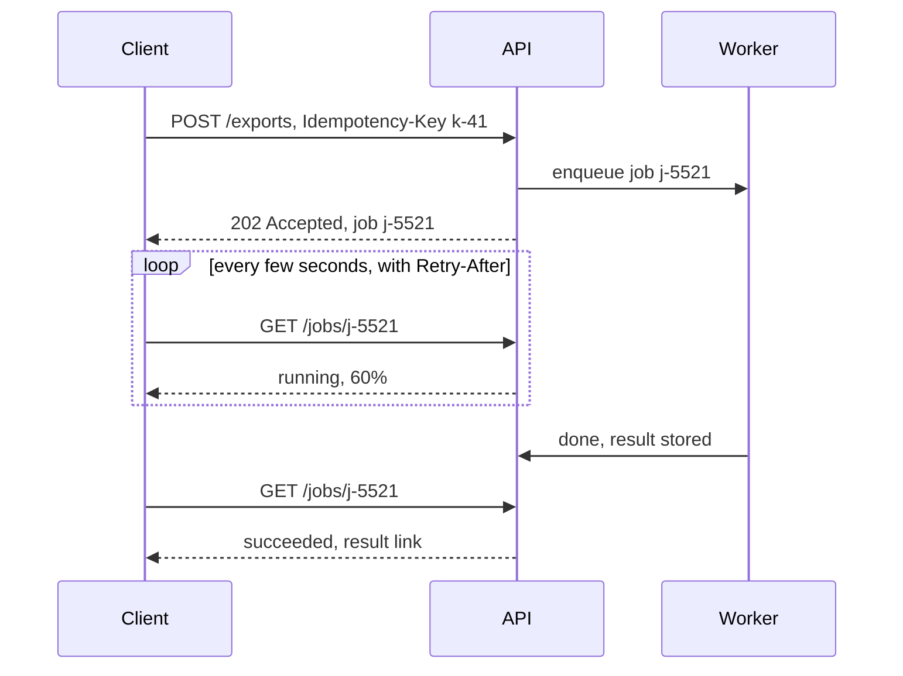

# Idempotent Writes and Long-running Jobs

## Start with the second order

Selby Retail, a fictional online retailer, ran its biggest sale of the year. The checkout app sent each order to the orders API with a 10-second timeout, and retried once if no answer came back.

In the peak hour the payment provider slowed, and some orders took 11 or 12 seconds. The app gave up at 10 seconds and sent the order again. The first attempt finished anyway, and so did the retry. By the end of the sale, 1,812 of 452,000 orders, about 0.4%, existed twice, and those customers had been charged twice.

Retrying was right. The API could not tell a retry from a new order. Call this **the second order**.

> **What you'll learn**
>
> - Why a timeout leaves the outcome of a write unknown.
> - How idempotency keys make a retried create safe.
> - How to handle two requests with the same key at the same moment.
> - How to start, track and finish a job that outlives one request, including a stream that drops.

## A timeout is an unknown outcome

When a client times out, it knows only that it did not hear back. Three different things may have happened:

1. The request never reached the server. Nothing was done.
2. The server did the work, and the response was lost or late. The work is done.
3. The server is still working. The work may finish after the client has given up.

Retrying is safe in case 1 and harmful in cases 2 and 3, and the client cannot tell which applies. The fix belongs on the server: make a repeated request have the same effect as one. That property is **idempotency**.

RFC 9110 defines `GET`, `HEAD`, `PUT` and `DELETE` as idempotent: sending one twice leaves the server as sending it once would. `POST`, used to create, is not. Two `POST` requests normally create two orders.

| Method | Typical use | Idempotent by definition? | Safe to retry blindly? |
| --- | --- | --- | --- |
| `GET` | Read | Yes | Yes |
| `PUT` | Replace a whole resource at a known address | Yes | Yes, if the body is complete |
| `DELETE` | Remove | Yes | Yes. A second call may return 404 |
| `POST` | Create, or start an action | No | Only with an idempotency key |

*Table 1: HTTP methods and retries. Creates need extra help to be retried safely.*

## Idempotency keys for creates

An **idempotency key** is a unique value the client sends with a create, usually in an `Idempotency-Key` header. The client generates it when the intent forms, such as when the customer presses "Place order", and sends the same key on every retry of that intent. The server records each key with a fingerprint of the request and the response it produced.

| Arrives | Server does | Client receives |
| --- | --- | --- |
| New key | Records the key as in progress, creates the order, stores the response | 201 and the order |
| Same key, same body, finished | Creates nothing. Returns the stored response | The same 201 and the same order |
| Same key, still in progress | Creates nothing | 409, try again shortly |
| Same key, different body | Creates nothing | 422: key reused for a different request |
| Key older than the retention window | Depends on policy: treat as new, or reject | 201, or an error |

*Table 2: How a server answers an idempotency key. The 409 and 422 responses follow the IETF draft that standardises the header.*

Three details decide whether keys work in practice:

- **Scope keys to the client.** Store them per account, and two customers who pick the same key never collide.
- **Keep keys long enough.** Retain them for longer than any client will keep retrying. Stripe's API documents pruning keys after they are at least 24 hours old.
- **Pass a key downstream.** Send the payment provider its own key, derived from the order's key, or a retry can create one order and two charges.

## Two requests, one key, same moment

Keys bring their own race. A double click, or a retry fired while the first attempt runs, sends two requests with one key milliseconds apart. If each checks "have I seen this key?" before either records it, both see "no" and both create an order.

Close the race in the database. Give the keys table a unique constraint on client and key, and make the first step an insert, not a read. Only one insert can win. The walkthrough traces a double click at Selby after the fix.

A customer double-clicks "Place order". Requests A and B carry the same key, k-7f3a, and arrive 40 milliseconds apart.

<button type="button" data-step="0" aria-pressed="false" aria-controls="key-step-0">1. A claims</button><button type="button" data-step="1" aria-pressed="false" aria-controls="key-step-1">2. B collides</button><button type="button" data-step="2" aria-pressed="false" aria-controls="key-step-2">3. A finishes</button><button type="button" data-step="3" aria-pressed="false" aria-controls="key-step-3">4. B retries</button>

<section id="key-step-0" class="step-panel" aria-labelledby="key-heading-0"><h4 id="key-heading-0">1. Request A claims the key</h4><dl><dt>At</dt><dd>0 ms</dd><dt>Action</dt><dd>Insert key k-7f3a with status in progress and the request fingerprint. The insert succeeds.</dd><dt>State</dt><dd>One key row, in progress. No order yet.</dd></dl></section><section id="key-step-1" class="step-panel" aria-labelledby="key-heading-1"><h4 id="key-heading-1">2. Request B collides</h4><dl><dt>At</dt><dd>40 ms</dd><dt>Action</dt><dd>Insert the same key. The unique constraint rejects it. B reads the row: in progress, same fingerprint.</dd><dt>State</dt><dd>B returns 409 with a short retry delay. Still one key row and no order.</dd></dl></section><section id="key-step-2" class="step-panel" aria-labelledby="key-heading-2"><h4 id="key-heading-2">3. Request A finishes</h4><dl><dt>At</dt><dd>2,300 ms</dd><dt>Action</dt><dd>Create order SR-90412, charge the card with the derived payment key, store the 201 response on the key row.</dd><dt>State</dt><dd>One order, one charge, key row complete.</dd></dl></section><section id="key-step-3" class="step-panel" aria-labelledby="key-heading-3"><h4 id="key-heading-3">4. Request B retries</h4><dl><dt>At</dt><dd>3,000 ms</dd><dt>Action</dt><dd>Find key k-7f3a complete with a matching fingerprint. Return the stored response.</dd><dt>State</dt><dd>B shows order SR-90412. Still one order and one charge.</dd></dl></section>

<button type="button" data-walk="previous">Previous</button>

<button type="button" data-walk="next">Next step</button>

The walkthrough is a scripted illustration. Add a second defence in the data: a unique constraint on the order's natural key, such as the cart identifier, rejects a duplicate even when a client forgets the key. If the server crashes during step 3, the key row stays in progress. Give in-progress rows an expiry, after which a retry may claim the key, and make the work safe to repeat. [Durability and Idempotency](/learn/production-ai/agentic-workflow-platforms/durability-and-idempotency) covers that for multi-step workflows.

### Timeouts that agree with each other

Selby's client gave up after 10 seconds while the server worked for 12. Set timeouts as a chain: each caller waits a little longer than the deadline it gives the next service. Give the payment call a deadline, say 8 seconds, and fail cleanly when it passes. Work that cannot reliably finish within the budget should become a job.

## Jobs that outlive a request

Some work takes minutes: exporting a year of orders or running a batch of model calls. [Keep the Request Path Free](/learn/engineering-foundations/apis-and-backend/keep-the-request-path-free) shows how to hand that work to a task queue. The API around the job needs three parts:

- **Start.** `POST /exports` with an idempotency key returns `202 Accepted` and the job's address, such as `/jobs/j-5521`, at once. A retried start returns the same job, not a second export.
- **Progress.** The job resource reports its state (queued, running, succeeded, failed or cancelled), progress such as "orders 1.2 million of 2 million", and when it last changed. Google's AIP-151 models this as an operation with a `done` flag.
- **Result.** A link to the output, or an error the client can act on. Offer cancellation for anything long.

Figure 1 shows the flow with polling.

*Figure 1: A long-running job with polling. The start returns at once, and the client follows a job resource until it reports done.*

The client can learn about progress in three ways:

| Method | How | Fits when | Watch for |
| --- | --- | --- | --- |
| Polling | Client asks the job resource every few seconds | Any client, including scripts | Tight loops: send `Retry-After` |
| Streaming | Server pushes progress events over one open connection | A person watches a progress bar | Proxies that buffer or cut connections |
| Callback | Server calls the client's webhook when the job ends | Server-to-server work | Signing and duplicate deliveries |

*Table 3: Three ways to report job progress. Many APIs offer polling as the baseline and add one of the others.*

## When a stream drops halfway

A streamed chat answer is a short job whose result arrives in pieces, and sometimes the provider drops halfway. [Build a Streaming Chat Endpoint](/learn/engineering-foundations/apis-and-backend/build-a-streaming-chat-endpoint) explains why the error must travel as an event inside the stream.

What to do next depends on what you kept:

- **Keep the partial text on the server**, marked incomplete. Never save it to the conversation as a finished answer.
- **Retry the generation once**, from the start, because most provider APIs cannot resume a broken stream. Reuse your own request identifier. [Retries and Fallbacks](/learn/production-ai/robust-agents/retries-and-fallbacks) covers falling back to a second model.
- **Let the client resume.** A reconnecting browser sends the last server-sent event identifier it saw in the `Last-Event-ID` header. A server that buffered the events can replay from there.
- **Do not repeat side effects.** If the model already called a tool that changed something, a blind retry may do it twice. Check the tool's idempotency key first.

## Limits of this lesson

- **Idempotency covers retries of one intent.** It does not stop a customer deliberately ordering twice.
- **Webhook receivers are out of scope.** The enterprise integration track covers them.
- **Fictional data.** Selby Retail, its orders and figures are illustrative.

## Interview angle

Each answer is an outline to say in about two minutes. Open each question and try it aloud before reading.

Interview question 1. How do you design for work that is slow or happens later: background jobs, callbacks and streaming? Where do idempotency and timeouts fit?

- **Answer:** Keep the request fast. Work that cannot finish within a set budget becomes a job: start returns 202 and a job address, progress comes by polling, streaming or a callback, and the result is a resource. Every start and create carries an idempotency key, because clients and queues retry. Timeouts form a chain, each caller waiting slightly longer than the deadline it gives downstream. Callbacks are signed and deduplicated by the receiver.
- **Trade-off:** Jobs add a queue, a state table and status endpoints. Synchronous calls are simpler until they time out under load.
- **Follow-up to expect:** "Which progress method first?" Polling, because every client can do it.

Interview question 2. After a timeout, a client retried and the customer now has two identical orders and two charges. What happened, and what do you change?

- **Answer:** The first request finished after the client gave up, and the API treated the retry as a new order. Add an idempotency key per checkout attempt, stored with a unique constraint and the stored response. Pass a derived key to the payment provider. Add a unique constraint on the cart identifier. Align timeouts so the server's deadline is shorter than the client's. Then find and refund existing duplicates.
- **Trade-off:** Storing keys and responses costs a write per request. Duplicates cost refunds and trust.
- **Follow-up to expect:** "Retries come from a mobile app." Generate the key on the device before the first attempt.

Interview question 3. Design idempotent creation for a create-payment endpoint, including two identical requests arriving at once.

- **Answer:** Require an `Idempotency-Key` header on create. Store the key per client with a fingerprint of the body, a status and the response. Insert the key first, under a unique constraint, so only one concurrent request claims it. The loser reads the row: in progress returns 409 with a retry delay, complete returns the stored response, a different body returns 422. Expire stuck in-progress rows after a timeout. Retain completed keys longer than clients retry, such as 24 hours.
- **Trade-off:** A 409 pushes waiting onto the client. Holding the second request is friendlier but ties up a connection.
- **Follow-up to expect:** "The service crashes after charging, before storing the response." The provider's own key makes the retried charge return the original result.

Interview question 4. A report takes about five minutes to build. How does the client find out how it is going and when it is done?

- **Answer:** Start it with `POST`, returning 202 and a job address. The job resource reports state, progress such as rows processed, and a result link when done. Offer polling with `Retry-After` as the baseline, server-sent events for a person watching, and a completion webhook for server clients. Support cancellation, and keep failed jobs with a usable error.
- **Trade-off:** Polling is universal but adds requests and delay. Streaming is immediate but needs connections that proxies keep open.
- **Follow-up to expect:** "Thousands of clients poll every second." Raise `Retry-After`, cache job status reads and suggest callbacks.

Interview question 5. The model provider drops the connection halfway through a streamed answer. What does the user see, and what does the server do?

- **Answer:** The server sends an error event inside the stream, because the status code has already gone. The user sees the partial text marked as interrupted, with a retry option or an automatic retry. The server keeps the partial text but does not save it as a finished answer, retries the generation once with the same request identifier, and falls back to another model if the provider is down. A reconnecting client sends `Last-Event-ID` to replay buffered events.
- **Trade-off:** An automatic retry hides the failure but may show a different answer. Asking the user adds a click.
- **Follow-up to expect:** "A tool call ran before the drop." Check its idempotency key before retrying, so the action does not run twice.
- **Go deeper:** [Build a Streaming Chat Endpoint](/learn/engineering-foundations/apis-and-backend/build-a-streaming-chat-endpoint) and [Retries and Fallbacks](/learn/production-ai/robust-agents/retries-and-fallbacks).

## References

1. IETF, [RFC 9110: HTTP Semantics](https://www.rfc-editor.org/rfc/rfc9110), accessed 17 November 2026. Which methods are idempotent, and 202 Accepted.
2. IETF HTTPAPI working group, [The Idempotency-Key HTTP Header Field (draft)](https://datatracker.ietf.org/doc/draft-ietf-httpapi-idempotency-key-header/), accessed 17 November 2026. The header, and 409 and 422 responses for key conflicts.
3. Stripe, [Idempotent requests](https://docs.stripe.com/api/idempotent_requests), accessed 17 November 2026. Key storage, parameter comparison and pruning after 24 hours.
4. Google, [AIP-151: Long-running operations](https://google.aip.dev/151), accessed 17 November 2026. An operation resource with a done flag, result and error.
5. WHATWG, [HTML Standard: server-sent events](https://html.spec.whatwg.org/multipage/server-sent-events.html), accessed 17 November 2026. Event identifiers and the Last-Event-ID header on reconnect.

## Key takeaways

- A timeout leaves the outcome unknown, so retries must be safe on the server.
- Creates need an idempotency key, stored per client with a fingerprint and the response.
- Claim the key with an insert under a unique constraint, and pass a derived key downstream.
- Long work becomes a job: 202 to start, a resource to track, a result to fetch.
- A dropped stream ends with an error event, a retry and no repeated side effects.

## Check yourself

1. Why does checking for a key before inserting it fail under a double click?

Both requests can check before either inserts, so both see no key and both create an order. An insert under a unique constraint lets only one succeed.

2. Why should the same key with a different body be rejected instead of replayed?

It signals a client bug or a reused key. Replaying the old response would tell the client its new request succeeded when nothing was done.

3. Why should a job's start request also carry an idempotency key?

A retried start would otherwise launch a second job, doubling the work and possibly the output, such as two exports or two batches of model calls.

