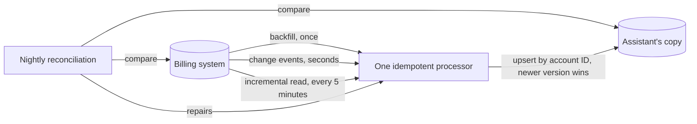

# Recoverable Data Syncs

## Start with the silent gap

Lowick Energy, a fictional energy supplier with 410,000 customer accounts, built a customer-service assistant. The assistant answers from a copy of each account: tariff, address, payment plan. The copy was loaded once, then kept current by change events that the billing system sends whenever an account changes.

One Sunday the billing vendor ran six hours of maintenance on its event sender. Accounts still changed during those hours, because the billing system itself stayed up. The changes were saved in billing, and no events were ever sent for them. 2,300 accounts in the copy were now wrong, and nothing in the sync had failed.

Three weeks later a complaints manager noticed the assistant quoting tariffs that customers had left. No alert had fired, because no event had been rejected. Call this **the silent gap**.

> **What you'll learn**
>
> - The four mechanisms of a recoverable sync and the job each one does.
> - How incremental reads and change data capture catch what events miss.
> - Why a checkpoint advances only after the data is committed.
> - What replay finds, what reconciliation finds, and why you need both.
> - Why every path should feed one idempotent processor.

## Four mechanisms, one job

Events alone make a fast sync and a fragile one. A sync you can recover combines four mechanisms:

| Mechanism | Job | What it misses |
| --- | --- | --- |
| **Backfill** | Sets the baseline: a full copy of the records in scope | Everything that changes after it runs |
| **Events** (webhooks or a topic) | Delivers changes within seconds | Changes made while the sender was down, and events lost in transit |
| **Incremental reads** | Every few minutes, reads records changed since a saved point | Deletes, if the source only marks changes with a timestamp |
| **Reconciliation** | On a schedule, compares the source with the copy and repairs drift | Nothing it compares, but it is slow and expensive |

*Table 1: The four mechanisms of a recoverable sync. Each covers a gap the one above it leaves.*

Figure 1 shows them working together.

*Figure 1: A recoverable sync. Four paths feed one processor, and reconciliation checks the result against the source.*

Running a backfill alongside the live load needs a clear boundary so the two never write the same records. That is taught in [backfills while live](/learn/fde-building-in-the-estate/customer-data-pipelines/backfills-while-live). Connector choices for each enterprise system, including file feeds and rate limits, are in [connecting enterprise systems](/learn/enterprise-integration/connecting-enterprise-systems/crm-erp-and-ticketing-systems). Choosing between webhooks, polling and REST at a partner's boundary is in [choosing the transport](/learn/enterprise-integration/framing-an-integration/choosing-the-transport).

## Incremental reads and change data capture

An **incremental read** asks the source for records changed since a saved point. There are two common ways to find them.

**A modified-time cursor.** Query for records whose `updated_at` is later than the last value you saw. It works on almost any API or database and has three traps:

- **Ties.** Many records can share one timestamp. Cursor on the pair (`updated_at`, `id`), not the time alone, or a page boundary can skip records.
- **Late commits.** A transaction that started earlier can commit after you have read past its timestamp. Re-read a short overlap, such as the last five minutes, every time.
- **Deletes.** A deleted record has no `updated_at` to find. Ask whether the source keeps a deleted flag or a deletions endpoint.

**Change data capture (CDC).** Read the source database's own change log, the record it keeps of every committed insert, update and delete. PostgreSQL exposes this through logical decoding, and tools such as Debezium turn it into a stream of change events. CDC sees deletes and every change in commit order. It needs access to the customer's database at a level that many customers will not grant to a vendor, and a log position that is kept until you have read it.

Lowick's billing system was a vendor's software as a service, with no database access. Lowick added a five-minute incremental read by modified time, using the pair cursor and the overlap. It would have caught the Sunday gap within five minutes of the sender's maintenance ending.

Sizing the overlap, pages that end inside a tied second and the changes a cursor never sees are taught in [incremental loads and watermarks](/learn/fde-building-in-the-estate/customer-data-pipelines/incremental-loads-and-watermarks). Moving a whole live database to a new system with a bulk copy and change capture is [migrating live data](/learn/fde-deploying-in-the-estate/releases-cutover-and-recovery/migrating-live-data).

## Checkpoints advance only after commit

A **checkpoint** is the saved point an incremental read or a stream consumer resumes from: a timestamp and ID, a log position or a broker offset. The rule is the same as for acknowledgements in [queues, topics and acknowledgements](/learn/engineering-foundations/distributed-systems-essentials/queues-topics-and-acknowledgements). Move the checkpoint only after the records it covers are committed to the copy.

If the job saves the checkpoint first and then crashes before writing, the records between the old and new checkpoint are skipped for good. If it writes first and crashes before saving the checkpoint, the next run re-reads them. The second failure is harmless when the processor is idempotent.

Store the checkpoint in the same database as the copy, and save it in the same transaction as the batch where you can. Then the two cannot disagree.

## Replay and reconciliation find different things

**Replay** re-runs events you already have, from a broker's retention or an event log. It repairs damage from a bug in your processing. It cannot recover an event that was never sent.

**Reconciliation** compares the source with the copy and repairs any difference, whatever caused it. It finds drift that no failed event reveals: the Sunday gap, a manual fix in the source, a record changed by a bulk import that sent no events. At scale, compare in stages. Count and hash records in buckets, such as by account ID range, then compare row by row only in buckets whose hashes differ.

The switcher applies each tool to Lowick's Sunday gap.

2,300 accounts changed in billing during six hours when no events were sent. Which tool finds them?

<button type="button" data-mode="replay" aria-pressed="false" aria-controls="replay-result">Replay</button>
<button type="button" data-mode="incremental" aria-pressed="false" aria-controls="incremental-result">Incremental read</button>
<button type="button" data-mode="reconcile" aria-pressed="false" aria-controls="reconcile-result">Reconciliation</button>

<section id="replay-result" class="mode-panel" data-announcement="Replay selected. It finds none of the gap."><h4>Replay</h4><ul><li>Replay re-runs events Lowick received.</li><li>No events exist for the 2,300 changes.</li><li>Replay finds none of them.</li></ul>
The right tool after a processing bug. Useless for events that never left the source.
</section>
<section id="incremental-result" class="mode-panel" data-announcement="Incremental read selected. It finds the changed records within minutes."><h4>Incremental read</h4><ul><li>The five-minute read asks billing for accounts modified since its checkpoint.</li><li>All 2,300 have a newer modified time, so they are read and applied.</li><li>Accounts closed during the gap are found only if billing exposes deletions.</li></ul>
Fast repair of most of the gap, with blind spots for deletes and wrong timestamps.
</section>
<section id="reconcile-result" class="mode-panel" data-announcement="Reconciliation selected. It finds every difference by the next morning."><h4>Reconciliation</h4><ul><li>The nightly job compares hashes for 410 buckets of about 1,000 accounts each.</li><li>Buckets that differ are compared row by row, which finds every changed, added or closed account.</li><li>Repairs go through the normal processor, and the count is reported.</li></ul>
Slowest, and the only tool that finds drift of any cause.
</section>

Report what reconciliation repairs. A rising count is an alarm: it means another path is losing changes. Lowick's nightly report would have shown 2,300 repairs on Monday morning, not three weeks later.

## One idempotent processor for every path

Backfill, events, incremental reads, replay and reconciliation repairs all end in the same write. Give them one processor:

- **Upsert by the record's key.** Insert the account if new, update it if present.
- **Newer version wins.** Apply a change only if its version or modified time is newer than the stored one. An old event replayed after a reconciliation repair is ignored.
- **Record the path.** Store which path made each write, so you can count what each one contributes.
- **Separate the rates.** Live events go first. Backfill, replay and repairs run at capped rates, so recovery never starves live traffic.

One processor means one set of rules to test. Two code paths drift apart, and the backfill then writes differently from the live sync. Go deeper on idempotent steps in [durability and idempotency](/learn/production-ai/agentic-workflow-platforms/durability-and-idempotency), on reading through rate limits with bounded retries in [retries and fallbacks](/learn/production-ai/robust-agents/retries-and-fallbacks), and on parking records that keep failing in [reliability and failure handling](/interview/final-week/module-12-reliability-and-failure-handling).

## Limits of this lesson

- **One-way sync.** Two systems that both edit the same record need field ownership and conflict rules, taught in [rate limits, backlogs and two-way sync](/learn/enterprise-integration/connecting-enterprise-systems/rate-limits-backlogs-and-two-way-sync).
- **Source access decides the method.** CDC needs database access. Many vendor systems offer only an API with a modified-time filter.
- **Fictional data.** Lowick Energy, its vendor and the figures are illustrative.

## Interview angle

Each answer is an outline to say in about two minutes. Open each question and try it aloud before reading.

Interview question 1. Your sync relies on a vendor's change webhooks. How do you make sure the copy stays correct?

- **Answer:** Treat webhooks as the fast path, not the only one. Backfill once for a baseline. Add an incremental read every few minutes that asks for records modified since a checkpoint, with an ID tie-breaker and a short overlap. Run a scheduled reconciliation that compares source and copy in hashed buckets and repairs drift, and report its repair count. Send every path through one idempotent processor that upserts by key and lets the newer version win.
- **Trade-off:** Incremental reads and reconciliation spend the vendor's API quota and need scheduling around its limits.
- **Follow-up to expect:** "How often do you reconcile?" As often as the business can tolerate wrong data, bounded by the quota. Nightly is a common start.

Interview question 2. What is the difference between replay and reconciliation, and when do you need each?

- **Answer:** Replay re-runs events you already hold. It repairs damage from your own processing bug, provided the events are still retained. Reconciliation compares source and copy and finds drift of any cause, including events never sent, manual fixes and bulk imports. Use replay after fixing a consumer bug. Run reconciliation on a schedule regardless, because it finds the gaps you do not know about.
- **Trade-off:** Replay is cheap and targeted. Reconciliation is thorough and reads the whole source.
- **Follow-up to expect:** "Reconciliation repairs 50 records every night." Something is losing changes. Find which path should have carried them.

Interview question 3. Explain change data capture, and when you would choose a modified-time cursor instead.

- **Answer:** Change data capture reads the source database's change log, so it sees every insert, update and delete in commit order, with low delay. It needs database-level access and a retained log position. A modified-time cursor needs only an API filter, so it works with vendor systems, but it misses deletes and needs a tie-breaker and an overlap for late commits. Choose CDC when you can get log access to a database you are allowed to read. Choose the cursor for a vendor's API.
- **Trade-off:** CDC is complete and needs privileged access. The cursor is easy to get and has blind spots that reconciliation must cover.
- **Follow-up to expect:** "Where do you store the checkpoint?" With the copy, saved after or with the batch's commit.

## References

1. PostgreSQL, [Logical decoding concepts](https://www.postgresql.org/docs/current/logicaldecoding-explanation.html), accessed 17 November 2026. Reading committed changes from the database's log through replication slots.
2. Debezium, [Features](https://debezium.io/documentation/reference/stable/features.html), accessed 17 November 2026. Change data capture from database logs, including deletes and snapshots.
3. The author's own field experience, the basis for the four-mechanism sync and the staged reconciliation.

## Key takeaways

- Events are the fast path. Incremental reads and reconciliation cover what events miss.
- A modified-time cursor needs an ID tie-breaker, an overlap and a plan for deletes. CDC sees everything and needs database access.
- Advance a checkpoint only after the records it covers are committed.
- Replay re-runs known events. Reconciliation finds unknown drift. Run reconciliation on a schedule.
- Send every path through one idempotent processor where the newer version wins.

## Check yourself

1. Why did no alert fire during Lowick's silent gap?

No event failed. The events were never sent, so the sync had nothing to reject or retry.

2. A job saves its checkpoint, then crashes before writing the batch. What happens?

The next run starts after the batch, so those records are skipped until reconciliation finds them.

3. Why re-read a five-minute overlap on every incremental read?

A transaction can commit after you have read past its timestamp. The overlap catches it, and the idempotent processor makes the repeat reads harmless.

