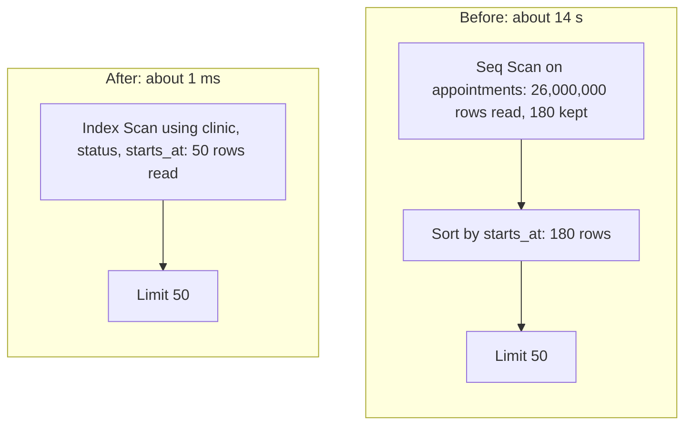

# Indexes and Query Plans

## Start with the report that aged

Thorne Clinics, a fictional chain of 200 outpatient clinics, gave each clinic manager a morning list: today's open appointments at their clinic, earliest first, 50 per page.

At launch the appointments table held 300,000 rows and the list loaded in 0.2 seconds. Two years later it held 26 million rows. The same list took 14 seconds, and on Monday mornings, with every manager opening it at 08:00, it timed out.

Nobody had changed the query. The table had an index on `status`, added at launch, and it had stopped helping long ago. The query had been slowing down a little each week for two years. Call this **the report that aged**.

> **What you'll learn**
>
> - What an index buys and what it costs.
> - How to order the columns of a composite index for a filter-and-sort query.
> - How to read a query plan.
> - Why queries slow down as tables grow, and a routine for fixing one.

## What an index buys and costs

A **B-tree index**, the default in PostgreSQL and most relational databases, is a sorted copy of one or more columns, with a pointer from each entry to its row. Because it is sorted, the database can jump to a value or a range in a few steps instead of reading the whole table. Because it is sorted, it can also return rows already in order.

It is not free:

- **Every write maintains it.** Each insert adds an entry to every index on the table. Each update of an indexed column moves an entry. A table with eight indexes does nine writes per insert.
- **It takes space**, and space in memory is what keeps it fast.
- **The planner may ignore it.** If a condition matches a large share of the table, reading the table straight through is cheaper than following millions of pointers.

The last point explains Thorne's `status` index. About 40% of appointments are open at any time. Using an index to find 10 million rows is slower than scanning all 26 million. The planner stopped using it as the table grew.

## Composite indexes for filter-and-sort

Thorne's query has three conditions and a sort: `clinic_id = 12`, `status = 'open'`, `starts_at` within today, ordered by `starts_at`, limit 50.

A **composite index** covers several columns in a set order. PostgreSQL's documentation states the rule: a multicolumn B-tree index works best with equality conditions on its leading columns, followed by a range condition on the next one. That gives a practical order:

1. **Equality columns first**: `clinic_id`, `status`.
2. **Then the range or sort column**: `starts_at`.

With the index on `(clinic_id, status, starts_at)`, all entries for clinic 12 with status open sit together, already sorted by start time. The database jumps to today's first entry, reads forward and stops after 50. No sort step, no wasted rows.

| Index | Serves this query? | Why |
| --- | --- | --- |
| `(status)` | Barely | Matches 40% of the table, and the planner prefers a full scan |
| `(starts_at)` | Partly | Finds today's 35,600 appointments across all clinics, then filters to one clinic |
| `(clinic_id, status, starts_at)` | Fully | Equality, equality, then the range in sorted order. Reads about 50 entries |
| `(starts_at, clinic_id, status)` | Poorly | The range comes first, so the equality columns cannot narrow the scan within it |

*Table 1: Candidate indexes for Thorne's list. Column order decides whether an index serves a filter-and-sort query.*

The 35,600 comes from the table: 26 million appointments over about 730 days is about 35,600 a day, or about 178 per clinic per day.

The switcher shows the plan and timing under three indexes, using these figures.

Query: clinic 12, status open, starting today, earliest first, limit 50. The table holds 26 million appointments.

<button type="button" data-mode="status" aria-pressed="false" aria-controls="status-result">Status only</button>
<button type="button" data-mode="time" aria-pressed="false" aria-controls="time-result">Start time only</button>
<button type="button" data-mode="composite" aria-pressed="false" aria-controls="composite-result">Composite</button>

<section id="status-result" class="mode-panel" data-announcement="Status only selected. Full scan, about 14 seconds."><h4>Index on status only</h4><ul><li>Plan: sequential scan of 26 million rows, filter, then sort.</li><li>Rows read: 26 million. Rows kept: about 180.</li><li>Time: about 14 seconds.</li></ul>
The index exists but is not used. Open appointments are too common for it to help.
</section>
<section id="time-result" class="mode-panel" data-announcement="Start time only selected. Range scan, tens of milliseconds."><h4>Index on start time only</h4><ul><li>Plan: index scan on today's range, filter on clinic and status.</li><li>Rows read: about 35,600, every clinic's appointments for today. Rows kept: about 180.</li><li>Time: tens of milliseconds, and it grows with the number of clinics.</li></ul>
Already sorted, but 99% of rows read are thrown away.
</section>
<section id="composite-result" class="mode-panel" data-announcement="Composite selected. About 50 entries read, about a millisecond."><h4>Composite index on clinic, status, start time</h4><ul><li>Plan: index scan from clinic 12, open, start of today. Limit stops it at 50.</li><li>Rows read: about 50.</li><li>Time: about a millisecond, and nearly flat as the table grows.</li></ul>
No sort step. The index delivers rows in the order the query wants.
</section>

The timings are illustrative orders of magnitude, not benchmarks.

One composite index can serve several queries that share its leading columns. `(clinic_id, status, starts_at)` also serves "all open appointments at clinic 12" and "all appointments at clinic 12". It does not serve "open appointments at every clinic today", because that query does not fix `clinic_id`.

## Reading a query plan

The database's **planner** chooses how to run each query and shows its choice when you prefix the query with `explain`. Adding the option that executes the query also reports real row counts and timings.

<!-- spelling: source -->
In PostgreSQL that is `explain (analyze, buffers)`, with the option spelled as the product spells it. It runs the query. Use it with care on statements that write.

A plan is a tree. Each node takes rows from its children, does one job and passes rows up. Read it from the most indented node outward. Figure 1 shows Thorne's plan before and after the fix.

*Figure 1: Thorne's plan before and after the composite index, read from the bottom up. The scan node changes from reading the whole table to reading 50 index entries, and the sort disappears.*

| Plan node | Means | Worry when |
| --- | --- | --- |
| Seq Scan | Read the whole table | The table is large and the filter removes most rows |
| Index Scan | Walk the index, then fetch each row | Rows fetched are far more than rows returned |
| Index Only Scan | Answer from the index alone | Rarely a worry. Add columns to an index on purpose to get this |
| Bitmap Heap Scan | Collect matching row locations, then read them in table order | Many rows match: check whether a better index would narrow them |
| Sort | Order rows in memory or on disk | It sorts many rows, or reports using disk |
| Nested Loop | For each outer row, look up inner rows | The outer side has far more rows than estimated |

*Table 2: Common PostgreSQL plan nodes and when to look closer.*

Two numbers on each node tell you most of what you need. **Estimated rows against actual rows**: a large gap means the planner's statistics are wrong, and it may have chosen a bad plan because of it. **Time per node**: find the node where the time goes, and fix that one.

## Why queries slow down as tables grow

A query that was fast on a small table can slow for several reasons, and each leaves a different mark in the plan.

| Cause | Mark in the plan | Fix |
| --- | --- | --- |
| No index fits the filter and sort | Seq Scan with a filter that removes most rows, then Sort | Composite index in equality, then range order |
| An old index no longer selective | Index present but unused | Replace it with one that leads with selective columns |
| Stale statistics | Estimated rows far from actual | Refresh statistics, and check autovacuum is keeping up |
| A function on the column, such as `date(starts_at) = current_date` | Seq Scan despite an index on `starts_at` | Rewrite as a range on the raw column, or index the expression |
| Deep offset pagination | Rows read grow with page number | Switch to cursor pagination |
| Growing result | Plan fine, but rows returned keep rising | Return less: aggregate, page or narrow the time window |

*Table 3: Why queries slow as tables grow, how each shows in a plan, and the usual fix.*

Deep offsets are covered from the API side in [Pagination, Filtering and Versioning](/learn/engineering-foundations/apis-and-backend/pagination-filtering-and-versioning).

### A routine for one slow query

1. **Reproduce with real parameters.** A query fast for a small clinic may be slow for the largest one.
2. **Get the plan with real timings** and find the node that takes the time.
3. **Compare estimated and actual rows** on that node.
4. **Change one thing**: an index, a rewrite or fresh statistics. Measure again.
5. **Count the write cost.** Check how often the table is written before adding a fifth index to it.

## Limits of this lesson

- **PostgreSQL first.** Other databases use different node names and some different index types, but the ideas transfer.
- **Indexes are not the only tool.** Partitioning, summary tables and read replicas solve problems an index cannot.
- **Fictional data.** Thorne Clinics, its figures and timings are illustrative.

## Interview angle

Each answer is an outline to say in about two minutes. Open each question and try it aloud before reading.

Interview question 1. How do you decide which indexes a table needs, and how do you tell whether a query uses them well?

- **Answer:** Start from the queries that matter, not the columns. For each, put equality columns first and the range or sort column next in a composite index. It then filters and returns rows in order. Prefer one index serving several queries through shared leading columns. Then read the plan with real timings: check the scan type, compare estimated with actual rows, and find the node that takes the time. Drop indexes that no query uses, because each one costs every write.
- **Trade-off:** More indexes speed reads and slow every insert and update.
- **Follow-up to expect:** "Why not index every column?" Single-column indexes rarely serve multi-condition queries well, and each adds write cost.

Interview question 2. A customer's daily report has grown from under a second to over a minute in a year, with no code change. How do you find the cause?

- **Answer:** Reproduce it with the parameters the customer uses, then get the plan with real timings. Look for a full scan whose filter discards most rows, a large sort, or estimates far from actuals. Check whether the existing indexes match the filter and sort order, whether a function on a column blocks an index, and whether statistics are current. Fix the costliest node first, often with a composite index, and measure again. Confirm the report needs all the rows it returns.
- **Trade-off:** A new index fixes the read quickly and adds write cost. A summary table makes the report instant but serves data up to a day old.
- **Follow-up to expect:** "The plan looks fine but it is still slow." Check locks, disk and the volume returned to the client.

## References

1. PostgreSQL, [Multicolumn indexes](https://www.postgresql.org/docs/current/indexes-multicolumn.html), accessed 17 November 2026. Equality on leading columns plus a range on the next.
2. PostgreSQL, [Indexes and order by](https://www.postgresql.org/docs/current/indexes-ordering.html), accessed 17 November 2026. Returning rows in index order and avoiding a sort.
3. PostgreSQL, [Using EXPLAIN](https://www.postgresql.org/docs/current/using-explain.html), accessed 17 November 2026. Plan nodes, estimates and actual timings.
4. Markus Winand, [Use The Index, Luke: indexed order by](https://use-the-index-luke.com/sql/sorting-grouping/indexed-order-by), accessed 17 November 2026. Pipelined ordering and stopping early with a limit.

## Key takeaways

- An index speeds reads, costs every write and is ignored when it matches too much.
- Order a composite index with equality columns first, then the range or sort column.
- Read a plan from the innermost node, and compare estimated with actual rows.
- Queries slow as tables grow when indexes stop fitting, statistics go stale or functions block indexes.
- Reproduce with real parameters, change one thing and measure.

## Check yourself

1. Why did Thorne's planner stop using the status index?

About 40% of appointments are open, so the index pointed at millions of rows. Scanning the table straight through became cheaper than following that many pointers.

2. Why does the composite index make the sort step disappear?

Within one clinic and status, the index entries are already ordered by start time, so rows come out in the order the query asks for.

3. What does a large gap between estimated and actual rows suggest?

The planner's statistics are wrong, and it may have chosen a poor plan as a result. Refresh statistics before adding indexes.

