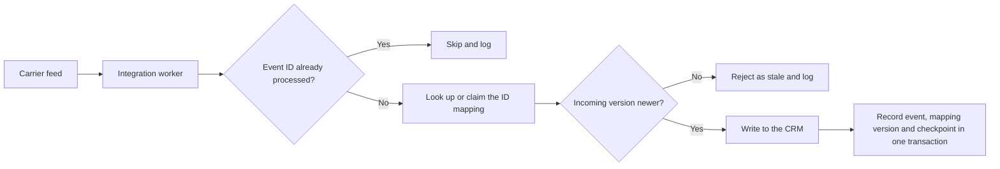

# Modelling the Integration's Own State

## Start with the connector that forgot

Wendover Freight, a fictional logistics firm, asked your team to copy shipment updates from a carrier's API into its customer relationship management (CRM) system. Account managers used the CRM to answer "where is my order?" calls.

The connector polled the carrier every minute, created a CRM record for each new shipment and updated known ones. It kept the map from carrier shipment IDs to CRM record IDs in memory, and the time of its last poll in a local file.

On a Tuesday afternoon a routine deploy replaced the container. The local file went with it. The new worker started from its default, the last 24 hours, and its in-memory map was empty. It created 3,100 duplicate shipment records. Worse, a carrier retry delivered an old "in transit" event after a newer "delivered" event, and the worker applied it. For two days, account managers told customers that delivered parcels were still on the road.

Call this **the connector that forgot**: an integration that kept its own working memory in a place that does not survive a restart.

> **What you'll learn**
>
> - Why an integration needs its own database, separate from the systems it connects.
> - Which five kinds of state must survive a restart, and the key that guards each.
> - How a version check rejects a stale or out-of-order update.
> - Why the checkpoint must move in the same transaction as the work it records.

## The integration owns a small database

An integration moves data between systems it does not own. The carrier owns shipments. The CRM owns customer records. The integration still has to remember things that neither system can tell it: which carrier ID maps to which CRM ID, which events it has already applied, how far through the feed it has read, what is waiting to be retried and what it did.

Call this **control state**. It is data about the movement, not the business data being moved. It belongs in a database the integration owns, usually a few tables in a managed PostgreSQL instance or a schema in one the team already runs.

Process memory and local files die with the process, and deploys, crashes and autoscaling all restart workers. A restart is a normal event, so control state needs a real database.

Teams sometimes try to keep control state in the target system instead, such as a custom "carrier ID" field on each CRM record. That avoids a database but costs more than it saves. Every lookup becomes a rate-limited API call. The CRM cannot hold the checkpoint or the retry queue. And nothing can update the CRM record and the checkpoint in one transaction.

The trade-off is one more database to back up, monitor and secure, though a small one of narrow rows.

## What must survive a restart

Five kinds of control state cover most integrations. Each gets a table, and each table gets a constraint that makes the database refuse the mistake the integration would otherwise make.

| State | What it holds | Key or constraint | What goes wrong without it |
| --- | --- | --- | --- |
| ID mapping | Source system, source ID, target ID, last applied version | Unique on source system and source ID | Duplicate records in the target after a restart |
| Processed events | Source system, event ID, processed time | Primary key on source system and event ID | The same event applied twice |
| Checkpoint | Source system, cursor or watermark, updated time | One row per source and feed | Re-reading a day of data, or skipping some |
| Retry queue | Work item, attempt count, next attempt time, last error | Unique on work item | Lost work, or two workers retrying one item |
| Audit log | What changed, from which event, by which run, when | Insert-only for the application | Nobody can say why a target record holds a value |

*Table 1: The five kinds of control state. The constraint in each row turns a silent duplicate or loss into a database error the code can handle.*

The mapping table did most of the damage at Wendover. With a unique constraint on carrier and shipment ID, the restarted worker would have looked up the existing CRM ID instead of creating a new record. An insert of a second mapping would have failed loudly instead of producing a duplicate. PostgreSQL's `INSERT ... ON CONFLICT` lets the worker claim a mapping or read the existing one in a single statement.

*Figure 1: One event through the integration's own state. Every decision reads a table the worker owns, so a restarted worker makes the same decisions.*

The [modelling entities, keys and constraints](/learn/engineering-foundations/sql-and-data-modelling/modelling-entities-keys-and-constraints) lesson covers keys and constraints in general. For how unique constraints and indexes serve one access path, see the [API and data contracts](/learn/staff-ai-system-design/mvp/mvp-learn-and-design) section of the Staff AI System Design course.

Writes to the CRM need one more guard. If the worker crashes after the CRM accepted a create but before the mapping row commits, a retry could create a second record. Send an idempotency key derived from the source ID with every create, or search the CRM by source ID before creating. **Go deeper:** the same course teaches idempotency keys in its MVP stage, linked above.

## Reject the stale update with a version check

Partners do not deliver events in order. Retries, parallel workers, a webhook racing a polling job and a backfill running beside live traffic all reorder them. An integration that applies whatever arrives last will sometimes move a record backwards, as Wendover's did.

A **version check** fixes this. Store the last applied source version on the mapping row. Apply an incoming update only if its version is newer, in the same statement that records it: update the mapping row and set the new version where the stored version is lower than the incoming one. If the statement changes zero rows, the update is stale. Log it, count it and skip the CRM write.

The comparison is only as good as the version. A partner's sequence number or record version is best, because the partner's system assigns it in order. A partner's "last modified" timestamp is weaker: two updates can share a timestamp, and clocks on different partner servers can drift. If timestamps are all you have, break ties with the event ID and alert on events older than a set window. Your own receive time is the weakest, because it records arrival order, which is the order you are trying to correct.

The switcher replays Wendover's two events under both rules.

Shipment 88231 receives "delivered" (carrier version 7) at 14:02, then a retried "in transit" (carrier version 5) at 14:03.

<button type="button" data-mode="last-write" aria-pressed="false" aria-controls="last-write-result">Last write wins</button>
<button type="button" data-mode="version-check" aria-pressed="false" aria-controls="version-check-result">Version check</button>

<section id="last-write-result" class="mode-panel" data-announcement="Last write wins selected. The record moves backwards to in transit."><h4>Last write wins</h4><ul><li>14:02: the CRM record becomes "delivered".</li><li>14:03: the retried event overwrites it with "in transit".</li><li>No error is raised. The record stays wrong until a person notices.</li></ul>
Every component did what it was told. The rule itself was wrong for an unordered feed.
</section>
<section id="version-check-result" class="mode-panel" data-announcement="Version check selected. The stale event is rejected and logged."><h4>Version check</h4><ul><li>14:02: version 7 is newer than the stored 4, so the record becomes "delivered" and the mapping stores 7.</li><li>14:03: version 5 is not newer than 7. The update changes zero rows.</li><li>The worker logs a stale event and increments a counter. The CRM is not touched.</li></ul>
The record stays correct, and the count shows how disordered the feed is.
</section>

The trade-off is that a version check can hide a real correction. If the carrier fixes a mistake by resending an old version, the check discards it. Agree with the partner that corrections carry a new version, and give operators a way to replay one event by hand with the check overridden and the override audited.

This is the same idea as an optimistic lock, which detects a conflict instead of preventing it. The [transactions, locking and isolation](/learn/engineering-foundations/sql-and-data-modelling/transactions-locking-and-isolation) lesson covers locks and isolation levels.

## Move the checkpoint with the work

A checkpoint records how far the integration has read. It is only safe if it moves in the same local transaction as the rows that record the work: the processed event, the mapping version and the audit entry. Commit them together and a crash leaves either all of them or none of them.

If the checkpoint moves first and the worker crashes, the events in between are skipped for good. If the work commits and the checkpoint lags, the restarted worker re-reads some events, which the processed-events table then skips. Re-reading is safe and skipping is not, so when in doubt, let the checkpoint lag.

Two details matter in practice.

- **A watermark means contiguous.** If events arrive with sequence numbers 101, 103 and 102 late, the watermark stays at 101 until 102 is applied. Advancing it to 103 hides the gap. Track gaps and reconcile them instead.
- **Batch size sets the replay window.** Committing every event is simplest and slowest. Committing every 500 is faster but replays up to 500 events after a crash. That is fine when the processed-events table makes replays harmless.

**Go deeper:** the [reliability and consistency](/learn/staff-ai-system-design/reliability-consistency/reliability-consistency-learn-and-design) stage of the Staff AI System Design course covers a result and an outbox row in one transaction, and why a watermark must not skip a gap.

The audit log answers a different question: why does this CRM record hold this value? Each row names the source event, the version, the run and the decision, including "rejected as stale". At Wendover, one query over such rows would have shown the retried event and when it was applied.

## Limits of this lesson

- **Scale changes the store.** Very high event rates may need partitioned tables or a key-value store for the processed-events set, with an expiry window.
- **Some partners give no version.** Then you depend on timestamps and reconciliation, and should say so in the integration's design.
- **Fictional data.** Wendover Freight, its carrier and figures are illustrative.

## Interview angle

Each answer is an outline to say in about two minutes. Open the question and try it aloud before reading.

Interview question 1. Your integration created thousands of duplicate records after a deploy. What state was missing, and how would you design it?

- **Answer:** The integration kept its ID mapping and checkpoint in memory or on local disk, so a restart lost both. Give it its own database with five tables: ID mapping with a unique constraint on source system and source ID, processed events keyed by event ID, one checkpoint row per feed, a retry queue and an insert-only audit log. Claim or read the mapping in one statement, and send an idempotency key with every create in the target. Then clean up the duplicates using the mapping table as the record of which target ID is canonical.
- **Trade-off:** One more database to run and secure, in exchange for restarts that resume instead of repeating work.
- **Follow-up to expect:** "Why not store the source ID on the CRM record?" Lookups become rate-limited API calls, and nothing commits the record and the checkpoint together.

Interview question 2. A partner's webhooks sometimes arrive out of order and a record moves backwards. How do you stop it?

- **Answer:** Store the last applied source version on the mapping row and apply an update only if its version is newer, in one conditional update. Zero rows changed means stale: log it, count it and skip the target write. Prefer the partner's sequence or record version over its timestamp, and break timestamp ties with the event ID. Watch the stale-event count, because a rise shows the feed got more disordered.
- **Trade-off:** A version check also discards a correction resent with an old version. Agree that corrections carry a new version, and keep an audited manual replay.
- **Follow-up to expect:** "The partner only gives timestamps." Use them with an event-ID tie-break, alert on very old events and reconcile nightly.

Interview question 3. Where should the checkpoint be written, and when?

- **Answer:** In the integration's own database, in the same local transaction as the processed-event, mapping and audit rows for the work it covers. A crash then leaves all or none. If it must lag, let it lag: a re-read is skipped by the processed-events table, while a checkpoint that ran ahead skips events for good. Advance a watermark only over contiguous sequence numbers.
- **Trade-off:** Committing per event is slow. Larger batches are faster but replay more after a crash.
- **Follow-up to expect:** "The target write cannot join your transaction." Right. That is why the target write carries an idempotency key.

## References

1. PostgreSQL Global Development Group, [Constraints](https://www.postgresql.org/docs/current/ddl-constraints.html), PostgreSQL documentation, accessed 18 November 2026. Unique and primary-key constraints, and how the database enforces them.
2. PostgreSQL Global Development Group, [INSERT](https://www.postgresql.org/docs/current/sql-insert.html), PostgreSQL documentation, accessed 18 November 2026. The `ON CONFLICT` clause for claiming or reading a row in one statement.
3. Martin Fowler, [Optimistic Offline Lock](https://martinfowler.com/eaaCatalog/optimisticOfflineLock.html), Catalog of Patterns of Enterprise Application Architecture, accessed 18 November 2026. Detecting a conflicting update instead of preventing it.
4. The author's own field experience, the basis for the five kinds of control state and the restart story.

## Key takeaways

- An integration owns control state that neither connected system can hold. Put it in a database, not in memory or local files.
- Five tables cover most integrations: ID mapping, processed events, checkpoint, retry queue and audit log, each with a constraint that refuses the mistake.
- A version check applies an update only if it is newer. Prefer the partner's sequence or version over timestamps.
- Move the checkpoint in the same transaction as the work. A lagging checkpoint re-reads safely. A leading one loses events.
- Writes to the target cannot join that transaction, so they carry an idempotency key.

## Check yourself

1. Which constraint would have prevented Wendover's duplicate records?

A unique constraint on carrier and shipment ID in the ID-mapping table. The restarted worker would have found the existing CRM ID, or failed to insert a second mapping, instead of creating a new record.

2. An update changes zero rows under the version check. What does the worker do?

Treats the event as stale: logs it with an audit row, increments the stale-event counter and skips the write to the target system.

3. Why is a checkpoint that lags safer than one that leads?

A lagging checkpoint re-reads events, and the processed-events table skips them. A leading checkpoint marks events as read that were never applied, so they are lost.

