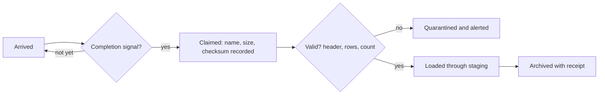

# Legacy Feeds: SOAP, SFTP and CSV

## Start with the half file that counted as whole

Morvah Freight, a parcel carrier, asked for a customer-service assistant that answers "where is my parcel?". Delivery confirmations came from a partner courier as one comma-separated values (CSV) file each night, dropped on Morvah's secure file transfer server, and Hamid, the forward deployed engineer, wrote a loader that checked the drop folder every five minutes, loaded any file it had not seen and recorded the file name as done. One night the partner's link was slow and the upload ran from 02:12 to 02:31. At 02:15 the loader read the 3,100 rows that had arrived, dropped the last one because it was cut off mid-line, and marked the name as done. When the upload finished, it skipped the file it had already processed. In the morning, 5,300 delivered parcels still showed "in transit", and over the next two days 600 customers opened missing-parcel claims for parcels sitting on their doorsteps. Nothing in the folder said the file was finished, and the loader assumed it was. Call this **the half file that counted as whole**.

> **What you'll learn**
>
> - How a SOAP service describes itself, and what to check when you call one.
> - Why an SFTP drop gives no signal that a file is complete, and which signals to agree.
> - The ways real CSV files break the format, and how to parse defensively.
> - A five-step routine that loads each file once and completely.

## SOAP: a contract written in XML

Many enterprise systems built before about 2010 expose SOAP services, and they are still in daily use. SOAP (originally Simple Object Access Protocol) sends messages written in XML (Extensible Markup Language), usually over HTTP. Each message is an **envelope** holding an optional **header**, for things like security tokens, and a **body** with the request or response.

A SOAP service is described by a WSDL (Web Services Description Language) document. It lists the operations, the exact structure of each message and the address to call. Most languages can generate a client from it.

What to check when you connect:

- **Save the WSDL.** Keep the version you built against in your repository. When the partner changes the service, compare the new one with it before anything breaks.
- **Read the body for errors.** A failed call returns a **fault** element in the body, with an HTTP error status, often 500. The fault says whether the problem was your request or their server. Log it in full.
- **Respect namespaces.** XML elements belong to namespaces. An element in the wrong namespace may be ignored without an error. A field you send can disappear.
- **Set timeouts.** SOAP services are often slow and messages large. Set a timeout per operation, and agree with the owner how many calls you may make at once.
- **Ask about security headers.** Some services require signed or token-bearing headers in a standard called WS-Security. Generated clients do not always add them for you.

## SFTP drops: files with no handshake

SFTP (SSH File Transfer Protocol) moves files over an encrypted Secure Shell connection. It is the common way for two organisations to swap files on a schedule. The sender uploads, the receiver polls a folder.

The protocol tells the reader nothing about whether an upload has finished. A file usually appears in the folder listing when the upload starts and grows until it ends. That gap is how Morvah loaded 3,100 rows of 8,400.

Agree a completion signal with the sender. Table 1 lists the common ones, strongest first.

| Signal | How it works | Weakness |
|---|---|---|
| Upload then rename | The sender writes `deliveries.csv.part`, then renames it when done. The loader ignores `.part` files. | Needs the sender to change their process |
| Marker file | After the data file, the sender writes a small file with the same name and the row count and checksum | Needs the sender's cooperation |
| Trailer row | The last row of the file states the number of data rows | The file can still be read mid-upload, but the count catches it |
| Size unchanged | The loader waits until the size and modified time stay the same across two checks a few minutes apart | A stalled upload looks finished |

*Table 1: Ways to know a file is complete. A rename on the same server is usually a single step. The reader never sees a half-written file under the final name.*

If the sender can do nothing, use the size check and verify the row count against another source, such as a daily total the partner reports by email or through its own service.

## CSV is not one format

RFC 4180 describes a common CSV format, but it is informational, not a standard every exporter follows. Real files vary in ways that break naive loaders:

- **Quoting.** A field can contain commas and line breaks inside quotes. Splitting on commas and newlines miscounts rows.
- **Encoding.** One partner sends UTF-8, another a Windows code page. Accented names turn into nonsense when the encoding is guessed wrong. A byte order mark can appear as junk in the first column name.
- **Headers that drift.** A column is renamed, added or moved without warning.
- **Local formats.** Dates as 04/11/2026 mean different days in different countries. Decimals may use commas.
- **Partial and padded files.** A missing final line, trailing blank lines, or a last row cut off mid-field.

Parse with a real CSV library and declare the encoding. Check the header against the expected column list before reading any rows. Count parsed records, not lines. If any row fails, move the whole file to a quarantine folder and alert someone, unless the customer has agreed that partial loads are acceptable. A file that loads 99% of its rows without saying so is worse than one that loads nothing and raises an alarm.

## Load each file once, and completely

Figure 1 shows the states a file moves through.

*Figure 1: A file moves forward only when its signal and checks pass. Nothing is marked done until the load succeeds.*

The walkthrough follows one night's file through the routine Morvah adopted.

The partner's file for 4 November, with 8,400 delivery confirmations, through Morvah's new loader, after the partner agreed to send a marker file.

<button type="button" data-step="0" aria-pressed="false" aria-controls="file-step-0">1. Wait</button><button type="button" data-step="1" aria-pressed="false" aria-controls="file-step-1">2. Claim</button><button type="button" data-step="2" aria-pressed="false" aria-controls="file-step-2">3. Validate</button><button type="button" data-step="3" aria-pressed="false" aria-controls="file-step-3">4. Load</button><button type="button" data-step="4" aria-pressed="false" aria-controls="file-step-4">5. Archive</button>

<section id="file-step-0" class="step-panel" aria-labelledby="file-heading-0"><h4 id="file-heading-0">1. Wait for the signal</h4><dl><dt>Action</dt><dd>The loader sees the data file at 02:15 but no marker file. It waits. The marker arrives at 02:31 and says 8,400 rows.</dd><dt>Guards against</dt><dd>Reading a file that is still growing.</dd></dl></section><section id="file-step-1" class="step-panel" aria-labelledby="file-heading-1"><h4 id="file-heading-1">2. Claim the file</h4><dl><dt>Action</dt><dd>Move it to a processing folder and record its name, size and checksum in a ledger. If that checksum is already loaded, skip it.</dd><dt>Guards against</dt><dd>Two loaders taking the same file, and a resent file loading twice.</dd></dl></section><section id="file-step-2" class="step-panel" aria-labelledby="file-heading-2"><h4 id="file-heading-2">3. Validate everything</h4><dl><dt>Action</dt><dd>Check the header, parse every record with the agreed encoding, and compare the count with the marker: 8,400 against 8,400.</dd><dt>Guards against</dt><dd>Partial files, renamed columns and garbled names reaching customers.</dd></dl></section><section id="file-step-3" class="step-panel" aria-labelledby="file-heading-3"><h4 id="file-heading-3">4. Load through staging</h4><dl><dt>Action</dt><dd>Write the rows to a staging table, then apply them keyed by parcel number in one transaction.</dd><dt>Guards against</dt><dd>Half a file visible to the assistant, and duplicates if the step is rerun.</dd></dl></section><section id="file-step-4" class="step-panel" aria-labelledby="file-heading-4"><h4 id="file-heading-4">5. Archive and report</h4><dl><dt>Action</dt><dd>Move the file to an archive, mark the ledger row done, and send the partner a receipt with the count loaded.</dd><dt>Guards against</dt><dd>Nobody noticing a missing night until customers complain.</dd></dl></section>

<button type="button" data-walk="previous">Previous</button>

<button type="button" data-walk="next">Next step</button>

The walkthrough is a scripted illustration. Two habits matter most. The ledger keys on the checksum, not the name, so a corrected file with the same name is loaded and a duplicate is skipped. And an alarm fires when no file has arrived by an agreed time, because a feed that stops sends no error. Staging and replacing data in one step is covered in more depth in [backfills while live](/learn/fde-building-in-the-estate/customer-data-pipelines/backfills-while-live).

## Limits of this lesson

- **Server behaviour varies.** Whether a rename is a single step, and when a file first appears in a listing, depend on the SFTP server and its storage. Test with the partner's real setup.
- **Late and corrected files.** Files that arrive late or replace earlier ones are covered in [schema drift and late data](/learn/fde-building-in-the-estate/customer-data-pipelines/schema-drift-and-late-data).
- **Composite engagement.** Morvah Freight, its staff and its figures are illustrative, not a real customer.

## Interview angle

Each answer is an outline to say in about two minutes. Open the question and try it aloud before reading.

Interview question 1. A customer's finance system offers a SOAP service, and its warehouse partner sends nightly CSV files over SFTP. What do you need to handle for each?

- **Answer:** For SOAP, generate the client from the WSDL and keep that WSDL in the repository to compare against changes. Read faults from the response body, watch namespaces, set timeouts and agree concurrency with the owner, and check whether security headers are needed. For SFTP, agree a completion signal, such as rename after upload or a marker file with row count and checksum. For CSV, use a real parser with a declared encoding, check the header, count records, and quarantine bad files rather than loading part of them.
- **Trade-off:** Strict validation stops more loads and needs someone to answer alerts. Loose loading hides errors until customers find them.
- **Follow-up to expect:** "The CSV has a new column." Fail the header check, then add the column deliberately after asking what it means.

Interview question 2. Your loader sometimes reads files from an SFTP folder before the partner has finished uploading them. The partner says they cannot change their process. What do you do?

- **Answer:** Wait for the size and modified time to stay the same across two checks a few minutes apart before claiming the file. Parse it fully and reject it if the last record is incomplete. Record the checksum, not only the name, so a file that changes after loading is detected and reloaded by replacing its rows. Reconcile the daily count against another source the partner already produces, such as a summary report. Alert when the counts differ or no file arrives by the agreed time.
- **Trade-off:** Waiting adds minutes of delay and a stalled upload can still look complete, which is why the count check matters.
- **Follow-up to expect:** "Could you poll more often?" That makes the problem worse. More polls mean more chances to catch a file mid-upload.

## References

1. W3C, [SOAP Version 1.2 Part 1: Messaging Framework](https://www.w3.org/TR/soap12-part1/), accessed 17 November 2026. The envelope, header, body and fault structure.
2. W3C, [Web Services Description Language (WSDL) Version 2.0](https://www.w3.org/TR/wsdl20/), accessed 17 November 2026. How a service describes its operations and messages.
3. IETF, [RFC 4180: Common Format and MIME Type for CSV Files](https://www.rfc-editor.org/rfc/rfc4180), accessed 17 November 2026. The common CSV format, its quoting rules and its informational status.
4. The author's own field experience, the basis for the completion signals and the file routine.

## Key takeaways

- Keep the WSDL you built against, read SOAP faults from the body, and set timeouts per operation.
- SFTP says nothing about when a file is complete. Agree a signal: rename, marker file or trailer.
- Real CSV breaks the format. Parse with a library, declare the encoding, check the header and count records.
- Claim files by checksum, validate everything, load through staging, and archive with a receipt.
- Alert when a file fails and when none arrives, because a stopped feed sends no error.

## Check yourself

1. Why did the rest of Morvah's file never load?

The loader marked the file name as done after reading 3,100 rows. When the upload finished, it skipped the name it had already seen.

2. Why count parsed records rather than lines?

A quoted field can contain a line break. One record can then span two lines.

3. Why key the ledger on the checksum instead of the file name?

A corrected file may reuse the name. The checksum tells a new version from a duplicate.

