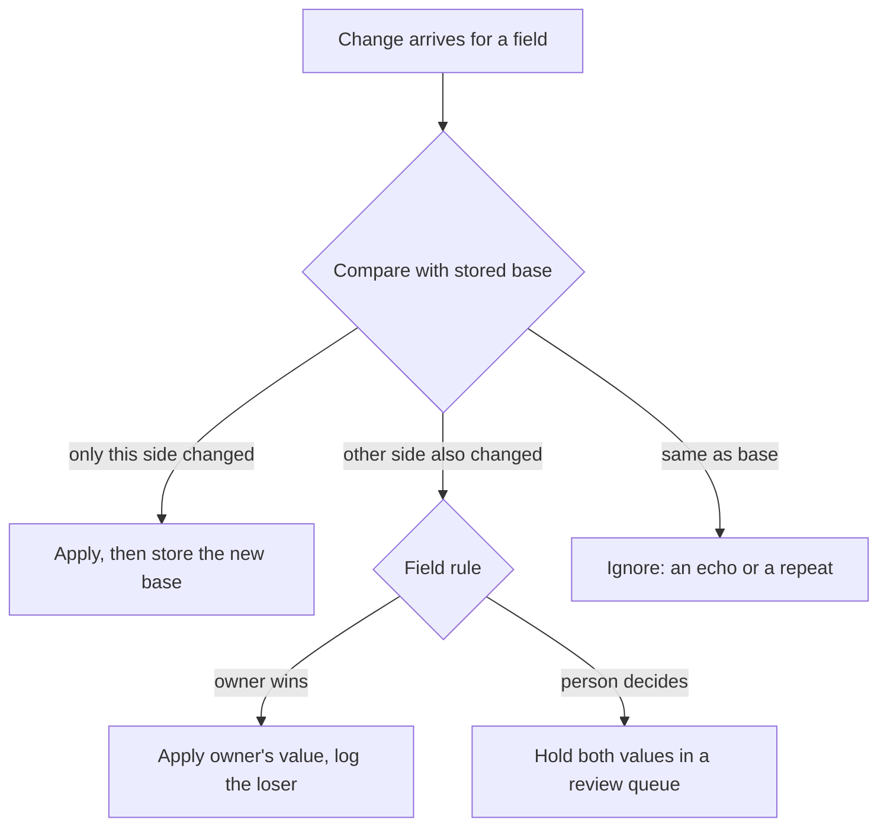

# Rate Limits, Backlogs and Two-way Sync

## Start with the stale change that won

Hexworth Retail, a fictional appliance retailer, kept customer details in two places: its customer relationship management (CRM) system, which the website updates, and its ticketing system, where agents handle delivery problems. A connector synced contact details both ways.

One morning the connector stopped at 06:00, when its credentials expired. Nobody noticed until 12:00. By then 90,000 changes were queued from both sides.

Two of them belonged to the same customer. At 08:50 she changed her address on the website. At 09:30 she phoned about a delivery and gave the agent a newer address, because she was moving that week. The agent updated the ticket.

When the connector restarted, eight workers pulled from the queue as fast as they could. The CRM allows 10 requests a second. Most calls were rejected and retried at once. Changes were applied in whatever order the workers finished them, and the last write won. The 09:30 change landed first. The 08:50 change landed 20 minutes later and overwrote both systems with the older address. Her replacement fridge went to the flat she had left.

The connector compared nothing. It applied each change as it arrived. Call this **the stale change that won**.

> **What you'll learn**
>
> - How to read a system's rate limits and share them with live traffic.
> - How to drain a backlog with arithmetic, not hope.
> - Why every synced field needs one owner, and how to stop echoes.
> - How to detect and resolve conflicting updates.
> - What a safe webhook receiver checks before it says "received".

## Read the limits first

A **rate limit** caps how many requests a client may make in a period. Systems express it in different ways: requests per second, a daily quota, a cap on calls in flight at once, or a cost per call that depends on its size. Many systems share one quota across every integration a customer runs, so your connector competes with others.

When you exceed a limit, an HTTP system usually answers with status 429, "Too Many Requests", often with a `Retry-After` header saying how long to wait. Treat that as an instruction:

- **Wait as told.** Honour `Retry-After`. If there is none, back off exponentially with random jitter so your workers do not retry in step.
- **Limit yourself first.** Keep a client-side budget, such as a token bucket, set below the published limit. Hitting the limit should be rare, not your steady state.
- **Use bulk interfaces.** Many systems offer a call that updates many records at once. It costs fewer requests per record.

The server side of the same idea is taught in [protect the endpoint from abuse and cost](/learn/engineering-foundations/apis-and-backend/protect-the-endpoint-from-abuse-and-cost).

## Drain a backlog with arithmetic

After an outage, the backlog and the live traffic both need the same limited budget. Live changes matter more, because people are waiting for them now. The switcher compares Hexworth's first restart with the one it ran after the incident.

12:00. 90,000 queued changes for 30,000 customers. The CRM allows 10 requests a second. Live changes arrive at about 2 a second.

<button type="button" data-mode="fullspeed" aria-pressed="false" aria-controls="fullspeed-result">Full speed</button>
<button type="button" data-mode="paced" aria-pressed="false" aria-controls="paced-result">Paced and coalesced</button>

<section id="fullspeed-result" class="mode-panel" data-announcement="Full speed selected. Most calls are rejected and live changes wait."><h4>Eight workers at full speed</h4><ul><li>The workers send about 40 requests a second. 10 succeed and 30 are rejected and retried at once.</li><li>Live changes sit behind 90,000 queued ones.</li><li>At 10 accepted a second, the queue takes at least 2.5 hours, with every change applied in arrival order.</li></ul>
Most of the traffic is wasted retries, and the newest changes are the last to land.
</section>
<section id="paced-result" class="mode-panel" data-announcement="Paced selected. The backlog clears in about 83 minutes with live changes first."><h4>Two lanes, paced and coalesced</h4><ul><li>The connector keeps to 8 requests a second, below the limit. Live changes get 2 a second in their own lane.</li><li>The backlog is coalesced to the latest change per customer and field: 30,000 writes instead of 90,000.</li><li>At 6 a second the backlog clears in 5,000 seconds, about 83 minutes, and each write is checked against the base value.</li></ul>
No rejected calls, live changes on time, and a finish time to tell the customer.
</section>

The numbers are illustrative but the method is general. Work out the budget, reserve the live share and some headroom, divide the backlog by what is left, and tell the customer the finish time. **Coalescing** removes intermediate states. If a field changed three times while the connector was down, only the last value needs writing. Coalesce per field, not per record, or a change to one field can drop a change to another.

## One owner per field

Two-way sync is two one-way syncs that can overwrite each other. The first defence is ownership, as in the field map from [CRM, ERP and ticketing systems](/learn/enterprise-integration/connecting-enterprise-systems/crm-erp-and-ticketing-systems).

- **Most fields have one writer.** Marketing consent is owned by the CRM. Ticket priority is owned by the ticketing system. The connector copies them one way only and never writes back.
- **Shared fields need a rule.** A contact address may be edited in both. Write down which side wins in a conflict, or whether a person decides.
- **Suppress echoes.** When the connector writes to the ticketing system, the ticketing system raises its own change event. Without care, the connector syncs that event back to the CRM, and the loop repeats. Tag every write the connector makes, for example by using a dedicated integration account, and ignore change events made by it. Also skip any write where the new value equals the last synced value.

## When both sides change

Comparing timestamps alone is unreliable. The two systems' clocks differ, and a queued change carries the time it was sent, not the time it was made. Compare against the **base**: the last value both systems agreed on, which the connector stores for each synced field. Each change records the value it replaced. If that value matches the base, only this side has changed since the last sync.

*Figure 1: A three-way comparison. The stored base shows which side changed, so arrival order no longer decides the result.*

At Hexworth, the base for her address was the old flat. The 09:30 ticket change replaced the old flat, which matched the base. It was applied and its address became the new base. The 08:50 website change also said it replaced the old flat, but the base was now the 09:30 address. Both sides had changed. Under Hexworth's rule an address conflict goes to a person. It was held for review with both values and their source times, and the agent confirmed the newer one.

## Receiving webhooks safely

Many systems push changes as **webhooks**: HTTP calls to your endpoint when something happens. A receiver is public. Anyone can call it. Before you trust a webhook, check four things.

1. **Signature.** The sender signs each request with a shared secret, usually as an HMAC (hash-based message authentication code). Compute it over the raw request bytes, exactly as received, before any parsing. Compare in constant time.
2. **Freshness.** Reject a request whose signed timestamp is more than a few minutes old. That stops an attacker replaying a captured request.
3. **Duplicates.** Senders retry, so the same event can arrive twice. Record each event ID and skip ones already seen, for longer than the sender's retry period.
4. **Durable receipt.** Write the event to a durable queue, then return a success status at once. Process it afterwards. A receiver that does slow work first times out and triggers retries.

Events can also arrive out of order. Duplicates and ordering are taught in [recovering half-finished work](/learn/fde-deploying-in-the-estate/reliability-performance-and-cost/recovering-half-finished-work).

## Limits of this lesson

- **Providers differ.** Limits, bulk interfaces, retry schedules and signature formats vary. Read each provider's documentation.
- **Some conflicts need a person.** No rule resolves every case. Size the review queue and staff it.
- **Fictional data.** Hexworth Retail and its figures are illustrative.

## Interview angle

Each answer is an outline to say in about two minutes. Open the question and try it aloud before reading.

Interview question 1. What changes in your design when a connector must respect a rate limit and keep two systems in sync both ways?

- **Answer:** For the limit, find the real budget and who shares it, keep a client-side limiter below it, honour 429 responses and `Retry-After`, back off with jitter and use bulk calls. Give live changes their own lane. For two-way sync, give each field one owner and copy it one way, write rules for shared fields, suppress echoes by tagging the connector's writes, and store a base value per field to detect when both sides changed.
- **Trade-off:** Field ownership limits where users may edit. Shared fields need conflict rules and sometimes people.
- **Follow-up to expect:** "Why not last write wins?" Clocks differ and queues reorder changes, so the stale one can win.

Interview question 2. Overnight your connector to a ticketing system failed. 40,000 events are queued. The system allows 600 requests a minute, and morning traffic needs about 200. How do you catch up?

- **Answer:** Keep live traffic first, in its own lane. Leave headroom: give the backlog 300 a minute, keeping the total at 500. Coalesce to the latest change per record and field. If that leaves 16,000 writes, the drain takes about 53 minutes, against 133 for all 40,000. Use bulk calls if the system has them. Honour 429s with backoff, compare each write with its stored base, and tell the customer the finish time.
- **Trade-off:** More headroom protects other integrations but lengthens the drain.
- **Follow-up to expect:** "Can you ask for a higher limit?" Ask, but plan for the current one.

Interview question 3. A customer changes her address online at 14:05. An agent changes it to a different address in the ticketing system at 14:07. Both changes reach the sync. What happens?

- **Answer:** Each change is compared with the stored base address. Whichever arrives first replaced the base value. It is applied and becomes the new base. The second then differs from both, so it is a conflict. Apply the field's rule. If the website owns the address, keep its value and log the agent's. Address affects deliveries. A better rule holds both for an agent to confirm with the customer.
- **Trade-off:** A review queue is slower and needs staff. An automatic rule can silently pick the wrong one.
- **Follow-up to expect:** "Why not take the later time?" The clocks and queue order make "later" unreliable.

## References

1. IETF, [RFC 6585: Additional HTTP Status Codes](https://www.rfc-editor.org/rfc/rfc6585), accessed 17 November 2026. Status 429 and the `Retry-After` header.
2. Google, [Handling Overload](https://sre.google/sre-book/handling-overload/), Site Reliability Engineering, accessed 17 November 2026. Client-side throttling and retry budgets.
3. Standard Webhooks, [Standard Webhooks specification](https://github.com/standard-webhooks/standard-webhooks/blob/main/spec/standard-webhooks.md), accessed 17 November 2026. Signing the event ID, timestamp and body, and rejecting stale timestamps.
4. IETF, [RFC 2104: HMAC](https://www.rfc-editor.org/rfc/rfc2104), accessed 17 November 2026. Keyed hashing for message authentication.

## Key takeaways

- Find the real budget, limit yourself below it, and honour 429 and `Retry-After`.
- Drain a backlog in its own lane behind live changes, coalesced per field, with a finish time.
- Give each synced field one owner, and suppress the connector's own echoes.
- Detect conflicts against a stored base, not by arrival order or clocks.
- Verify a webhook's signature on the raw bytes, its freshness and its ID, then queue it before replying.

## Check yourself

1. Why did the 08:50 address overwrite the 09:30 one?

The connector applied changes in the order they finished and let the last write win. The older change finished last.

2. Why must coalescing work per field, not per record?

Two changes to one record may touch different fields. Keeping only the latest record change would drop the other field's change.

3. Why compute the webhook signature before parsing the body?

Parsing and re-serialising can change the bytes, such as spacing or key order. The signature was made over the bytes as sent.

