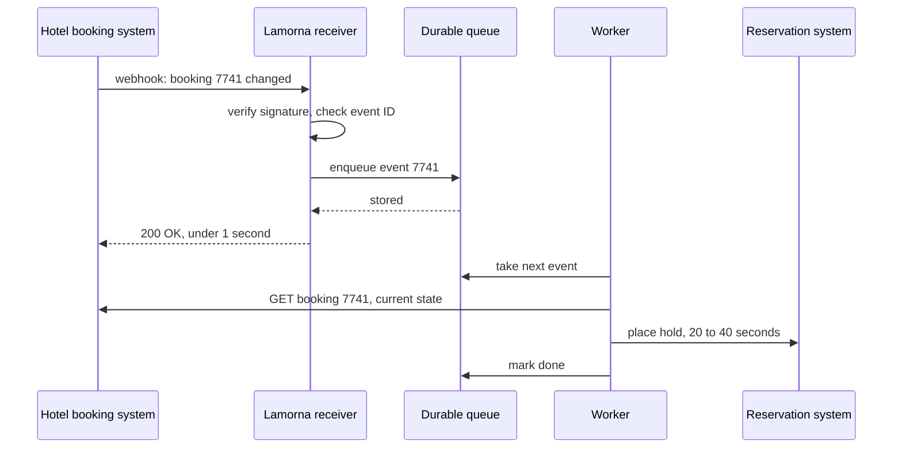

# Choosing the Transport

## Start with the webhook that never came

Lamorna Holidays, a fictional tour operator, sells packages that include rooms at partner hotels. When a hotel confirms a room, its booking system sends Lamorna a webhook: an HTTP call to Lamorna's endpoint saying "booking confirmed". Lamorna then emails the customer.

One Friday a deployment failed and Lamorna's receiver was down for 40 minutes. The hotel group's system retried each webhook three times over 15 minutes, then gave up, as its documentation said it would. 212 confirmations were never delivered.

Nothing alerted. The receiver had no record of events it never received. Customers waited for emails that did not come, and 31 of them booked elsewhere over the weekend. On Monday a hotel asked why Lamorna had not collected payment for rooms it was holding.

The design trusted one push channel to deliver every event. Call this **the webhook that never came**.

> **What you'll learn**
>
> - The difference between pull and push, and what each costs.
> - Where REST, webhooks, polling and WebSockets each fit.
> - Why polling is the backstop for missed webhooks.
> - The usual combination: a webhook for speed, polling for misses, REST for full state.
> - How to acknowledge fast and call a slow system later.

## Pull or push

Every transport answers one question: who starts the conversation?

- **Pull.** The system that wants the data asks for it. It controls the pace and can always ask again. The cost is delay, up to the interval between asks, and the calls that find nothing new.
- **Push.** The system that has the data sends it when something happens. Delivery is fast and there are no empty calls. The cost is that the receiver must be reachable, must cope with bursts, and depends on the sender's retry rules. When the sender stops retrying, the event is gone.

Neither is better in general. Pull puts control with the receiver. Push puts it with the sender. In an integration between two companies, the sender is usually the other company. Push then means relying on rules you do not control.

## Four transports and their fit

| Transport | Who starts | Fits when | Watch for |
| --- | --- | --- | --- |
| **REST call** | The caller, per request | The caller needs an answer now: read current state, or make a change and learn the result | The caller waits. A slow system means timeouts. |
| **Webhook** | The sender, per event | A partner must tell you something happened, within seconds | A public endpoint. Events lost after the retry window, sent twice or out of order. |
| **Polling** | The receiver, on a schedule | The source has no events, or as a backstop for missed ones | Delay equals the interval. Empty calls use your rate limit. Needs a "changed since" query and a checkpoint. |
| **WebSocket** | Either side, over one long-lived connection | Live two-way traffic with an interactive client, such as a chat screen | Connections hold state and drop. Rarely offered between two companies' back ends. |

*Table 1: Four transports. Two companies' systems mostly use the first three. WebSockets suit a user's screen.*

Two lessons elsewhere cover the parts of this choice inside your own service. [Keep the request path free](/learn/engineering-foundations/apis-and-backend/keep-the-request-path-free) explains when to answer synchronously and when to hand work to a queue. [Build a streaming chat endpoint](/learn/engineering-foundations/apis-and-backend/build-a-streaming-chat-endpoint) compares streaming responses and WebSockets by direction of traffic. This lesson stays at the boundary between organisations.

Polling is the oldest of the four and the easiest to dismiss. Hohpe and Woolf call it a polling consumer: the receiver asks when it is ready and never gets more than it can handle. For a partner with no events, it is the only option. For a partner with events, it is still useful, as the next section shows.

## Polling as the backstop

Webhooks get lost. The receiver is down longer than the sender's retry window. A sender bug skips an event. Someone rotates a secret and every signature fails for an hour. In each case the receiver cannot tell that anything is missing, because the missing event is the evidence.

A **backstop poll** catches these. On a schedule, ask the partner for everything changed since your last checkpoint, with a small overlap. Process anything you have not seen. The switcher compares three designs for Lamorna's Friday.

Friday, 17:00 to 17:40. Lamorna's receiver is down. The hotel group retries each webhook for 15 minutes, so the 212 confirmations sent before 17:25 run out of retries.

<button type="button" data-mode="webhook" aria-pressed="false" aria-controls="webhook-result">Webhook only</button>
<button type="button" data-mode="poll" aria-pressed="false" aria-controls="poll-result">Polling only</button>
<button type="button" data-mode="both" aria-pressed="false" aria-controls="both-result">Webhook plus backstop</button>

<section id="webhook-result" class="mode-panel" data-announcement="Webhook only selected. 212 confirmations are lost with no alert."><h4>Webhook only</h4><ul><li>On a normal day, confirmations arrive within seconds.</li><li>The 212 events sent before 17:25 exhaust their retries while the receiver is still down. They are never delivered.</li><li>Nothing records the loss. Nothing alerts.</li></ul>
Fast when everything works, and silent when it does not.
</section>
<section id="poll-result" class="mode-panel" data-announcement="Polling only selected. Nothing is lost but each confirmation waits up to 5 minutes."><h4>Polling every 5 minutes</h4><ul><li>Lamorna asks for bookings changed since its checkpoint, 288 times a day per hotel group.</li><li>At 17:40 the first poll after recovery returns every confirmation from the outage. None is lost.</li><li>On a normal day each confirmation waits up to 5 minutes, 2.5 on average, and most polls find nothing.</li></ul>
Nothing is lost, at the cost of delay and calls against the rate limit.
</section>
<section id="both-result" class="mode-panel" data-announcement="Webhook plus backstop selected. Normal days are fast and the outage is recovered within 15 minutes."><h4>Webhook plus a 15-minute backstop poll</h4><ul><li>On a normal day, webhooks deliver in seconds. The poll finds events already processed and skips them by booking ID and version.</li><li>After 17:40 the next scheduled poll, at 17:45, returns the 212 missed confirmations.</li><li>96 polls a day instead of 288, and an alert if the poll finds anything the webhooks missed.</li></ul>
Speed from the push, completeness from the pull.
</section>

The alert in the third design matters. If the backstop poll keeps finding events the webhooks missed, the push channel is broken, and someone should know before customers do.

Set the poll interval from how late a missed event may be, not from how fresh normal events must be. The webhook handles freshness. The poll handles completeness. Overlap each poll with the previous window by a minute or two, because the partner's "changed since" timestamps can lag. Duplicates from the overlap are harmless when processing skips what it has seen. Go deeper: [durability and idempotency](/learn/production-ai/agentic-workflow-platforms/durability-and-idempotency).

## The usual combination

Put the three together and each does one job:

1. **The webhook says something changed.** Treat it as a signal carrying an ID, not as the full record.
2. **A REST call fetches the current state.** Read the booking from the partner's API. Now you have its latest version, even if webhooks arrived out of order or an older one is delayed in a retry.
3. **The poll catches what the webhook missed.** It feeds the same processor as the webhooks, so a missed event and a pushed one are handled identically.

Fetching after the signal costs one call per event. It removes two hard problems: ordering, because you always read the latest state, and trust in the payload, because the data comes from an authenticated call you made. Where the partner's rate limit cannot take the extra calls, use the webhook payload and compare its version with the one you hold.

## Acknowledge fast, work later

A webhook sender waits for your response, often for 10 seconds or less. Lamorna's own reservation system took 20 to 40 seconds to place a hold on a room. In the first version, the receiver called it before replying. The hotel's system timed out, assumed failure and sent the webhook again. Lamorna placed the hold twice.

The fix is a **hybrid**: synchronous at the edge, asynchronous behind it. The receiver checks the request, writes it to a durable queue, and replies straight away. A worker takes it from the queue and calls the slow system at its own pace.

*Figure 1: Acknowledge after the durable enqueue, then work. The hotel sees a fast success. The slow call happens in the worker, which fetches the current booking first.*

Three rules keep it safe:

- **Acknowledge only after the write is durable.** Reply before the queue confirms, and a crash loses the event after the sender stopped retrying.
- **Make the worker safe to repeat.** The sender may still deliver twice, and the backstop poll may find the same booking. Key the hold on the booking ID. Go deeper: [idempotent writes and long-running jobs](/learn/engineering-foundations/apis-and-backend/idempotent-writes-and-long-running-jobs).
- **Give the worker its own failure policy.** When the reservation system is down, the worker retries with backoff and the queue absorbs the wait. Go deeper: [retries, circuit breakers and bulkheads](/learn/production-ai/scaling-and-reliability/retries-circuit-breakers-and-bulkheads).

The same shape works for an inbound REST call that starts slow work: return `202 Accepted` with a status link, and let a worker finish. What the receiver checks before it enqueues is in [the webhook receiver](/learn/enterprise-integration/receiving-webhooks-safely/the-webhook-receiver).

## Limits of this lesson

- **Partners decide what exists.** Many offer only polling. Some send webhooks without a "changed since" query, which leaves reconciliation as the only backstop.
- **Retry windows vary.** Read each partner's documented schedule before you size your outage tolerance.
- **Fictional data.** Lamorna Holidays and its figures are illustrative.

## Interview angle

Each answer is an outline to say in about two minutes. Open the question and try it aloud before reading.

Interview question 1. A partner offers webhooks and a REST API. How do you choose what to use for receiving their order updates?

- **Answer:** Use both, each for one job. The webhook is the fast signal that an order changed. A REST fetch reads the current order, which handles out-of-order events and avoids trusting the payload. A scheduled poll of "changed since my checkpoint", with a small overlap, catches webhooks that were lost. All three feed one processor that skips versions it has already handled. Alert when the poll finds events the webhooks missed.
- **Trade-off:** The fetch and the poll cost calls against the partner's limit.
- **Follow-up to expect:** "Their rate limit is tight." Drop the fetch, use the payload's version number, and keep the poll.

Interview question 2. When would you choose polling over webhooks even if the partner offers both?

- **Answer:** When delay of a few minutes is acceptable and simplicity matters more. Polling needs no public endpoint, no signature checks and no outage planning, because the receiver asks when ready and can always ask again. It also suits a receiver behind a firewall that cannot accept inbound calls. Choose webhooks when users need updates within seconds or polling would waste most of the rate limit on empty calls.
- **Trade-off:** Polling's delay equals its interval, and every empty poll uses quota.
- **Follow-up to expect:** "How often would you poll?" From the freshness the business needs, checked against the limit.

Interview question 3. A partner's webhook times out after 5 seconds. Processing an event takes 30. What do you build?

- **Answer:** Split the work. The receiver verifies the signature, checks the event ID against those seen, writes the event to a durable queue and replies 200 once the write is confirmed, well inside 5 seconds. A worker takes events from the queue, fetches current state if needed, and does the 30-second work. Make the worker idempotent, keyed on the event's business ID, and give it retries with backoff and a dead-letter queue.
- **Trade-off:** The partner's "success" now means "received", not "processed". Expose processing status separately if they need it.
- **Follow-up to expect:** "The queue write fails." Return an error so the sender retries.

Interview question 4. Someone proposes WebSockets between your service and a partner's back end. What do you ask?

- **Answer:** Ask what needs a live two-way connection. WebSockets suit interactive clients, such as a user's screen receiving a stream. Between two back ends, a long-lived connection adds reconnect logic, state on both sides and firewall rules, and it still loses messages sent while disconnected. Most server-to-server flows are covered by REST for requests, webhooks for events and polling for completeness. Choose WebSockets only if both sides need low-latency messages in both directions continuously.
- **Trade-off:** WebSockets cut per-message overhead but make delivery and recovery your problem.
- **Follow-up to expect:** "What about streaming model output to a user?" That is a different boundary, covered in the streaming chat endpoint lesson.

## References

1. Gregor Hohpe and Bobby Woolf, [Polling Consumer](https://www.enterpriseintegrationpatterns.com/patterns/messaging/PollingConsumer.html), Enterprise Integration Patterns, accessed 17 November 2026. A receiver that asks for messages when it is ready.
2. Standard Webhooks, [Standard Webhooks specification](https://github.com/standard-webhooks/standard-webhooks/blob/main/spec/standard-webhooks.md), accessed 17 November 2026. Delivery with retries, event IDs and signed timestamps.
3. IETF, [RFC 9110: HTTP Semantics](https://www.rfc-editor.org/rfc/rfc9110), accessed 17 November 2026. The meaning of `200 OK` and `202 Accepted`.
4. IETF, [RFC 6455: The WebSocket Protocol](https://www.rfc-editor.org/rfc/rfc6455), accessed 17 November 2026. A long-lived two-way connection over one TCP connection.

## Key takeaways

- Pull gives the receiver control at the cost of delay. Push gives speed at the cost of trusting the sender's retries.
- REST answers now, webhooks signal events, polling fills gaps, WebSockets serve live interactive clients.
- Back every webhook feed with a scheduled poll, and alert when the poll finds misses.
- Treat the webhook as a signal and fetch the current state.
- Acknowledge after a durable enqueue, then do slow work in an idempotent worker.

## Check yourself

1. Why could no alert fire for Lamorna's 212 lost confirmations?

The receiver only knew about events it received. The missing events left no trace, so only a pull could reveal them.

2. What sets the backstop poll's interval?

How late a missed event may arrive, checked against the rate limit. The webhook handles normal freshness.

3. Why must the receiver wait for the queue to confirm the write before replying?

After a success reply the sender stops retrying. If the event was not yet stored, a crash would lose it for good.

