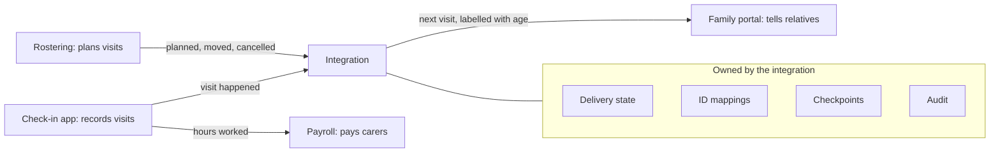

# Owners Before Boxes

## Start with the copy that became the owner

Bronwen, a forward deployed engineer, was sent to Tiverton Home Care, a care agency whose carers visit about 900 clients a day, after its family portal went wrong. Coordinators plan visits in a rostering system, carers check in on a phone app and payroll pays for the visits made. The project team had drawn four boxes and copied every scheduled visit into the integration's own database to keep the portal fast, and within a month payroll was reading that copy too. In a week of snow, coordinators cancelled 140 visits, but the copy only heard about new ones: families saw visits that were not coming, and payroll paid £2,380 for visits that never happened. When finance asked who should fix it, the rostering team said its system was right and the integration team said it only copied data. The copy had become the place other systems trusted, and nobody owned it. Call this **the copy that became the owner**.

> **What you'll learn**
>
> - How to frame an integration as a business story before drawing any boxes.
> - Why to name each system by the job it does.
> - How to give every fact one owner, and why a stored copy is never the owner.
> - Which four kinds of state the integration itself owns.
> - A five-part boundary checklist to run before you design anything.

## Tell the story first

Start with one sentence a person in the business would recognise. At Tiverton it would read: "When a coordinator cancels a visit, the family stops expecting it, the carer stops being sent, and payroll stops paying for it."

That sentence does work a diagram cannot. It names the event that starts everything (a cancellation). It names who cares about the result (families, carers, payroll). It also exposes the gap at once. The first design handled only new visits, and the story is about a cancellation.

Write the story for each event the integration must handle: a visit is booked, moved, cancelled, completed. If you cannot tell the story for an event, you do not yet know enough to design for it. Ask the people who do the work, as taught in [stakeholder and workflow maps](/learn/forward-deployed/customer-discovery/stakeholder-and-workflow-maps).

Then name each system by the job it does, not by its product name or a letter:

- **Rostering** decides who visits whom, and when.
- **Check-in app** records that a visit happened, and for how long.
- **Payroll** decides what each carer is paid.
- **Family portal** tells relatives what to expect.

A box labelled by its job tells you whom to ask about it. "System B" tells you nothing. A vendor name invites arguments about the product instead of the work.

## One owner per fact

For each fact the story mentions, name the one system that creates and changes it. That system is the **source of truth** for the fact. Everyone else reads it from there or holds a copy of it.

| Fact | Owner | Who reads it |
| --- | --- | --- |
| A visit is planned for a time and carer | Rostering | Check-in app, family portal |
| A visit was cancelled | Rostering | Check-in app, family portal, payroll |
| A visit happened, from 09:02 to 09:47 | Check-in app | Payroll, family portal |
| A carer is owed £17 for it | Payroll | Nobody else |

*Table 1: Tiverton's facts and their owners. Payroll pays from the check-in record, not from the plan.*

Own facts, not systems. Rostering owns the plan, but it does not own whether a visit happened. The check-in app does. Choosing one owner per whole system is the mistake [CRM, ERP and ticketing systems](/learn/enterprise-integration/connecting-enterprise-systems/crm-erp-and-ticketing-systems) warns against, and that lesson shows how to build the field-level map. This lesson stays one level up, at the facts the business story depends on.

Notice what the table does to the snow week. Payroll should never have paid from a list of planned visits. Its fact is "a visit happened", and the check-in app owns that. Had the owners been agreed first, the copy would never have been read for pay.

## A stored copy is not ownership

Copies are often needed. The family portal cannot call the rostering system for every page view, so it reads a copy. That is fine, as long as everyone treats the copy as a copy:

- **Nobody edits it.** A copy changes only when the owner changes. To correct it, fix the owner and re-read.
- **It carries its age.** Each copy records when it was last refreshed. The portal can say "updated 2 minutes ago".
- **It hears every kind of change.** Creates, updates, cancellations and deletions. A copy that only hears creates drifts from the first cancellation.
- **It is checked.** A scheduled comparison against the owner finds drift that no failed event reveals.

There is a short test for whether a copy has become an owner. Ask: "If the copy and the owner disagree, which one do we fix?" If the answer is ever the copy, it has become an owner, and it needs a named team, a process and an agreement in writing. Usually the better fix is to send the readers back to the true owner.

## What the integration owns

The integration sits between systems, so it is tempting to let it hold everything. Keep it to four kinds of state. Each one exists only because the integration exists.

| State | What it records | Tiverton example |
| --- | --- | --- |
| **Delivery state** | Which events were sent, acknowledged, failed or are waiting | Cancellation of visit V-88231 sent to the portal at 07:14, acknowledged |
| **ID mappings** | How one system's ID for a thing matches another's | Rostering visit V-88231 is portal entry 5520 |
| **Checkpoints** | How far through each source the integration has read | Last rostering change read: 07:13:58, change 41,207 |
| **Audit** | What was sent, when, under which identity, and what came back | Who or what changed portal entry 5520, and the response |

*Table 2: The four kinds of state an integration owns. Business facts stay with their owners.*

Everything else belongs to someone else. If the integration keeps a cached copy of visits for speed, that cache follows the rules of the previous section. It is not a fifth kind of integration state.

How to store these four in a database, and what must survive a restart, is taught in [modelling the integration's own state](/learn/engineering-foundations/sql-and-data-modelling/modelling-the-integrations-own-state).

*Figure 1: Tiverton after the fix. Each system is named by its job. Payroll reads from the check-in app, and the integration owns only its own state.*

The small scope pays off when something breaks. With delivery state you can answer "did the portal get the cancellation?". With checkpoints you can resume after an outage. With ID mappings you can update the right portal entry instead of creating a second one. With audit you can show finance exactly what happened. None of these needs the integration to own a single business fact.

## The boundary checklist

Before you draw an architecture, settle five questions with the system owners. The walkthrough runs the checklist for Tiverton's cancellation flow.

Run the boundary checklist for one event: a coordinator cancels a visit. Each step shows the question, Tiverton's answer and what it changes in the design.

<button type="button" data-step="0" aria-pressed="false" aria-controls="boundary-step-0">1. Participants</button><button type="button" data-step="1" aria-pressed="false" aria-controls="boundary-step-1">2. Trigger</button><button type="button" data-step="2" aria-pressed="false" aria-controls="boundary-step-2">3. Data each way</button><button type="button" data-step="3" aria-pressed="false" aria-controls="boundary-step-3">4. Owners</button><button type="button" data-step="4" aria-pressed="false" aria-controls="boundary-step-4">5. Slow or down</button>

<section id="boundary-step-0" class="step-panel" aria-labelledby="boundary-heading-0"><h4 id="boundary-heading-0">1. Who takes part?</h4><dl><dt>Question</dt><dd>Which systems and teams send, receive or are affected by this event?</dd><dt>Tiverton</dt><dd>Rostering, the check-in app, the family portal and payroll. The rostering team and the payroll team are the owners to ask.</dd><dt>Design change</dt><dd>Payroll joins the list. The first design left it out.</dd></dl></section><section id="boundary-step-1" class="step-panel" aria-labelledby="boundary-heading-1"><h4 id="boundary-heading-1">2. What starts it?</h4><dl><dt>Question</dt><dd>Which event triggers the flow, and how does the integration learn of it?</dd><dt>Tiverton</dt><dd>A coordinator sets a visit to cancelled. Rostering can send a change event and also answer "changed since" queries.</dd><dt>Design change</dt><dd>The integration listens for every change, not only new visits, and keeps a checkpoint.</dd></dl></section><section id="boundary-step-2" class="step-panel" aria-labelledby="boundary-heading-2"><h4 id="boundary-heading-2">3. What data moves each way?</h4><dl><dt>Question</dt><dd>What is sent in each direction, and what comes back?</dd><dt>Tiverton</dt><dd>Rostering to integration: visit ID, new status, time of change. Integration to portal: portal entry ID and status. Portal back: an acknowledgement only.</dd><dt>Design change</dt><dd>Nothing flows back into rostering, so there is no two-way sync to design.</dd></dl></section><section id="boundary-step-3" class="step-panel" aria-labelledby="boundary-heading-3"><h4 id="boundary-heading-3">4. Who owns each fact?</h4><dl><dt>Question</dt><dd>For every fact in the flow, which system is the source of truth?</dd><dt>Tiverton</dt><dd>Rostering owns the plan and the cancellation. The check-in app owns whether a visit happened. Payroll owns pay.</dd><dt>Design change</dt><dd>Payroll reads completed visits from the check-in app. The integration's copy is for the portal only.</dd></dl></section><section id="boundary-step-4" class="step-panel" aria-labelledby="boundary-heading-4"><h4 id="boundary-heading-4">5. What if a side is slow or down?</h4><dl><dt>Question</dt><dd>What happens when each participant is slow, down or sends a burst?</dd><dt>Tiverton</dt><dd>If the portal is down, cancellations wait in a queue and are sent in order per visit. If rostering is down, the portal shows "last updated" and its age.</dd><dt>Design change</dt><dd>A durable queue, an age label on the portal, and an alert when the checkpoint is more than 15 minutes old.</dd></dl></section>

<button type="button" data-walk="previous">Previous</button>

<button type="button" data-walk="next">Next step</button>

The walkthrough is a scripted illustration. Step 1 alone would have caught the snow-week failure, because payroll would have been named as a participant.

The fifth question is where retries, timeouts and queues come in. This lesson does not re-teach them. Go deeper: [queues, topics and acknowledgements](/learn/engineering-foundations/distributed-systems-essentials/queues-topics-and-acknowledgements) and [retries, circuit breakers and bulkheads](/learn/production-ai/scaling-and-reliability/retries-circuit-breakers-and-bulkheads). How the integration hears about the change is the subject of the next lesson, [choosing the transport](/learn/enterprise-integration/framing-an-integration/choosing-the-transport).

## Limits of this lesson

- **Ownership is agreed, not discovered.** The table records a decision by the system owners. Get it in writing.
- **Facts can change owner.** A visit's pay becomes payroll's once approved. Mark those hand-overs in the story.
- **Composite engagement.** Tiverton Home Care, Bronwen and the figures are illustrative, not a real customer.

## Interview angle

Each answer is an outline to say in about two minutes. Open the question and try it aloud before reading.

Interview question 1. An interviewer says "Integrate our scheduling system with our billing system" and waits. What do you do in the first five minutes?

- **Answer:** Do not draw boxes yet. Ask for the business story: which events matter (a booking made, moved, cancelled, completed) and who cares about each result. Name each system by its job. Then run the boundary checklist: participants, the trigger, data in each direction, the owner of each fact, and what happens when a side is slow or down. Only then sketch the flow. Say out loud which facts each system owns.
- **Trade-off:** Five minutes of questions feel slow, but they stop you designing the wrong flow for forty.
- **Follow-up to expect:** "Assume what you need." State the assumptions, and mark which ones would change the design if wrong. The full forty-minute version of this round is in [the integration design interview](/learn/enterprise-integration/a-worked-partner-integration/the-integration-design-interview).

Interview question 2. Your integration keeps a copy of customer orders for speed. Another team starts reading it for reports. Is that a problem?

- **Answer:** Only if the copy stops being treated as a copy. Check four things: nobody edits it, it records its age, it hears every kind of change including deletes, and it is reconciled against the owner. Then ask "if they disagree, which do we fix?" If the reporting team would ever fix the copy, it has become an owner with no owner. Either point them at the source of truth or give the copy a named team and a contract.
- **Trade-off:** Sharing the copy saves load on the owner but makes your integration someone else's dependency.
- **Follow-up to expect:** "How would you notice drift?" A scheduled comparison of counts and a sample of records against the owner.

Interview question 3. What state should an integration service own, and what should it never own?

- **Answer:** It owns delivery state (what was sent, acknowledged or failed), ID mappings between systems, checkpoints for how far it has read each source, and an audit of what it did and under which identity. It never owns business facts such as an order's status or a customer's address. Those belong to their source systems. Any cache it keeps is a labelled copy. Keeping its own state small makes recovery, replay and audit possible without a fight over truth.
- **Trade-off:** Reading facts from their owners costs calls and latency that a local copy would avoid.
- **Follow-up to expect:** "Why store ID mappings at all?" Without them a retry or update creates a second record instead of changing the first.

Interview question 4. Two systems both hold a customer's delivery address and they disagree. How do you decide which is right?

- **Answer:** Decide by fact, not by system. Ask which system's users create and change the delivery address as part of their work. That system owns it, and the other holds a copy. If both teams edit it legitimately, you have two owners, and the business must choose one or agree a rule for conflicts. Write the decision down with both owners. Then fix the copy by re-reading from the owner, never by editing it.
- **Trade-off:** Choosing one owner may force a team to change where it edits addresses.
- **Follow-up to expect:** "What if both must edit it?" That is two-way sync with a conflict rule, taught in [rate limits, backlogs and two-way sync](/learn/enterprise-integration/connecting-enterprise-systems/rate-limits-backlogs-and-two-way-sync).

## References

1. Martin Fowler, [BoundedContext](https://martinfowler.com/bliki/BoundedContext.html), accessed 17 November 2026. Why one model per area of a business, with explicit relationships between areas.
2. Gregor Hohpe and Bobby Woolf, [Integration Styles](https://www.enterpriseintegrationpatterns.com/patterns/messaging/IntegrationStylesIntro.html), Enterprise Integration Patterns, accessed 17 November 2026. The choices for how separate applications share data.
3. [CRM, ERP and ticketing systems](/learn/enterprise-integration/connecting-enterprise-systems/crm-erp-and-ticketing-systems), this track. The field-level source-of-truth map.
4. The author's own field experience, the basis for the boundary checklist and the four kinds of integration state.

## Key takeaways

- Tell the business story for each event before drawing any boxes.
- Name each system by the job it does.
- Give every fact one owner, and own facts rather than whole systems.
- A copy is never edited, carries its age, hears every change and is reconciled.
- The integration owns only delivery state, ID mappings, checkpoints and audit.

## Check yourself

1. Why did payroll pay for cancelled visits at Tiverton?

It read the integration's copy of planned visits, which never heard about cancellations. Its fact, a visit happened, belonged to the check-in app.

2. What question tells you a copy has become an owner?

"If the copy and the owner disagree, which one do we fix?" If the answer is ever the copy, it has become an owner.

3. Which checklist step would have caught the snow-week failure first?

Step 1, participants. Naming payroll would have led to asking which fact it pays from.

