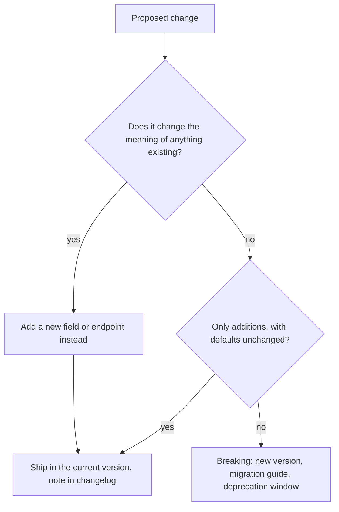

# An API Partners Build Against

## Start with the minor change that moved the money

Glaisdale Payroll runs payroll for small employers, and about 40 accounting partners build against its API: each payday they read every payslip and post the wages to their clients' ledgers. Ines, the forward deployed engineer embedded in Glaisdale's platform team, changed one field, `net_pay`, from take-home pay in pounds, such as `1842.50`, to whole pence, `184250`, to avoid rounding errors. The schema still said "number", the release was marked minor, and the changelog had one line about it. On the next payday one partner's import read `184250` as pounds and posted wages a hundred times too large to the ledgers of 60 employers, whose accountants spent two days reversing entries. Glaisdale's support team learned of it from an angry email, not from a test. Nothing in the shape of the API had changed; its meaning had. Call this **the minor change that moved the money**.

> **What you'll learn**
>
> - What an API contract promises to partners: documentation, stability and deprecation windows.
> - Why additive change is the default, and why a change of meaning breaks clients.
> - When to publish a new version, and what each version costs you.
> - How to retire an old version on a published timetable.
> - How to catch breaking changes before partners do, on both sides of the API.

## The contract is a promise

A partner builds against your API once and then depends on it for years. They cannot see your code or your plans. What they rely on is the contract, and it has three parts.

- **Documentation.** A reference for every endpoint and field, with types, units, allowed values and examples. An error catalogue that says which errors are worth retrying. The rate limits. A changelog that says what changed and whether it can break anything.
- **Stability.** A written statement of what will not change without a new version. It should cover more than field names and types. Units, meaning, defaults, sort order, error codes and limits are all things partners' code depends on.
- **A deprecation window.** A published minimum time between announcing that something will be removed and removing it. Partners plan their work around it.

Typed request and response schemas make the shape of the contract checkable. [Define the API contract with typed schemas](/learn/engineering-foundations/apis-and-backend/define-the-api-contract-with-typed-schemas) teaches that inside one service. A partner contract adds what a schema cannot express: what a field means, and how long that meaning lasts.

Glaisdale's schema said `net_pay` was a number. Its documentation said "net pay". Neither said "in pounds, to two decimal places", so a change of unit looked safe to Ines and broke the partner.

## Additive change by default

Most changes can be made by adding, without touching anything a partner already uses:

- **Add a new optional field.** Clients that do not know it ignore it.
- **Add a new endpoint** alongside the old one.
- **Add an optional request parameter** whose default keeps today's behaviour.

Additive change works only if partners read tolerantly. Martin Fowler's **tolerant reader** takes only the fields it needs and ignores the rest. Say in your documentation that clients must ignore unknown fields, and that new enum values may appear. Then a new field or status breaks nobody who followed the advice.

The rule that matters most is this one: **never change the meaning of an existing field.** Units, currency, time zone, sign and what counts as included are all meaning. Glaisdale's correct change was to add `net_pay_pence` and keep `net_pay` in pounds. Partners could move to the new field when ready, and the old one could be retired later on the published timetable.

[Pagination, filtering and versioning](/learn/engineering-foundations/apis-and-backend/pagination-filtering-and-versioning) has a table of common changes and whether each breaks clients. Use it as a review checklist. When unsure, treat a change as breaking.

*Figure 1: Reviewing a proposed change. A change of meaning is turned into an addition. Only what cannot be added goes to a new version.*

## Explicit versions for breaking change

Some changes cannot be made by addition. A resource is restructured, a field must be removed for legal reasons, or a default must change. Then publish an explicit new version and run it beside the old one. Where the version lives (in the path, a header, or a date pinned per client) is covered in the versioning lesson linked above. The partner-facing work is the same whichever you pick:

- **Pin each partner.** A partner stays on the version it built against until it chooses to move. Never upgrade a partner silently.
- **Publish a migration guide.** List every difference, field by field, with before-and-after examples. Partners should not need to diff two references.
- **Offer a sandbox.** Partners test against the new version with realistic data before they switch production.
- **Batch breaking changes.** Each live version is code you run, test and support. Collect breaking changes into occasional releases rather than one version per change.

A new version is a cost you pay for years, and so do your partners. That is why additive change is the default and a version is the exception.

## Retire old versions on a timetable

Removing a version that partners still call is an incident. The deprecation window turns removal into a planned process. The walkthrough shows how Glaisdale retired `net_pay` after adding `net_pay_pence`, with a six-month window.

Glaisdale retires the old <code>net_pay</code> field over six months. Each step shows what Glaisdale does, what partners see and how progress is measured.

<button type="button" data-step="0" aria-pressed="false" aria-controls="deprecation-step-0">1. Announce</button><button type="button" data-step="1" aria-pressed="false" aria-controls="deprecation-step-1">2. Migrate</button><button type="button" data-step="2" aria-pressed="false" aria-controls="deprecation-step-2">3. Measure</button><button type="button" data-step="3" aria-pressed="false" aria-controls="deprecation-step-3">4. Remind</button><button type="button" data-step="4" aria-pressed="false" aria-controls="deprecation-step-4">5. Remove</button>

<section id="deprecation-step-0" class="step-panel" aria-labelledby="deprecation-heading-0"><h4 id="deprecation-heading-0">1. Announce, month 0</h4><dl><dt>Glaisdale does</dt><dd>Publishes the removal date in the changelog, emails each partner's named technical contact, and marks the field deprecated in the reference.</dd><dt>Partners see</dt><dd>A <code>Deprecation</code> response header on calls that return <code>net_pay</code>, with a link to the guide.</dd><dt>Measure</dt><dd>Every partner contact has acknowledged the notice.</dd></dl></section><section id="deprecation-step-1" class="step-panel" aria-labelledby="deprecation-heading-1"><h4 id="deprecation-heading-1">2. Help them migrate, months 0 to 3</h4><dl><dt>Glaisdale does</dt><dd>Publishes a one-page guide: read <code>net_pay_pence</code>, divide by 100 for pounds. Both fields are returned, and the sandbox has realistic payslips.</dd><dt>Partners see</dt><dd>Both fields side by side, so they can compare values before switching.</dd><dt>Measure</dt><dd>Partners who have tested in the sandbox.</dd></dl></section><section id="deprecation-step-2" class="step-panel" aria-labelledby="deprecation-heading-2"><h4 id="deprecation-heading-2">3. Measure who still depends on it, month 3</h4><dl><dt>Glaisdale does</dt><dd>Counts, per partner, how many requests still come from integrations that have not confirmed the move. 31 of 40 partners have moved.</dd><dt>Partners see</dt><dd>The nine remaining get a direct call from their account contact.</dd><dt>Measure</dt><dd>Partners not yet moved, by name, reviewed weekly.</dd></dl></section><section id="deprecation-step-3" class="step-panel" aria-labelledby="deprecation-heading-3"><h4 id="deprecation-heading-3">4. Remind and rehearse, months 4 to 5</h4><dl><dt>Glaisdale does</dt><dd>Adds a <code>Sunset</code> header with the removal date. Runs two announced one-hour brownouts in the sandbox with the field removed.</dd><dt>Partners see</dt><dd>Their sandbox tests fail if they still read the old field, before production does.</dd><dt>Measure</dt><dd>Two partners left, both with a confirmed migration date.</dd></dl></section><section id="deprecation-step-4" class="step-panel" aria-labelledby="deprecation-heading-4"><h4 id="deprecation-heading-4">5. Remove, month 6</h4><dl><dt>Glaisdale does</dt><dd>Removes the field on the published date, not on a payday. Support is staffed for the week.</dd><dt>Partners see</dt><dd>Nothing, if they moved. A clear error and a link to the guide, if not.</dd><dt>Measure</dt><dd>No payroll runs fail in the following week.</dd></dl></section>

<button type="button" data-walk="previous">Previous</button>

<button type="button" data-walk="next">Next step</button>

The walkthrough is a scripted illustration. The headers are standard: RFC 9745 defines `Deprecation` and RFC 8594 defines `Sunset`. They help partners who log response headers, but they do not replace the email and the phone call. The named contact in step 1 is easy to skip and hard to find later. Collect a technical contact from every partner when they sign up.

## Catch breaks before partners do

Glaisdale found out from a partner. Three checks would have found it first.

- **Compare the schema in every build.** Diff the published API description against the last released one, and fail the build on a removed field, a changed type or a new required parameter.
- **Test examples as contracts.** Keep example responses with values, such as a payslip with `net_pay: 1842.50`. A change of unit fails the example even when the type is unchanged.
- **Let partners state what they use.** Fowler's **consumer-driven contracts** have each consumer publish the fields and behaviour it depends on, as tests the provider runs. Even a few partners' tests cover the fields that matter most.

As a forward deployed engineer you are often on the other side, building against a customer's partner API. The same ideas protect you. Pin the version you build against. Read tolerantly. Log `Deprecation` and `Sunset` headers and alert on them. Run a small contract test against the partner's sandbox every day, so a change shows up there and not in production.

## Limits of this lesson

- **Partners differ in speed.** A six-month window suits most, but a large partner on a yearly release cycle may need longer. Agree it in the contract.
- **Some changes cannot wait.** A security fix may need a shorter window. Explain why, and help partners move.
- **Composite engagement.** Glaisdale Payroll, its staff and its figures are illustrative, not a real customer.

## Interview angle

Each answer is an outline to say in about two minutes. Open the question and try it aloud before reading.

Interview question 1. You own an API that 40 partner companies build against. A product manager wants to rename a confusing field. What do you do?

- **Answer:** Treat the rename as an addition plus a deprecation. Add the field under the new name, return both, and document the old one as deprecated. Announce a removal date with the published window, email each partner's technical contact, and send a `Deprecation` header. Measure which partners still read the old name, call the laggards, rehearse removal in the sandbox, and remove it on the date. Never rename in place, even in a minor release.
- **Trade-off:** Both names live for months, which costs response size and confuses new readers of the reference.
- **Follow-up to expect:** "Can we ship v2 instead?" Only if other breaking changes justify a whole version.

Interview question 2. A field's type stays the same but its unit changes from pounds to pence. Is that a breaking change?

- **Answer:** Yes. A change of meaning breaks every client that relied on the old meaning, and no schema check will catch it. Clients keep parsing the value and act on a number a hundred times too large. Add a new field with the new unit in its name, keep the old one unchanged, and retire it on the published timetable. Put units in field names or the reference, and keep example responses with real values as tests.
- **Trade-off:** Unit-bearing names are longer, but they make the meaning part of the contract.
- **Follow-up to expect:** "How would you catch it in review?" Example-based contract tests fail when a known value changes.

Interview question 3. How long should a deprecation window be, and what happens when a large partner has not moved by the end?

- **Answer:** Long enough to cover your slowest partners' release cycles with slack, written in the contract before you need it. Shorten it only for security fixes. Measure who still uses the old version from the start, not at the end. If a large partner has not moved, find out why: a missing feature in the new version or a stalled project. Agree a short, dated extension in writing, and keep removal dates per partner rather than for everyone.
- **Trade-off:** Extensions keep old code alive and teach partners that dates move.
- **Follow-up to expect:** "Who decides on an extension?" The account owner and the API owner together, with the cost stated.

Interview question 4. You are integrating a customer's system with a partner's API. How do you protect the integration from the partner changing their API?

- **Answer:** Pin the version you built against, if they offer versions. Read tolerantly: take only the fields you need and ignore unknown ones and new enum values with a safe default. Log and alert on `Deprecation` and `Sunset` headers. Subscribe a team address, not one person's, to their changelog. Run a daily contract test against their sandbox that checks the fields and values you depend on. Wrap their API in one adapter, so a change touches one place.
- **Trade-off:** The adapter and tests are code to maintain for an API you do not control.
- **Follow-up to expect:** "They change it without notice." The daily sandbox test is the alarm, and the adapter limits the repair.

## References

1. Google, [AIP-180: Backwards compatibility](https://google.aip.dev/180), accessed 17 November 2026. Which changes keep existing clients working within a major version.
2. Martin Fowler, [TolerantReader](https://martinfowler.com/bliki/TolerantReader.html), accessed 17 November 2026. Reading only the data a client needs, so additions do not break it.
3. Ian Robinson, [Consumer-Driven Contracts: A Service Evolution Pattern](https://martinfowler.com/articles/consumerDrivenContracts.html), martinfowler.com, accessed 17 November 2026. Consumers stating the parts of a contract they depend on.
4. IETF, [RFC 9745: The Deprecation HTTP Response Header Field](https://www.rfc-editor.org/rfc/rfc9745) and [RFC 8594: The Sunset HTTP Header Field](https://www.rfc-editor.org/rfc/rfc8594), accessed 17 November 2026. Signalling deprecation and removal dates in responses.

## Key takeaways

- An API contract is documentation, a stability promise and a deprecation window.
- Change by addition, and never change the meaning of an existing field.
- Publish a new version only for changes that cannot be added, and batch them.
- Retire old versions on a published timetable: announce, migrate, measure, remind, remove.
- Catch breaks in your own build with schema diffs and example-based contract tests.

## Check yourself

1. Why did Glaisdale's schema check not catch the change?

The type stayed "number". Only the unit changed, and the schema did not record the unit.

2. What should Glaisdale have done instead of changing `net_pay`?

Added `net_pay_pence`, kept `net_pay` in pounds, and retired the old field on the published timetable.

3. Why does additive change depend on partners reading tolerantly?

A client that rejects unknown fields or enum values breaks when anything is added. Tolerant readers ignore what they do not need.

