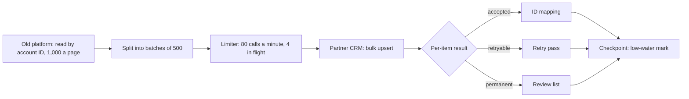

# Moving Large Datasets

## Start with the export that never added up

Fowey Foods, a food wholesaler, was moving 2,000,000 customer accounts from its old ordering platform into a partner's new customer relationship management (CRM) system while the old platform stayed live and customers kept ordering. Rhys, the forward deployed engineer, wrote the first script: it read accounts 1,000 at a time, sorted by last-modified time, using "skip N, take 1,000", and sent each page to the CRM as two batches of 500 that created a record for every account. Accounts changed during the run moved within the sort order, so some pages repeated accounts and others skipped them. One account with a malformed postcode made the CRM reject its whole batch of 500, and the script retried that batch 40 times before giving up. At hour six the script crashed, and the only way to resume was to start again from zero. When Rhys compared totals, the CRM held 3,870 accounts twice and was missing 4,120, and nobody could say which. Call this **the export that never added up**.

> **What you'll learn**
>
> - Why cursor paging on a stable key beats offset paging over changing data.
> - How batch writes report per-item results, and what to do with each kind of failure.
> - How to size a concurrency cap from the partner's rate limit.
> - How to keep a checkpoint that lets a transfer resume, not restart.
> - A step-by-step plan for a two-million-record transfer.

## Paging over data that moves

**Offset paging** ("skip 300,000, take 1,000") counts positions. When rows are added, removed or re-sorted above the read position, every later page shifts. You get repeats and gaps. **Cursor paging** ("the next 1,000 after this key") starts each page after the last key read, so changes elsewhere do not move it. [Pagination, filtering and versioning](/learn/engineering-foundations/apis-and-backend/pagination-filtering-and-versioning) shows both in detail. For a bulk transfer, two choices follow.

- **Sort by a key that never changes.** For a full copy, page by account ID. Fowey sorted by last-modified time, and every update during the run moved an account to the end of the list. Sorted by ID, an account stays where it is however often it changes.
- **Catch changes in a second pass.** A full copy by ID reads each account once, at some moment during the run. Accounts that change after their page was read are stale in the target. Record when the transfer started. When it finishes, read every account changed since then, minus a few minutes of overlap, and send those again. Why the overlap is needed (ties and late commits at the boundary) is taught in [incremental loads and watermarks](/learn/fde-building-in-the-estate/customer-data-pipelines/incremental-loads-and-watermarks).

The full copy sets the baseline and the change pass brings it up to date. The same shape, run against a live pipeline, is taught in [backfills while live](/learn/fde-building-in-the-estate/customer-data-pipelines/backfills-while-live).

## Batch writes and partial failure

Sending one record per call wastes most of a rate limit. Partners offer **batch** or bulk endpoints that take many records per call. They come in two kinds, and you must know which you have.

- **All or nothing.** The batch succeeds or fails as one. One bad record fails the other 499. Google's API guidance (AIP-233) calls this atomic.
- **Per-item results.** The call returns a result for each record. Most succeed, some fail, and the response says which.

With per-item results, sort each failure into one of three classes.

| Result | Examples | What to do |
| --- | --- | --- |
| **Accepted** | Created or updated | Record the target ID in the ID mapping |
| **Retryable** | Rate limited, timed out, partner busy | Retry later in a separate pass, with backoff |
| **Permanent** | Malformed postcode, missing required field | Put on a review list for a person. Never retry unchanged. |

*Table 1: Per-item results. Retrying a permanent failure wastes calls and never succeeds.*

With an all-or-nothing endpoint, split a failed batch in half and resend each half. Repeat until the bad record is alone, then move it to the review list. A batch of 500 with one bad record takes about 9 halvings to isolate it.

Every write should be an **upsert keyed on the source ID**: "create account F-102938, or update it if it exists". Fowey's script created records, and every repeated page made a duplicate. With upserts, a page sent twice changes nothing the second time. That property is what makes retries and resumes safe. Go deeper: [idempotent writes and long-running jobs](/learn/engineering-foundations/apis-and-backend/idempotent-writes-and-long-running-jobs).

## Concurrency inside the rate limit

One worker sending one batch at a time is slow, because each call waits for the partner. Several workers in parallel are faster, until they exceed the partner's rate limit and the calls start failing. Size the number of calls in flight from the limit.

Start with the budget. Reading a partner's limits, sharing them with live traffic and backing off on a 429 are taught in [rate limits, backlogs and two-way sync](/learn/enterprise-integration/connecting-enterprise-systems/rate-limits-backlogs-and-two-way-sync). Subtract live traffic and keep headroom. What is left is the transfer's rate.

Then use a simple rule: **calls in flight = rate × time per call**. If the transfer may make 80 calls a minute (1.33 a second) and each call takes 3 seconds, about 4 calls are in flight at once. A cap of 4 workers keeps the transfer at the budget. More workers would only queue at the limiter or collect 429 responses.

Put a limiter in front of the workers as well as the cap. It stops a run of fast calls bursting above the rate. The cap also adapts: if the partner slows down, the same 4 workers send fewer calls a minute. Go deeper on retries: [retries, circuit breakers and bulkheads](/learn/production-ai/scaling-and-reliability/retries-circuit-breakers-and-bulkheads).

## Checkpoints you can resume from

A **checkpoint** records how far the transfer has safely got. It turns a crash at hour six into a resume from hour six. The core rule, advance it only after the records it covers are committed and store it outside the process, is taught in [recoverable data syncs](/learn/engineering-foundations/distributed-systems-essentials/recoverable-data-syncs). Two points are specific to a bulk transfer.

- **A page is committed when every record has a result.** Accepted, queued for retry or on the review list. A page with records still unaccounted for is not done.
- **With parallel workers, save the low-water mark.** Pages finish out of order. The checkpoint is the last page such that it and every page before it are complete.

On restart, read from the checkpoint. Pages that were in flight are sent again. Because every write is an upsert keyed on the source ID, the repeats are harmless.

*Figure 1: The transfer pipeline. Each page's results are recorded before the checkpoint moves past it.*

## A two-million-record transfer, step by step

The walkthrough re-runs Fowey's transfer with everything above. The partner allows 120 calls a minute. Fowey's live integration uses up to 30.

Move 2,000,000 accounts into the partner CRM while the old platform stays live. Each step shows the decision and its numbers.

<button type="button" data-step="0" aria-pressed="false" aria-controls="transfer-step-0">1. Page</button><button type="button" data-step="1" aria-pressed="false" aria-controls="transfer-step-1">2. Batch</button><button type="button" data-step="2" aria-pressed="false" aria-controls="transfer-step-2">3. Pace</button><button type="button" data-step="3" aria-pressed="false" aria-controls="transfer-step-3">4. Checkpoint</button><button type="button" data-step="4" aria-pressed="false" aria-controls="transfer-step-4">5. Finish</button>

<section id="transfer-step-0" class="step-panel" aria-labelledby="transfer-heading-0"><h4 id="transfer-heading-0">1. Page by a stable key</h4><dl><dt>Decision</dt><dd>Read by account ID with a cursor, 1,000 a page. Record the start time, 01:00.</dd><dt>Numbers</dt><dd>2,000,000 accounts make 2,000 pages.</dd><dt>Avoids</dt><dd>Repeats and gaps from accounts that change during the run.</dd></dl></section><section id="transfer-step-1" class="step-panel" aria-labelledby="transfer-heading-1"><h4 id="transfer-heading-1">2. Batch with per-item results</h4><dl><dt>Decision</dt><dd>Send each page as two bulk upserts of 500, keyed on the account ID. Sort every failure by class.</dd><dt>Numbers</dt><dd>2,000 pages make 4,000 calls. At a 0.2% permanent failure rate, about 4,000 accounts go to the review list.</dd><dt>Avoids</dt><dd>One bad postcode blocking 499 good accounts, and duplicates on any resend.</dd></dl></section><section id="transfer-step-2" class="step-panel" aria-labelledby="transfer-heading-2"><h4 id="transfer-heading-2">3. Pace inside the limit</h4><dl><dt>Decision</dt><dd>Of 120 calls a minute, leave 30 for live traffic and 10 as headroom. The transfer gets 80.</dd><dt>Numbers</dt><dd>80 a minute at 3 seconds a call means 4 in flight, so cap the workers at 4. 4,000 calls take 50 minutes.</dd><dt>Avoids</dt><dd>429 responses, wasted retries and slower service for live users.</dd></dl></section><section id="transfer-step-3" class="step-panel" aria-labelledby="transfer-heading-3"><h4 id="transfer-heading-3">4. Checkpoint the low-water mark</h4><dl><dt>Decision</dt><dd>After both batches of a page have recorded results, mark the page done. Save the highest page with no gaps before it.</dd><dt>Numbers</dt><dd>A crash with pages up to 1,238 complete and 1,239 to 1,240 in flight resumes at 1,239. Two pages are resent, harmlessly.</dd><dt>Avoids</dt><dd>Restarting from zero after a crash.</dd></dl></section><section id="transfer-step-4" class="step-panel" aria-labelledby="transfer-heading-4"><h4 id="transfer-heading-4">5. Catch up and reconcile</h4><dl><dt>Decision</dt><dd>Read accounts changed since 00:55 by a change cursor and send them again. Run the retry pass. Compare counts in 20 ranges of 100,000 IDs, and check a sample field by field.</dd><dt>Numbers</dt><dd>About 6,000 changed accounts make 12 more calls. The CRM should hold every account except those on the review list.</dd><dt>Avoids</dt><dd>A total that does not add up, with nobody able to say which accounts are wrong.</dd></dl></section>

<button type="button" data-walk="previous">Previous</button>

<button type="button" data-walk="next">Next step</button>

The walkthrough is a scripted illustration, and the failure rate and call time are assumptions. Measure both in a trial run of a few thousand records first. The trial also shows whether the old platform can serve reads at the pace you need.

The reconciliation in step 5 is what lets you tell the business "complete". Counting per range of IDs shows where a gap is, not only that one exists. Hashing buckets and comparing row by row only where they differ is taught in [recoverable data syncs](/learn/engineering-foundations/distributed-systems-essentials/recoverable-data-syncs). The review list is part of the answer: 4,000 accounts that a person must correct at the source, each with the reason the partner gave.

## Limits of this lesson

- **Partners differ.** Batch sizes, per-item reporting and limits vary. Some offer an asynchronous bulk job instead, which you submit, poll and then read results from. The same rules apply.
- **Deletes need care.** Accounts closed during the run need a tombstone or a full ID comparison to reach the target. The ways a change pass misses deletes are in [incremental loads and watermarks](/learn/fde-building-in-the-estate/customer-data-pipelines/incremental-loads-and-watermarks).
- **Composite engagement.** Fowey Foods, its staff and its figures are illustrative, not a real customer.

## Interview angle

Each answer is an outline to say in about two minutes. Open the question and try it aloud before reading.

Interview question 1. You must copy 5 million records from a live system through a paginated API. Offset or cursor, and sorted by what?

- **Answer:** Cursor, sorted by an immutable unique key such as the record ID. Offset paging over a changing table repeats and skips rows as others are inserted or deleted, and deep pages get slower. Sorting by last-modified time moves records during the run. Record the start time, and after the full pass run a change pass for everything modified since, with a few minutes of overlap. Make writes upserts by source ID so overlaps are harmless.
- **Trade-off:** A cursor cannot jump to page 400, which matters for screens but not for a transfer.
- **Follow-up to expect:** "The API only offers offset." Filter by ID ranges and page within each small range.

Interview question 2. A bulk endpoint takes 500 records. One malformed record makes the call fail. How do you handle it?

- **Answer:** First find out whether the endpoint reports per item or is all or nothing. With per-item results, record the accepted ones, retry the retryable ones later and put permanent failures on a review list. With all or nothing, split the failed batch in halves and resend until the bad record is alone, about nine rounds for 500. Never retry an unchanged batch that failed validation. Report the review list with the partner's reasons to the record owners.
- **Trade-off:** Splitting costs extra calls, but only for batches that contain a bad record.
- **Follow-up to expect:** "Can you validate before sending?" Yes, for known rules. The partner may still reject on rules you cannot see.

Interview question 3. A partner allows 300 calls a minute, shared with live traffic that uses up to 100. Each bulk call takes 2 seconds. How many workers do you run?

- **Answer:** Leave live traffic its 100 and keep some headroom, say 50, giving the transfer 150 calls a minute, 2.5 a second. Calls in flight are rate times call time: 2.5 times 2 is 5. Cap the workers at 5 and put a limiter at 150 a minute in front of them to stop bursts. Honour 429 responses and `Retry-After`. If calls slow down, the same cap automatically lowers the rate.
- **Trade-off:** More headroom protects live users and other integrations but lengthens the transfer.
- **Follow-up to expect:** "How long for 3 million records at 500 a call?" 6,000 calls at 150 a minute, 40 minutes.

Interview question 4. Your transfer crashed after six hours. How should it have been built so you can resume, and how do you prove it finished?

- **Answer:** Keep a checkpoint outside the process, advanced only when every record on a page has a recorded result. With parallel workers, save the low-water mark, the last page with no unfinished page before it. Make every write an upsert by source ID, so pages in flight at the crash can be resent safely. To prove completion, run a change pass from the start time, compare counts per ID range on both sides, check a sample field by field, and report the review list.
- **Trade-off:** Recording per-page results adds writes, but it is what makes a resume and a proof possible.
- **Follow-up to expect:** "Counts match but a field looks wrong." The field-by-field sample is there to catch mapping errors that counts miss.

## References

1. Google, [AIP-158: Pagination](https://google.aip.dev/158), accessed 17 November 2026. Page tokens and page sizes for list methods.
2. Google, [AIP-233: Batch methods: Create](https://google.aip.dev/233), accessed 17 November 2026. Atomic against partial success for batch writes.
3. Markus Winand, [We need tool support for keyset pagination](https://use-the-index-luke.com/no-offset), Use The Index, Luke, accessed 17 November 2026. Why offset paging slows down and shifts over changing data.
4. IETF, [RFC 6585: Additional HTTP Status Codes](https://www.rfc-editor.org/rfc/rfc6585), accessed 17 November 2026. Status 429 and the `Retry-After` header.

## Key takeaways

- Page a bulk transfer with a cursor on an immutable key, then catch changes in a second pass.
- Use per-item results and sort failures into accepted, retryable and permanent.
- Make every write an upsert keyed on the source ID.
- Size calls in flight as rate times call time, inside the budget left after live traffic.
- Advance the checkpoint only after commit, and prove completion with per-range counts.

## Check yourself

1. Why did sorting by last-modified time cause both repeats and gaps at Fowey?

Accounts updated during the run moved to the end of the sort order. Positions shifted, so offset pages repeated some accounts and skipped others.

2. Why is resending the pages that were in flight at a crash safe?

Every write is an upsert keyed on the account ID. A page sent twice updates the same records with the same values.

3. Why count per range of IDs rather than one total?

A per-range count shows where a gap is. One total only shows that something is wrong.

