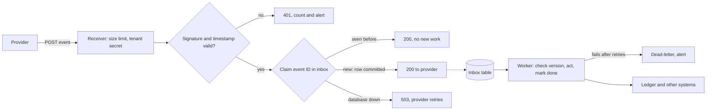

# The Webhook Receiver

## Start with the slow yes

Felbrigg Lettings, a fictional letting agency, collects rent through a payments provider. When a tenant pays, the provider sends a `payment.succeeded` webhook to Felbrigg's receiver. The receiver checked the signature, then did all the work before it replied: it wrote the payment to the rent ledger, cleared any arrears flag, rendered a PDF receipt and emailed it. Then it returned 200.

On the first of the month, 6,200 tenants paid between 07:00 and 09:00. The ledger database slowed and each request took about 14 seconds. The provider waits 10 seconds for a reply. After that it treats the delivery as failed and retries.

Felbrigg's receiver kept no record of handled events. Every slow delivery finished its work after the provider had given up, and then the retry did the same work again. By 09:30 the ledger showed 1,870 tenants as having paid twice, and some three times. Finance caught it the next morning, an hour before the landlord payout run would have paid out on credits that did not exist.

The receiver said yes only after doing everything, and could not recognise an event it had already handled. Call this **the slow yes**.

> **What you'll learn**
>
> - The four threats a public receiver faces, and the defence for each.
> - Why the order is verify, then parse, then act.
> - How a signature, a timestamp window and event-ID records work together against replay.
> - Why the reply comes after a durable enqueue, not before it and not after the work.
> - Which status codes make a provider retry, give up or stop sending.

## A public endpoint and its threats

A webhook receiver is an HTTPS endpoint on the internet. Assume anyone can find it and send it anything. [Rate limits, backlogs and two-way sync](/learn/enterprise-integration/connecting-enterprise-systems/rate-limits-backlogs-and-two-way-sync) shows how webhook events feed a sync. This lesson builds the receiver in front of it.

| Threat | What the attacker or fault does | Defence |
|---|---|---|
| Spoofed | Sends an event the provider never sent | A signature only the provider and you can produce |
| Tampered | Changes a genuine event, such as the amount | The signature covers the exact bytes, so any change breaks it |
| Replayed | Resends a genuine signed event later | A signed timestamp with a short window, plus event-ID records |
| Cross-tenant | Uses one customer's valid event against another's account | One secret per tenant, chosen by the endpoint, and the account in the event checked against it |

*Table 1: The receiver's threat model. The first three are about the message. The fourth is about whose message it is.*

Replay needs no attacker. The provider's own retries are replays. Felbrigg's failure was a replay with no bad actor anywhere.

The cross-tenant case appears when one receiver serves many customers. Give each tenant its own endpoint path or identifier, look up that tenant's secret from it, and reject an event whose account ID belongs to someone else. Never let the event body choose which secret verifies it. How tenant identity is carried through the rest of the system is taught in [tenant isolation levels](/learn/production-ai/security-tenancy-prompt-injection/tenant-isolation-levels).

## Verify, then parse, then act

A generic signing scheme works like this. The provider and you share a secret. For each delivery, the provider builds a string from the event ID, the attempt timestamp and the raw body, joined by full stops. It computes an HMAC (hash-based message authentication code) over that string with SHA-256 and the secret, and sends the result in a header beside the ID and timestamp.

| Step | Receiver does | Why it matters |
|---|---|---|
| 1. Bound the request | Reject bodies over a size limit | A huge body costs memory before any check runs |
| 2. Choose the secret | Look up the tenant's secret from the endpoint, never from the body | An attacker cannot pick a secret they know |
| 3. Recompute | HMAC over ID, timestamp and the raw bytes as received | Parsing and re-serialising changes bytes, so the result would not match |
| 4. Compare | Constant-time comparison against each signature in the header | A byte-by-byte comparison that stops early leaks timing |
| 5. Parse | Only now decode the JSON (JavaScript Object Notation) | Untrusted input never reaches the parser |

*Table 2: The verification sequence. Nothing in the body is trusted, or even read as data, until step 4 passes.*

The header can carry more than one signature, which is how secrets rotate without downtime. During a rotation the provider signs with both the old and the new secret, and the receiver accepts either. When every delivery verifies with the new one, remove the old secret.

## Three checks against replay

A signature proves the provider made the request, not that it made it recently or only once. A captured request stays validly signed forever. Three checks together close that gap:

- **The signature** binds the event ID and the timestamp to the body. An attacker cannot change either without breaking it.
- **The timestamp window** rejects any attempt signed more than about five minutes ago, allowing for clock skew. A request captured last week fails here.
- **Event-ID records** catch what the window lets through: a replay inside the five minutes, and the provider's own retries.

Retries pass the timestamp check, because each attempt is signed with its own time, but they keep the same event ID. So the event-ID record must outlive the provider's whole retry schedule. If the provider retries for three days, keep records for at least three days. A record kept for an hour turns the fourth retry into a fresh event.

**Claiming** the event ID means inserting it into a table with a unique constraint. The insert either succeeds, so this delivery is new, or fails on the constraint, so it was seen before. Do the claim and the enqueue in one transaction. A common form is an **inbox table**: one row per event, keyed by event ID, holding the raw body and a status. One insert claims the ID and stores the work. If they were separate, a crash between them would leave the ID claimed with nothing queued, and every retry would be discarded as a duplicate. The general mechanics of idempotent processing are in [durability and idempotency](/learn/production-ai/agentic-workflow-platforms/durability-and-idempotency).

## Acknowledge after the durable enqueue

The reply is the acknowledgement that stops the provider retrying. Its timing decides what a crash or a slow database can do. The switcher compares three choices for Felbrigg's receiver on the first of the month.

07:40 on the first of the month. The provider waits 10 seconds for a reply. A worker process crashes once during the hour.

<button type="button" data-mode="first" aria-pressed="false" aria-controls="first-result">Reply first</button>
<button type="button" data-mode="last" aria-pressed="false" aria-controls="last-result">Reply after the work</button>
<button type="button" data-mode="enqueue" aria-pressed="false" aria-controls="enqueue-result">Reply after the enqueue</button>

<section id="first-result" class="mode-panel" data-announcement="Reply first selected. Fast replies, but a crash loses events for good."><h4>200 before anything is stored</h4><ul><li>Every reply takes a few milliseconds, so the provider never retries.</li><li>The crash takes 40 events held in memory with it.</li><li>The provider believes they were delivered. Those tenants show as unpaid.</li></ul>
Fast and silent. Lost events surface later as arrears disputes.
</section>
<section id="last-result" class="mode-panel" data-announcement="Reply after the work selected. Slow replies cause retries and double payments."><h4>200 after ledger, receipt and email</h4><ul><li>Replies take about 14 seconds, past the 10-second limit.</li><li>The provider retries deliveries that already succeeded.</li><li>Without event-ID records, 1,870 payments are applied twice or more.</li></ul>
The slow yes. Every slowdown downstream becomes duplicate work.
</section>
<section id="enqueue-result" class="mode-panel" data-announcement="Reply after the enqueue selected. Replies stay fast and nothing is lost."><h4>200 after the inbox insert commits</h4><ul><li>Verify, claim and store take about 30 milliseconds, even with the ledger slow.</li><li>The crash stops a worker, not the receiver. Its events stay in the inbox and another worker picks them up.</li><li>The ledger falls 20 minutes behind at peak and catches up by 09:20.</li></ul>
The provider sees quick replies. Delay moves to a queue you can measure.
</section>

Replying after the enqueue changes what "received" means: stored where a crash cannot lose it, not done. The work happens afterwards, at a pace the downstream systems can bear. That is the idea behind [queue-based load levelling](https://learn.microsoft.com/en-us/azure/architecture/patterns/queue-based-load-leveling): the queue absorbs the first-of-the-month peak.

The worker still has to be idempotent. It can crash after writing to the ledger and before marking the inbox row done, and then the row is processed again. Key the ledger write on the event ID, so the second attempt finds it already applied. Retry policy for the worker's own calls is taught in [retries, circuit breakers and bulkheads](/learn/production-ai/scaling-and-reliability/retries-circuit-breakers-and-bulkheads).

## Status codes the provider reads

Providers differ, so read yours. The Standard Webhooks specification treats any 2xx reply as success and anything else, including a timeout or a reset connection, as a failure to retry. It reserves 410 Gone to mean "stop sending to this endpoint".

| Situation | Reply | What the provider does |
|---|---|---|
| Verified, claimed and stored | 200 or 204 | Stops. Delivery complete |
| Verified, already in the inbox | 200 | Stops. Replying with an error would cause pointless retries |
| Signature or timestamp fails | 401 | Retries, and fails again. Alert if the rate rises, since it may mean a rotated secret |
| Verified, but the event type is unknown or the body is malformed | 200, row stored as quarantined | Stops. You hold the event and fix the handler, instead of losing it when retries run out |
| Inbox database unavailable | 503, with `Retry-After` if you know | Retries later. Nothing is lost, provided the outage is shorter than the retry schedule |
| Endpoint retired on purpose | 410 | Disables the endpoint |

*Table 3: Replies and their effect, using the Standard Webhooks behaviour as the reference.*

Two rules follow. Never return 2xx for anything not stored durably. Never return an error for an event you have stored.

## The full receiver

Figure 1 shows the fast public path and the worker path that can fall behind safely.

*Figure 1: The complete receiver. Verify, claim, enqueue and acknowledge on the request path. All slow work sits behind the inbox.*

Three details complete it:

- **Out-of-order events.** Retries mean a `payment.refunded` can arrive before the `payment.succeeded` it refers to. The worker compares a version or sequence in the event with the stored one and holds or skips stale updates. Or treat the event as a signal and fetch current state from the API. How events are shaped and routed internally is in [canonical events and routing](/learn/production-ai/agentic-workflow-platforms/canonical-events-and-routing).
- **Missed events.** A provider gives up eventually. Pair the receiver with a scheduled poll of "changed since" from the provider's API, as taught in [choosing the transport](/learn/enterprise-integration/framing-an-integration/choosing-the-transport).
- **Measures.** Track verification failures, duplicates, inbox depth and the age of the oldest unprocessed row. Age shows how late payments are. Depth does not.

Felbrigg rebuilt its receiver this way. On the next first of the month, every reply took under 50 milliseconds, and 31 retries after a network fault were all claimed as duplicates.

## Limits of this lesson

- **A generic scheme.** Real providers name headers differently, and some sign only the body or use asymmetric keys. The order of checks stays the same.
- **Fictional data.** Felbrigg Lettings, its volumes and its timings are illustrative.

## Interview angle

Each answer is an outline to say in about two minutes. Open the question and try it aloud before reading.

Interview question 1. Walk me through what your webhook endpoint does between receiving a request and returning a response.

- **Answer:** Cap the body size. Find the tenant from the endpoint and load its secret. Recompute the HMAC over event ID, timestamp and raw bytes, and compare in constant time against each signature in the header. Reject a timestamp outside about five minutes. Then insert the event into an inbox table keyed by event ID, in one transaction. A new row gets 200. A duplicate gets 200 with no new work. A database failure gets 503. Workers process the inbox afterwards.
- **Trade-off:** The inbox adds a table and workers to run. Inline work ties reply time to the slowest system.
- **Follow-up to expect:** "What if the worker fails for good?" Dead-letter the row, alert, and replay it after the fix.
- **Go deeper:** [Durability and idempotency](/learn/production-ai/agentic-workflow-platforms/durability-and-idempotency).

Interview question 2. Your receiver checks signatures. Why is that not enough to stop a replay, and what do you add?

- **Answer:** A captured request stays validly signed, so it can be resent. Sign the timestamp with the body and reject old attempts, which stops late replays. Record event IDs to stop replays inside the window and the provider's retries, which carry fresh timestamps. Keep those records longer than the retry schedule.
- **Trade-off:** A tighter window shrinks the replay gap but rejects genuine requests from senders with skewed clocks.
- **Follow-up to expect:** "How long do you keep event IDs?" At least the provider's longest retry period, plus margin.

Interview question 3. One endpoint receives events for 300 customer accounts on your platform. How do you stop one customer's events affecting another?

- **Answer:** Give each tenant its own secret and its own endpoint path or identifier. Choose the secret from the path, never from the body. After verifying, check that the account in the event belongs to that tenant. Store the tenant on the inbox row, and have workers act only within it.
- **Trade-off:** Per-tenant secrets mean more to rotate. A shared secret lets one leak expose every tenant.
- **Follow-up to expect:** "A secret leaks." Rotate it with a short overlap, then review events received since the leak.

## References

1. Standard Webhooks, [Standard Webhooks specification](https://github.com/standard-webhooks/standard-webhooks/blob/main/spec/standard-webhooks.md), accessed 17 November 2026. Signing ID, timestamp and body, constant-time comparison, using the ID for idempotency, retries on non-2xx replies and 410 to disable.
2. IETF, [RFC 2104: HMAC](https://www.rfc-editor.org/rfc/rfc2104), accessed 17 November 2026. Keyed hashing for message authentication.
3. Python Software Foundation, [hmac: keyed-hashing for message authentication](https://docs.python.org/3/library/hmac.html), accessed 17 November 2026. The `compare_digest` function for constant-time comparison.
4. Microsoft, [Queue-based load levelling pattern](https://learn.microsoft.com/en-us/azure/architecture/patterns/queue-based-load-leveling), Microsoft Learn, accessed 17 November 2026. A queue between a bursty sender and a slower service.

## Key takeaways

- Treat the receiver as public: defend against spoofed, tampered, replayed and cross-tenant events.
- Verify on the raw bytes with the tenant's secret before parsing anything.
- Use signature, timestamp window and event-ID records together, and keep the records longer than the retry schedule.
- Claim and store the event in one transaction, then reply 200. Do the work afterwards.
- Reply 2xx only for what is stored, and never an error for what is.

## Check yourself

1. Why did Felbrigg's tenants show as paying twice?

The receiver replied only after slow work, so the provider timed out and retried. With no event-ID records, each retry applied the payment again.

2. Why must the claim and the enqueue happen in one transaction?

If the claim commits and the enqueue fails, every retry is discarded as a duplicate, and the event is lost.

3. A signed, fresh event has an event type your code does not know. What do you reply?

200, after storing it as quarantined. An error reply would make the provider retry for days, and you would lose it when retries run out.

