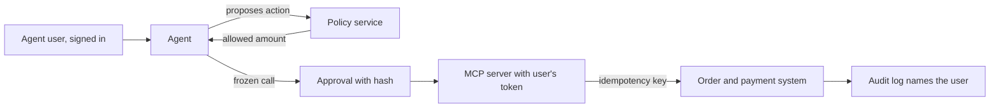

# Agents That Touch Business Systems

## Start with the approved refund that grew

Tarrow Retail, a furniture and homeware chain, gave its customer-service team an agent that looks up orders and issues refunds through a Model Context Protocol (MCP) server in front of the order system. Martha, the forward deployed engineer, required a supervisor's approval for refunds over £50. A customer complained about a damaged £64 lamp, and a supervisor approved the request "Approve refund for order 88213?". Before executing, the agent read the customer's next message about a late delivery, added the £18 delivery charge and a £130 goodwill credit it believed was policy, and refunded £212. The approval record showed a yes for order 88213; nobody had approved £212. Call this **the blank-cheque approval**: the approval was for a description, and the action changed underneath it.

> **What you'll learn**
>
> - Give an MCP server the user's own access, not a broad service account.
> - Bind each approval to the exact action and its arguments.
> - Resume after a crash and handle a timeout whose outcome is unknown.
> - Catch a tool that keeps its shape but changes its meaning.
> - Cap loops and budgets, and keep policy decisions out of the model.

## Acting as the user

**MCP** is a protocol that lets an AI application connect to tools and data through servers. Tarrow's first server called the order system with one service account that could refund any order for any amount. Every agent user, from a new starter to the head of service, effectively held that account's rights.

Pass the user's identity through instead. The MCP specification describes OAuth-based authorisation for remote servers. In practice:

- **Delegated tokens.** The user signs in, and the server receives a token that represents that user, or exchanges it for one the order system accepts.
- **The system enforces its own rules.** A new starter's refund limit applies to the agent's calls as it does to their clicks.
- **The audit log names the person.** Every refund records the user, the agent session and the tool call.

When the business system has no per-user API access, enforce the user's rights inside the server, log both identities, and record the gap as a risk with the customer's security team. The site's [delegated authority and zero ambient authority](/learn/production-ai/security-tenancy-prompt-injection/delegated-authority-and-zero-ambient-authority) lesson covers the model in depth, and [service accounts and least privilege](/learn/fde-deploying-in-the-estate/networks-and-identity/service-accounts-and-least-privilege) covers the same choice for any integration.

## Approvals bound to the exact action

An approval must cover one exact action. At Tarrow the fix had three parts:

- **Freeze the action.** The agent prepares the tool call with all its arguments: tool name, order, amount, payment method, reason.
- **Show it whole.** The supervisor sees the customer, order, amount, method, the policy rule that applies and the agent's reason, with anything unusual highlighted.
- **Check at execution.** The approval stores a hash of the frozen call. The executor recomputes the hash and refuses any call that differs. A changed amount needs a new approval.

Approvals also expire, after 30 minutes at Tarrow, because prices and order states move. See [the confirmation gate lesson](/learn/production-ai/robust-agents/the-confirmation-gate-and-memoization). The same rule for a person approving a record, rather than an agent's call, is in [human review and approval](/learn/fde-building-in-the-estate/building-for-operators/human-review-and-approval).

## Crashes and timeouts with unknown outcomes

An agent run can take minutes and touch several systems. If the process dies halfway, two failures threaten: losing the work, and repeating an action that already happened. **Durable state** means the run's progress is saved after each step, so it resumes where it stopped. An **idempotency key** is a unique ID sent with an action, which lets the receiving system recognise a repeat and return the first result instead of acting twice.

The walkthrough follows a refund through a crash.

Refund of £64 on order 88213, approved. The worker crashes after the payment call. Step through the recovery.

<button type="button" data-step="0" aria-pressed="false" aria-controls="crash-step-0">1. Record intent</button><button type="button" data-step="1" aria-pressed="false" aria-controls="crash-step-1">2. Call with key</button><button type="button" data-step="2" aria-pressed="false" aria-controls="crash-step-2">3. Crash</button><button type="button" data-step="3" aria-pressed="false" aria-controls="crash-step-3">4. Resume</button>

<section id="crash-step-0" class="step-panel" aria-labelledby="crash-heading-0"><h4 id="crash-heading-0">1. Record the intent</h4><dl><dt>What happens</dt><dd>The worker saves a checkpoint: step "refund", key R-88213-1, amount £64, status "starting".</dd><dt>Why</dt><dd>The key is fixed before any call, so every retry uses the same one.</dd></dl></section><section id="crash-step-1" class="step-panel" aria-labelledby="crash-heading-1"><h4 id="crash-heading-1">2. Call the payment system with the key</h4><dl><dt>What happens</dt><dd>The refund request carries key R-88213-1. The payment system refunds £64 and stores the key with the result.</dd><dt>Why</dt><dd>The payment system can now spot a repeat of this exact request.</dd></dl></section><section id="crash-step-2" class="step-panel" aria-labelledby="crash-heading-2"><h4 id="crash-heading-2">3. Crash before saving the result</h4><dl><dt>What happens</dt><dd>The worker dies. The checkpoint still says "starting".</dd><dt>Risk</dt><dd>Without a key, a restart would refund £64 again.</dd></dl></section><section id="crash-step-3" class="step-panel" aria-labelledby="crash-heading-3"><h4 id="crash-heading-3">4. Resume and reconcile</h4><dl><dt>What happens</dt><dd>A new worker loads the checkpoint, sends the same request with key R-88213-1, and receives the original result. It saves "done" and moves to the next step.</dd><dt>Result</dt><dd>One refund, and the run finishes.</dd></dl></section>

<button type="button" data-walk="previous">Previous</button>

<button type="button" data-walk="next">Next step</button>

The walkthrough is a scripted illustration. A **timeout** is the same problem without a crash: the request left, no answer came back, and the outcome is unknown. Never treat a timeout as a failure. Query the system by key or by order to learn what happened, then retry with the same key only if nothing was done. If the system offers neither keys nor a status query, stop and send the case to a person. Workflow engines such as Temporal provide durable state, and [durability and idempotency](/learn/production-ai/agentic-workflow-platforms/durability-and-idempotency) covers the pattern.

## Tools that change meaning

In March, Tarrow's order team changed the refund API's `amount` field from pounds to pence. The field name and type stayed the same. Every schema check passed. The agent's first refund under the new version sent 64, which became 64p.

Shape checks do not catch meaning. Add **contract tests** that assert behaviour: refund 64.00 pounds on a test order and check the ledger shows £64.00. Run them against the business system on a schedule and before each release. Pin the tool version the agent uses, and switch only after the tests pass on the new one. Ask the system owner to announce changes, and log the version of every call. See [typed tool results and teachable errors](/learn/production-ai/tool-design-mcp-a2a/typed-tool-results-and-teachable-errors).

## Loops and budgets

An agent can call `get_order` and `get_customer` in turn for ever, each result prompting the other. Set limits in code, not in the prompt:

- **Step cap.** At most 15 tool calls per task at Tarrow.
- **Repeat detection.** The same call with the same arguments twice in a row stops the run.
- **Cost budget.** A token and spend ceiling per task.
- **Escalation.** On any limit, hand the case to a person with the trace attached.

Set each limit from the measured distribution on real tasks, as [workflow or agent](/learn/fde-building-in-the-estate/choosing-the-ai-approach/workflow-or-agent) shows.

## Answers apart from policy decisions

Tarrow's agent invented the £130 goodwill credit. Policy lived in the prompt as prose, and the model interpreted it. Move decisions into code:

- **A policy service decides.** Given the order and the complaint type, it returns what is allowed: refund amount, credit, or none.
- **The model communicates.** It explains the decision to the customer and gathers facts. It never states an amount the service did not return.
- **Check outgoing text.** Before a message is sent, a check compares any amounts or promises in it with the service's decision.

Figure 1 shows Tarrow's design after the fix.

*Figure 1: Tarrow's agent after the incident. Policy decides amounts, approvals cover the frozen call, and the MCP server acts as the signed-in user.*

The site's [policy lives outside the prompt](/learn/production-ai/security-tenancy-prompt-injection/policy-lives-outside-the-prompt) lesson goes further.

## Limits of this lesson

- **Not every system offers idempotency keys.** Then use a status query before each retry, or keep the action manual.
- **Hashes need stable arguments.** Normalise amounts, dates and order of fields before hashing.
- **Composite engagement.** Tarrow Retail, Martha and their figures are illustrative, not a real customer.

## Interview angle

Each answer is an outline to say in about two minutes. Open each question and try it aloud before reading.

Interview question 1. The MCP server behind your agent uses one service account with wide access. What is wrong, and what do you change?

- **Answer:** Every user gains the account's rights, and the audit log cannot say who acted. Pass the user's identity through with delegated tokens so the business system applies its own permissions and logs the real person. If it lacks per-user access, enforce the user's rights in the server, log both identities and record the gap as a risk.
- **Trade-off:** Delegated tokens need identity work and refresh handling. A shared account is quicker and turns every user into an administrator.
- **Follow-up to expect:** "Background jobs have no user." Give them a narrow account of their own, scoped to that job.
- **Go deeper:** [Delegated authority and zero ambient authority](/learn/production-ai/security-tenancy-prompt-injection/delegated-authority-and-zero-ambient-authority).

Interview question 2. A supervisor approves an agent's action, and the agent then changes it before running it. How do you prevent that?

- **Answer:** Freeze the full tool call with every argument before asking. Show the approver the exact action, amount and reason. Store a hash of the frozen call with the approval, and have the executor refuse any call whose hash differs. Any change needs a new approval. Approvals expire after a set time.
- **Trade-off:** Strict binding means more re-approvals when facts change. Loose binding means approvals mean nothing.
- **Follow-up to expect:** "The approver is slow." Batch similar low-risk approvals, but never loosen the binding.
- **Go deeper:** [The confirmation gate](/learn/production-ai/robust-agents/the-confirmation-gate-and-memoization).

Interview question 3. An agent crashes right after it has issued a payment. How do you resume without paying twice?

- **Answer:** Save a checkpoint after every step, and before each external action record an idempotency key. Send the key with the payment. On restart, load the checkpoint and repeat the call with the same key, which returns the original result, or query the payment system by key. Mark the step done and continue.
- **Trade-off:** Checkpointing adds writes and a durable store. Without it, a crash means lost work or a double payment.
- **Follow-up to expect:** "The payment system has no keys." Query by order before retrying, or keep that step manual.
- **Go deeper:** [Durability and idempotency](/learn/production-ai/agentic-workflow-platforms/durability-and-idempotency).

Interview question 4. A business system changes what a field means but keeps its name and type. How does your agent catch it?

- **Answer:** Schema checks cannot. Write contract tests that check behaviour, such as refunding a known amount on a test order and reading the ledger. Run them on a schedule and before upgrades. Pin the tool version, log it with every call, and switch only after tests pass. Ask the owner to announce changes.
- **Trade-off:** Behaviour tests need a test environment and maintenance. Without them, the first sign is a wrong refund.
- **Follow-up to expect:** "There is no test environment." Use read-only checks in production and keep writes manual until one exists.
- **Go deeper:** [Typed tool results and teachable errors](/learn/production-ai/tool-design-mcp-a2a/typed-tool-results-and-teachable-errors).

Interview question 5. A support assistant tells a customer they will get a refund that policy does not allow. How do you stop it happening again?

- **Answer:** Move the decision out of the prompt into a policy service that returns what is allowed for this order. The model explains the decision and never states an amount the service did not return. Check outgoing messages for amounts and promises against that decision before sending. Honour or correct the promise already made, with the business owner.
- **Trade-off:** A policy service is extra work to build and keep current. Prose policy in a prompt gets interpreted.
- **Follow-up to expect:** "Policy has grey areas." Route those to a person with the facts gathered.
- **Go deeper:** [Policy lives outside the prompt](/learn/production-ai/security-tenancy-prompt-injection/policy-lives-outside-the-prompt).

## References

1. Model Context Protocol, [Specification, authorisation section](https://modelcontextprotocol.io/specification/2025-06-18/basic/authorization), accessed 17 November 2026. OAuth-based authorisation for remote MCP servers.
2. Amazon Web Services, [Making retries safe with idempotent APIs](https://aws.amazon.com/builders-library/making-retries-safe-with-idempotent-apis/), accessed 17 November 2026. Client request tokens and safe retries.
3. Temporal, [Workflows](https://docs.temporal.io/workflows), accessed 17 November 2026. Durable execution that resumes after a crash.
4. Martin Fowler, [Consumer-driven contracts](https://martinfowler.com/articles/consumerDrivenContracts.html), accessed 17 November 2026. Tests that capture what a consumer depends on.

## Key takeaways

- Let the MCP server act as the signed-in user, so the system's own rules and audit apply.
- Bind each approval to a hash of the exact call, and expire it.
- Checkpoint every step and send idempotency keys, and treat a timeout as unknown.
- Catch tools that change meaning with behaviour tests and pinned versions.
- Cap steps and spend in code, and let a policy service decide amounts.

## Check yourself

1. Why did the supervisor's approval not stop the £212 refund?

It approved a description, "refund for order 88213", with no amount attached. Nothing checked the executed call against what was approved.

2. Why is a timeout not the same as a failure?

The request may have reached the system and succeeded. Retrying without checking can repeat the action.

3. Why did schema checks miss the change from pounds to pence?

The field kept its name and type. Only its meaning changed, which only a test of behaviour can see.

