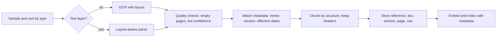

# Inputs as They Really Arrive

## Start with the tidy old tariff

Brisco Utilities, a fictional energy and water supplier, gave its contact-centre agents an assistant that answered tariff and policy questions from 4,200 internal documents. In testing it scored well on questions the project team wrote.

In April, the new standing charges took effect. The new tariff schedule existed only as a scanned PDF. The ingestion step read it with plain text extraction, which found no text layer and stored a near-empty page. The previous year's schedule was a Word file that parsed cleanly. For two weeks the assistant quoted last year's charge with a confident citation, and 310 customers were given the wrong figure before a team leader noticed.

Nothing in the model was wrong. The current document was unreadable and the old one was easy to read. Call this **the tidy stale answer**.

> **What you'll learn**
>
> - Sample and sort a customer's corpus before choosing parsers.
> - Handle scanned pages and tables without losing their structure.
> - Record versions and effective dates so retrieval prefers what applies.
> - Chunk by structure and keep a reference from every chunk to its source.

## Sort the corpus before choosing tools

A customer rarely knows what is in their own document store. Before picking a parser or a chunk size, take a random sample of about 50 documents, open each one, and sort them by how they were made. Brisco's sample, scaled to the full corpus, looked like this:

| Type | Documents | Share | What goes wrong | Handling |
| --- | --- | --- | --- | --- |
| Word and HTML policies | 1,900 | 45% | Headings lost, old versions kept beside new | Parse by heading, read version fields |
| PDFs with a text layer | 1,300 | 31% | Columns read across, tables flattened | Layout-aware parser |
| Scanned PDFs | 700 | 17% | No text at all without OCR | OCR with layout, check confidence |
| Spreadsheets | 300 | 7% | Merged cells, several tables per sheet | One record per row, headers repeated |

*Table 1: Brisco's corpus by type. The 17% that were scans held most of the tariff schedules.*

Two questions follow from the table. Which types answer the most user questions? And which types fail silently? At Brisco the answer to both was the scanned tariff schedules: a small share of documents behind a large share of questions. Spend parsing effort there first.

Count failures you cannot see as well as those you can. A parser that returns an empty page raises no error. Add a check at ingestion: flag any page with fewer than a set number of characters, any table with a single column, and any document whose text is mostly symbols. Send those to a person or a stronger parser.

## Scanned pages and tables

**Optical character recognition (OCR)** turns an image of text into text. Run it only on pages that lack a text layer, because OCR on a page that already has text adds errors. Most OCR engines report a confidence per word or line. Keep it, and route pages with low average confidence to review.

Tables need more than OCR. A tariff table read line by line becomes a stream of numbers with no headers, and the model cannot tell a standing charge from a unit rate. A **layout-aware parser** detects the table, its rows, columns and merged cells, and returns them as a structure. Cloud services such as Amazon Textract and Azure Document Intelligence do this, as do several open-source libraries. Pick one by running it on your own sample, not on the vendor's demo files.

The switcher shows the same Brisco tariff row after three parsing approaches.

One row of the scanned April tariff: region "North West", standing charge 61.2p a day, unit rate 24.9p per kWh.

<button type="button" data-mode="plain" aria-pressed="false" aria-controls="plain-result">Plain text extraction</button>
<button type="button" data-mode="ocr" aria-pressed="false" aria-controls="ocr-result">OCR without layout</button>
<button type="button" data-mode="layout" aria-pressed="false" aria-controls="layout-result">Layout-aware parse</button>

<section id="plain-result" class="mode-panel" data-announcement="Plain text extraction selected. The page comes back empty."><h4>Plain text extraction</h4><ul><li>The scan has no text layer, so the page comes back empty.</li><li>No error is raised. The document is indexed with no content.</li><li>Retrieval falls back to last year's Word schedule.</li></ul>
This is what happened at Brisco in April.
</section>
<section id="ocr-result" class="mode-panel" data-announcement="OCR without layout selected. Numbers survive but lose their headers."><h4>OCR without layout</h4><ul><li>The text reads "North West 61.2 24.9 North East 59.8 25.1".</li><li>The numbers are there, but nothing says which is the standing charge.</li><li>The model guesses from position and sometimes swaps the two.</li></ul>
Better than empty, and harder to spot when wrong.
</section>
<section id="layout-result" class="mode-panel" data-announcement="Layout-aware parse selected. Each value keeps its row and column header."><h4>Layout-aware parse</h4><ul><li>The parser returns a table with headers "Region", "Standing charge (p/day)" and "Unit rate (p/kWh)".</li><li>Each row becomes a chunk that repeats the headers: "North West, standing charge 61.2p a day, unit rate 24.9p per kWh".</li><li>A question about North West standing charges retrieves exactly this row.</li></ul>
Costs more per page. Worth it for the documents that answer the most questions.
</section>

Check the result before trusting it. For each document type, compare 10 parsed tables cell by cell against the source. If more than one cell in 50 is wrong, try another parser or add review for that type.

## Versions, conflicts and effective dates

Brisco kept every tariff schedule since 2019 in the same folder. Each was correct for its period. Retrieval had no way to know which period a question was about.

Record, for every document, the facts that decide whether it applies:

- **Effective from and effective to.** The dates the content governs, which are often different from the file's creation date.
- **Supersedes.** The document this one replaces. The older one is then marked historical.
- **Owner.** The team or person who answers for the content.
- **Status.** Draft, current or withdrawn.

Some of these sit in the document itself, such as "Effective 1 April 2026" in a header. Extract them at ingestion and ask the owner to confirm the ones you cannot find. Then filter at query time. A question asked today retrieves only content effective today, unless the user asks about another date, as in "what was the charge in January?".

**Conflicts** are different from versions. Two documents both marked current that disagree, such as a policy and a team procedure giving different refund limits, are a business problem, not a retrieval one. Do not let the model pick one. Show both with their owners and dates, and send the conflict to a named owner to resolve. Keep a list of open conflicts and report it weekly to the sponsor.

## Chunking by structure, with references

A **chunk** is the piece of text that is embedded and retrieved. Cut chunks along the document's own structure: a policy section with its heading, a table row with its column headers, a clause with its number. Fixed-length chunks cut a rule from its exception.

Every chunk inherits its document's metadata, including effective dates and owner. Some documents need dates per chunk. An amendment letter that changes clause 4 from 1 June leaves clauses 1 to 3 as they were. Store the amendment's date on the chunks it changes.

Each chunk also needs a **reference** back to its source: document ID, version, page, section and, for tables, row and column. That reference serves three later needs. Citations point users to the exact passage. Deletions find every chunk from a removed document. Re-ingestion of an unchanged document can be skipped by comparing a content hash. Figure 1 shows the path.

*Figure 1: Brisco's ingestion path after the April incident. Quality checks and metadata come before chunking, so every chunk carries its dates and its reference.*

The site's retrieval-augmented generation (RAG) course covers parsers and splitters in depth. See [the document abstraction and metadata design](/learn/llm-and-retrieval/document-ingestion-and-metadata-design/the-document-abstraction-and-metadata-design), [PDF and Word parser comparison](/learn/llm-and-retrieval/document-ingestion-and-metadata-design/pdf-and-word-parser-comparison-and-element-level-parsing) and [splitter fundamentals](/learn/llm-and-retrieval/chunking-and-indexing/splitter-fundamentals-character-recursive-token-and-structure-aware). This lesson covers what the customer's real documents demand of those tools.

## Limits of this lesson

- **Sampling misses rare types.** A 50-document sample can miss a format that holds a critical answer. Ask owners which documents they consult most.
- **Metadata needs owners.** Effective dates extracted by a parser are guesses until an owner confirms them.
- **Fictional data.** Brisco Utilities and its figures are illustrative.

## Interview angle

Each answer is an outline to say in about two minutes. Open each question and try it aloud before reading.

Interview question 1. A customer's knowledge base mixes scans, spreadsheets, Word files and several versions of each policy. How do you get it ready for retrieval?

- **Answer:** Sample about 50 documents and sort them by type before choosing tools. Use a layout-aware parser for PDFs, OCR only where there is no text layer, and one record per spreadsheet row with headers repeated. Add quality checks for empty pages and low OCR confidence. Record owner, version and effective dates, mark superseded versions, and filter by date at query time.
- **Trade-off:** Careful parsing per type costs time. Spend it on the types behind the most questions.
- **Follow-up to expect:** "Two current documents disagree." Show both with owners and dates, and send the conflict to a named owner.
- **Go deeper:** [PDF and Word parser comparison](/learn/llm-and-retrieval/document-ingestion-and-metadata-design/pdf-and-word-parser-comparison-and-element-level-parsing).

Interview question 2. Answers drawn from scanned tables are often wrong, while text answers are fine. What do you check?

- **Answer:** Look at what the parser produced for those tables. Usually the scan had no text layer and came back empty, or OCR kept the numbers but lost the headers. Compare 10 parsed tables cell by cell with the source. Switch to OCR with table detection, emit one chunk per row with headers repeated, and route low-confidence pages to review.
- **Trade-off:** Layout-aware parsing is slower and dearer per page. Apply it to the document types that need it.
- **Follow-up to expect:** "Merged cells break the rows." Fill merged values down into each row before chunking.

Interview question 3. Design an ingestion pipeline that keeps a reference from every answer back to its source.

- **Answer:** Give each document a stable ID and version. Parse by type, check quality, attach owner and effective dates, then chunk by structure. Store with every chunk its document ID, version, page, section and table row. Hash the content so unchanged documents are skipped on re-ingestion. The answer step cites chunk references, which resolve to the exact passage.
- **Trade-off:** Rich references add storage and ingestion work. Without them you cannot cite, delete or audit.
- **Follow-up to expect:** "A document is updated." Ingest the new version, mark the old one superseded, and remove its chunks from current retrieval.

Interview question 4. How do you chunk policy documents that have effective dates and amendments?

- **Answer:** Chunk along sections and clauses, keeping the heading with each chunk. Every chunk inherits the document's effective-from and effective-to dates. Where an amendment changes one clause from a later date, store that date on the changed chunks only. At query time, filter to chunks effective on the date the question is about, which defaults to today.
- **Trade-off:** Per-chunk dates make ingestion more complex. Document-level dates alone return superseded clauses.
- **Follow-up to expect:** "The user asks about last year." Pass that date to the filter instead of today's.
- **Go deeper:** [Splitter fundamentals](/learn/llm-and-retrieval/chunking-and-indexing/splitter-fundamentals-character-recursive-token-and-structure-aware).

## References

1. Amazon Web Services, [Tables in Amazon Textract](https://docs.aws.amazon.com/textract/latest/dg/how-it-works-tables.html), accessed 17 November 2026. Table, cell and merged-cell detection in scanned documents.
2. Microsoft, [Document Intelligence layout model](https://learn.microsoft.com/en-us/azure/ai-services/document-intelligence/prebuilt/layout), accessed 17 November 2026. Layout analysis that returns tables and reading order.
3. Tesseract OCR, [Improving the quality of the output](https://tesseract-ocr.github.io/tessdoc/ImproveQuality.html), accessed 17 November 2026. Scan quality and preprocessing that affect OCR accuracy.
4. The site's [document abstraction and metadata design](/learn/llm-and-retrieval/document-ingestion-and-metadata-design/the-document-abstraction-and-metadata-design) lesson, the deep dive on document metadata.

## Key takeaways

- Sample and sort the corpus by type before choosing parsers.
- Run OCR only where there is no text layer, and keep tables as tables.
- Add ingestion checks for failures that raise no error, such as empty pages.
- Record owner, version and effective dates, and filter by date at query time.
- Chunk by structure, and give every chunk a reference back to its source.

## Check yourself

1. Why did Brisco's assistant quote last year's charge with a confident citation?

The current schedule was a scan with no text layer and was indexed empty. The old Word schedule parsed cleanly and nothing marked it as superseded. It became the best match.

2. Why can OCR without layout be worse than an empty page?

An empty page is easy to detect. OCR without layout keeps the numbers but loses which column each belongs to, so wrong answers look plausible.

3. Name three later needs that a chunk's reference to its source serves.

Citations to the exact passage, finding every chunk of a deleted document, and skipping re-ingestion of unchanged documents.

