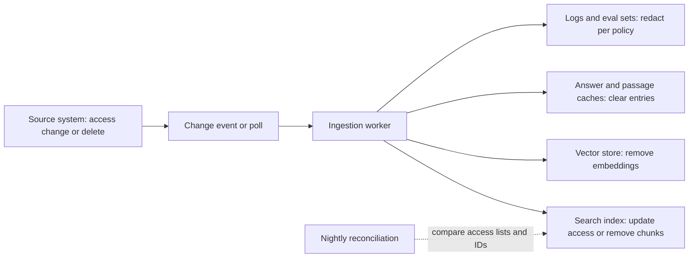

# Permissions, Deletions and Citations

## Start with the answer that stayed

Hallam Clinic, a group of private clinics, gave its staff an assistant over 9,000 documents: clinical protocols, rotas, HR policies and management papers. Dev, the forward deployed engineer, filtered retrieval by the user's groups and tested that filter carefully, then cached answers for 24 hours, keyed by the question text, to save cost. On a Tuesday a clinic manager asked about a restructuring proposal and got a summary drawn from a confidential board paper she could read. That afternoon a receptionist asked the same question in the same words, and the cache returned the stored answer without running retrieval. The filter worked every time it ran; the cache meant it did not run. Call this **the answer that outlived its permission**.

> **What you'll learn**
>
> - Filter by the user's permissions before search, not after generation.
> - Keep caches inside the permission scope of the user who asks.
> - Carry revocations and deletions to every store that holds a copy.
> - Match exact codes as well as natural-language questions.
> - Tie each claim to a passage, and decline when none supports it.

## Filter before you search

**Permission-aware retrieval** means a user can only retrieve passages from documents they could open in the source system. The rule sounds simple. The design choices are where it fails:

- **Copy permissions at ingestion.** Store each chunk with the groups or users allowed to read its document, taken from the source system's access list.
- **Filter inside the search.** Pass the user's groups to the search as a filter, so forbidden chunks are never candidates. Filtering after retrieval leaves the top results empty or reveals that something was hidden.
- **Never filter after generation.** Once a forbidden passage reaches the model, its content can appear in the answer in paraphrase. No output filter reliably catches that.
- **Resolve groups at query time.** Look up the user's current groups from the identity provider for each request, or from a cache with a short expiry.

The site's [permission-aware ingestion](/learn/production-ai/enterprise-rag-in-production/permission-aware-ingestion) and [pushing policy into the index](/learn/production-ai/enterprise-rag-in-production/pushing-policy-into-the-index) lessons go deeper. This lesson covers where the field version breaks.

## Caches that leak

Every cache between the user and the source is a place where a permission check can be skipped. Hallam had three: the answer cache, a cache of retrieved passages, and the user's chat history, which was shown when a colleague opened a shared screen.

The switcher compares three ways to key Hallam's answer cache.

A manager and a receptionist ask "What is the status of the restructuring?" on the same day. Only the manager can read the board paper.

<button type="button" data-mode="question" aria-pressed="false" aria-controls="question-result">Question text</button>
<button type="button" data-mode="user" aria-pressed="false" aria-controls="user-result">Question and user</button>
<button type="button" data-mode="scope" aria-pressed="false" aria-controls="scope-result">Question and source set</button>

<section id="question-result" class="mode-panel" data-announcement="Question text key selected. The receptionist sees the board paper summary."><h4>Question text</h4><ul><li>Both users hit the same entry.</li><li>The receptionist receives a summary of a paper she cannot open.</li><li>A revoked user also keeps receiving cached answers for up to 24 hours.</li></ul>
Cheapest, and unsafe whenever users have different rights.
</section>
<section id="user-result" class="mode-panel" data-announcement="Question and user key selected. No cross-user leak, few cache hits."><h4>Question and user</h4><ul><li>Each user has their own entries, so nothing crosses between users.</li><li>Hit rate falls sharply, because the same question from 400 staff is 400 entries.</li><li>A user whose access was revoked still receives their own cached answer until it expires.</li></ul>
Safe across users, weak on revocation.
</section>
<section id="scope-result" class="mode-panel" data-announcement="Question and source set key selected. Reused only when the user can read every source."><h4>Question and source set</h4><ul><li>The entry stores the documents the answer was built from.</li><li>Before serving it, the system checks the asking user can read every one of them, using current permissions.</li><li>Any permission change on a source document clears entries built from it.</li></ul>
More work per request. Safe across users and after revocation.
</section>

Hallam moved to the third design and cut the expiry to one hour. Apply the same thinking to every derived copy: summaries, embeddings, evaluation sets built from production questions, and logs.

## Revocations and deletions travel

A permission change or deletion in the source system must reach every store that holds a copy, within a time the customer agrees. Hallam agreed 15 minutes for revocations and 24 hours for deletions. Figure 1 shows the path.

*Figure 1: How a revocation or deletion reaches every copy. Events give speed. The nightly reconciliation catches the events that were missed.*

Three rules keep this honest:

- **Use the chunk reference.** Each chunk stores its document ID and version. A deletion then finds every chunk without a search.
- **Prefer events, keep a sweep.** Subscribe to the source's change events where it has them. Run a nightly job that compares document IDs and access lists between source and index, because events get lost.
- **Measure the lag.** Record the time from source change to index change, and alert when it passes the agreed limit.

Deletion has legal weight when it follows a person's request to erase their data. The [data lifecycle across every store](/learn/production-ai/agentops/the-data-lifecycle-across-every-store) lesson covers that, and [residency, retention and deletion](/learn/fde-deploying-in-the-estate/security-reviews-and-compliance/residency-retention-and-deletion) shows how to prove to the customer that every copy is gone, backups and logs included.

## Exact codes and natural language

Hallam's staff search for procedure codes such as `HC-4471` and drug names as often as they ask questions in sentences. Vector search turns text into meaning, and codes carry little meaning. A search for `HC-4471` returned protocols for `HC-4417` and `HC-4472`, close in embedding space and wrong.

**Keyword search**, such as the BM25 ranking function or PostgreSQL full-text search, matches exact tokens. **Hybrid search** runs both and merges the result lists. Add three field fixes:

- **Detect code-like queries.** A pattern for the customer's code formats sends those queries to an exact match first.
- **Check the tokeniser.** Many tokenisers split `HC-4471` into `HC` and `4471`. Index codes as single tokens in a dedicated field.
- **Measure on real queries.** Pull 200 searches from logs, label the right document, and compare keyword, vector and hybrid on them.

See [dense, sparse and hybrid retrieval](/learn/retrieval-quality-engineering/retrieval-hybrid-rerank/dense-sparse-hybrid-retrieval-with-bm25-and-ensembleretriever) for the mechanics.

## Citations and declining to answer

A **citation** ties a claim in the answer to a passage the user can open. Make it checkable:

- **Number the passages** in the prompt and require each claim to name one.
- **Verify in code** that every cited ID was in the retrieved set for this user.
- **Link to the source**, using the chunk reference. The user lands on the right page or row.
- **Decline when unsupported.** If no passage supports an answer, say so and say what is missing, such as "No current protocol covers this. The nearest is HC-4472, which applies to adults."

A decline is a correct answer when the documents do not hold one. Count declines in evaluation and review a sample. A sudden rise usually means an ingestion or permission fault, not a model fault. See [answers with sources and per-claim citations](/learn/retrieval-quality-engineering/end-to-end-rag-systems/answers-with-sources-and-per-claim-citations).

## Limits of this lesson

- **Source permissions can be wrong.** Retrieval inherits the source's mistakes. A document shared too widely in the source is shared too widely in answers.
- **Reconciliation costs.** Comparing access lists for millions of documents nightly needs paging and incremental checks.
- **Composite engagement.** Hallam Clinic, Dev and their figures are illustrative, not a real customer.

## Interview angle

Each answer is an outline to say in about two minutes. Open each question and try it aloud before reading.

Interview question 1. Users search for exact product codes and the assistant returns similar but wrong items. What do you change?

- **Answer:** Vector search matches meaning, and codes have little. Add keyword search and merge the two, or detect code-like queries with a pattern and run an exact match first. Check the tokeniser does not split codes, and index them in their own field. Measure on 200 real logged searches before and after.
- **Trade-off:** Hybrid search adds latency and an index to maintain. Pure vector search fails every exact lookup.
- **Follow-up to expect:** "Codes have typos." Allow a small edit distance on the code field and show near matches labelled as such.
- **Go deeper:** [Dense, sparse and hybrid retrieval](/learn/retrieval-quality-engineering/retrieval-hybrid-rerank/dense-sparse-hybrid-retrieval-with-bm25-and-ensembleretriever).

Interview question 2. A user lost access to a document yesterday, yet today the assistant still answers from it. Where do you look?

- **Answer:** First the caches: answer caches, passage caches and chat history often skip the permission check. Then the index: did the access-list change reach it, and how long does that take? Then group resolution: is the user's group membership cached? Fix by keying caches to the source set and checking current rights before serving, clearing entries on change, and measuring revocation lag.
- **Trade-off:** Re-checking permissions on every cache hit costs latency. Skipping it leaks.
- **Follow-up to expect:** "How fast must revocation be?" Agree a number with the customer's security team, and alert when exceeded.

## References

1. PostgreSQL, [Introduction to full text search](https://www.postgresql.org/docs/current/textsearch-intro.html), accessed 17 November 2026. Tokens, dictionaries and exact-term matching.
2. OWASP, [LLM02: Sensitive information disclosure](https://genai.owasp.org/llmrisk/llm022025-sensitive-information-disclosure/), accessed 17 November 2026. Disclosure of data a user should not see through model outputs.
3. The site's [permission-aware ingestion](/learn/production-ai/enterprise-rag-in-production/permission-aware-ingestion) lesson, the deep dive on carrying access lists into the index.
4. The author's own field experience, the basis for the cache-key comparison.

## Key takeaways

- Filter by the user's current permissions inside the search, never after generation.
- Every cache is a place the permission check can be skipped. Key it to the source set.
- Carry revocations and deletions to every copy, reconcile nightly, and measure the lag.
- Use keyword or hybrid search for exact codes, and check the tokeniser.
- Verify citations in code, and treat a well-explained decline as a correct answer.

## Check yourself

1. Why did Hallam's retrieval filter not stop the leak?

The cached answer was served without retrieval, so the filter never ran for the receptionist's request.

2. Why keep a nightly reconciliation when change events already exist?

Events can be lost or fail to process. The nightly comparison catches documents and access lists that drifted.

3. A search for HC-4471 returns HC-4417. Which search type explains this, and why?

Vector search. The two codes look alike to the embedding model, which captures similarity, not exact identity.

